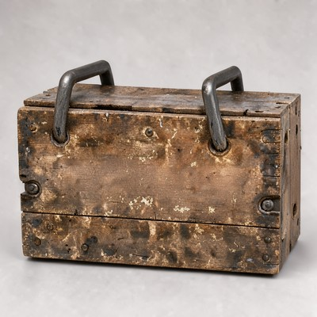
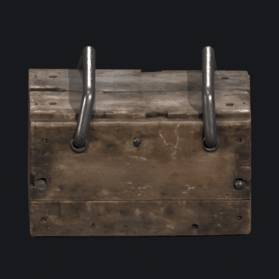
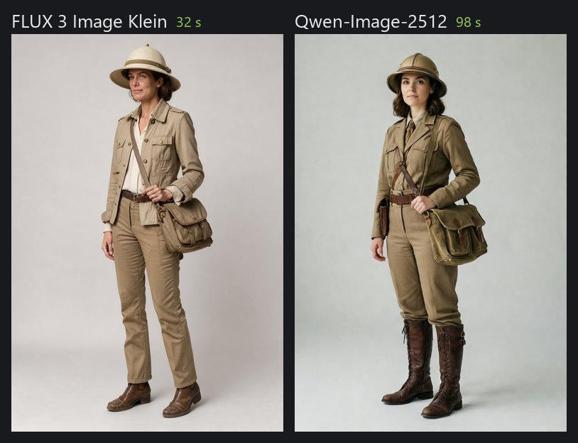
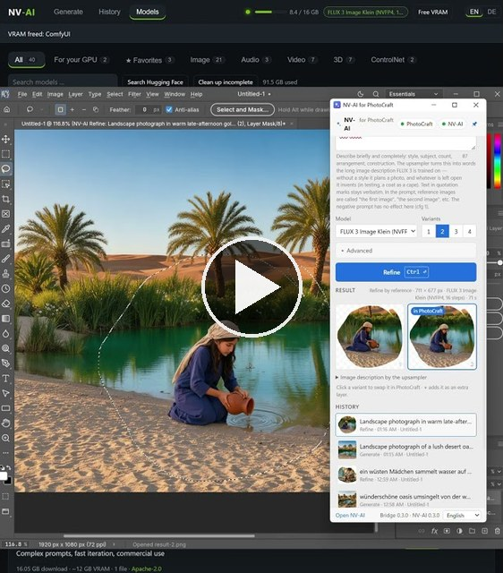

# NVAI-open

Local image, audio, video and 3D generation on your own computer. No cloud, no subscription, no account, no content filter.

## Download

| | |
|---|---|
| Windows 10/11, NVIDIA or AMD Radeon | [NV-AI-Setup-0.5.1.exe](https://github.com/Mantux775/NVAI-open/releases/download/v0.5.1/NV-AI-Setup-0.5.1.exe) |
| macOS 15+ on Apple Silicon, signed and notarized | [NV-AI-0.4.1.dmg](https://github.com/Mantux775/NVAI-open/releases/download/v0.5.1/NV-AI-0.4.1.dmg) |

All releases: [github.com/Mantux775/NVAI-open/releases](https://github.com/Mantux775/NVAI-open/releases)

## What's new? / Was gibt's Neues?

October 2026: NV-AI 0.5.1 for Windows, NV-AI 0.4.1 for Mac ([release notes](https://github.com/Mantux775/NVAI-open/releases/tag/v0.5.1))

| | |
|---|---|
| Report a problem | Describe what went wrong, NV-AI creates an anonymized report with timestamp and logs and opens a prefilled GitHub issue (Windows and Mac) |
| Graphics cards in the header | With several cards, click a card at the top and tick what it should do |
| AMD Radeon | The Windows setup installs PyTorch with ROCm instead of CUDA (experimental, [testers wanted](https://github.com/Mantux775/NVAI-open/issues/2)) |
| Several graphics cards | Image models, language models and 3D each on their own NVIDIA card (experimental, [testers wanted](https://github.com/Mantux775/NVAI-open/issues/1)) |
| Expand prompt on the Mac | A few words become a full image description, in NV-AI and in the PhotoCraft add-on |
| Mac menu bar | Follows the app's language setting |

| | |
|---|---|
| Problem melden | Beschreiben, was schiefging; NV-AI erstellt einen anonymisierten Bericht mit Zeitstempel und Protokollen und öffnet ein vorausgefülltes GitHub-Issue (Windows und Mac) |
| Grafikkarten in der Kopfleiste | Mit mehreren Karten oben eine Karte anklicken und anhaken, was sie machen soll |
| AMD Radeon | Das Windows-Setup installiert PyTorch mit ROCm statt CUDA (experimentell, [Tester gesucht](https://github.com/Mantux775/NVAI-open/issues/2)) |
| Mehrere Grafikkarten | Bildmodelle, Sprachmodelle und 3D je auf einer eigenen NVIDIA-Karte (experimentell, [Tester gesucht](https://github.com/Mantux775/NVAI-open/issues/1)) |
| Prompt ausbauen auf dem Mac | Aus ein paar Worten wird eine volle Bildbeschreibung, in NV-AI und im PhotoCraft-Add-on |
| Menüleiste auf dem Mac | Folgt der Spracheinstellung der App |

[English](#english) · [Video](#video) · [Deutsch](#deutsch)

---

## English

### Hi

I vibe-coded this app because I needed it myself, and I'd like to share it. I wanted images, sounds and 3D models for my own game projects without paying per picture or sending everything to the cloud.

It has only been tested on my own hardware: a Windows PC with an RTX 5060 Ti (16 GB) and 64 GB RAM, and a Mac mini M1 with 8 GB. Feedback is very welcome as an [issue](https://github.com/Mantux775/NVAI-open/issues), easiest with "Report a problem" in the app (top right on Windows, Settings on the Mac): it attaches an anonymized report with the logs. I have a full-time job, so answers can take a while. NV-AI was built in German first, so you may still find German code comments. English and German are both available in all apps.

### Features at a glance

| | Windows | Mac |
|---|---|---|
| Images | FLUX 3 Image Klein, Qwen-Image-2512, Chroma, Z-Image, SDXL family and more | FLUX.2 Klein 4B (MLX), Stable Diffusion via Core ML |
| Editing | Reference images, image to image, inpainting with a mask | Reference images, image to image, inpainting with a mask |
| Expand prompt | For every image model | Yes, since 0.4 |
| Audio | Sound effects (Stable Audio Open), music with vocals (ACE-Step) | |
| Video | Wan 2.1/2.2, LTX-Video, text or image to video | |
| 3D | Image to GLB model, with PBR textures (TRELLIS.2) or shape only (TripoSG) | |
| Graphics | NVIDIA, AMD Radeon (experimental), several cards (experimental) | Apple Silicon |
| Uncensored models | Chroma, Pony, NoobAI and more, one click away | |
| Claude Code | MCP server with 15 tools | |
| PhotoCraft add-on | Yes | Yes |

### Claude Code: your assets on request

NV-AI comes with an MCP server. Register it once, and Claude Code can generate images, sounds, music, video clips and 3D models for you while it works on your project, and copy them straight into it:

```
claude mcp add --scope user nvai -- "<install folder>\server\.venv\Scripts\python.exe" -m nvai.mcp_server
```

Then just ask: "Make a weathered wooden barrel as a 3D model and put it into Assets/Generated/Meshes", or "I need a sword clash sound and 60 seconds of tense orchestral music for the boss fight". Claude checks what is installed, suggests a model if one is missing (and asks before downloading), generates, and gets back the file paths.

| Tool | What it does |
|---|---|
| `generate_image`, `generate_audio`, `generate_video` | Generate and return the file paths |
| `image_to_3d`, `text_to_3d` | Turn an image, or just a text, into a GLB model |
| `expand_prompt` | Turn a few words into a full image description |
| `list_models`, `download_model`, `set_active_model` | Manage models, including size, VRAM need and license |
| `copy_asset`, `list_assets` | Put results into your project |

Setup with the Windows setup, data folder and port: [docs/CLAUDE_CODE.md](docs/CLAUDE_CODE.md). That guide also explains model choice, prompts and sizes, and Claude reads the same advice from the tool descriptions.

### NVIDIA and AMD

| Graphics card | What NV-AI does |
|---|---|
| NVIDIA RTX 50 | Uses the NVFP4 versions of FLUX 3 and Qwen-Image, which the card computes natively in hardware |
| NVIDIA RTX 20, 30, 40 | Recommends the INT8 versions instead; FLUX 3 INT8 runs on 8 GB cards according to Black Forest Labs |
| Two or more NVIDIA cards | Experimental since 0.5: in the header or under "Models" → "Graphics cards", image models, language models and 3D each get their own card. The language models then run in a second ComfyUI, so "Expand prompt" works while an image renders |
| AMD Radeon | Experimental since 0.5: the setup detects a Radeon and installs PyTorch with ROCm 7.2.1 from AMD. Needs driver 26.2.2 or newer and a card on AMD's [compatibility list](https://rocm.docs.amd.com/projects/radeon-ryzen/en/latest/docs/compatibility.html). Image models in INT8 or FP8; 3D needs NVIDIA for now |

The model list marks which models fit your card and says when a format does not run natively on it.

Testers wanted: I only have one NVIDIA card. The multi-card mode is tested with one card simulating two, and on AMD the installation is tested but no image was generated yet. If you have the hardware, please use "Report a problem" or report in [#1 (several NVIDIA cards)](https://github.com/Mantux775/NVAI-open/issues/1) or [#2 (AMD Radeon)](https://github.com/Mantux775/NVAI-open/issues/2).

### Uncensored models

NV-AI has no content filter of its own: no prompt blocklist, no image check, nothing is sent anywhere. What a model will draw depends only on how it was trained. Some models in the catalog are trained without filters and can be downloaded with one click under "Models":

| Model | Good for | Download / VRAM | License |
|---|---|---|---|
| Chroma1-HD (fp8) | Scenes, painting styles, dark fantasy and horror; follows long prompts well, negative prompt works | 13.7 GB / about 11 GB | Apache-2.0 |
| Pony Diffusion V6 XL | Characters and creatures; huge LoRA ecosystem; needs its score tags (`score_9, score_8_up, …`) | 6.5 GB / about 8 GB | see model card |
| NoobAI-XL v1.1 | Stylized 2D and anime; knows more characters and styles than Illustrious | 6.6 GB / about 8 GB | Fair AI Public License 1.0-SD |
| Chroma v37 | The older Chroma, kept for comparison | 21.7 GB / about 13 GB | Apache-2.0 |

More can be found with "Models" → "Search on Hugging Face": NV-AI checks a file before downloading and loads SDXL and SD 1.5 checkpoints, which covers most community fine-tunes.

You are responsible for what you create and publish. Respect the law and each model's license; the FLUX 3 license, for example, requires a content filter or a review of every image before it is published.

### Expand prompt

Type a few words, click "Expand prompt", and NV-AI writes a full image description from them: setting, materials, light, what happens in the picture. Read it, delete what was invented, generate. It works with every image model.

| | Uses | Time |
|---|---|---|
| Windows | The prompt upsampler of FLUX 3 Image Klein (Qwen3.5-9B) | about 15 s on an RTX 5060 Ti |
| Mac | The text encoder of FLUX.2 Klein (Qwen3-4B), nothing extra to download | 22 to 25 s on a Mac mini M1 |

### 3D: from an image to a model

Generate an image of an object, then turn it into a GLB model for Unity, Blender or any engine. TRELLIS.2 (MIT) also paints PBR textures (color, metal, roughness, 2048²) in about 75 seconds; TripoSG (MIT) builds the shape only.

<p align="center">
  
  
</p>
<p align="center"><sub>Left the image (FLUX 3), right the 3D model made from it with TRELLIS.2.</sub></p>

Lettering does not survive (TRELLIS.2 paints its own texture), so put text and decals on afterwards, and plan some retopology before a model goes into a game.

### Image models compared

Same prompt, seed and size (832 × 1216), measured on an RTX 5060 Ti with the model loaded: FLUX 3 Image Klein about 32 s, Qwen-Image-2512 about 98 s, Qwen-Image 2.1 about 21 s (non-commercial license).



In short: FLUX 3 is fast and the only one that edits images while keeping the rest intact. Qwen-Image-2512 is better at lettering and at how things are built, and is Apache-2.0. More comparisons, prompt tips and test results: [docs/MODELS.md](docs/MODELS.md). All images in this README were generated with NV-AI.

### Mac app

On Apple Silicon, NV-AI is a native app. It runs FLUX.2 Klein 4B with MLX: generate, refine, fill with a mask, up to three reference images, and expand prompts. Smaller Stable Diffusion models run through Core ML. It offers the same REST API as the Windows version, so the PhotoCraft add-on works with both.

### PhotoCraft add-on

[PhotoCraft](https://github.com/storytold/photocraft) is a great open-source photo editor. The optional add-on connects it to NV-AI: select an area, then fill it, generate something new or rework it, and the result comes back as a layer with a mask. Needs PhotoCraft 0.10.0 or newer. Thanks a lot to the PhotoCraft developers for such a well-scriptable editor.

### iOS app (closed beta)

There is also an iOS app with a 3D scanner that turns photos of real objects into 3D models. If enough people are interested I'll make it public, so tell me in an issue if you would use it.

### Requirements

| | Windows | macOS |
|---|---|---|
| System | Windows 10 (2004+) or 11, 64-bit | macOS 15 or newer, Apple Silicon |
| Graphics / memory | 12 GB+ VRAM recommended (8 GB works with the INT8 models). NVIDIA: driver 580.88+. AMD Radeon: driver 26.2.2+ | 16 GB RAM or more recommended (8 GB works for small images) |
| Disk | about 10 GB for the program, plus 5 to 30 GB per model | about 1 GB for the app, plus about 10 GB for FLUX.2 Klein |
| Internet | for setup (about 3 GB) and model downloads | for model downloads |

The Windows setup is not code-signed, so Windows may show "Windows protected your PC": click "More info", then "Run anyway". Details: [docs/INSTALL.md](docs/INSTALL.md).

### Licenses

The code in this repository is under the [MIT License](LICENSE): do whatever you want with it. Third-party components keep their own licenses, see [THIRD_PARTY_NOTICES.txt](THIRD_PARTY_NOTICES.txt). ComfyUI (GPL-3.0) is shipped as a separate program with its full source code.

Models are not part of this repository. Each has its own license, shown in NV-AI's model list. FLUX 3 Image Klein (FLUX Kommunity License) allows commercial use of images only below USD 5 million annual revenue and requires checking every image before publishing. Qwen-Image-2512, FLUX.2 Klein 4B and Chroma are Apache-2.0.

### More

- [docs/INSTALL.md](docs/INSTALL.md): installing, building from source, the PhotoCraft add-on
- [docs/MODELS.md](docs/MODELS.md): the image models in detail, prompt tips, test results
- [docs/CLAUDE_CODE.md](docs/CLAUDE_CODE.md): using NV-AI from Claude Code
- [photocraft-addon/](photocraft-addon/): source of the PhotoCraft add-on

---

## Video

<p align="center">
  <a href="https://www.youtube.com/shorts/e9jSTwgwnrI"></a>
</p>

<p align="center">NV-AI and the PhotoCraft add-on in action, a short on YouTube.<br>
NV-AI und das PhotoCraft-Add-on in Aktion, ein kurzes Video auf YouTube.<br>
<a href="https://www.youtube.com/shorts/e9jSTwgwnrI">youtube.com/shorts/e9jSTwgwnrI</a></p>

---

## Deutsch

### Hallo

Ich habe diese App aus eigenem Bedarf „vibegecodet“ und möchte sie teilen. Ich wollte Bilder, Sounds und 3D-Modelle für meine eigenen Spieleprojekte erzeugen, ohne pro Bild zu zahlen oder alles in die Cloud zu schicken.

Getestet ist sie nur auf meiner eigenen Hardware: einem Windows-PC mit RTX 5060 Ti (16 GB) und 64 GB RAM und einem Mac mini M1 mit 8 GB. Über Feedback als [Issue](https://github.com/Mantux775/NVAI-open/issues) freue ich mich sehr, am einfachsten mit „Problem melden“ in der App (Windows oben rechts, Mac in den Einstellungen): Das hängt einen anonymisierten Bericht mit den Protokollen an. Ich habe einen Vollzeitjob, Antworten können also dauern. NV-AI ist zuerst auf Deutsch entstanden, im Code stehen deshalb noch deutsche Kommentare. Deutsch und Englisch sind in allen Apps wählbar.

### Funktionen im Überblick

| | Windows | Mac |
|---|---|---|
| Bilder | FLUX 3 Image Klein, Qwen-Image-2512, Chroma, Z-Image, SDXL-Familie und weitere | FLUX.2 Klein 4B (MLX), Stable Diffusion über Core ML |
| Bearbeiten | Referenzbilder, Bild zu Bild, Füllen mit Maske | Referenzbilder, Bild zu Bild, Füllen mit Maske |
| Prompt ausbauen | Für jedes Bildmodell | Ja, seit 0.4 |
| Audio | Soundeffekte (Stable Audio Open), Musik mit Gesang (ACE-Step) | |
| Video | Wan 2.1/2.2, LTX-Video, aus Text oder Bild | |
| 3D | Aus einem Bild ein GLB-Modell, mit PBR-Texturen (TRELLIS.2) oder als reine Form (TripoSG) | |
| Grafik | NVIDIA, AMD Radeon (experimentell), mehrere Karten (experimentell) | Apple Silicon |
| Unzensierte Modelle | Chroma, Pony, NoobAI und weitere, einen Klick entfernt | |
| Claude Code | MCP-Server mit 15 Werkzeugen | |
| PhotoCraft-Add-on | Ja | Ja |

### Claude Code: Assets auf Zuruf

NV-AI bringt einen MCP-Server mit. Einmal eingetragen, erzeugt Claude Code Bilder, Sounds, Musik, Videoclips und 3D-Modelle, während es an deinem Projekt arbeitet, und kopiert sie gleich hinein:

```
claude mcp add --scope user nvai -- "<Installationsordner>\server\.venv\Scripts\python.exe" -m nvai.mcp_server
```

Dann einfach sagen: „Mach ein verwittertes Holzfass als 3D-Modell und leg es nach Assets/Generated/Meshes“ oder „Ich brauche einen Schwertklang und 60 Sekunden spannende Orchestermusik für den Bosskampf“. Claude prüft, was installiert ist, schlägt bei Bedarf ein Modell vor (und fragt vor dem Download), generiert und bekommt die Dateipfade zurück.

| Werkzeug | Was es tut |
|---|---|
| `generate_image`, `generate_audio`, `generate_video` | Erzeugen und die Dateipfade liefern |
| `image_to_3d`, `text_to_3d` | Aus einem Bild oder nur aus Text ein GLB-Modell |
| `expand_prompt` | Aus ein paar Worten eine volle Bildbeschreibung |
| `list_models`, `download_model`, `set_active_model` | Modelle verwalten, mit Größe, VRAM-Bedarf und Lizenz |
| `copy_asset`, `list_assets` | Ergebnisse ins Projekt bringen |

Einrichtung mit dem Windows-Setup, Datenordner und Port: [docs/CLAUDE_CODE.md](docs/CLAUDE_CODE.md) (englisch). Dort stehen auch Modellwahl, Prompts und Formate, und Claude liest dieselben Hinweise aus den Werkzeugbeschreibungen.

### NVIDIA und AMD

| Grafikkarte | Was NV-AI macht |
|---|---|
| NVIDIA RTX 50 | Nutzt die NVFP4-Fassungen von FLUX 3 und Qwen-Image, die die Karte nativ in Hardware rechnet |
| NVIDIA RTX 20, 30, 40 | Empfiehlt stattdessen die INT8-Fassungen; FLUX 3 INT8 läuft laut Black Forest Labs schon auf 8-GB-Karten |
| Zwei oder mehr NVIDIA-Karten | Experimentell seit 0.5: In der Kopfleiste oder unter „Modelle“ → „Grafikkarten“ bekommen Bildmodelle, Sprachmodelle und 3D je eine eigene Karte. Die Sprachmodelle laufen dann in einem zweiten ComfyUI, „Prompt ausbauen“ geht also, während ein Bild rechnet |
| AMD Radeon | Experimentell seit 0.5: Das Setup erkennt eine Radeon und installiert PyTorch mit ROCm 7.2.1 von AMD. Nötig sind Treiber 26.2.2 oder neuer und eine Karte auf AMDs [Kompatibilitätsliste](https://rocm.docs.amd.com/projects/radeon-ryzen/en/latest/docs/compatibility.html). Bildmodelle in INT8 oder FP8; 3D braucht vorerst NVIDIA |

Die Modellliste markiert, welche Modelle zur Karte passen, und sagt, wenn ein Format darauf nicht nativ rechnet.

Tester gesucht: Ich habe nur eine NVIDIA-Karte. Der Mehrkartenbetrieb ist mit einer Karte getestet, die zwei simuliert, und auf AMD ist die Installation getestet, aber noch kein Bild erzeugt. Wer die Hardware hat: bitte über „Problem melden“ oder in [#1 (mehrere NVIDIA-Karten)](https://github.com/Mantux775/NVAI-open/issues/1) oder [#2 (AMD Radeon)](https://github.com/Mantux775/NVAI-open/issues/2) berichten.

### Unzensierte Modelle

NV-AI hat keinen eigenen Inhaltsfilter: keine Sperrliste für Prompts, keine Bildprüfung, nichts wird irgendwohin geschickt. Was ein Modell zeichnet, hängt nur von seinem Training ab. Einige Modelle im Katalog sind ohne Filter trainiert und unter „Modelle“ mit einem Klick geladen:

| Modell | Gut für | Download / VRAM | Lizenz |
|---|---|---|---|
| Chroma1-HD (fp8) | Szenen, Malstile, Dark Fantasy und Horror; folgt langen Prompts gut, Negativprompt wirkt | 13,7 GB / rund 11 GB | Apache-2.0 |
| Pony Diffusion V6 XL | Figuren und Kreaturen; riesiges LoRA-Angebot; braucht seine Score-Tags (`score_9, score_8_up, …`) | 6,5 GB / rund 8 GB | siehe Model Card |
| NoobAI-XL v1.1 | Stilisiertes 2D und Anime; kennt mehr Figuren und Stile als Illustrious | 6,6 GB / rund 8 GB | Fair AI Public License 1.0-SD |
| Chroma v37 | Das ältere Chroma, zum Vergleich | 21,7 GB / rund 13 GB | Apache-2.0 |

Weitere findet „Modelle“ → „Auf Hugging Face suchen“: NV-AI prüft eine Datei vor dem Download und lädt SDXL- und SD-1.5-Checkpoints, damit sind die meisten Community-Feintunings abgedeckt.

Für das, was du erzeugst und veröffentlichst, bist du selbst verantwortlich. Gesetze und die Lizenz des Modells gelten; die FLUX-3-Lizenz etwa verlangt einen Inhaltsfilter oder die Prüfung jedes Bildes vor der Veröffentlichung.

### Prompt ausbauen

Ein paar Worte eintippen, auf „Prompt ausbauen“ klicken, und NV-AI schreibt daraus eine volle Bildbeschreibung: Ort, Material, Licht, was im Bild passiert. Lesen, Erfundenes streichen, generieren. Das geht mit jedem Bildmodell.

| | Nutzt | Dauer |
|---|---|---|
| Windows | Den Prompt-Upsampler von FLUX 3 Image Klein (Qwen3.5-9B) | rund 15 s auf einer RTX 5060 Ti |
| Mac | Den Text-Encoder von FLUX.2 Klein (Qwen3-4B), kein zusätzlicher Download | 22 bis 25 s auf einem Mac mini M1 |

### 3D: vom Bild zum Modell

Ein Bild eines Objekts erzeugen, dann daraus ein GLB-Modell für Unity, Blender oder jede Engine machen. TRELLIS.2 (MIT) malt dazu PBR-Texturen (Farbe, Metall, Rauheit, 2048²) in rund 75 Sekunden; TripoSG (MIT) baut nur die Form.

<p align="center">
  
  
</p>
<p align="center"><sub>Links das Bild (FLUX 3), rechts das daraus gebaute 3D-Modell mit TRELLIS.2.</sub></p>

Schrift übersteht das nicht (TRELLIS.2 malt die Textur selbst), also Schrift und Aufkleber nachträglich aufbringen und vor dem Einsatz im Spiel etwas Retopologie einplanen.

### Bildmodelle im Vergleich

Gleicher Prompt, Seed und Format (832 × 1216), gemessen auf einer RTX 5060 Ti mit geladenem Modell: FLUX 3 Image Klein rund 32 s, Qwen-Image-2512 rund 98 s, Qwen-Image 2.1 rund 21 s (nicht kommerzielle Lizenz).


Kurz gesagt: FLUX 3 ist schnell und als einziges Modell in der Lage, Bilder zu bearbeiten und den Rest unverändert zu lassen. Qwen-Image-2512 ist besser bei Schrift und Konstruktion und steht unter Apache-2.0. Weitere Vergleiche, Prompt-Tipps und Testergebnisse: [docs/de/MODELLE.md](docs/de/MODELLE.md). Alle Bilder in diesem README hat NV-AI erzeugt.

### Mac-App

Auf Apple Silicon ist NV-AI eine native App. Sie rechnet FLUX.2 Klein 4B mit MLX: Generieren, Überarbeiten, Füllen mit Maske, bis zu drei Referenzbilder und Prompt ausbauen. Kleinere Stable-Diffusion-Modelle laufen über Core ML. Sie bietet dieselbe REST-Schnittstelle wie die Windows-Fassung, das PhotoCraft-Add-on arbeitet also mit beiden.

### PhotoCraft-Add-on

[PhotoCraft](https://github.com/storytold/photocraft) ist ein toller Open-Source-Bildeditor. Das optionale Add-on verbindet ihn mit NV-AI: Bereich auswählen, dann füllen, neu generieren oder überarbeiten, das Ergebnis kommt als Ebene mit Maske zurück. Braucht PhotoCraft ab 0.10.0. Vielen Dank an die PhotoCraft-Entwickler für einen so gut steuerbaren Editor.

### iOS-App (geschlossene Beta)

Es gibt auch eine iOS-App mit 3D-Scanner, die aus Fotos echter Gegenstände 3D-Modelle macht. Wenn genug Interesse da ist, stelle ich sie öffentlich bereit. Schreibt mir gern in einem Issue, wenn ihr sie nutzen würdet.

### Voraussetzungen

| | Windows | macOS |
|---|---|---|
| System | Windows 10 (ab 2004) oder 11, 64 Bit | macOS 15 oder neuer, Apple Silicon |
| Grafik / Speicher | empfohlen ab 12 GB VRAM (8 GB gehen mit den INT8-Modellen). NVIDIA: Treiber ab 580.88. AMD Radeon: Treiber ab 26.2.2 | empfohlen ab 16 GB RAM (8 GB reichen für kleine Bilder) |
| Platte | rund 10 GB für das Programm, dazu 5 bis 30 GB pro Modell | rund 1 GB für die App, dazu etwa 10 GB für FLUX.2 Klein |
| Internet | fürs Einrichten (rund 3 GB) und die Modelle | für die Modelle |

Das Windows-Setup ist nicht signiert. Windows zeigt deshalb eventuell „Der Computer wurde durch Windows geschützt“: auf „Weitere Informationen“ und dann „Trotzdem ausführen“ klicken. Details: [docs/de/INSTALL.md](docs/de/INSTALL.md).

### Lizenzen

Der Code in diesem Repo steht unter der [MIT-Lizenz](LICENSE): Jeder darf damit machen, was er will. Fremde Komponenten behalten ihre eigenen Lizenzen, siehe [THIRD_PARTY_NOTICES.txt](THIRD_PARTY_NOTICES.txt). ComfyUI (GPL-3.0) wird als eigenständiges Programm mit vollständigem Quelltext mitgeliefert.

Modelle sind nicht Teil dieses Repos. Jedes hat seine eigene Lizenz, die NV-AI in der Modellliste anzeigt. FLUX 3 Image Klein (FLUX Kommunity License) erlaubt kommerzielle Nutzung der Bilder nur unter 5 Millionen US-Dollar Jahresumsatz und verlangt, jedes Bild vor der Veröffentlichung zu prüfen. Qwen-Image-2512, FLUX.2 Klein 4B und Chroma stehen unter Apache-2.0.

### Weiterlesen

- [docs/de/INSTALL.md](docs/de/INSTALL.md): Installation, Bauen aus dem Quelltext, PhotoCraft-Add-on
- [docs/de/MODELLE.md](docs/de/MODELLE.md): die Bildmodelle im Detail, Prompt-Tipps, Testergebnisse
- [docs/CLAUDE_CODE.md](docs/CLAUDE_CODE.md): NV-AI aus Claude Code nutzen (englisch)
- [photocraft-addon/](photocraft-addon/): Quelltext des PhotoCraft-Add-ons
