# NVAI-open

A studio for whole videos with sound, plus images, speech, music and 3D models on demand, all generated by local AI models on your own computer. Free, private, no account, no subscription, no cloud.

**Version 1.1.0 is here:** faces stay true to the photo, with clean eyes even when they are small. NVAI-open guides you from the idea to the finished file: every button names the next step and how long it takes.

## Download

| | |
|---|---|
| Windows 10/11, NVIDIA, AMD Radeon or Intel | [NVAI-open-Setup-1.1.0.exe](https://github.com/Mantux775/NVAI-open/releases/download/v1.1.0/NVAI-open-Setup-1.1.0.exe) |
| macOS 15+ on Apple Silicon, signed and notarized | [NVAI-open-1.1.0.dmg](https://github.com/Mantux775/NVAI-open/releases/download/v1.1.0/NVAI-open-1.1.0.dmg) |

Install, open, pick what you want to make: NVAI-open downloads exactly the models for it, the setup brings everything else along. [Installation details](docs/INSTALL.md) · [All releases](https://github.com/Mantux775/NVAI-open/releases)

## What's new? / Was gibt's Neues?

November 2026: NVAI-open 1.1.0 for Windows and the Mac ([release notes](https://github.com/Mantux775/NVAI-open/releases/tag/v1.1.0)), after 1.0.0, the first stable release ([release notes](https://github.com/Mantux775/NVAI-open/releases/tag/v1.0.0))

- **Recompute a face** (1.1.0, also on the Mac): video models lose the pupils of small faces; "☺ Recompute face" redraws the face from the original photo, in a video on every frame. [Details](docs/EYE_CORRECTION.md)
- **Draft, then final** (1.1.0, also on the Mac): check a take small and fast, then render the good one at full size with the same seed. [Details](docs/EYE_CORRECTION.md#what-helps)
- **Align heads in the crossfade** (1.1.0): right-click a crossfade between two clips of the same person, and the double eyes are gone. [Details](docs/STUDIO.md#speed-and-transitions)
- **Still image from the edit** (1.1.0, also on the Mac): right-click a clip → "Still image here into the media", for example as the start of the next role. Results made from MiniMax H3 output keep its warning.

<details><summary><kbd>&nbsp;Read more&nbsp;▾&nbsp;</kbd></summary>

- **Guided from idea to file** (1.0.0): every button says what comes next and how long it takes, pick a way and see only what fits, a step bar in the Studio and one job list for all tabs. [Details](docs/STUDIO.md#step-by-step)
- **Chinese and French** (0.5.39): choose them in the language list at the top right. Based on a contribution by NeoTiko ([#4](https://github.com/Mantux775/NVAI-open/pull/4)).
- **AI agents through an address** (0.5.39): WorkBuddy, Cursor, Claude Code and other agents connect to `http://127.0.0.1:8100/mcp`. [Details](docs/CLAUDE_CODE.md#setup)
- **Person from a photo** (0.5.37, 0.5.38): every attempt takes the face from the photo, so it no longer drifts, and Generate → Image now makes pictures with it too. [Details](docs/PHOTO_TO_VIDEO.md)
- **Layout to render and VACE** (0.5.36): a rough grey animation from Blender sets camera and motion of an LTX-2.5 shot; Wan 2.1 VACE 1.3B puts a character from a reference image into a video. [Details](docs/MODELS.md)
- **Older Radeons and Intel cards through Vulkan** (0.5.35, experimental): images, videos, sound and the narrator voice with stable-diffusion.cpp and audio.cpp; on the RX 5000 and RX 6500/6400 ComfyUI with ROCm can be chosen instead (0.5.38). [Details](docs/DIRECTML.md)
- **Audio and audio forensics** (0.5.29, also on the Mac): separate voices from music, remove a recurring sound such as an alarm; a long recording with many channels becomes a case with transcript and translation, handed over as a review package. [Details](docs/AUDIO.md#audio-forensics)
- **Train your own LoRA** (0.5.29): put a dataset together and train it on your own graphics card. [Details](docs/LORAS.md#training-your-own-lora)
- **Assistant in the Studio** (0.5.28, also on the Mac): a whole video in seven short steps, with the best models for your hardware. [Details](docs/STUDIO.md#the-assistant)
- **Kandinsky 6 Pro and Lite** (0.5.25, NVIDIA only): video with sound in one pass. **The sound may not be used commercially, and its video VAE is not licensed in the EU.** [Details](docs/MODELS.md#other-video-models)
- **MiniMax H3, with a license warning** (since 0.5.18): video with stereo sound. **Its license forbids any use in the EU, the UK, South Korea and the USA without a separate license from MiniMax, and nothing made with it may be published.** [Details](docs/MODELS.md#minimax-h3-since-0518)

</details>

**Deutsch:** [Was gibt's Neues?](#was-gibts-neues) (Neuigkeiten im deutschen Teil)

[English](#english) · [Video](#video) · [Deutsch](#deutsch)

---

## English

### Hi

I vibe-coded this app because I needed it myself: images, sounds and 3D models for my game projects, without paying per picture or sending everything to the cloud. Now I'm sharing it. Everything runs on your own graphics card, and nothing leaves your computer.

It is tested on my own hardware: Windows with an RTX 5060 Ti (16 GB) and a Mac mini M1 (8 GB). Feedback is very welcome as an [issue](https://github.com/Mantux775/NVAI-open/issues), easiest with "Report a problem" in the app, which attaches an anonymized report. I have a full-time job, so answers can take a while. All apps are in English and German, the Windows interface also in Chinese and French.

### Studio: whole videos from scenes

The Studio is the first tab when NVAI-open starts. At the top you compose: scenes with a prompt on lanes for picture, voice, music and sound, plus markers that say what goes where. At the bottom you edit the real clips. A step bar shows where the project stands, from the idea to the export, and one button takes the next step with the time it needs. The export uses your graphics card's video encoder at YouTube loudness.

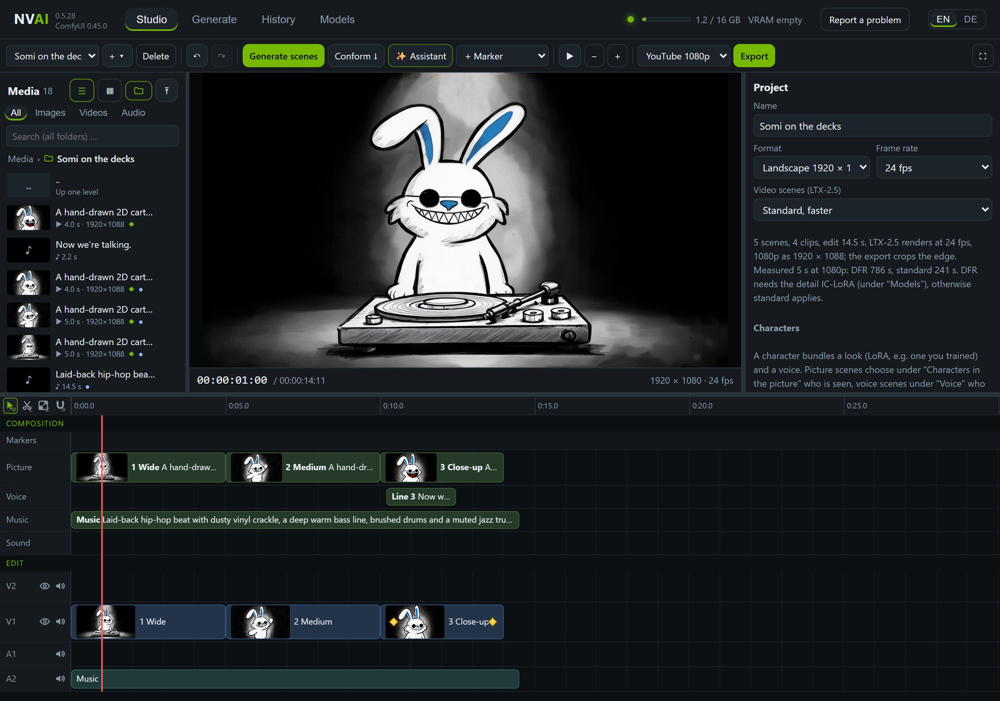

- **Assistant:** new to it? "✨ Assistant" walks you through a whole video in seven steps, with the best models for your hardware and the expected time.
- **Scene states:** every scene says what is missing, waiting or running. If the scene it continues got a new take, it is marked "outdated", with "Render again" or "Keep as is". Right-click or × removes a scene card, dragging reorders it.
- **Editing:** selection, razor and magnet with their keys, right-click menus, speed in percent, cross dissolve, dips and wipes, zoom with keyframes, video and audio tracks with eye and mute.
- **Seamless shots:** "Chain to" makes a clip continue the one before it, so two shots join without a jump.
- **References and extras:** depending on the model, a scene takes reference images, an end image or a loop, a rough layout video for camera and motion, or a description of the sound.
- **Voices and characters:** voice scenes speak their text with Qwen3-TTS, and one speaker keeps the same voice over all lines. A character bundles a look from a LoRA (also one you trained) and a voice; a video scene can speak a line with its lips.
- **Media and quality:** every project has its own folder and can be packed into a ZIP file for another computer. Video scenes are also kept losslessly, only the export compresses (42.3 instead of 37.7 dB PSNR for a YouTube export).
- **Export:** YouTube 1080p and 4K, Shorts, AV1, a lossless master (MKV) or ProRes 4444 for other editing software.
- **Claude Code** can build the whole video for you over MCP while you watch. NVAI-open for Mac has the Studio too, with the same project format.

Step by step: [docs/STUDIO.md](docs/STUDIO.md)

**The short film with the rabbit:** Somi began as a quick hand sketch. FLUX 3 made a character of it and, as an edit, gave him a tired mood; each shot got a start image, Qwen3-TTS spoke his line, Stable Audio 3 made the music, and LTX-2.5 animated the shots in the Studio, the line with his lips. Claude Code operated the app over MCP, every decision was made by a person, and the 30 seconds took about 50 minutes on one graphics card. [Step by step with screenshots](docs/SHORT_FILM.md) · [The film on YouTube](https://www.youtube.com/watch?v=cDhmiLMU6WQ)


### From a portrait to a video

<p align="center"></p>
<p align="center"><sub>Made with NVAI-open: a generated photo becomes a ship captain who speaks in a storm. <a href="docs/videos/photo-to-video-captain.mp4">With sound</a></sub></p>

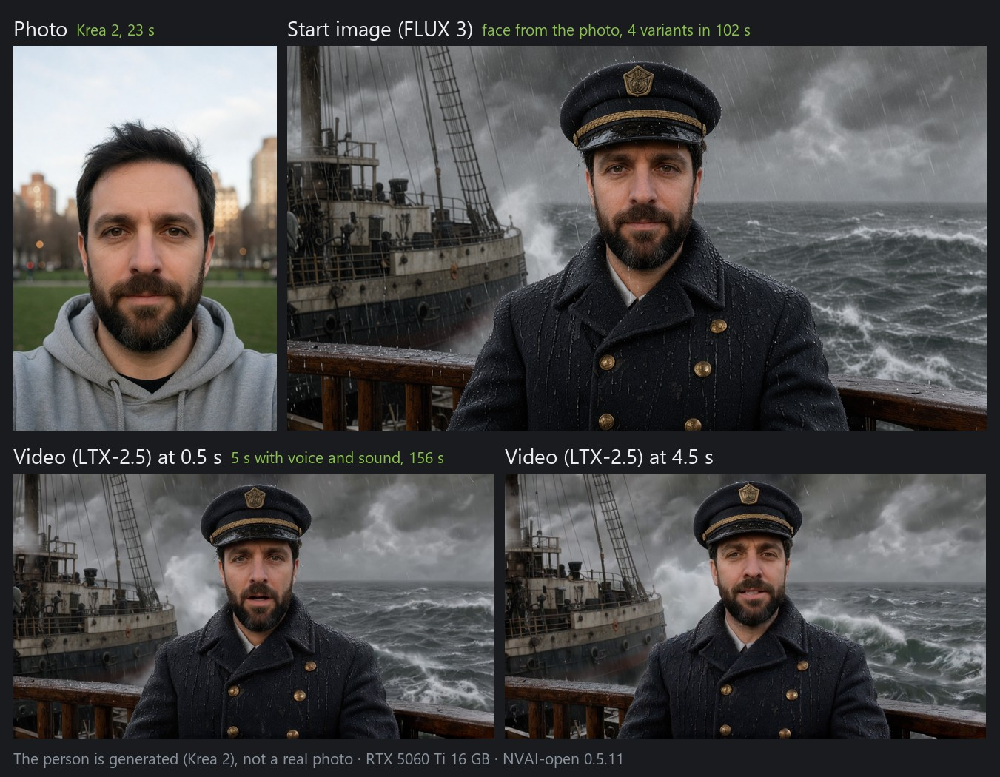

1. **Generate → Image:** create a portrait, or use a photo of someone who agreed to it.
2. **Video from it:** under the finished portrait, "▶ Video from it" makes it the start image of a video.
3. **Person from a photo:** crop the photo to head and shoulders ("Crop" shows an outline), describe the role. FLUX 3 keeps the face and makes four start images; pick the one that looks most alike. New attempts always start from the photo.
4. **Prompt:** describe what moves, what the camera does and what the person says. LTX-2.5 makes the video with speech and sound.
5. **Keep the face:** choose the way "Loop" (with a still camera) or "Start and end". Without one, the face changed after a second in our test. The price: water and smoke stand still too.

Step by step with screenshots: [docs/PHOTO_TO_VIDEO.md](docs/PHOTO_TO_VIDEO.md)

### Eyes in small faces

When a person is small in the picture (from the knees up or a whole figure), video models draw the eyes as blurry holes: MiniMax H3 turns 32 × 32 pixels into one unit, so in 1344 × 768 a face of about 105 px is only three units tall and an eye smaller than one. The pupils were gone from the first frame on, with every seed.

1. **Closer framing:** from the waist up the face has 250 px and more.
2. **Draft, then final:** check a take as a draft, then "⇧ Render final" (Generate) or "⇧ Final" (Studio) renders it again at 1920 × 1088 with the same seed. The pupils stayed in our test.
3. **Recompute the face:** "☺ Recompute face" under a result (Generate) or under the takes of a scene (Studio) redraws the face from the original photo with FLUX 3 and lays it onto the moving head in every frame, about 75 s for 3 s of video. For clips without speech: mouth and eyelids no longer move afterwards.

Upscaling or another seed does not help. More, with a step-by-step guide for a video in which one person changes roles: [docs/EYE_CORRECTION.md](docs/EYE_CORRECTION.md)

### 3D: from an image to a model

Generate an image of an object and turn it into a GLB model. TripoSG, which the setup brings along, builds the shape. TRELLIS.2 paints the textures too, but needs an installation from source ([details](docs/INSTALL.md#optional-3d-workers)).

<p align="center">
  
  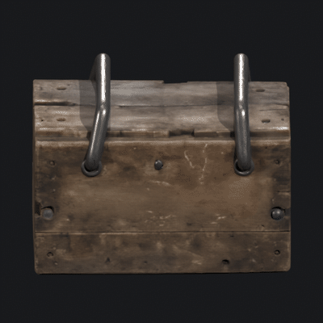
</p>

Lettering gets lost on the way to the mesh. "Take the front from the image" puts the source image onto the front of the model:


### Images

Four models are recommended, each for something else. **Krea 2** looks the most like a photo (about 18 s per image). **MOSS-Image** is strongest at lettering and layout (about 57 s, Apache-2.0). **Qwen-Image-2512** gets details and construction right (about 100 s, Apache-2.0). **FLUX 3 Image Klein** edits a picture and keeps the rest intact (about 28 s). Same prompt and seed, one image each:


The patch should read "ARES VII": MOSS-Image wrote it the cleanest, Krea 2 wrote "ARES VIII".

Krea 2 also takes an image as a style template: the lighthouse keeps its content and becomes a watercolor or a woodcut.

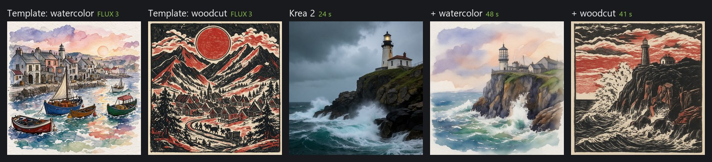

MOSS-Image writes posters and signs letter-perfect. With its 50 steps the crate's rope handles pass through drilled holes; with 25 they hung without a hold in one of three images:

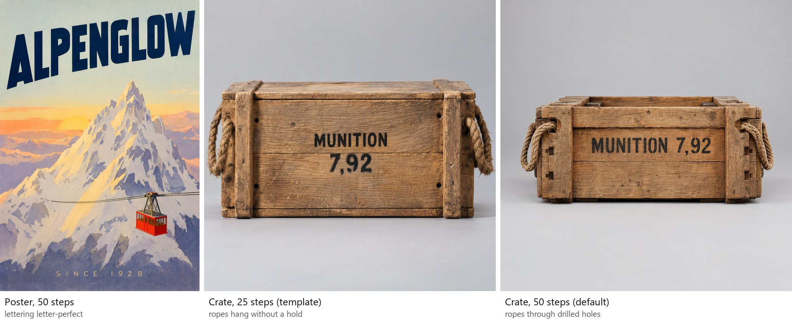

Editing with FLUX 3: "replace the rope handles with iron handles, keep everything else unchanged".


LoRAs teach a model a style, for example a more photographic look:

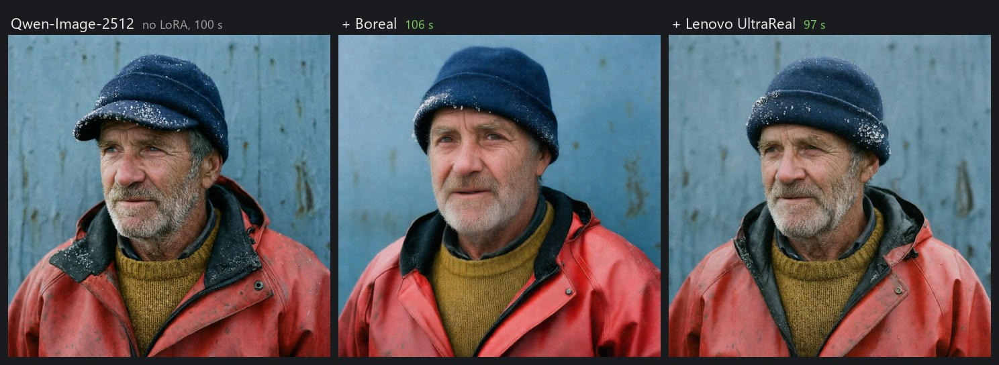

Which models take LoRAs, adding one you trained yourself and the LoRAs we tested: [docs/LORAS.md](docs/LORAS.md).

The four models side by side, with prompts and times: [docs/MODEL_COMPARISON.md](docs/MODEL_COMPARISON.md). More comparisons and prompt tips: [docs/MODELS.md](docs/MODELS.md). All images in this README were made with NVAI-open.

### Edit pictures: extend and fill

Make a picture wider or taller, and NVAI-open paints the new border to match. Or mark an area and fill it: remove things, add new ones. The rest of the picture stays as it was.


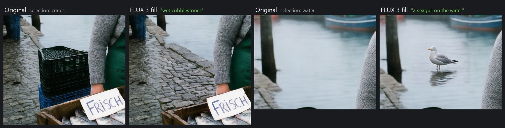

### Restore old photos

Scratches, dust, tears, stains and fading go away, the photo gets color if you like, and SeedVR2 sharpens and enlarges it. "Automatic" looks at the photo and decides how much to redraw: the whole picture for overall aging such as water stains, only the damaged spots for dust and scratches on an otherwise good photo. It chose right on 20 of 21 test photos. Colorizing only adds color; brightness and detail stay the photo's own. NVAI-open for Mac does all of it natively. Details: [docs/MODELS.md](docs/MODELS.md#old-photos)

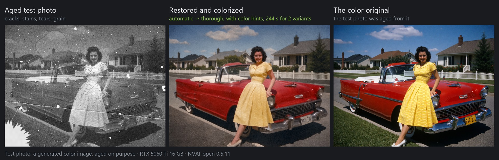

### What you can do

- **Studio:** build a whole video from scenes, cut it and export it with your graphics card's encoder.
- **Swap in a face:** a person from a photo (someone who agreed to it) in a new role, as a start image from FLUX 3 and a video with sound from LTX-2.5.
- **Images:** FLUX 3, Qwen-Image-2512, Krea 2, MOSS-Image and many more. Edit with reference images, fill in or extend a picture.
- **LoRAs:** from Hugging Face, Civitai or your own training; NVAI-open reads the file header and shows which models a LoRA fits.
- **Music and sounds:** instrumental music up to 5 minutes, sound effects.
- **Speech:** a narrator voice you describe in one sentence or take over from a recording, in 10 languages.
- **3D models:** from an image to a GLB model for Unity, Blender or any engine; with textures through TRELLIS.2, installed from source.
- **Old photos:** remove scratches, tears and water stains, colorize, sharpen.
- **Audio and audio forensics:** separate voices from music, speech from noise, remove one recurring sound such as an alarm, also in recordings of many hours; examine a case with a translation track and hand it over as a review package. [Details](docs/AUDIO.md)
- **AI agents:** Claude Code, WorkBuddy, Cursor and other agents create your assets over MCP while they work on your project.
- **No filter of its own:** uncensored models are one click away. You are responsible for what you make.
- **Windows and Mac**, NVIDIA and AMD Radeon, and an add-on for the photo editor PhotoCraft.

### Tips

Every tab has a **Recommended settings** box with what we measured. The most important points:

**Getting started**

- **Follow the green button:** in Generate and in the Studio it names the next step and how long it takes on your card. The first job after a start also starts the engine and loads the model (about a minute); after that only the computing time counts.
- **Download what you need:** on first start, pick what you want to make and NVAI-open loads exactly those models. Everything else is under "Models", with size, license and time.
- **FLUX 3 and LTX-2.5:** accept the license on Hugging Face and store a read token under "Models". Step by step: [docs/HUGGINGFACE.md](docs/HUGGINGFACE.md)

**Images**

- **Format before prompt:** the best size is preselected; portrait for a standing figure, landscape for a vehicle, square for objects. The format decides more than the prompt.
- **Whole English sentences:** style first, then the subject with material, color and condition, then light and background. Name the time of day, or it turns into dusk.
- **Arrange, don't count:** "the front truck …, behind it a line of separate trucks, each with its own cab". Without "separate", equal objects melt into one.
- **Lettering** goes into quotation marks with position and kind ("black stencilled letters on the front read …").
- **Make 4 images** and judge them at full size, not as thumbnails.
- **FLUX 3:** name the style first, or it becomes a photo. Switch off "Expand the prompt" when construction or counts must be exact (it added a second fishing line in 4 of 6 images).
- **Krea 2:** name the framing ("medium shot from the waist up, his whole head inside the frame"), or the head may be cut off.
- **MOSS-Image:** describe the finished picture, put the text in quotation marks with position and typeface, and leave it at 50 steps.

**Video**

- **The way first:** text only, start image, start and end, loop, layout video or extend; only what fits the way is offered.
- **A short prompt:** 4 to 8 sentences in the present tense: shot, place and light, action, people, camera, sound. Name loud sounds explicitly; sounds described as soft come out almost inaudible.
- **Stillness in one positive sentence** ("sits perfectly still like a statue"): with a short prompt the figure moved 38 to 49 % less. Don't mention what should not happen, not even negated.
- **Calm voices:** "shouts" turns into a grimace, "says firmly in a rough, deep voice" stays calm.
- **Faces:** keep the face large, make the start image with FLUX 3 from a frontal photo and choose "Loop" (still camera) or "Start and end". The price: water and smoke stand still too. Let people speak only with their face in the shot, about 2 words per second, and pick from a few variants by ear.
- **Moving background:** only what the prompt names moves. Describe water, smoke, rain, lights in puddles or a slow camera move explicitly; a night street with a locked-off camera and nothing named stood still.
- **Rain from the first frame:** the video keeps the start image exactly, so put rain or snow into the start image first (FLUX 3 edit), then animate without a loop.
- **Double eyes in a crossfade:** right-click the incoming clip in the Studio → "Align heads in the crossfade".
- **Two clips without a seam:** "Chain to" in the Studio or "Extend"; the second clip takes over the last second of the first. If a scene shows "outdated", the scene before it got a new take: render it again or keep it.
- **Faces need pixels:** with a whole figure in 1080p the head is only about 100 px and the eyes come out uneven, in images and in video. Show people from the knees up or closer and check the eyes at full size. For a walking person, render several seeds with best quality (DFR) and keep the cleanest: the eyes vary strongly from seed to seed.
- **Backlight:** put a light in haze low behind the legs; at head height it glows through hair and helmet.
- **Same person, a new outfit in each clip:** take the frame where you cut a clip, change only the outfit (edit it with FLUX 3 and name the framing) and use it as the start image of the next clip; a short crossfade then looks like a morph. Start the next clip a few frames in, after its slow start, or the eyes double in the crossfade. If the person walks toward the camera, cut each clip early (about 1.25 s), or they come too close by the last outfit. End images made from the next clip's start image change the helmet and the street in the middle of a clip.
- **Length:** on a 16 GB card keep wide 1080p clips to 6 seconds (8 seconds took over an hour); make longer scenes from several clips.
- **Upscaling:** "Upscale ×2" doubles a finished video (5 s from 1080p to 4K in 104 s). Generated directly at 1080p it is still a little finer, so use it for 4K exports and smaller clips.
- **MiniMax H3:** only with a separate license from MiniMax in the EU, the UK, South Korea and the USA, and never publish what it makes. It tends to slow motion, so describe the pace of every movement.

**Studio and sound**

- **Cut it yourself:** "Conform" only puts the chosen takes into the edit; trim and arrange them, then export. For clean cross dissolves every outgoing clip needs half a second of its own material.
- **Sound effects:** describe the sound, not the scene ("heavy metal sword clash, single impact, bright metallic ring"); 3 to 8 seconds are enough.
- **Music:** one sentence with genre, instruments, drums and mood, then "BPM: 100."; there are no vocals.
- **Narrator voice:** describe gender, age, pitch, pace and mood in one sentence. The same description sounds different with every seed, so pick the best take and use it as the recording for all further lines.

**More**

- **Your own LoRA:** the assistant under "Create/Edit LoRA" leads through it; 24 images of the character in different poses and settings, every one checked at full size; 20 epochs take about 2 h 10 min on an RTX 5060 Ti, and with the preset our characters showed at strength 1. Name colors such as ears and nose in the prompt. No images from FLUX 3, its license forbids training other models with them. [How it works](docs/LORAS.md#training-your-own-lora)
- **3D:** one object on a plain background, without floor or shadow; both would end up in the mesh.
- **Old photos:** leave it on "Automatic", put known colors into the hints ("his suit is dark brown") and compare both variants at full size.
- **A face in a new scene on the Mac:** put the photo under "Reference images", not "Start image", say who it is (woman or man, age, hair) and describe the new scene. The assistant's "A face from a photo" asks for this.

The same list with the measurements, written for Claude Code: [docs/CLAUDE_CODE.md](docs/CLAUDE_CODE.md#recommended-settings-at-a-glance)

### Claude Code and other AI agents: your assets on request

NVAI-open comes with an MCP server at `http://127.0.0.1:8100/mcp`. While NVAI-open is running, register it once in Claude Code:

```
claude mcp add --scope user --transport http nvai http://127.0.0.1:8100/mcp
```

WorkBuddy, Cursor and other agents that take an address get the same one in their `mcp.json`:

```json
{"mcpServers": {"nvai": {"type": "http", "url": "http://127.0.0.1:8100/mcp"}}}
```

Then just ask your agent: "Make a weathered wooden barrel as a 3D model and put it into Assets/Generated/Meshes". Claude, for example, picks a model, asks before a download, generates, and copies the result into your project. "Models → AI agents (MCP)" in the app shows your address with entries to copy. Setup and all tools: [docs/CLAUDE_CODE.md](docs/CLAUDE_CODE.md)

### Graphics cards and uncensored models

NVAI-open picks the right model versions for your card: NVFP4 on an RTX 50, INT8 on RTX 20, 30 and 40. With several cards it uses the strongest one. Radeon cards work experimentally: from the RX 6600 up with ROCm, the RX 5000, RX 6500/6400 and older Radeons through Vulkan (on the RX 5000 and RX 6500/6400 ROCm can be chosen instead). Intel Arc cards also run through Vulkan. Testers are very welcome in [#2](https://github.com/Mantux775/NVAI-open/issues/2). Details: [docs/INSTALL.md](docs/INSTALL.md)

NVAI-open has no content filter of its own. The model list marks every model as censored, partly censored or uncensored, and more models and LoRAs from Hugging Face and Civitai are under "Models" → "Search models and LoRAs". Respect the law and each model's license; the FLUX 3 license, for example, requires a review of every image before it is published. Overview: [docs/MODELS.md](docs/MODELS.md#censored-or-uncensored)

### Mac app, PhotoCraft add-on, iOS

- **Mac:** a native app for Apple Silicon. Images with FLUX.2 Klein and Z-Image Turbo (generate, edit, fill, reference images, LoRAs), restoring old photos, music and sounds with Stable Audio 3, a narrator voice with Qwen3-TTS, short videos with LTX-Video (bigger video models from 16 GB of memory, with sound from 32 GB), the Studio, and audio forensics with review packages. It guides you the same way as on Windows, with the step bar, the time on every button and the job list. On a Mac mini M1 with 8 GB, 30 seconds of music take about 13 seconds and 2 seconds of video about 95 seconds.
- **[PhotoCraft](https://github.com/storytold/photocraft) add-on:** select an area in this great open-source photo editor, fill it, rework it or restore it, and the result comes back as a layer. Tested with PhotoCraft 0.23.1. Thanks to the PhotoCraft developers for such a well-scriptable editor.
- **iOS (closed beta):** a 3D scanner that turns photos of real objects into models. Tell me in an issue if you would use it.

### Requirements

| | Windows | macOS |
|---|---|---|
| System | Windows 10 (2004+) or 11, 64-bit | macOS 15 or newer, Apple Silicon |
| Graphics / memory | 12 GB+ VRAM recommended (8 GB works with the INT8 models). NVIDIA: driver 580.88+. AMD Radeon RX 7000/9000 (RX 5000 and RX 6000 experimental): driver 26.2.2+; older Radeons and Intel cards through Vulkan (experimental) | 16 GB RAM or more recommended (8 GB works for images and short videos) |
| Disk | about 10 GB for the program, plus 5 to 40 GB per model | about 1 GB for the app, plus about 10 GB for FLUX.2 Klein |
| Internet | for setup (about 3 GB) and model downloads | for model downloads |

The Windows setup is not code-signed, so Windows may show "Windows protected your PC": click "More info", then "Run anyway".

### Licenses

The code is under the [MIT License](LICENSE): do whatever you want with it. Third-party components keep their own licenses, see [THIRD_PARTY_NOTICES.txt](THIRD_PARTY_NOTICES.txt); ComfyUI (GPL-3.0) is shipped as a separate program with its full source. Models are not part of this repository; each has its own license, shown in the model list.

### More

- [docs/INSTALL.md](docs/INSTALL.md): installing, building from source, the PhotoCraft add-on
- [docs/DIRECTML.md](docs/DIRECTML.md): older Radeons and Intel cards through Vulkan, with measurements
- [docs/MODELS.md](docs/MODELS.md): the models in detail, prompt tips, test results
- [docs/PHOTO_TO_VIDEO.md](docs/PHOTO_TO_VIDEO.md): from a photo to a video, step by step
- [docs/STUDIO.md](docs/STUDIO.md): the Studio, whole videos from scenes
- [docs/CLAUDE_CODE.md](docs/CLAUDE_CODE.md): using NVAI-open from Claude Code and other AI agents
- [docs/MAKING_OF.md](docs/MAKING_OF.md): how Claude built a video in the Studio
- [docs/SHORT_FILM.md](docs/SHORT_FILM.md): a short film from a hand sketch, step by step with screenshots
- [docs/DOCK_ORGANIZER_VIDEO.md](docs/DOCK_ORGANIZER_VIDEO.md): a promo video for a Mac app, with automated screen recordings
- [photocraft-addon/](photocraft-addon/): source of the PhotoCraft add-on

---

## Video

<p align="center">
  <a href="https://www.youtube.com/watch?v=t4dyqInjm1M"></a>
</p>

<p align="center">A promo video for the Mac app Dock Organizer: music from Stable Audio 3, cut in the Studio, on YouTube (<a href="docs/DOCK_ORGANIZER_VIDEO.md">how it was made</a>).<br>
Ein Werbevideo für die Mac-App Dock Organizer: Musik von Stable Audio 3, geschnitten im Studio, auf YouTube (<a href="docs/de/DOCK_ORGANIZER_VIDEO.md">wie es entstand</a>).<br>
<a href="https://www.youtube.com/watch?v=t4dyqInjm1M">youtube.com/watch?v=t4dyqInjm1M</a></p>

<p align="center">
  <a href="https://www.youtube.com/watch?v=cDhmiLMU6WQ"></a>
</p>

<p align="center">A short film with the rabbit Somi, from a hand sketch to the export in the Studio, on YouTube (<a href="docs/SHORT_FILM.md">how it was made</a>).<br>
Ein Kurzfilm mit dem Hasen Somi, von der Handskizze bis zum Export im Studio, auf YouTube (<a href="docs/de/KURZFILM.md">wie er entstand</a>).<br>
<a href="https://www.youtube.com/watch?v=cDhmiLMU6WQ">youtube.com/watch?v=cDhmiLMU6WQ</a></p>

<p align="center">
  <a href="https://www.youtube.com/shorts/e9jSTwgwnrI"></a>
</p>

<p align="center">NVAI-open and the PhotoCraft add-on in action, a short on YouTube.<br>
NVAI-open und das PhotoCraft-Add-on in Aktion, ein kurzes Video auf YouTube.<br>
<a href="https://www.youtube.com/shorts/e9jSTwgwnrI">youtube.com/shorts/e9jSTwgwnrI</a></p>

<p align="center">
  <a href="https://www.youtube.com/watch?v=UYrT4YY8gDo"></a>
</p>

<p align="center">The Studio in action: a tutorial made completely on a local GPU, on YouTube.<br>
Das Studio in Aktion: ein Tutorial, komplett auf der eigenen Grafikkarte gemacht, auf YouTube.<br>
<a href="https://www.youtube.com/watch?v=UYrT4YY8gDo">youtube.com/watch?v=UYrT4YY8gDo</a></p>

<p align="center">
  <a href="https://www.youtube.com/watch?v=xseQ42CFneY"></a>
</p>

<p align="center">The update: the Studio for Mac and new local AI models, on YouTube.<br>
Das Update: das Studio für den Mac und neue lokale KI-Modelle, auf YouTube.<br>
<a href="https://www.youtube.com/watch?v=xseQ42CFneY">youtube.com/watch?v=xseQ42CFneY</a></p>

---

## Deutsch

### Hallo

Ich habe diese App „vibegecodet“, weil ich sie selbst brauchte: Bilder, Sounds und 3D-Modelle für meine Spieleprojekte, ohne pro Bild zu zahlen oder alles in die Cloud zu schicken. Jetzt teile ich sie. Alles rechnet auf deiner eigenen Grafikkarte, nichts verlässt deinen Rechner.

Getestet ist sie auf meiner eigenen Hardware: Windows mit RTX 5060 Ti (16 GB) und ein Mac mini M1 (8 GB). Über Feedback als [Issue](https://github.com/Mantux775/NVAI-open/issues) freue ich mich sehr, am einfachsten mit „Problem melden“ in der App, das hängt einen anonymisierten Bericht an. Ich habe einen Vollzeitjob, Antworten können also dauern. Alle Apps gibt es auf Deutsch und Englisch, die Windows-Oberfläche auch auf Chinesisch und Französisch.

### Was gibt's Neues?

November 2026: NVAI-open 1.1.0 für Windows und den Mac ([Release-Notizen](https://github.com/Mantux775/NVAI-open/releases/tag/v1.1.0)), nach 1.0.0, der ersten stabilen Fassung ([Release-Notizen](https://github.com/Mantux775/NVAI-open/releases/tag/v1.0.0)).

- **Gesicht nachrechnen** (1.1.0, auch auf dem Mac): Videomodellen gehen bei kleinen Gesichtern die Pupillen verloren; „☺ Gesicht nachrechnen“ malt das Gesicht aus dem Originalfoto neu, im Video in jedem Bild. [Einzelheiten](docs/de/AUGENKORREKTUR.md)
- **Erst Entwurf, dann Final** (1.1.0, auch auf dem Mac): einen Take klein und schnell prüfen, den guten dann groß mit demselben Seed rechnen. [Einzelheiten](docs/de/AUGENKORREKTUR.md#was-hilft)
- **Köpfe in der Überblendung angleichen** (1.1.0): Rechtsklick auf eine Überblendung zwischen zwei Clips derselben Person, und die doppelten Augen sind weg. [Einzelheiten](docs/de/STUDIO.md#geschwindigkeit-und-übergänge)
- **Standbild aus dem Schnitt** (1.1.0, auch auf dem Mac): Rechtsklick auf einen Clip → „Standbild hier ins Material“, etwa als Start der nächsten Rolle. Was aus Ergebnissen von MiniMax H3 entsteht, behält dessen Warnung.

<details><summary><kbd>&nbsp;Weiterlesen&nbsp;▾&nbsp;</kbd></summary>

- **Geführt von der Idee zur Datei** (1.0.0): Jeder Knopf sagt, was als Nächstes kommt und wie lange es dauert, einen Weg wählen und nur Passendes sehen, eine Schrittleiste im Studio und eine Auftragsleiste für alle Reiter. [Einzelheiten](docs/de/STUDIO.md#schritt-für-schritt)
- **Chinesisch und Französisch** (0.5.39): wählbar in der Sprachliste oben rechts. Auf Grundlage eines Beitrags von NeoTiko ([#4](https://github.com/Mantux775/NVAI-open/pull/4)).
- **KI-Agenten über eine Adresse** (0.5.39): WorkBuddy, Cursor, Claude Code und andere Agenten verbinden sich mit `http://127.0.0.1:8100/mcp`. [Einzelheiten](docs/CLAUDE_CODE.md#setup) (englisch)
- **Person aus einem Foto** (0.5.37, 0.5.38): Jeder Versuch nimmt das Gesicht aus dem Foto, damit es nicht mehr abdriftet, und unter Generieren → Bild entstehen damit jetzt auch Bilder. [Einzelheiten](docs/de/FOTO_ZU_VIDEO.md)
- **Layout to Render und VACE** (0.5.36): Eine grobe graue Animation aus Blender gibt Kamera und Bewegung einer LTX-2.5-Einstellung vor; Wan 2.1 VACE 1.3B bringt eine Figur aus einem Referenzbild ins Video. [Einzelheiten](docs/de/MODELLE.md)
- **Ältere Radeons und Intel-Karten über Vulkan** (0.5.35, experimentell): Bilder, Videos, Ton und Sprecherstimme mit stable-diffusion.cpp und audio.cpp; auf der RX 5000 und RX 6500/6400 lässt sich stattdessen ComfyUI mit ROCm wählen (0.5.38). [Einzelheiten](docs/de/DIRECTML.md)
- **Audio und Ton-Forensik** (0.5.29, auch auf dem Mac): Stimmen von Musik trennen, ein wiederkehrendes Geräusch wie einen Alarm entfernen; aus einer langen Aufnahme mit vielen Kanälen wird ein Fall mit Mitschrift und Übersetzung, weitergegeben als Prüfpaket. [Einzelheiten](docs/de/AUDIO.md#ton-forensik)
- **Eigene LoRA trainieren** (0.5.29): einen Datensatz zusammenstellen und auf der eigenen Grafikkarte trainieren. [Einzelheiten](docs/de/LORAS.md#eigene-lora-trainieren)
- **Assistent im Studio** (0.5.28, auch auf dem Mac): ein ganzes Video in sieben kurzen Schritten, mit den besten Modellen für deine Hardware. [Einzelheiten](docs/de/STUDIO.md#der-assistent)
- **Kandinsky 6 Pro und Lite** (0.5.25, nur NVIDIA): Video mit Ton in einem Durchgang. **Der Ton ist nicht kommerziell nutzbar, und die Video-VAE ist in der EU nicht lizenziert.** [Einzelheiten](docs/de/MODELLE.md#weitere-videomodelle)
- **MiniMax H3 mit Lizenzwarnung** (seit 0.5.18): Video mit Stereoton. **Die Lizenz verbietet jede Nutzung in der EU, in Großbritannien, Südkorea und den USA ohne eigene Lizenz von MiniMax, und nichts damit Erzeugtes darf veröffentlicht werden.** [Einzelheiten](docs/de/MODELLE.md#minimax-h3-seit-0518)

</details>

### Studio: ganze Videos aus Szenen

Das Studio ist der erste Reiter, wenn NVAI-open startet. Oben komponierst du: Szenen mit Prompt auf Bahnen für Bild, Sprecher, Musik und Klang, dazu Marker, die sagen, was wohin kommt. Unten schneidest du die echten Clips. Eine Schrittleiste zeigt, wo das Projekt steht, von der Idee bis zum Export, und ein Knopf macht den nächsten Schritt samt der Zeit, die er braucht. Der Export nutzt den Video-Encoder deiner Grafikkarte, in der Lautheit von YouTube.

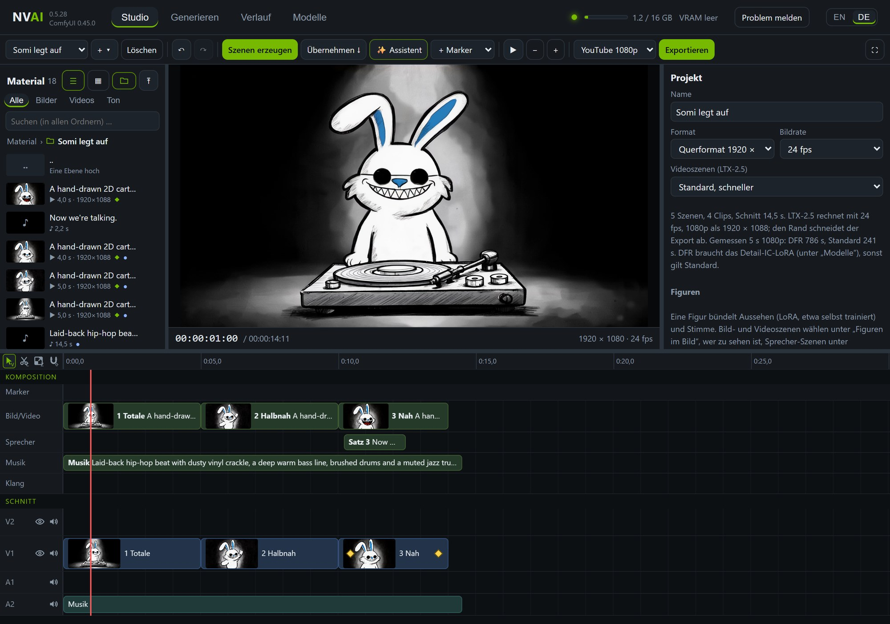

- **Assistent:** neu im Studio? „✨ Assistent“ führt dich in sieben Schritten durch ein ganzes Video, mit den besten Modellen für deine Hardware und der zu erwartenden Zeit.
- **Zustand je Szene:** Jede Szene sagt, was fehlt, wartet oder rechnet. Bekam die Szene, an die sie anschließt, einen neuen Take, steht sie auf „veraltet“, mit „Neu rechnen“ oder „So lassen“. Rechtsklick oder × entfernt eine Szenenkarte, Ziehen sortiert um.
- **Schneiden:** Auswahl, Schneiden und Magnet mit ihren Tasten, Rechtsklick-Menüs, Geschwindigkeit in Prozent, Überblendung, Abblende und Wischblende, Zoomen mit Keyframes, Video- und Tonspuren mit Auge und Stummschalter.
- **Nahtlose Einstellungen:** „Anschluss an“ lässt einen Clip den vorigen fortsetzen, so gehen zwei Einstellungen ohne Sprung ineinander über.
- **Vorlagen und Zusätze:** Je nach Modell nimmt eine Szene Referenzbilder, ein Endbild oder eine Schleife, ein grobes Layout-Video für Kamera und Bewegung oder eine Beschreibung des Tons.
- **Stimmen und Figuren:** Sprecher-Szenen sprechen ihren Text mit Qwen3-TTS, und ein Sprecher behält über alle Zeilen dieselbe Stimme. Eine Figur bündelt Aussehen aus einer LoRA (auch einer selbst trainierten) und Stimme; eine Videoszene spricht einen Satz mit den Lippen.
- **Material und Qualität:** Jedes Projekt hat einen eigenen Ordner und lässt sich als ZIP-Datei für einen anderen Rechner packen. Videoszenen werden zusätzlich verlustfrei aufbewahrt, komprimiert wird erst beim Export (42,3 statt 37,7 dB PSNR bei einem YouTube-Export).
- **Export:** YouTube 1080p und 4K, Shorts, AV1, ein verlustfreier Master (MKV) oder ProRes 4444 für andere Schnittprogramme.
- **Claude Code** baut dir auf Wunsch das ganze Video per MCP, während du zusiehst. NVAI-open für Mac hat das Studio auch, mit demselben Projektformat.

Schritt für Schritt: [docs/de/STUDIO.md](docs/de/STUDIO.md)

**Der Kurzfilm mit dem Hasen:** Somi begann als schnelle Handskizze. FLUX 3 machte daraus eine Figur und gab ihr als Bearbeitung eine müde Stimmung; jede Einstellung bekam ein Startbild, Qwen3-TTS sprach seinen Satz, Stable Audio 3 machte die Musik, und LTX-2.5 bewegte die Einstellungen im Studio, den Satz mit seinen Lippen. Claude Code bediente die App über MCP, die Entscheidungen traf ein Mensch, und die 30 Sekunden brauchten rund 50 Minuten auf einer Grafikkarte. [Schritt für Schritt mit Bildern](docs/de/KURZFILM.md) · [Der Film auf YouTube](https://www.youtube.com/watch?v=cDhmiLMU6WQ)


### Vom Porträt zum Video

<p align="center"></p>
<p align="center"><sub>Mit NVAI-open gemacht: Aus einem erzeugten Foto wird ein Schiffskapitän, der im Sturm spricht. <a href="docs/videos/photo-to-video-captain.mp4">Mit Ton</a></sub></p>

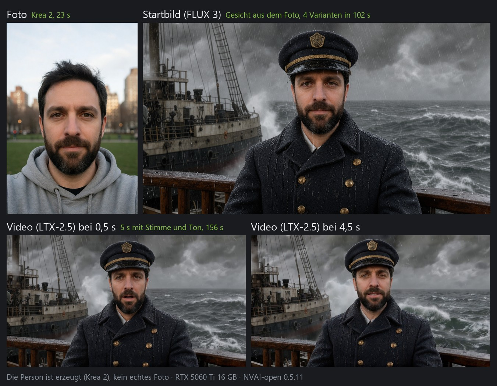

1. **Generieren → Bild:** ein Porträt erzeugen oder das Foto eines Menschen nehmen, der damit einverstanden ist.
2. **Video daraus:** unter dem fertigen Porträt macht „▶ Video daraus“ es zum Startbild eines Videos.
3. **Person aus einem Foto:** das Foto auf Kopf und Schultern zuschneiden („Zuschneiden“ zeigt eine Kontur), die Rolle beschreiben. FLUX 3 übernimmt das Gesicht und macht vier Startbilder; das ähnlichste auswählen. Neue Versuche gehen immer vom Foto aus.
4. **Prompt:** beschreiben, was sich bewegt, was die Kamera macht und was die Person sagt. LTX-2.5 macht daraus das Video mit Sprache und Ton.
5. **Gesicht halten:** den Weg „Schleife“ (mit ruhiger Kamera) oder „Start und Ende“ wählen. Ohne veränderte sich das Gesicht im Test nach einer Sekunde. Der Preis: Wasser und Rauch stehen dann auch still.

Schritt für Schritt mit Screenshots: [docs/de/FOTO_ZU_VIDEO.md](docs/de/FOTO_ZU_VIDEO.md)

### Augen bei kleinen Gesichtern

Ist eine Person klein im Bild (ab den Knien oder ganz), malen Videomodelle die Augen als verschwommene Löcher: MiniMax H3 fasst je 32 × 32 Pixel zu einer Einheit zusammen, in 1344 × 768 ist ein Gesicht von rund 105 px nur drei Einheiten hoch und ein Auge kleiner als eine. Die Pupillen fehlten schon ab dem ersten Bild, mit jedem Seed.

1. **Näher heran:** ab der Hüfte hat das Gesicht 250 px und mehr.
2. **Erst Entwurf, dann Final:** einen Take als Entwurf prüfen, dann rechnet „⇧ Final rechnen“ (Generieren) bzw. „⇧ Final“ (Studio) ihn mit demselben Seed in 1920 × 1088. Die Pupillen blieben im Test.
3. **Gesicht nachrechnen:** „☺ Gesicht nachrechnen“ unter einem Ergebnis (Generieren) oder unter den Takes einer Szene (Studio) malt das Gesicht mit FLUX 3 aus dem Originalfoto neu und legt es in jedem Bild auf den laufenden Kopf, rund 75 s für 3 s Video. Für Clips ohne Sprechen: Mund und Lider bewegen sich danach nicht.

Hochskalieren oder ein anderer Seed helfen nicht. Mehr, mit einem Leitfaden Schritt für Schritt für ein Video, in dem eine Person die Rollen wechselt: [docs/de/AUGENKORREKTUR.md](docs/de/AUGENKORREKTUR.md)

### 3D: vom Bild zum Modell

Ein Bild eines Objekts erzeugen und daraus ein GLB-Modell machen. TripoSG, das das Setup mitbringt, baut die Form. TRELLIS.2 malt die Texturen gleich mit, braucht aber eine Installation aus dem Quelltext ([Einzelheiten](docs/de/INSTALL.md#optional-3d-worker)).

<p align="center">
  
  
</p>

Schrift geht auf dem Weg zum Mesh verloren. „Vorderseite aus dem Bild übernehmen“ legt das Quellbild auf die Vorderseite des Modells:


### Bilder

Vier Modelle sind empfohlen, jedes für etwas anderes. **Krea 2** wirkt am ehesten wie ein Foto (rund 18 s je Bild). **MOSS-Image** ist am stärksten bei Schrift und Layout (rund 57 s, Apache-2.0). **Qwen-Image-2512** trifft Details und Konstruktion (rund 100 s, Apache-2.0). **FLUX 3 Image Klein** bearbeitet ein Bild und lässt den Rest, wie er ist (rund 28 s). Gleicher Prompt und Seed, je ein Bild:

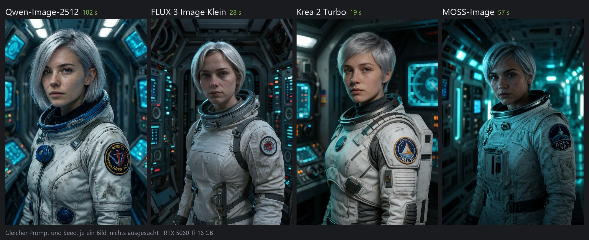

Auf dem Aufnäher soll „ARES VII“ stehen: MOSS-Image schrieb es am saubersten, Krea 2 schrieb „ARES VIII“.

Krea 2 nimmt auch ein Bild als Stilvorlage: Der Leuchtturm behält seinen Inhalt und wird zum Aquarell oder zum Holzschnitt.


MOSS-Image schreibt Plakate und Schilder buchstabengenau. Mit seinen 50 Schritten laufen die Seilgriffe der Kiste durch Bohrungen; mit 25 hingen sie in einem von drei Bildern ohne Halt:

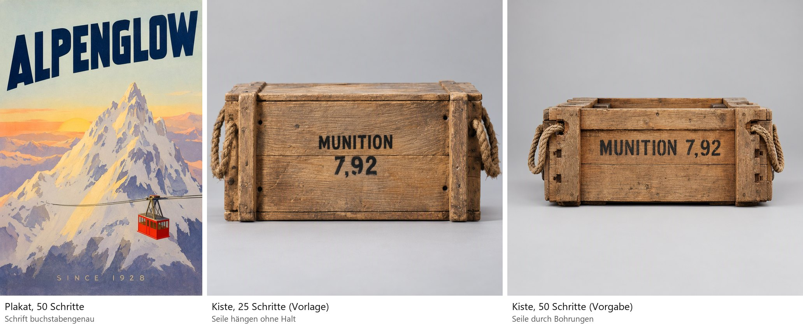

Bearbeiten mit FLUX 3: „replace the rope handles with iron handles, keep everything else unchanged“.


LoRAs bringen einem Modell einen Stil bei, zum Beispiel einen fotografischeren Look:


Welche Modelle LoRAs nehmen, eine selbst trainierte hinzufügen und die getesteten LoRAs: [docs/de/LORAS.md](docs/de/LORAS.md).

Die vier Modelle nebeneinander, mit Prompts und Zeiten (englisch): [docs/MODEL_COMPARISON.md](docs/MODEL_COMPARISON.md). Weitere Vergleiche und Prompt-Tipps: [docs/de/MODELLE.md](docs/de/MODELLE.md). Alle Bilder in diesem README hat NVAI-open erzeugt.

### Bilder bearbeiten: erweitern und füllen

Ein Bild breiter oder höher machen, und NVAI-open malt den neuen Rand passend dazu. Oder einen Bereich markieren und füllen: Dinge entfernen, neue hinzufügen. Der Rest des Bildes bleibt, wie er war.


### Alte Fotos restaurieren

Kratzer, Staub, Risse, Flecken und Ausbleichen verschwinden, auf Wunsch bekommt das Foto Farbe, und SeedVR2 schärft und vergrößert es. „Automatisch“ sieht sich das Foto an und entscheidet, wie viel neu gemalt wird: das ganze Bild bei flächiger Alterung wie Wasserflecken, nur die beschädigten Stellen bei Staub und Kratzern auf einem sonst guten Foto. Bei 20 von 21 Testfotos lag es richtig. Beim Einfärben kommt nur die Farbe dazu, Helligkeit und Detail bleiben die des Fotos. NVAI-open für Mac kann alles davon nativ. Mehr dazu: [docs/de/MODELLE.md](docs/de/MODELLE.md#alte-fotos)


### Was geht damit?

- **Studio:** ein ganzes Video aus Szenen bauen, schneiden und mit dem Encoder der Grafikkarte exportieren.
- **Gesicht tauschen:** eine Person aus einem Foto (die damit einverstanden ist) in einer neuen Rolle, als Startbild von FLUX 3 und als Video mit Ton von LTX-2.5.
- **Bilder:** FLUX 3, Qwen-Image-2512, Krea 2, MOSS-Image und viele weitere. Mit Referenzbildern bearbeiten, Bereiche füllen, Bilder erweitern.
- **LoRAs:** von Hugging Face, Civitai oder aus eigenem Training; NVAI-open liest den Dateikopf und zeigt, zu welchen Modellen eine LoRA passt.
- **Musik und Sounds:** instrumentale Musik bis 5 Minuten, Soundeffekte.
- **Sprache:** eine Sprecherstimme, die du in einem Satz beschreibst oder aus einer Aufnahme übernimmst, in 10 Sprachen.
- **3D-Modelle:** aus einem Bild ein GLB-Modell für Unity, Blender oder jede Engine; mit Texturen über TRELLIS.2, installiert aus dem Quelltext.
- **Alte Fotos:** Kratzer, Risse und Wasserflecken entfernen, einfärben, schärfen.
- **Audio und Ton-Forensik:** Stimmen von Musik trennen, Sprache von Rauschen, ein wiederkehrendes Geräusch wie einen Alarm entfernen, auch in Aufnahmen von vielen Stunden; einen Fall mit Übersetzer-Spur untersuchen und als Prüfpaket weitergeben. [Einzelheiten](docs/de/AUDIO.md)
- **KI-Agenten:** Claude Code, WorkBuddy, Cursor und andere Agenten erzeugen deine Assets per MCP, während sie an deinem Projekt arbeiten.
- **Kein eigener Filter:** unzensierte Modelle sind einen Klick entfernt. Für das, was du erzeugst, bist du selbst verantwortlich.
- **Windows und Mac**, NVIDIA und AMD Radeon, dazu ein Add-on für den Bildeditor PhotoCraft.

### Tipps

In jedem Reiter steht unter **Empfohlene Einstellungen**, was wir gemessen haben. Das Wichtigste:

**Loslegen**

- **Dem grünen Knopf folgen:** Unter Generieren und im Studio nennt er den nächsten Schritt und wie lange er auf deiner Karte dauert. Der erste Auftrag nach dem Start startet zusätzlich den Rechner und lädt das Modell (rund eine Minute), danach zählt nur die Rechenzeit.
- **Nur laden, was du brauchst:** Beim ersten Start wählst du, was du machen willst, und NVAI-open lädt genau diese Modelle. Alles andere steht unter „Modelle“, mit Größe, Lizenz und Zeit.
- **FLUX 3 und LTX-2.5:** die Lizenz auf Hugging Face annehmen und unter „Modelle“ einen Token mit Leserecht eintragen. Schritt für Schritt: [docs/de/HUGGINGFACE.md](docs/de/HUGGINGFACE.md)

**Bilder**

- **Format vor Prompt:** Das beste Format ist vorgewählt; Hochformat für eine stehende Figur, Querformat für ein Fahrzeug, quadratisch für Gegenstände. Das Format entscheidet mehr als der Prompt.
- **Ganze englische Sätze:** zuerst der Stil, dann das Motiv mit Material, Farbe und Zustand, dann Licht und Hintergrund. Die Tageszeit nennen, sonst wird es Dämmerung.
- **Ordnen statt zählen:** „the front truck …, behind it a line of separate trucks, each with its own cab“. Ohne „separate“ verschmelzen gleiche Dinge zu einem.
- **Schrift** in Anführungszeichen, mit Ort und Art („black stencilled letters on the front read …“).
- **4 Bilder machen** und in voller Größe beurteilen, nicht als Vorschaubild.
- **FLUX 3:** zuerst den Stil nennen, sonst wird es ein Foto. „Prompt ausbauen lassen“ abschalten, wenn Bauweise oder Anzahl genau stimmen müssen (sonst kam in 4 von 6 Bildern eine zweite Angelschnur dazu).
- **Krea 2:** den Bildausschnitt nennen („medium shot from the waist up, his whole head inside the frame“), sonst fehlt womöglich der Kopf.
- **MOSS-Image:** das fertige Bild beschreiben, die Schrift in Anführungszeichen mit Ort und Schriftart angeben und bei 50 Schritten lassen.

**Video**

- **Zuerst der Weg:** nur Text, Startbild, Start und Ende, Schleife, Layout-Video oder Verlängern; angeboten wird nur, was zum Weg passt.
- **Ein kurzer Prompt:** 4 bis 8 Sätze im Präsens: Einstellung, Ort und Licht, Handlung, Personen, Kamera, Ton. Laute Geräusche ausdrücklich nennen; leise beschriebene kommen fast unhörbar.
- **Stillstand in einem positiven Satz** („sits perfectly still like a statue“): Mit kurzem Prompt bewegte sich die Figur 38 bis 49 % weniger. Was nicht passieren soll, gar nicht nennen, auch nicht verneint.
- **Ruhige Stimmen:** „shouts“ wird zur Grimasse, „says firmly in a rough, deep voice“ bleibt ruhig.
- **Gesichter:** das Gesicht groß halten, das Startbild mit FLUX 3 aus einem frontalen Foto machen und „Schleife“ (ruhige Kamera) oder „Start und Ende“ wählen. Der Preis: Wasser und Rauch stehen dann auch still. Personen nur mit Gesicht im Bild sprechen lassen, rund 2 Wörter je Sekunde, und aus ein paar Varianten nach Gehör wählen.
- **Bewegung im Hintergrund:** Es bewegt sich nur, was der Prompt nennt. Wasser, Rauch, Regen, Lichter in Pfützen oder eine langsame Kamerafahrt ausdrücklich beschreiben; eine Nachtstraße mit fester Kamera und ohne einen solchen Satz stand still.
- **Regen ab dem ersten Bild:** Das Video übernimmt das Startbild genau, also Regen oder Schnee erst ins Startbild setzen (Bearbeiten mit FLUX 3), dann ohne Schleife animieren.
- **Doppelte Augen in der Überblendung:** im Studio Rechtsklick auf den einlaufenden Clip → „Köpfe in der Überblendung angleichen“.
- **Zwei Clips ohne Naht:** „Anschluss an“ im Studio oder „Verlängern“; der zweite Clip übernimmt die letzte Sekunde des ersten. Steht eine Szene auf „veraltet“, bekam die Szene davor einen neuen Take: neu rechnen oder so lassen.
- **Gesichter brauchen Pixel:** Bei einer ganzen Figur in 1080p ist der Kopf nur rund 100 px groß, und die Augen werden ungleich, im Bild wie im Video. Personen ab den Knien oder näher zeigen und die Augen in voller Größe prüfen. Geht die Person, mehrere Seeds in höchster Qualität (DFR) rechnen und den saubersten nehmen: Die Augen schwanken je Seed stark.
- **Gegenlicht:** Licht im Dunst tief hinter die Beine setzen; auf Kopfhöhe leuchtet es durch Haar und Helm.
- **Gleiche Person, neue Kleidung je Clip:** das Bild nehmen, an dem ein Clip geschnitten wird, darin nur die Kleidung ändern (mit FLUX 3 bearbeiten, den Bildausschnitt nennen) und als Startbild des nächsten Clips setzen; eine kurze Überblendung wirkt dann wie ein Morph. Den nächsten Clip erst einige Bilder nach seinem Anlauf einsetzen, sonst doppeln sich in der Überblendung die Augen. Geht die Person auf die Kamera zu, jeden Clip früh schneiden (nach etwa 1,25 s), sonst ist sie bei der letzten Kleidung zu nah. Endbilder aus dem Startbild des nächsten Clips ändern Helm und Straße mitten im Clip.
- **Länge:** Auf einer Karte mit 16 GB breite 1080p-Clips auf 6 Sekunden halten (8 Sekunden liefen über eine Stunde); längere Szenen aus mehreren Clips bauen.
- **Hochskalieren:** „Hochskalieren ×2“ verdoppelt ein fertiges Video (5 s von 1080p auf 4K in 104 s). Direkt in 1080p erzeugt ist es noch etwas feiner; gut für 4K-Exporte und kleinere Clips.
- **MiniMax H3:** in der EU, in Großbritannien, Südkorea und den USA nur mit eigener Lizenz von MiniMax, und nichts damit Erzeugtes veröffentlichen. Es neigt zu Zeitlupe, also jede Bewegung mit Tempo beschreiben.

**Studio und Ton**

- **Selbst schneiden:** „Übernehmen“ legt nur die gewählten Takes in den Schnitt; kürzen und anordnen, dann exportieren. Für saubere Überblendungen braucht jeder auslaufende Clip eine halbe Sekunde eigenes Material.
- **Soundeffekte:** den Klang beschreiben, nicht die Szene („heavy metal sword clash, single impact, bright metallic ring“); 3 bis 8 Sekunden reichen.
- **Musik:** ein Satz mit Gattung, Instrumenten, Schlagwerk und Stimmung, dann „BPM: 100.“; Gesang gibt es nicht.
- **Sprecherstimme:** Geschlecht, Alter, Tonlage, Tempo und Stimmung in einem Satz beschreiben. Dieselbe Beschreibung klingt mit jedem Seed anders, also die beste Probe wählen und sie als Aufnahme für alle weiteren Zeilen nehmen.

**Weiteres**

- **Eigene LoRA:** Der Assistent unter „LoRA erstellen/Bearbeiten“ führt hindurch; 24 Bilder der Figur in verschiedenen Haltungen und Umgebungen, jedes in voller Größe geprüft; 20 Epochen dauern auf einer RTX 5060 Ti rund 2 h 10 min, und mit der Vorgabe zeigten sich unsere Figuren bei Stärke 1. Farben wie Ohren und Nase im Prompt nennen. Keine Bilder aus FLUX 3, dessen Lizenz verbietet, damit andere Modelle zu trainieren. [So geht's](docs/de/LORAS.md#eigene-lora-trainieren)
- **3D:** ein Objekt vor schlichtem Hintergrund, ohne Boden und Schatten; beides landet sonst im Mesh.
- **Alte Fotos:** auf „Automatisch“ lassen, bekannte Farben in die Hinweise schreiben („his suit is dark brown“) und die zwei Varianten in voller Größe vergleichen.
- **Gesicht in neuer Szene auf dem Mac:** das Foto unter „Referenzbilder“ legen, nicht als „Ausgangsbild“, sagen, wer es ist (Frau oder Mann, Alter, Haare), und die neue Szene beschreiben. Der Assistent fragt im Weg „Gesicht aus einem Foto“ danach.

Dieselbe Liste mit den Messwerten, geschrieben für Claude Code: [docs/CLAUDE_CODE.md](docs/CLAUDE_CODE.md#recommended-settings-at-a-glance) (englisch)

### Claude Code und andere KI-Agenten: Assets auf Zuruf

NVAI-open bringt einen MCP-Server unter `http://127.0.0.1:8100/mcp` mit. Während NVAI-open läuft, in Claude Code einmal eintragen:

```
claude mcp add --scope user --transport http nvai http://127.0.0.1:8100/mcp
```

WorkBuddy, Cursor und andere Agenten, die eine Adresse nehmen, bekommen dieselbe Adresse in ihrer `mcp.json`:

```json
{"mcpServers": {"nvai": {"type": "http", "url": "http://127.0.0.1:8100/mcp"}}}
```

Dann einfach deinem Agenten sagen: „Mach ein verwittertes Holzfass als 3D-Modell und leg es nach Assets/Generated/Meshes“. Claude zum Beispiel wählt ein Modell, fragt vor einem Download, generiert und kopiert das Ergebnis ins Projekt. „Modelle → KI-Agenten (MCP)“ in der App zeigt deine Adresse mit Einträgen zum Kopieren. Einrichtung und alle Werkzeuge: [docs/CLAUDE_CODE.md](docs/CLAUDE_CODE.md) (englisch)

### Grafikkarten und unzensierte Modelle

NVAI-open wählt die passenden Modellfassungen für deine Karte: NVFP4 auf einer RTX 50, INT8 auf RTX 20, 30 und 40. Mit mehreren Karten rechnet die stärkste. Radeon-Karten laufen experimentell: ab der RX 6600 mit ROCm, die RX 5000, RX 6500/6400 und ältere Radeons über Vulkan (auf der RX 5000 und RX 6500/6400 lässt sich stattdessen ROCm wählen). Auch Intel-Arc-Karten rechnen über Vulkan. Tester sind in [#2](https://github.com/Mantux775/NVAI-open/issues/2) sehr willkommen. Details: [docs/de/INSTALL.md](docs/de/INSTALL.md)

NVAI-open hat keinen eigenen Inhaltsfilter. Die Modellliste kennzeichnet jedes Modell als zensiert, teilweise zensiert oder unzensiert, und weitere Modelle und LoRAs von Hugging Face und Civitai gibt es unter „Modelle“ → „Modelle und LoRAs suchen“. Gesetze und die Lizenz des Modells gelten; die FLUX-3-Lizenz etwa verlangt, jedes Bild vor der Veröffentlichung zu prüfen. Überblick: [docs/de/MODELLE.md](docs/de/MODELLE.md#zensiert-oder-unzensiert)

### Mac-App, PhotoCraft-Add-on, iOS

- **Mac:** eine native App für Apple Silicon. Bilder mit FLUX.2 Klein und Z-Image Turbo (generieren, überarbeiten, füllen, Referenzbilder, LoRAs), alte Fotos restaurieren, Musik und Klänge mit Stable Audio 3, eine Sprecherstimme mit Qwen3-TTS, kurze Videos mit LTX-Video (größere Videomodelle ab 16 GB Speicher, mit Ton ab 32 GB), das Studio und Ton-Forensik mit Prüfpaketen. Sie führt genauso wie unter Windows, mit der Schrittleiste, der Zeit auf jedem Knopf und der Auftragsleiste. Auf einem Mac mini M1 mit 8 GB dauern 30 Sekunden Musik rund 13 Sekunden und 2 Sekunden Video rund 95 Sekunden.
- **Add-on für [PhotoCraft](https://github.com/storytold/photocraft):** in diesem tollen Open-Source-Bildeditor einen Bereich auswählen, füllen, überarbeiten oder restaurieren, das Ergebnis kommt als Ebene zurück. Getestet mit PhotoCraft 0.23.1. Danke an die PhotoCraft-Entwickler für einen so gut steuerbaren Editor.
- **iOS (geschlossene Beta):** ein 3D-Scanner, der aus Fotos echter Gegenstände Modelle macht. Schreibt mir gern in einem Issue, wenn ihr ihn nutzen würdet.

### Voraussetzungen

| | Windows | macOS |
|---|---|---|
| System | Windows 10 (ab 2004) oder 11, 64 Bit | macOS 15 oder neuer, Apple Silicon |
| Grafik / Speicher | empfohlen ab 12 GB VRAM (8 GB gehen mit den INT8-Modellen). NVIDIA: Treiber ab 580.88. AMD Radeon RX 7000/9000 (RX 5000 und RX 6000 experimentell): Treiber ab 26.2.2; ältere Radeons und Intel-Karten über Vulkan (experimentell) | empfohlen ab 16 GB RAM (8 GB reichen für Bilder und kurze Videos) |
| Platte | rund 10 GB für das Programm, dazu 5 bis 40 GB pro Modell | rund 1 GB für die App, dazu etwa 10 GB für FLUX.2 Klein |
| Internet | fürs Einrichten (rund 3 GB) und die Modelle | für die Modelle |

Das Windows-Setup ist nicht signiert. Windows zeigt deshalb eventuell „Der Computer wurde durch Windows geschützt“: auf „Weitere Informationen“ und dann „Trotzdem ausführen“ klicken.

### Lizenzen

Der Code steht unter der [MIT-Lizenz](LICENSE): Jeder darf damit machen, was er will. Fremde Komponenten behalten ihre eigenen Lizenzen, siehe [THIRD_PARTY_NOTICES.txt](THIRD_PARTY_NOTICES.txt); ComfyUI (GPL-3.0) wird als eigenständiges Programm mit vollständigem Quelltext mitgeliefert. Modelle sind nicht Teil dieses Repos; jedes hat seine eigene Lizenz, die die Modellliste anzeigt.

### Weiterlesen

- [docs/de/INSTALL.md](docs/de/INSTALL.md): Installation, Bauen aus dem Quelltext, PhotoCraft-Add-on
- [docs/de/DIRECTML.md](docs/de/DIRECTML.md): ältere Radeons und Intel-Karten über Vulkan, mit Messungen
- [docs/de/MODELLE.md](docs/de/MODELLE.md): die Modelle im Detail, Prompt-Tipps, Testergebnisse
- [docs/de/FOTO_ZU_VIDEO.md](docs/de/FOTO_ZU_VIDEO.md): vom Foto zum Video, Schritt für Schritt
- [docs/de/STUDIO.md](docs/de/STUDIO.md): das Studio, ganze Videos aus Szenen
- [docs/CLAUDE_CODE.md](docs/CLAUDE_CODE.md): NVAI-open aus Claude Code und anderen KI-Agenten nutzen (englisch)
- [docs/de/MAKING_OF.md](docs/de/MAKING_OF.md): wie Claude ein Video im Studio gebaut hat
- [docs/de/KURZFILM.md](docs/de/KURZFILM.md): ein Kurzfilm von der Handskizze an, Schritt für Schritt mit Bildern
- [docs/de/DOCK_ORGANIZER_VIDEO.md](docs/de/DOCK_ORGANIZER_VIDEO.md): ein Werbevideo für eine Mac-App, mit automatischen Bildschirmaufnahmen
- [photocraft-addon/](photocraft-addon/): Quelltext des PhotoCraft-Add-ons
