# NVAI-open

Images, videos with sound, music and 3D models, made on your own computer. Free, private, no account, no subscription, no cloud.

<p align="center">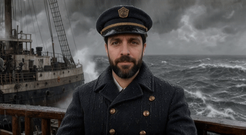</p>
<p align="center"><sub>Made with NVAI-open: a generated photo becomes a ship captain who speaks in a storm. <a href="docs/videos/photo-to-video-captain.mp4">With sound</a></sub></p>

## Download

| | |
|---|---|
| Windows 10/11, NVIDIA or AMD Radeon | [NVAI-open-Setup-0.5.18.exe](https://github.com/Mantux775/NVAI-open/releases/download/v0.5.18/NVAI-open-Setup-0.5.18.exe) |
| macOS 15+ on Apple Silicon, signed and notarized | [NVAI-open-0.5.0.dmg](https://github.com/Mantux775/NVAI-open/releases/download/v0.5.18/NVAI-open-0.5.0.dmg) |

Install, open, download a model under "Models", generate. The setup brings everything else along. [Installation details](docs/INSTALL.md) · [All releases](https://github.com/Mantux775/NVAI-open/releases)

## What's new? / Was gibt's Neues?

October 2026: NVAI-open 0.5.18 for Windows and 0.5.0 for the Mac ([release notes](https://github.com/Mantux775/NVAI-open/releases/tag/v0.5.18))

- **The best result without settings:** every image, music and video model now starts with its measured best settings, set when you pick the model: Qwen-Image-2512 at its native 1328², FLUX 3, Krea 2 and MOSS-Image at 2 MP, LTX-2.5 at 1080p with DFR, 60 s of music. A short tip under every model choice says what works best, for old photos too. Claude gets the same over MCP.
- **MiniMax H3, with a license warning:** video with stereo sound from text, a start image or up to 9 reference images, with the turbo LoRA, sparse attention and INT8 attention preselected (9.4 s in 6.6–6.9 instead of 37 min on an RTX 5060 Ti). **Its license prohibits any use in the EU, the UK, South Korea and the USA without a separate license from MiniMax, and nothing made with it may be published.** The app marks it in red until you confirm a permission. [Details](docs/MODELS.md#minimax-h3-since-0518)
- 0.5.17 brought two clips without a seam (latent chain), the Mac got the Studio ([notes](https://github.com/Mantux775/NVAI-open/releases/tag/v0.5.17))

Neu: **Das beste Ergebnis ohne Einstellen**: Jedes Bild-, Musik- und Videomodell startet mit seinen gemessenen Bestwerten, gesetzt bei der Modellwahl: Qwen-Image-2512 im nativen 1328², FLUX 3, Krea 2 und MOSS-Image mit 2 MP, LTX-2.5 in 1080p mit DFR, Musik 60 s. Ein kurzer Tipp unter jeder Modellwahl sagt, was am besten funktioniert, auch bei alten Fotos; Claude bekommt dasselbe über MCP. **MiniMax H3, mit Lizenzwarnung**: Video mit Stereoton aus Text, Startbild oder bis zu 9 Referenzbildern, mit Turbo-LoRA, Sparse Attention und INT8-Attention vorgewählt (9,4 s in 6,6–6,9 statt 37 min auf einer RTX 5060 Ti). **Die Lizenz verbietet jede Nutzung in der EU, in Großbritannien, Südkorea und den USA ohne eigene Lizenz von MiniMax, und nichts damit Erzeugtes darf veröffentlicht werden.** Die App markiert es rot, bis du eine Genehmigung bestätigst. [Einzelheiten](docs/de/MODELLE.md#minimax-h3-seit-0518)

[English](#english) · [Video](#video) · [Deutsch](#deutsch)

---

## English

### Hi

I vibe-coded this app because I needed it myself: images, sounds and 3D models for my game projects, without paying per picture or sending everything to the cloud. Now I'm sharing it. Everything runs on your own graphics card, and nothing leaves your computer.

It is tested on my own hardware: Windows with an RTX 5060 Ti (16 GB) and a Mac mini M1 (8 GB). Feedback is very welcome as an [issue](https://github.com/Mantux775/NVAI-open/issues), easiest with "Report a problem" in the app, which attaches an anonymized report. I have a full-time job, so answers can take a while. All apps are in English and German.

### What you can do

- **Images:** FLUX 3, Qwen-Image-2512, Krea 2, MOSS-Image and many more. Edit with reference images, fill in or extend a picture.
- **Video with sound:** LTX-2.5 makes the picture and the sound in one pass, speech included, up to 20 s and 1080p.
- **Studio:** compose a whole video from scenes, cut it, zoom with keyframes and export it with your graphics card's encoder.
- **Music and sounds:** instrumental music up to 5 minutes, sound effects.
- **3D models:** from an image to a textured model for Unity, Blender or any engine.
- **Old photos:** remove scratches, tears and water stains, colorize, sharpen.
- **A few words are enough:** "Expand prompt" writes the full description for you.
- **Claude Code:** Claude creates your assets while it works on your project.
- **No filter of its own:** uncensored models are one click away. You are responsible for what you make.
- **Windows and Mac**, NVIDIA and AMD Radeon, and an add-on for the photo editor PhotoCraft.

### From a portrait to a video

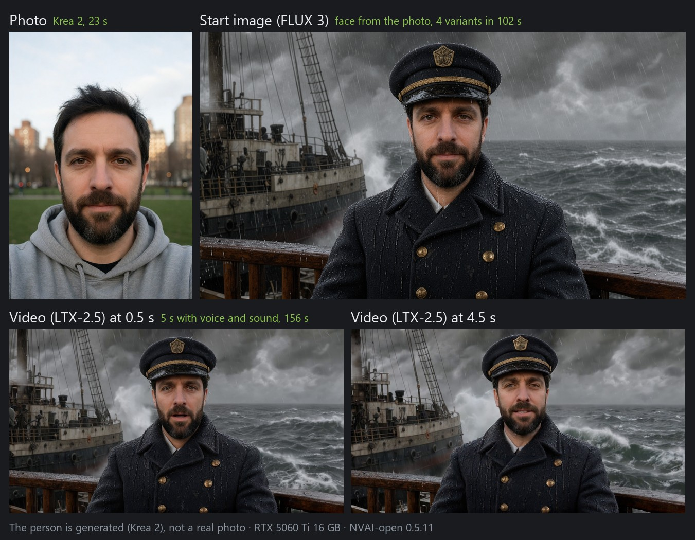

1. **Generate → Image:** create a portrait, or use a photo of someone who agreed to it.
2. **Generate → Video:** pick the portrait as the start image.
3. **Person from a photo:** describe the role. FLUX 3 keeps the face and makes four start images; pick the one that looks most alike.
4. **Prompt:** describe what moves, what the camera does and what the person says. LTX-2.5 makes the video with speech and sound.
5. **Keep the face:** tick "Loop" (with a still camera) or give an end image. Without one, the camera pushed in after a second in our test and the face changed. The price: water, smoke and everything else that is the same in both images stands still; for a moving background, use neither.

Step by step with screenshots: [docs/PHOTO_TO_VIDEO.md](docs/PHOTO_TO_VIDEO.md)

### Studio: whole videos from scenes

A full-screen editor for whole videos, the first tab when NVAI-open starts. At the top you compose: scenes with a prompt on lanes for picture, voice, music and sound, plus markers that say what goes where. At the bottom you edit the real clips: cut, trim, dissolve, set the volume. "Generate scenes" makes every clip, still image and piece of music with your local models, "Conform" puts the takes into the edit, and the export uses the video encoder of your graphics card at YouTube loudness.


- **Editing:** selection, razor and magnet with their keys, right-click menus everywhere, several clips at once, video and audio tracks with eye and mute, speed in percent, cross dissolve, dips to black or white and wipes, and a check before "Conform" overwrites anything.
- **Markers:** a chain marker makes a clip continue the one before it: it takes over its last second and the edit dissolves over it, so two shots join seamlessly; transition markers add transitions; an AI task marker leaves Claude a note in the timeline.
- **Media:** every project has its own folder for what it generates, exports and uploads, next to the general History; a compact list with search across all folders. Click a file to play it in the monitor, drag it onto a track, delete it right there.
- **High-quality 1080p:** video scenes run in the best LTX-2.5 quality, every AI video is also kept losslessly, and only the export compresses: measured 42.3 instead of 37.7 dB PSNR for a YouTube export.
- **Export:** YouTube 1080p and 4K, Shorts, AV1, a lossless master (MKV) or ProRes 4444 for other editing software.
- **Claude Code** builds the whole video for you over MCP while you watch it in the Studio.
- **Mac:** since 0.4.9 NVAI-open for Mac has the Studio too, with the same tools and project format ([On the Mac](docs/STUDIO.md#on-the-mac-nvai-open-for-mac-049)).

Step by step: [docs/STUDIO.md](docs/STUDIO.md)

### Video with sound

LTX-2.5 by Lightricks makes picture and sound together: speech, footsteps, wind, music. Start from a text, a start image or a start and an end image, make a seamless loop, let the picture follow a sound you give it, or extend a clip you already have.

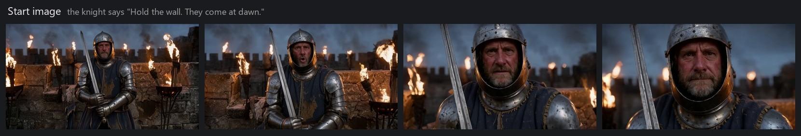

Under the video model, "Recommended LoRAs" adds styles with one click, such as painted fantasy or anime:

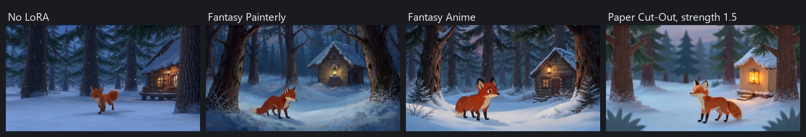

All ways and measured times: [docs/MODELS.md](docs/MODELS.md#new-in-058)

### 3D: from an image to a model

Generate an image of an object and turn it into a GLB model. TRELLIS.2 paints the textures too, TripoSG builds the shape only.

<p align="center">
  
  
</p>

Lettering does not survive the mesh stage on its own. "Take the front from the image" puts the source image onto the front of the mesh:

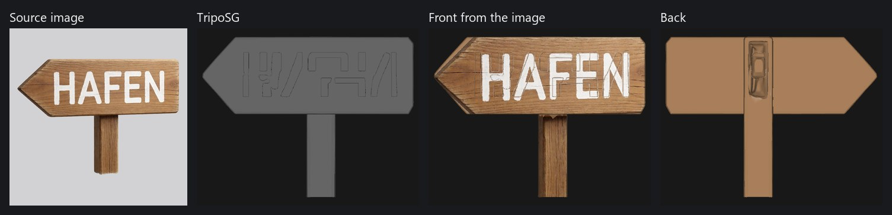

### Images

Four models are recommended, each for something else. **Krea 2** looks the most like a photo and is the fastest, about 18 s per image. **MOSS-Image** is strongest at lettering and layout, about 57 s, under Apache-2.0. **Qwen-Image-2512** gets details and construction right, about 100 s, also Apache-2.0. **FLUX 3 Image Klein** takes about 28 s and edits a picture while keeping the rest intact. Same prompt and seed, one image each:

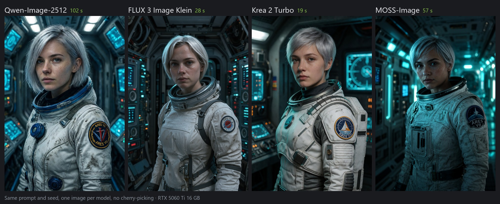

The patch should read "ARES VII": MOSS-Image wrote it the cleanest, Krea 2 wrote "ARES VIII". In the full comparison, only Qwen-Image-2512 set a pocket watch to ten past ten as asked.

Krea 2 also takes an image as a style template: the lighthouse keeps its content and takes on the watercolor or the woodcut.

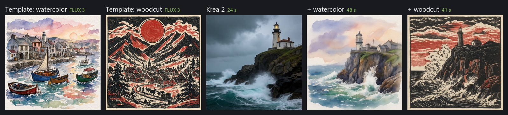


MOSS-Image writes posters and signs letter-perfect. With its 50 steps the crate's rope handles pass through drilled holes; with the 25 of ComfyUI's template they hung without a hold in one of three images:

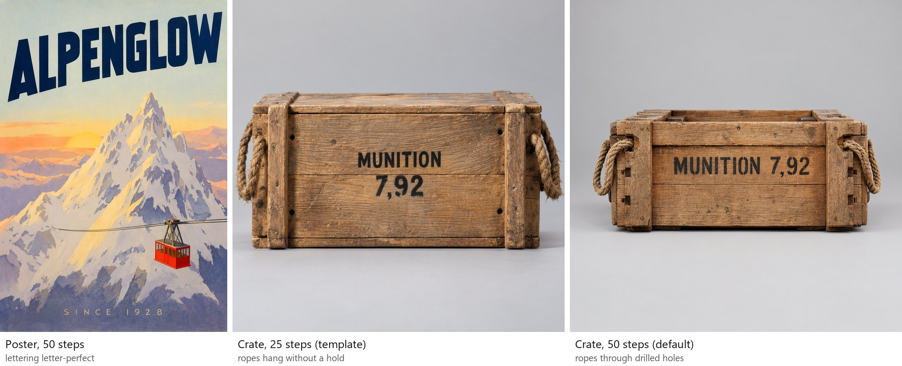

Editing with FLUX 3: "replace the rope handles with iron handles, keep everything else unchanged".


LoRAs teach a model a style, for example a more photographic look:

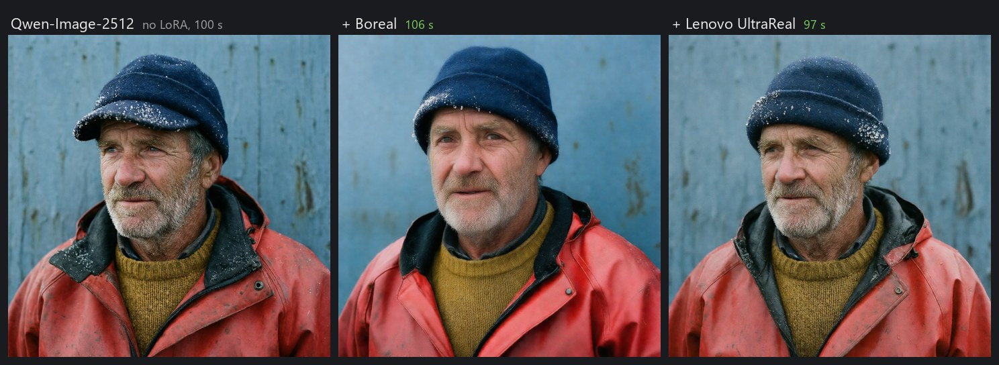

The four recommended models side by side, with prompts and times: [docs/MODEL_COMPARISON.md](docs/MODEL_COMPARISON.md). More comparisons, prompt tips and test results: [docs/MODELS.md](docs/MODELS.md). All images in this README were generated with NVAI-open.

### Edit pictures: extend and fill

Make a picture wider or taller, and NVAI-open paints the new border to match. Or mark an area and fill it: remove things, add new ones. The rest of the picture stays as it was.

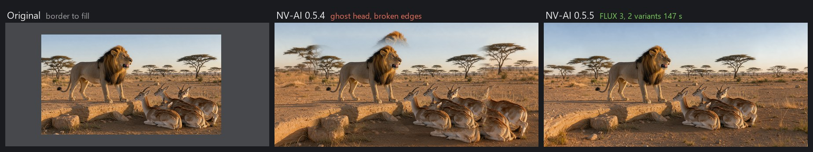

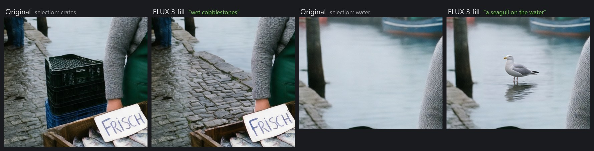

### Restore old photos

Scratches, dust, tears, stains and fading go, the photo gets color if you like, and SeedVR2 sharpens and enlarges it. "Thorough" redraws the whole photo, which suits overall aging such as water stains and fading; "Gentle" only replaces the damaged spots and keeps sharpness and faces exactly as they are, which suits dust, scratches and tears on an otherwise good photo. "Automatic" (the default) lets the image model look at the photo and choose; it picked the better one on 20 of 21 test photos. Colorizing takes only the color from FLUX 3, brightness and detail stay the photo's. Known colors in the hints make it more accurate. NVAI-open for Mac (0.4.7) does all of it natively on Apple Silicon: "Automatic" with Qwen3.5 4B, sharpening with SeedVR2 3B (on a Mac with 8 GB, doubling a 1 MP photo takes about 9 minutes). Details: [docs/MODELS.md](docs/MODELS.md#new-in-0511).

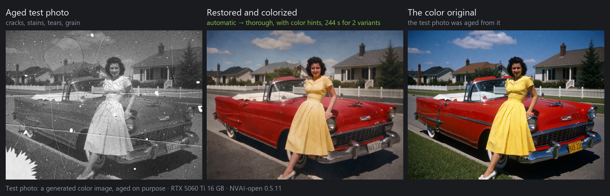

### Expand prompt

Type a few words, click "Expand prompt", and NVAI-open writes the full description: setting, materials, light, what happens. Read it, delete what you don't want, generate. Works for images, video, sounds, music and 3D.


### Tips

Every tab in NVAI-open has a **Recommended settings** box with what was measured. The most important ones:

- **Images:** the size for the best result is preselected (native or 2 MP); for a standing figure pick portrait, for a vehicle landscape. Write full English sentences with the style first, and make 4 images at once to pick from. With FLUX 3, switch off "Expand the prompt" when construction or counts must be exact: the upsampler added a second fishing line in 4 of 6 images, without it 0 of 2.
- **Krea 2:** name the framing ("medium shot from the waist up, his whole head inside the frame"); without it the head was cut off in 3 of 3 test images.
- **MOSS-Image:** describe the finished picture and put the text in quotation marks with position and typeface; leave it on 50 steps.
- **Video:** keep the prompt short (4–8 sentences) and say a person's stillness in one sentence ("sits perfectly still like a statue …"): with 8 instead of 14 sentences the person moved about 40–50 % less in our test. Name loud sounds explicitly, sounds described as soft come out almost inaudible. For a fixed shot write "Static camera, a locked-off medium shot"; if the framing has to hold, also give an end image edited from the start image (the prompt alone still pushed in, 3 of 3). For a recognizable person keep the face large (medium shot or closer), make the start image with FLUX 3 from a frontal reference (or extend the real photo to the video format), give the start image as the end image too ("Loop", still camera; in a close-up the face held for 5 s, without it the face changed after a second; the price: water and smoke then stand as still as the shore, even if the prompt asks them to move, so for a moving background give only a start image), and don't extend such clips. For an action with objects, fill only its result into the start image with a mask and give that as the end image (a fish in a bucket: one fish with one tail, the face unchanged), and say what the hands must not do. Let people speak only with their face in the shot and the same voice description, and make a few variants to pick by ear: LTX makes up the voice anew in every clip. A spoken line takes about 2 words per second: 15 words ran past the end of a 6 s shot, 11 fit; leave gestures out (even "a single quick wave" lasted 2.5 s). Write timing out ("For the first two seconds nothing happens: …"). Join two clips by chaining them (chain marker in the Studio, or "Extend"): the second one takes over the last second of the first. Leave "Lossless copy for editing" on if you cut the clips later; it costs about 32 MB per second at 1080p.
- **MiniMax H3:** only with a separate license from MiniMax in the EU, the UK, South Korea and the USA, and never publish what it makes. It tends to slow motion: describe the pace of every movement.
- **3D:** one object on a plain background, without floor or shadow; both would end up in the mesh.
- **FLUX 3 and LTX-2.5:** accept the license on Hugging Face and store a read token under "Models"; the model card shows whether access works. Step by step: [docs/HUGGINGFACE.md](docs/HUGGINGFACE.md)
- **Old photos:** leave it on "Automatic"; it chooses "Thorough" for overall aging (water stains, crack networks) and "Gentle" for separate damage on an otherwise good photo (dust, scratches, tears). Put known colors into the hints ("his suit is dark brown") and compare the two variants at full size.

The same list with the measurements, written for Claude Code: [docs/CLAUDE_CODE.md](docs/CLAUDE_CODE.md#recommended-settings-at-a-glance)

### Claude Code: your assets on request

NVAI-open comes with an MCP server. Register it once:

```
claude mcp add --scope user nvai -- "<install folder>\server\.venv\Scripts\python.exe" -m nvai.mcp_server
```

Then just ask: "Make a weathered wooden barrel as a 3D model and put it into Assets/Generated/Meshes". Claude picks a model, asks before a download, generates, and copies the result into your project. Setup and all tools: [docs/CLAUDE_CODE.md](docs/CLAUDE_CODE.md)

### Graphics cards and uncensored models

NVAI-open picks the right model versions for your card: NVFP4 on an RTX 50, INT8 on RTX 20, 30 and 40 (on a slow connection such as a riser, NVFP4 where only that fits into the memory). With several cards it uses the strongest one. AMD Radeon works experimentally (PyTorch with ROCm 10; on a Radeon RX 9000 the FP8 and bf16 versions); testers are very welcome in [#2](https://github.com/Mantux775/NVAI-open/issues/2). Details: [docs/INSTALL.md](docs/INSTALL.md)

NVAI-open has no content filter of its own. The model list marks every model as censored, partly censored or uncensored, and uncensored ones such as Chroma, Pony and NoobAI are one click away. More, including LoRAs from Hugging Face and Civitai, under "Models" → "Search models and LoRAs". Respect the law and each model's license; the FLUX 3 license, for example, requires a review of every image before it is published. Overview: [docs/MODELS.md](docs/MODELS.md#censored-or-uncensored)

### Mac app, PhotoCraft add-on, iOS

- **Mac:** a native app for Apple Silicon with FLUX.2 Klein and Z-Image Turbo: generate, refine, fill, reference images, expand prompts, LoRAs, restore old photos, music and sounds with Stable Audio 3 (30 seconds in about 13 seconds on an M1), short videos with LTX-Video 2B from text or a start image (2 seconds at 768 × 512 in about 95 seconds on an M1 with 8 GB; since 0.5.0 bigger video models for Macs with 16 GB and more, LTX-2.3 and LTX-2.5 with sound), and since 0.4.9 the Studio for whole videos from scenes.
- **[PhotoCraft](https://github.com/storytold/photocraft) add-on:** select an area in this great open-source photo editor, fill it, rework it or restore it, and the result comes back as a layer. Needs PhotoCraft 0.10.0 or newer. Thanks to the PhotoCraft developers for such a well-scriptable editor.
- **iOS (closed beta):** a 3D scanner that turns photos of real objects into models. Tell me in an issue if you would use it.

### Requirements

| | Windows | macOS |
|---|---|---|
| System | Windows 10 (2004+) or 11, 64-bit | macOS 15 or newer, Apple Silicon |
| Graphics / memory | 12 GB+ VRAM recommended (8 GB works with the INT8 models). NVIDIA: driver 580.88+. AMD Radeon: driver 26.2.2+ | 16 GB RAM or more recommended (8 GB works for small images) |
| Disk | about 10 GB for the program, plus 5 to 40 GB per model | about 1 GB for the app, plus about 10 GB for FLUX.2 Klein |
| Internet | for setup (about 3 GB) and model downloads | for model downloads |

The Windows setup is not code-signed, so Windows may show "Windows protected your PC": click "More info", then "Run anyway".

### Licenses

The code is under the [MIT License](LICENSE): do whatever you want with it. Third-party components keep their own licenses, see [THIRD_PARTY_NOTICES.txt](THIRD_PARTY_NOTICES.txt); ComfyUI (GPL-3.0) is shipped as a separate program with its full source. Models are not part of this repository, and each has its own license, shown in the model list.

### More

- [docs/INSTALL.md](docs/INSTALL.md): installing, building from source, the PhotoCraft add-on
- [docs/MODELS.md](docs/MODELS.md): the models in detail, prompt tips, test results
- [docs/PHOTO_TO_VIDEO.md](docs/PHOTO_TO_VIDEO.md): from a photo to a video, step by step
- [docs/STUDIO.md](docs/STUDIO.md): the Studio, whole videos from scenes
- [docs/CLAUDE_CODE.md](docs/CLAUDE_CODE.md): using NVAI-open from Claude Code
- [photocraft-addon/](photocraft-addon/): source of the PhotoCraft add-on

---

## Video

<p align="center">
  <a href="https://www.youtube.com/shorts/e9jSTwgwnrI"></a>
</p>

<p align="center">NVAI-open and the PhotoCraft add-on in action, a short on YouTube.<br>
NVAI-open und das PhotoCraft-Add-on in Aktion, ein kurzes Video auf YouTube.<br>
<a href="https://www.youtube.com/shorts/e9jSTwgwnrI">youtube.com/shorts/e9jSTwgwnrI</a></p>

---

## Deutsch

### Hallo

Ich habe diese App „vibegecodet“, weil ich sie selbst brauchte: Bilder, Sounds und 3D-Modelle für meine Spieleprojekte, ohne pro Bild zu zahlen oder alles in die Cloud zu schicken. Jetzt teile ich sie. Alles rechnet auf deiner eigenen Grafikkarte, nichts verlässt deinen Rechner.

Getestet ist sie auf meiner eigenen Hardware: Windows mit RTX 5060 Ti (16 GB) und ein Mac mini M1 (8 GB). Über Feedback als [Issue](https://github.com/Mantux775/NVAI-open/issues) freue ich mich sehr, am einfachsten mit „Problem melden“ in der App, das hängt einen anonymisierten Bericht an. Ich habe einen Vollzeitjob, Antworten können also dauern. Alle Apps gibt es auf Deutsch und Englisch.

### Was geht damit?

- **Bilder:** FLUX 3, Qwen-Image-2512, Krea 2, MOSS-Image und viele weitere. Mit Referenzbildern bearbeiten, Bereiche füllen, Bilder erweitern.
- **Video mit Ton:** LTX-2.5 macht Bild und Ton in einem Durchgang, samt Sprache, bis 20 s und 1080p.
- **Studio:** ein ganzes Video aus Szenen komponieren, schneiden, mit Keyframes zoomen und mit dem Encoder der Grafikkarte exportieren.
- **Musik und Sounds:** instrumentale Musik bis 5 Minuten, Soundeffekte.
- **3D-Modelle:** aus einem Bild ein texturiertes Modell für Unity, Blender oder jede Engine.
- **Alte Fotos:** Kratzer, Risse und Wasserflecken entfernen, einfärben, schärfen.
- **Ein paar Worte reichen:** „Prompt ausbauen“ schreibt die volle Beschreibung für dich.
- **Claude Code:** Claude erzeugt deine Assets, während es an deinem Projekt arbeitet.
- **Kein eigener Filter:** unzensierte Modelle sind einen Klick entfernt. Für das, was du erzeugst, bist du selbst verantwortlich.
- **Windows und Mac**, NVIDIA und AMD Radeon, dazu ein Add-on für den Bildeditor PhotoCraft.

### Vom Porträt zum Video

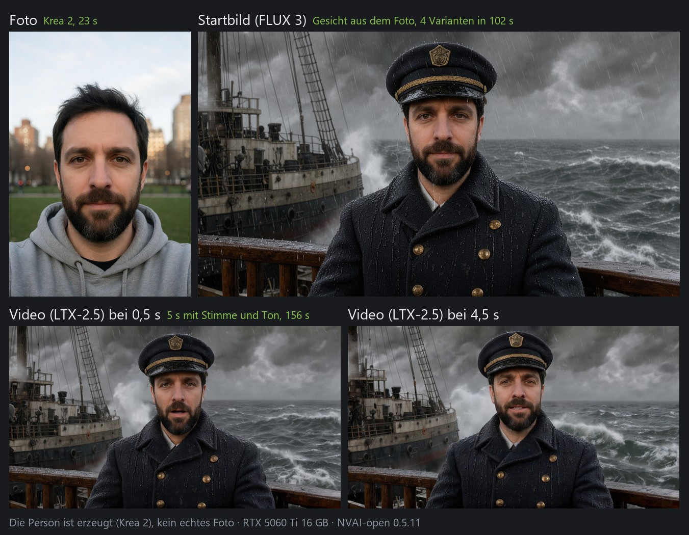

1. **Generieren → Bild:** ein Porträt erzeugen oder das Foto eines Menschen nehmen, der damit einverstanden ist.
2. **Generieren → Video:** das Porträt als Startbild wählen.
3. **Person aus einem Foto:** die Rolle beschreiben. FLUX 3 übernimmt das Gesicht und macht vier Startbilder; das ähnlichste auswählen.
4. **Prompt:** beschreiben, was sich bewegt, was die Kamera macht und was die Person sagt. LTX-2.5 macht daraus das Video mit Sprache und Ton.
5. **Gesicht halten:** „Schleife“ anhaken (mit ruhiger Kamera) oder ein Endbild mitgeben. Ohne fuhr die Kamera im Test nach einer Sekunde heran, und das Gesicht veränderte sich. Der Preis: Wasser, Rauch und alles andere, was in beiden Bildern gleich ist, steht dann still; für bewegten Hintergrund beides weglassen.

Schritt für Schritt mit Screenshots: [docs/de/FOTO_ZU_VIDEO.md](docs/de/FOTO_ZU_VIDEO.md)

### Studio: ganze Videos aus Szenen

Ein Schnittplatz über den ganzen Bildschirm für ganze Videos. Oben komponierst du: Szenen mit Prompt auf Bahnen für Bild, Sprecher, Musik und Klang, dazu Marker, die sagen, was wohin kommt. Unten schneidest du die echten Clips: schneiden, trimmen, überblenden, Lautstärke. „Szenen erzeugen“ macht alle Clips, Standbilder und Musikstücke mit deinen lokalen Modellen, „Übernehmen“ legt die Takes in den Schnitt, und der Export nutzt den Video-Encoder deiner Grafikkarte, in der Lautheit von YouTube.


- **Schneiden:** Auswahl, Schneiden und Magnet mit ihren Tasten, Rechtsklick-Menüs überall, mehrere Clips auf einmal, Video- und Tonspuren mit Auge und Stummschalter, Geschwindigkeit in Prozent, Überblendung, Abblende über Schwarz oder Weiß und Wischblende, und eine Rückfrage, bevor „Übernehmen“ etwas überschreibt.
- **Marker:** Ein Anschluss-Marker lässt einen Clip den vorigen fortsetzen: Er übernimmt dessen letzte Sekunde, der Schnitt blendet darüber, so gehen zwei Einstellungen nahtlos ineinander über; Übergang-Marker setzen Übergänge; ein KI-Auftrag hinterlässt Claude eine Notiz in der Zeitleiste.
- **Material:** Jedes Projekt hat einen eigenen Ordner für das, was es erzeugt, exportiert und hochlädt, neben dem allgemeinen Verlauf; eine kompakte Liste mit Suche über alle Ordner. Ein Klick spielt die Datei im Monitor ab, auf eine Spur gezogen wird sie zum Clip, gelöscht wird sie direkt dort.
- **Hochwertiges 1080p:** Videoszenen laufen in der höchsten Qualität von LTX-2.5, jedes KI-Video wird zusätzlich verlustfrei aufbewahrt, und komprimiert wird erst beim Export: gemessen 42,3 statt 37,7 dB PSNR bei einem YouTube-Export.
- **Export:** YouTube 1080p und 4K, Shorts, AV1, ein verlustfreier Master (MKV) oder ProRes 4444 für andere Schnittprogramme.
- **Claude Code** baut dir das ganze Video per MCP, während du im Studio zusiehst.
- **Mac:** Seit 0.4.9 hat NVAI-open für Mac das Studio auch, mit denselben Werkzeugen und demselben Projektformat ([Auf dem Mac](docs/de/STUDIO.md#auf-dem-mac-nvai-open-für-mac-049)).

Schritt für Schritt: [docs/de/STUDIO.md](docs/de/STUDIO.md)

### Video mit Ton

LTX-2.5 von Lightricks macht Bild und Ton zusammen: Sprache, Schritte, Wind, Musik. Starten lässt es sich mit einem Text, einem Startbild oder einem Start- und einem Endbild; es macht nahtlose Schleifen, das Bild kann einem vorgegebenen Ton folgen, und ein vorhandener Clip lässt sich verlängern.

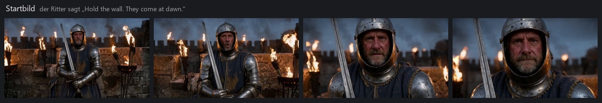

Unter dem Videomodell fügt „Empfohlene LoRAs“ Stile mit einem Klick hinzu, etwa gemalte Fantasy oder Anime:

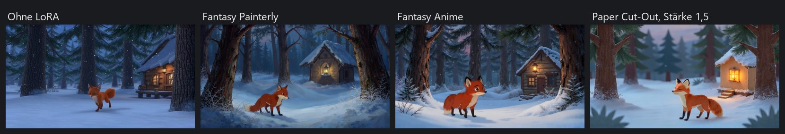

Alle Wege und gemessenen Zeiten: [docs/de/MODELLE.md](docs/de/MODELLE.md#neu-in-058)

### 3D: vom Bild zum Modell

Ein Bild eines Objekts erzeugen und daraus ein GLB-Modell machen. TRELLIS.2 malt die Texturen gleich mit, TripoSG baut nur die Form.

<p align="center">
  
  
</p>

Schrift übersteht den Weg zum Mesh nicht von allein. „Vorderseite aus dem Bild übernehmen“ legt das Quellbild auf die Vorderseite des Meshes:


### Bilder

Vier Modelle sind empfohlen, jedes für etwas anderes. **Krea 2** wirkt am ehesten wie ein Foto und ist am schnellsten, rund 18 s je Bild. **MOSS-Image** ist am stärksten bei Schrift und Layout, rund 57 s, unter Apache-2.0. **Qwen-Image-2512** trifft Details und Konstruktion, rund 100 s, ebenfalls Apache-2.0. **FLUX 3 Image Klein** braucht rund 28 s und bearbeitet ein Bild, ohne den Rest zu verändern. Gleicher Prompt und Seed, je ein Bild:


Auf dem Aufnäher soll „ARES VII“ stehen: MOSS-Image schrieb es am saubersten, Krea 2 schrieb „ARES VIII“. Im ganzen Vergleich stellte nur Qwen-Image-2512 eine Taschenuhr wie verlangt auf zehn nach zehn.

Krea 2 nimmt auch ein Bild als Stilvorlage: Der Leuchtturm behält seinen Inhalt und wird zum Aquarell oder zum Holzschnitt.


MOSS-Image schreibt Plakate und Schilder buchstabengenau. Mit seinen 50 Schritten laufen die Seilgriffe der Kiste durch Bohrungen; mit den 25 aus ComfyUIs Vorlage hingen sie in einem von drei Bildern ohne Halt:


Bearbeiten mit FLUX 3: „replace the rope handles with iron handles, keep everything else unchanged“.


LoRAs bringen einem Modell einen Stil bei, zum Beispiel einen fotografischeren Look:


Die vier empfohlenen Modelle nebeneinander, mit Prompts und Zeiten (englisch): [docs/MODEL_COMPARISON.md](docs/MODEL_COMPARISON.md). Weitere Vergleiche, Prompt-Tipps und Testergebnisse: [docs/de/MODELLE.md](docs/de/MODELLE.md). Alle Bilder in diesem README hat NVAI-open erzeugt.

### Bilder bearbeiten: erweitern und füllen

Ein Bild breiter oder höher machen, und NVAI-open malt den neuen Rand passend dazu. Oder einen Bereich markieren und füllen: Dinge entfernen, neue hinzufügen. Der Rest des Bildes bleibt, wie er war.


### Alte Fotos restaurieren

Kratzer, Staub, Risse, Flecken und Ausbleichen verschwinden, auf Wunsch bekommt das Foto Farbe, und SeedVR2 schärft und vergrößert es. „Gründlich“ rechnet das ganze Foto neu, das passt zu flächiger Alterung wie Wasserflecken und Ausbleichen; „Schonend“ ersetzt nur die beschädigten Stellen und lässt Schärfe und Gesichter genau, wie sie waren, das passt zu Staub, Kratzern und Rissen auf einem sonst guten Foto. „Automatisch“ (Vorgabe) lässt das Bildmodell das Foto ansehen und wählen; bei 20 von 21 Testfotos traf es die bessere Art. Beim Einfärben kommt nur die Farbe von FLUX 3, Helligkeit und Detail bleiben die des Fotos. Bekannte Farben in den Hinweisen machen es genauer. NVAI-open für Mac (0.4.7) kann alles davon nativ auf Apple Silicon: „Automatisch“ mit Qwen3.5 4B, Schärfen mit SeedVR2 3B (auf einem Mac mit 8 GB dauert das Doppelte eines 1-MP-Fotos rund 9 Minuten). Mehr dazu: [docs/de/MODELLE.md](docs/de/MODELLE.md#neu-in-0511).


### Prompt ausbauen

Ein paar Worte eintippen, auf „Prompt ausbauen“ klicken, und NVAI-open schreibt die volle Beschreibung: Ort, Material, Licht, was passiert. Lesen, Ungewolltes streichen, generieren. Das geht für Bilder, Video, Sounds, Musik und 3D.


### Tipps

In jedem Reiter von NVAI-open stehen unter **Empfohlene Einstellungen** die gemessenen Erfahrungen. Die wichtigsten:

- **Bilder:** das Format fürs beste Ergebnis ist vorgewählt (nativ bzw. 2 MP); für eine stehende Figur Hochformat wählen, für ein Fahrzeug Querformat. Ganze englische Sätze mit dem Stil vorn schreiben und 4 Bilder auf einmal zum Auswählen machen. Bei FLUX 3 „Prompt ausbauen lassen“ abschalten, wenn Bauweise oder Anzahl genau stimmen müssen: Der Ausbauer setzte in 4 von 6 Bildern eine zweite Angelschnur dazu, ohne ihn 0 von 2.
- **Krea 2:** den Bildausschnitt nennen („medium shot from the waist up, his whole head inside the frame“); ohne fehlte im Test in 3 von 3 Bildern der Kopf.
- **MOSS-Image:** das fertige Bild beschreiben und die Schrift in Anführungszeichen mit Ort und Schriftart angeben; bei 50 Schritten lassen.
- **Video:** den Prompt kurz halten (4–8 Sätze) und die Ruhe einer Person in einem Satz sagen („sits perfectly still like a statue …“): Mit 8 statt 14 Sätzen bewegte sich die Person im Test rund 40–50 % weniger. Laute Geräusche ausdrücklich nennen, leise beschriebene kommen fast unhörbar. Für eine feste Einstellung „Static camera, a locked-off medium shot“ schreiben; muss der Ausschnitt halten, zusätzlich ein aus dem Startbild bearbeitetes Endbild mitgeben (der Prompt allein fuhr trotzdem heran, 3 von 3). Für eine erkennbare Person das Gesicht groß halten (halbnah oder näher), das Startbild mit FLUX 3 aus einer frontalen Vorlage machen (oder das echte Foto aufs Videoformat erweitern), das Startbild auch als Endbild mitgeben („Schleife“, ruhige Kamera; in einer Nahaufnahme hielt das Gesicht so 5 s, ohne veränderte es sich nach einer Sekunde; der Preis: Wasser und Rauch stehen dann so still wie das Ufer, auch wenn der Prompt sie bewegen will, für bewegten Hintergrund also nur ein Startbild) und solche Clips nicht verlängern. Für eine Handlung mit Gegenständen nur ihr Ergebnis per Maske ins Startbild füllen und das als Endbild mitgeben (ein Fisch im Eimer: ein Fisch mit einer Schwanzflosse, das Gesicht unverändert), und sagen, was die Hände nicht tun sollen. Personen nur mit Gesicht im Bild und gleich beschriebener Stimme sprechen lassen und ein paar Varianten nach Gehör wählen: LTX erfindet die Stimme in jedem Clip neu. Ein gesprochener Satz braucht rund 2 Wörter je Sekunde: 15 Wörter liefen über das Ende einer 6-s-Szene hinaus, 11 passten; Gesten weglassen (selbst „a single quick wave“ dauerte 2,5 s). Zeiten ausschreiben („For the first two seconds nothing happens: …“). Zwei Clips verketten statt hart schneiden (Anschluss-Marker im Studio oder „Verlängern“): Der zweite übernimmt die letzte Sekunde des ersten. „Verlustfreie Kopie für den Schnitt“ anlassen, wenn du die Clips später schneidest; kostet rund 32 MB je Sekunde bei 1080p.
- **MiniMax H3:** in der EU, in Großbritannien, Südkorea und den USA nur mit eigener Lizenz von MiniMax, und nichts damit Erzeugtes veröffentlichen. Es neigt zu Zeitlupe: jede Bewegung mit Tempo beschreiben.
- **3D:** ein Objekt vor schlichtem Hintergrund, ohne Boden und Schatten; beides landet sonst im Mesh.
- **FLUX 3 und LTX-2.5:** die Lizenz auf Hugging Face annehmen und unter „Modelle“ einen Token mit Leserecht eintragen; die Modellkarte zeigt, ob der Zugriff klappt. Schritt für Schritt: [docs/de/HUGGINGFACE.md](docs/de/HUGGINGFACE.md)
- **Alte Fotos:** auf „Automatisch“ lassen; es wählt „Gründlich“ bei flächiger Alterung (Wasserflecken, Rissnetze) und „Schonend“ bei einzelnen Schäden auf einem sonst guten Foto (Staub, Kratzer, Risse). Bekannte Farben in die Hinweise („his suit is dark brown“) und die zwei Varianten in voller Größe vergleichen.

Dieselbe Liste mit den Messwerten, geschrieben für Claude Code: [docs/CLAUDE_CODE.md](docs/CLAUDE_CODE.md#recommended-settings-at-a-glance) (englisch)

### Claude Code: Assets auf Zuruf

NVAI-open bringt einen MCP-Server mit. Einmal eintragen:

```
claude mcp add --scope user nvai -- "<Installationsordner>\server\.venv\Scripts\python.exe" -m nvai.mcp_server
```

Dann einfach sagen: „Mach ein verwittertes Holzfass als 3D-Modell und leg es nach Assets/Generated/Meshes“. Claude wählt ein Modell, fragt vor einem Download, generiert und kopiert das Ergebnis ins Projekt. Einrichtung und alle Werkzeuge: [docs/CLAUDE_CODE.md](docs/CLAUDE_CODE.md) (englisch)

### Grafikkarten und unzensierte Modelle

NVAI-open wählt die passenden Modellfassungen für deine Karte: NVFP4 auf einer RTX 50, INT8 auf RTX 20, 30 und 40 (an einem langsamen Anschluss wie einem Riser NVFP4, wenn nur das in den Speicher passt). Mit mehreren Karten rechnet die stärkste. AMD Radeon läuft experimentell (PyTorch mit ROCm 10; auf einer Radeon RX 9000 die FP8- und bf16-Fassungen); Tester sind in [#2](https://github.com/Mantux775/NVAI-open/issues/2) sehr willkommen. Details: [docs/de/INSTALL.md](docs/de/INSTALL.md)

NVAI-open hat keinen eigenen Inhaltsfilter. Die Modellliste kennzeichnet jedes Modell als zensiert, teilweise zensiert oder unzensiert, und unzensierte wie Chroma, Pony und NoobAI sind einen Klick entfernt. Weitere, auch LoRAs von Hugging Face und Civitai, unter „Modelle“ → „Modelle und LoRAs suchen“. Gesetze und die Lizenz des Modells gelten; die FLUX-3-Lizenz etwa verlangt, jedes Bild vor der Veröffentlichung zu prüfen. Überblick: [docs/de/MODELLE.md](docs/de/MODELLE.md#zensiert-oder-unzensiert)

### Mac-App, PhotoCraft-Add-on, iOS

- **Mac:** eine native App für Apple Silicon mit FLUX.2 Klein und Z-Image Turbo: generieren, überarbeiten, füllen, Referenzbilder, Prompt ausbauen, LoRAs, alte Fotos restaurieren, Musik und Klänge mit Stable Audio 3 (30 Sekunden in rund 13 Sekunden auf einem M1), kurze Videos mit LTX-Video 2B aus Text oder einem Startbild (2 Sekunden in 768 × 512 in rund 95 Sekunden auf einem M1 mit 8 GB; seit 0.5.0 größere Videomodelle für Macs ab 16 GB, LTX-2.3 und LTX-2.5 mit Ton) und seit 0.4.9 das Studio für ganze Videos aus Szenen.
- **Add-on für [PhotoCraft](https://github.com/storytold/photocraft):** in diesem tollen Open-Source-Bildeditor einen Bereich auswählen, füllen, überarbeiten oder restaurieren, das Ergebnis kommt als Ebene zurück. Braucht PhotoCraft ab 0.10.0. Danke an die PhotoCraft-Entwickler für einen so gut steuerbaren Editor.
- **iOS (geschlossene Beta):** ein 3D-Scanner, der aus Fotos echter Gegenstände Modelle macht. Schreibt mir gern in einem Issue, wenn ihr ihn nutzen würdet.

### Voraussetzungen

| | Windows | macOS |
|---|---|---|
| System | Windows 10 (ab 2004) oder 11, 64 Bit | macOS 15 oder neuer, Apple Silicon |
| Grafik / Speicher | empfohlen ab 12 GB VRAM (8 GB gehen mit den INT8-Modellen). NVIDIA: Treiber ab 580.88. AMD Radeon: Treiber ab 26.2.2 | empfohlen ab 16 GB RAM (8 GB reichen für kleine Bilder) |
| Platte | rund 10 GB für das Programm, dazu 5 bis 40 GB pro Modell | rund 1 GB für die App, dazu etwa 10 GB für FLUX.2 Klein |
| Internet | fürs Einrichten (rund 3 GB) und die Modelle | für die Modelle |

Das Windows-Setup ist nicht signiert. Windows zeigt deshalb eventuell „Der Computer wurde durch Windows geschützt“: auf „Weitere Informationen“ und dann „Trotzdem ausführen“ klicken.

### Lizenzen

Der Code steht unter der [MIT-Lizenz](LICENSE): Jeder darf damit machen, was er will. Fremde Komponenten behalten ihre eigenen Lizenzen, siehe [THIRD_PARTY_NOTICES.txt](THIRD_PARTY_NOTICES.txt); ComfyUI (GPL-3.0) wird als eigenständiges Programm mit vollständigem Quelltext mitgeliefert. Modelle sind nicht Teil dieses Repos, jedes hat seine eigene Lizenz, die die Modellliste anzeigt.

### Weiterlesen

- [docs/de/INSTALL.md](docs/de/INSTALL.md): Installation, Bauen aus dem Quelltext, PhotoCraft-Add-on
- [docs/de/MODELLE.md](docs/de/MODELLE.md): die Modelle im Detail, Prompt-Tipps, Testergebnisse
- [docs/de/FOTO_ZU_VIDEO.md](docs/de/FOTO_ZU_VIDEO.md): vom Foto zum Video, Schritt für Schritt
- [docs/de/STUDIO.md](docs/de/STUDIO.md): das Studio, ganze Videos aus Szenen
- [docs/CLAUDE_CODE.md](docs/CLAUDE_CODE.md): NVAI-open aus Claude Code nutzen (englisch)
- [photocraft-addon/](photocraft-addon/): Quelltext des PhotoCraft-Add-ons
