# NVAI-open

A studio for whole videos, plus images, video with sound, speech, music and 3D models on demand, all made on your own computer. Free, private, no account, no subscription, no cloud.

## Download

| | |
|---|---|
| Windows 10/11, NVIDIA or AMD Radeon | [NVAI-open-Setup-0.5.27.exe](https://github.com/Mantux775/NVAI-open/releases/download/v0.5.27/NVAI-open-Setup-0.5.27.exe) |
| macOS 15+ on Apple Silicon, signed and notarized | [NVAI-open-0.5.5.dmg](https://github.com/Mantux775/NVAI-open/releases/download/v0.5.24/NVAI-open-0.5.5.dmg) |

Install, open, download a model under "Models", generate. The setup brings everything else along. [Installation details](docs/INSTALL.md) · [All releases](https://github.com/Mantux775/NVAI-open/releases)

## What's new? / Was gibt's Neues?

November 2026: NVAI-open 0.5.27 for Windows ([release notes](https://github.com/Mantux775/NVAI-open/releases/tag/v0.5.27)); the Mac app stays at 0.5.5

- **Start image in the Studio:** a video scene's properties now have a "Start image" field. Drag an image from the media list onto it or pick one from the project folder. The clip begins with it, so a character looks the same in every shot. Before, only Claude Code could set it over MCP. [Details](docs/STUDIO.md#step-by-step)
- **Spoken lines no longer cut off** (0.5.26): a video that follows a given sound (`audio_asset_id`, or a character speaking in the Studio) is now rounded up to the next frame and the rest filled with silence; before, up to 0.29 s of the end could be missing. In the Studio a speaking clip fills its whole scene, and LTX-2.5 and Wan clips no longer leave black frames at the end of a scene whose length doesn't fit the frame grid.
- **Kandinsky 6 Pro and Lite, with sound** (0.5.25): two more video models that make picture and sound in one pass, 5 s at 864 × 480, from text or a start image (NVIDIA only). What can be heard goes into its own "Sound" field. In the test Pro kept the action and the face, but it takes about 17 minutes for 5 s. **The sound may not be used commercially, and its video VAE is not licensed in the EU.** [Details](docs/MODELS.md#other-video-models)
- **Your own LoRAs** (0.5.24): "Models" → "Add LoRA file" takes a LoRA you trained yourself or got elsewhere. NVAI-open reads the file header first and shows which models it fits; you confirm or change the assignment, also later. When generating, "+ Add your own LoRA file" sits right in the LoRA list. On the Mac for FLUX.2 Klein 4B. [All about LoRAs](docs/LORAS.md)
- **Characters in the Studio** (0.5.24): a character bundles a look (one or more LoRAs) and a voice. Picture scenes show it, voice scenes speak with its voice, and on Windows a video scene with LTX-2.5 speaks a voice line with its lips. [Details](docs/STUDIO.md#characters)
- **MiniMax H3, with a license warning** (since 0.5.18): video with stereo sound, 9 seconds in about 7 minutes. **Its license forbids any use in the EU, the UK, South Korea and the USA without a separate license from MiniMax, and nothing made with it may be published.** The app marks it in red. [Details](docs/MODELS.md#minimax-h3-since-0518)

Neu in 0.5.27 (Mac bleibt 0.5.5):

- **Startbild im Studio:** In den Eigenschaften einer Videoszene gibt es jetzt das Feld „Startbild“. Ein Bild aus dem Material darauf ziehen oder aus dem Projektordner wählen. Der Clip beginnt damit, so sieht eine Figur in jeder Einstellung gleich aus. Bisher ging das nur über Claude Code per MCP. [Einzelheiten](docs/de/STUDIO.md#schritt-für-schritt)
- **Kein abgeschnittenes Satzende mehr** (0.5.26): Ein Video, das einem vorgegebenen Ton folgt (`audio_asset_id` oder eine sprechende Figur im Studio), wird jetzt auf das nächste Bild aufgerundet und der Rest mit Stille gefüllt; vorher konnten bis zu 0,29 s vom Ende fehlen. Im Studio füllt ein sprechender Clip seine ganze Szene, und Clips mit LTX-2.5 und Wan lassen am Ende einer Szene, deren Länge nicht auf das Bildraster passt, keine schwarzen Bilder mehr.
- **Kandinsky 6 Pro und Lite, mit Ton** (0.5.25): zwei weitere Videomodelle, die Bild und Ton in einem Durchgang machen, 5 s in 864 × 480, aus Text oder einem Startbild (nur NVIDIA). Was zu hören ist, kommt in ein eigenes Feld „Ton“. Pro hielt im Test Handlung und Gesicht, braucht aber rund 17 Minuten für 5 s. **Der Ton ist nicht kommerziell nutzbar, und die Video-VAE ist in der EU nicht lizenziert.** [Einzelheiten](docs/de/MODELLE.md#weitere-videomodelle)
- **Eigene LoRAs** (0.5.24): „Modelle“ → „LoRA-Datei hinzufügen“ nimmt eine LoRA, die du selbst trainiert oder anderswo gefunden hast. NVAI-open liest zuerst den Dateikopf und zeigt, zu welchen Modellen sie passt; du bestätigst oder änderst die Zuordnung, auch später. Beim Generieren steht „+ Eigene LoRA-Datei hinzufügen“ direkt in der LoRA-Liste. Auf dem Mac für FLUX.2 Klein 4B. [Alles zu LoRAs](docs/de/LORAS.md)
- **Figuren im Studio** (0.5.24): Eine Figur bündelt Aussehen (eine oder mehrere LoRAs) und Stimme. Bildszenen zeigen sie, Sprecher-Szenen sprechen mit ihrer Stimme, und unter Windows spricht eine Videoszene mit LTX-2.5 einen Satz mit den Lippen. [Einzelheiten](docs/de/STUDIO.md#figuren)
- **MiniMax H3 mit Lizenzwarnung** (seit 0.5.18): Video mit Stereoton, 9 Sekunden in rund 7 Minuten. **Die Lizenz verbietet jede Nutzung in der EU, in Großbritannien, Südkorea und den USA ohne eigene Lizenz von MiniMax, und nichts damit Erzeugtes darf veröffentlicht werden.** Die App markiert es rot. [Einzelheiten](docs/de/MODELLE.md#minimax-h3-seit-0518)

[English](#english) · [Video](#video) · [Deutsch](#deutsch)

---

## English

### Hi

I vibe-coded this app because I needed it myself: images, sounds and 3D models for my game projects, without paying per picture or sending everything to the cloud. Now I'm sharing it. Everything runs on your own graphics card, and nothing leaves your computer.

It is tested on my own hardware: Windows with an RTX 5060 Ti (16 GB) and a Mac mini M1 (8 GB). Feedback is very welcome as an [issue](https://github.com/Mantux775/NVAI-open/issues), easiest with "Report a problem" in the app, which attaches an anonymized report. I have a full-time job, so answers can take a while. All apps are in English and German.

### What you can do

- **Studio:** build a whole video from scenes, cut it and export it with your graphics card's encoder.
- **Swap in a face:** a person from a photo (someone who agreed to it) in a new role, as a start image from FLUX 3 and a video with sound from LTX-2.5.
- **Images:** FLUX 3, Qwen-Image-2512, Krea 2, MOSS-Image and many more. Edit with reference images, fill in or extend a picture.
- **LoRAs:** from Hugging Face, Civitai or your own training; NVAI-open reads the file header and shows which models a LoRA fits.
- **Video with sound:** LTX-2.5 makes picture and sound in one pass, speech included: clips of up to 20 seconds, in up to 1080p.
- **Music and sounds:** instrumental music up to 5 minutes, sound effects.
- **Speech:** a narrator voice you describe in one sentence or take over from a recording, in 10 languages. In the Studio one speaker keeps the same voice over many lines.
- **3D models:** from an image to a textured model for Unity, Blender or any engine.
- **Old photos:** remove scratches, tears and water stains, colorize, sharpen.
- **A few words are enough:** "Expand prompt" writes the full description for you.
- **Claude Code:** Claude creates your assets while it works on your project.
- **No filter of its own:** uncensored models are one click away. You are responsible for what you make.
- **Windows and Mac**, NVIDIA and AMD Radeon, and an add-on for the photo editor PhotoCraft.

### Studio: whole videos from scenes

The Studio is the first tab when NVAI-open starts. At the top you compose: scenes with a prompt on lanes for picture, voice, music and sound, plus markers that say what goes where. At the bottom you edit the real clips. "Generate scenes" makes every clip, still image and piece of music with your local models, "Conform" puts the takes into the edit, and the export uses your graphics card's video encoder at YouTube loudness.

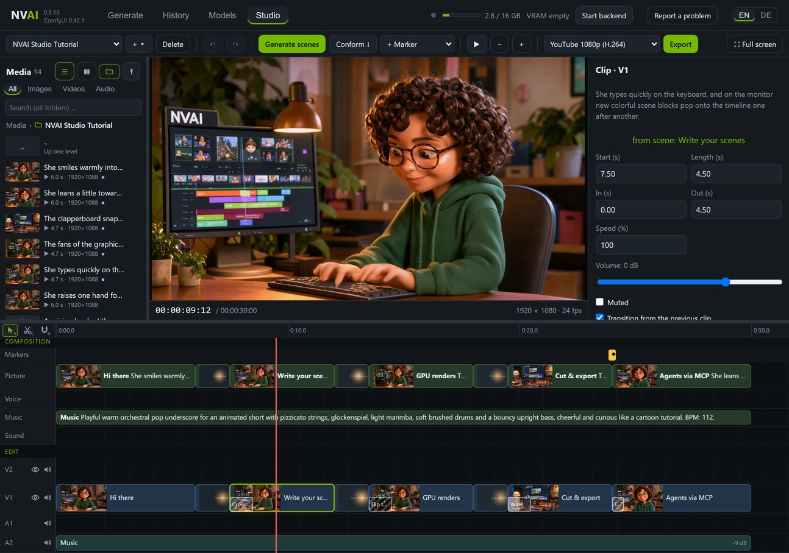

- **Editing:** selection, razor and magnet with their keys, right-click menus, speed in percent, cross dissolve, dips and wipes, zoom with keyframes, video and audio tracks with eye and mute.
- **Generating:** next to "Conform" you see which scene is being made and how far it is; "✕ Cancel" stops the run, finished takes stay.
- **Seamless shots:** a chain marker makes a clip continue the one before it, so two shots join without a jump.
- **Narrator voice:** voice scenes speak their text with Qwen3-TTS; "Same voice as" keeps one speaker over all lines, and each scene takes the length of its line.
- **Characters:** a look from a LoRA (also one you trained yourself) and a voice in one. Picture scenes show them, voice scenes speak with their voice, and a video scene can speak a voice line with its lips.
- **Media:** every project has its own folder for what it generates, exports and uploads. Whole projects can be packed into a ZIP file and opened on another computer.
- **Quality:** video scenes run in the best LTX-2.5 quality and are also kept losslessly; only the export compresses (42.3 instead of 37.7 dB PSNR for a YouTube export).
- **Export:** YouTube 1080p and 4K, Shorts, AV1, a lossless master (MKV) or ProRes 4444 for other editing software.
- **Claude Code** can build the whole video for you over MCP while you watch.
- **Mac:** NVAI-open for Mac has the Studio too, with the same project format.

Step by step: [docs/STUDIO.md](docs/STUDIO.md)

**The short film with the rabbit:** Suomi began as a quick hand sketch. FLUX 3 made a character of it and, as an edit, gave him a tired mood; each shot got a start image, Qwen3-TTS spoke his line, Stable Audio 3 made the music, and LTX-2.5 animated the shots in the Studio, the line with his lips. Claude Code operated the app over MCP, every decision was made by a person, and the 30 seconds took about 50 minutes on one graphics card. [Step by step with screenshots](docs/SHORT_FILM.md) · [The film on YouTube](https://www.youtube.com/watch?v=cDhmiLMU6WQ)

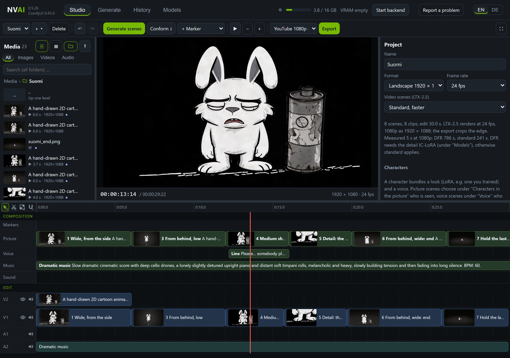

<p align="center">
  <a href="https://www.youtube.com/watch?v=UYrT4YY8gDo"></a>
  <a href="https://www.youtube.com/watch?v=xseQ42CFneY"></a>
</p>
<p align="center"><sub>A tutorial made completely on a local GPU with the Studio, and the update with the Studio for Mac and new local AI models (YouTube).</sub></p>

### From a portrait to a video

<p align="center">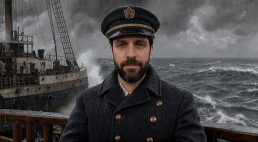</p>
<p align="center"><sub>Made with NVAI-open: a generated photo becomes a ship captain who speaks in a storm. <a href="docs/videos/photo-to-video-captain.mp4">With sound</a></sub></p>

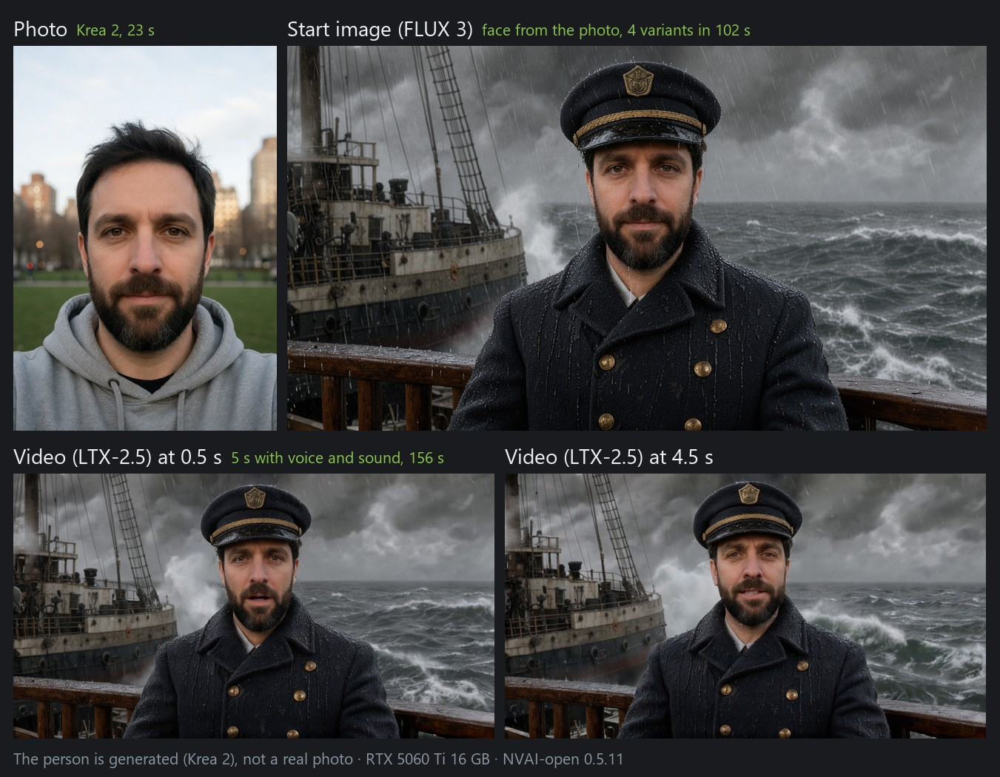

1. **Generate → Image:** create a portrait, or use a photo of someone who agreed to it.
2. **Generate → Video:** pick the portrait as the start image.
3. **Person from a photo:** describe the role. FLUX 3 keeps the face and makes four start images; pick the one that looks most alike.
4. **Prompt:** describe what moves, what the camera does and what the person says. LTX-2.5 makes the video with speech and sound.
5. **Keep the face:** tick "Loop" (with a still camera) or give an end image. Without one, the face changed after a second in our test. The price: water and smoke stand still too.

Step by step with screenshots: [docs/PHOTO_TO_VIDEO.md](docs/PHOTO_TO_VIDEO.md)

### Video with sound

LTX-2.5 by Lightricks makes picture and sound together: speech, footsteps, wind, music. Start from a text, a start image or a start and an end image, make a seamless loop, let the picture follow a sound you give it, or extend a clip you already have.

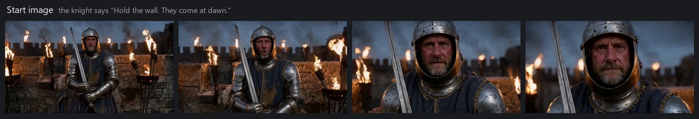

Under the video model, "Recommended LoRAs" adds styles with one click, such as painted fantasy or anime:

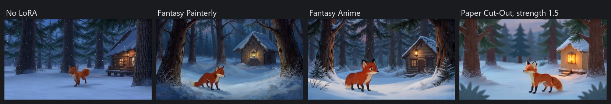

A finished clip can be doubled afterwards: "Upscale ×2" under a video in the History (RelayVSR, 5 s from 1080p to 4K in under two minutes):

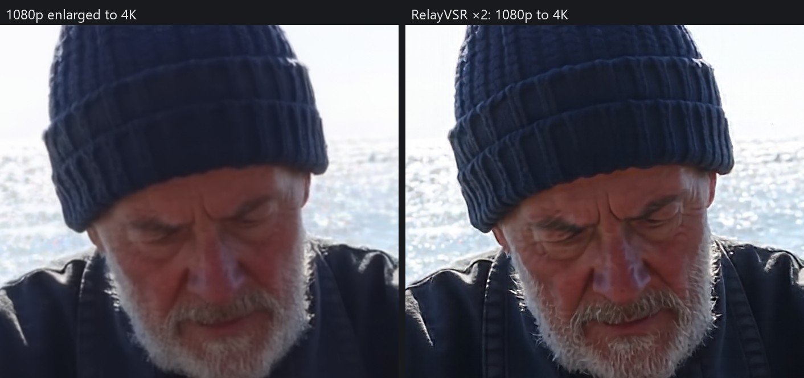

All ways and measured times: [docs/MODELS.md](docs/MODELS.md#ltx-25)

### 3D: from an image to a model

Generate an image of an object and turn it into a GLB model. TRELLIS.2 paints the textures too, TripoSG builds the shape only.

<p align="center">
  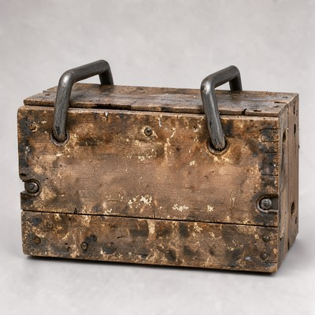
  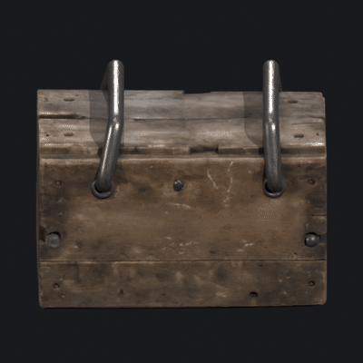
</p>

Lettering gets lost on the way to the mesh. "Take the front from the image" puts the source image onto the front of the model:

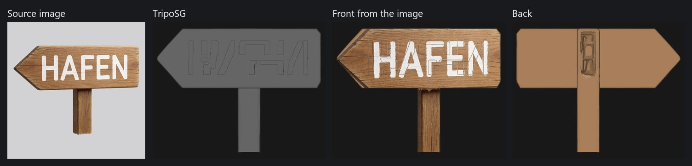

### Images

Four models are recommended, each for something else. **Krea 2** looks the most like a photo (about 18 s per image). **MOSS-Image** is strongest at lettering and layout (about 57 s, Apache-2.0). **Qwen-Image-2512** gets details and construction right (about 100 s, Apache-2.0). **FLUX 3 Image Klein** edits a picture and keeps the rest intact (about 28 s). Same prompt and seed, one image each:


The patch should read "ARES VII": MOSS-Image wrote it the cleanest, Krea 2 wrote "ARES VIII".

Krea 2 also takes an image as a style template: the lighthouse keeps its content and becomes a watercolor or a woodcut.

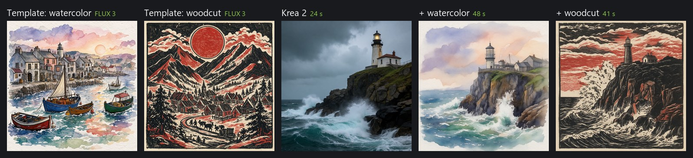

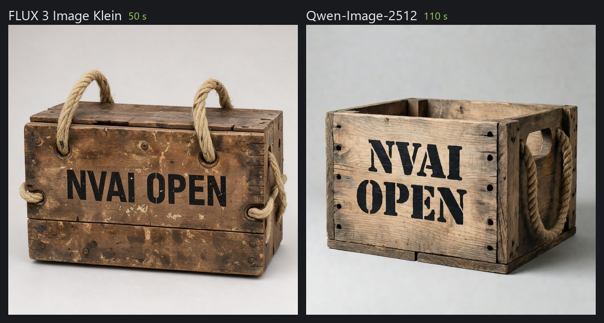

MOSS-Image writes posters and signs letter-perfect. With its 50 steps the crate's rope handles pass through drilled holes; with 25 they hung without a hold in one of three images:

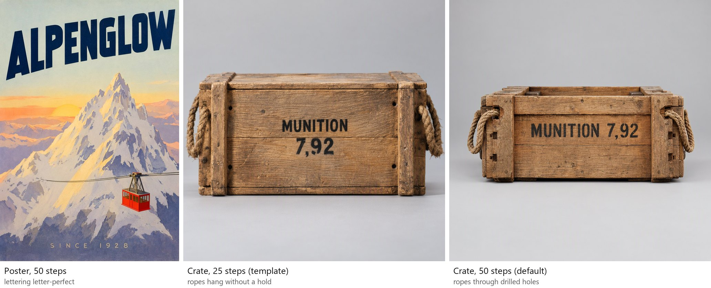

Editing with FLUX 3: "replace the rope handles with iron handles, keep everything else unchanged".

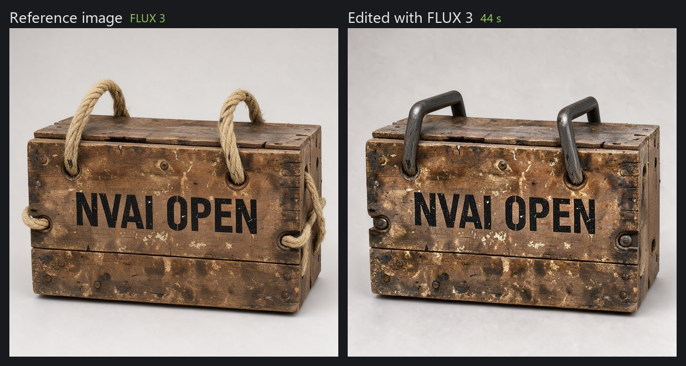

LoRAs teach a model a style, for example a more photographic look:

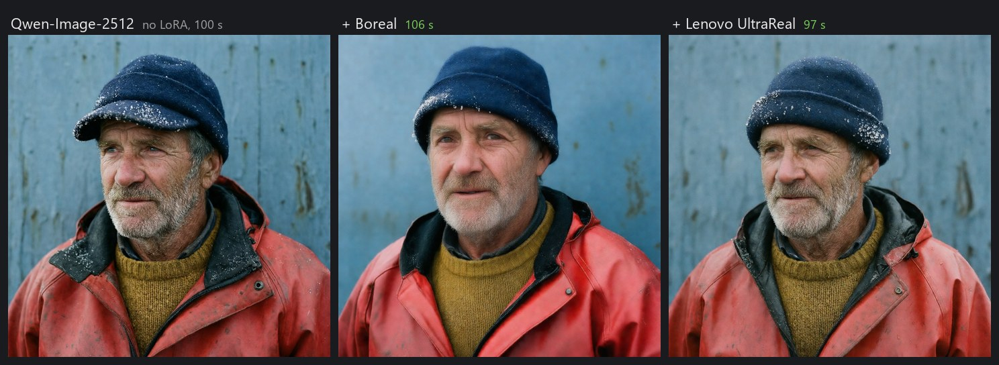

Which models take LoRAs, adding one you trained yourself and the LoRAs we tested: [docs/LORAS.md](docs/LORAS.md).

The four models side by side, with prompts and times: [docs/MODEL_COMPARISON.md](docs/MODEL_COMPARISON.md). More comparisons and prompt tips: [docs/MODELS.md](docs/MODELS.md). All images in this README were made with NVAI-open.

### Edit pictures: extend and fill

Make a picture wider or taller, and NVAI-open paints the new border to match. Or mark an area and fill it: remove things, add new ones. The rest of the picture stays as it was.

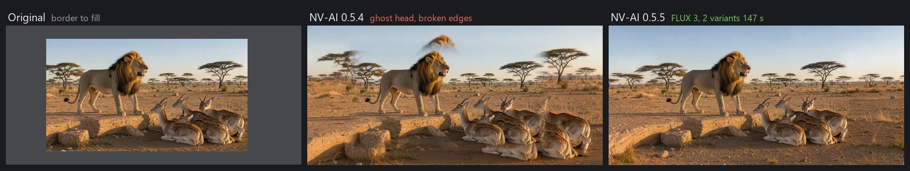

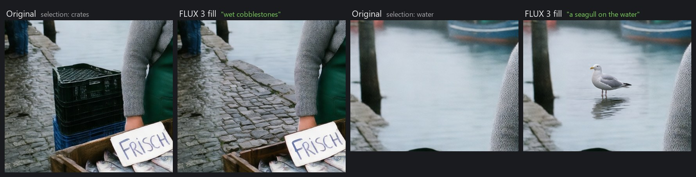

### Restore old photos

Scratches, dust, tears, stains and fading go away, the photo gets color if you like, and SeedVR2 sharpens and enlarges it. "Automatic" looks at the photo and decides how much to redraw: the whole picture for overall aging such as water stains, only the damaged spots for dust and scratches on an otherwise good photo. It chose right on 20 of 21 test photos. Colorizing only adds color; brightness and detail stay the photo's own. NVAI-open for Mac does all of it natively. Details: [docs/MODELS.md](docs/MODELS.md#old-photos)

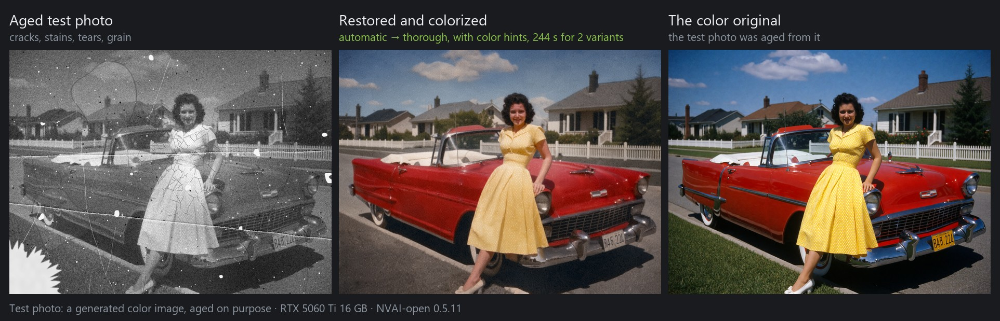

### Expand prompt

Type a few words, click "Expand prompt", and NVAI-open writes the full description: setting, materials, light, what happens. Read it, delete what you don't want, generate. Works for images, video, sounds, music and 3D.

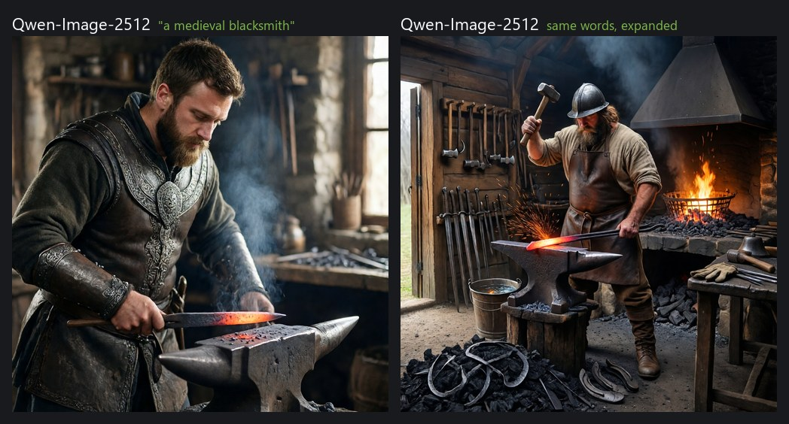

### Tips

Every tab has a **Recommended settings** box with what we measured. The most important points:

- **Images:** the best size is preselected; pick portrait for a standing figure and landscape for a vehicle. Write whole English sentences with the style first, and make 4 images to choose from.
- **FLUX 3:** switch off "Expand the prompt" when construction or counts must be exact (otherwise it added a second fishing line in 4 of 6 images).
- **Krea 2:** name the framing ("medium shot from the waist up, his whole head inside the frame"), or the head may be cut off.
- **MOSS-Image:** describe the finished picture, put the text in quotation marks with position and typeface, and leave it at 50 steps.
- **Video:** keep the prompt short (4–8 sentences) and name loud sounds explicitly; sounds described as soft come out almost inaudible.
- **Faces in video:** keep the face large, make the start image with FLUX 3 from a frontal photo and tick "Loop" or give an end image. Let people speak only with their face in the shot, about 2 words per second, and make a few variants to pick by ear.
- **Two clips without a seam:** use the chain marker in the Studio or "Extend"; the second clip takes over the last second of the first.
- **Upscaling:** "Upscale ×2" in the History doubles a finished video (5 s from 1080p to 4K in 104 s). Generated directly at 1080p it is still a little finer, so use it for 4K exports and smaller clips.
- **MiniMax H3:** only with a separate license from MiniMax in the EU, the UK, South Korea and the USA, and never publish what it makes. It tends to slow motion, so describe the pace of every movement.
- **Narrator voice:** describe gender, age, pitch, pace and mood in one sentence. The same description sounds different with every seed, so pick the best take and use it as the recording for all further lines.
- **3D:** one object on a plain background, without floor or shadow; both would end up in the mesh.
- **FLUX 3 and LTX-2.5:** accept the license on Hugging Face and store a read token under "Models". Step by step: [docs/HUGGINGFACE.md](docs/HUGGINGFACE.md)
- **Old photos:** leave it on "Automatic", put known colors into the hints ("his suit is dark brown") and compare both variants at full size.

The same list with the measurements, written for Claude Code: [docs/CLAUDE_CODE.md](docs/CLAUDE_CODE.md#recommended-settings-at-a-glance)

### Claude Code: your assets on request

NVAI-open comes with an MCP server. Register it once:

```
claude mcp add --scope user nvai -- "<install folder>\server\.venv\Scripts\python.exe" -m nvai.mcp_server
```

Then just ask: "Make a weathered wooden barrel as a 3D model and put it into Assets/Generated/Meshes". Claude picks a model, asks before a download, generates, and copies the result into your project. Setup and all tools: [docs/CLAUDE_CODE.md](docs/CLAUDE_CODE.md)

### Graphics cards and uncensored models

NVAI-open picks the right model versions for your card: NVFP4 on an RTX 50, INT8 on RTX 20, 30 and 40. With several cards it uses the strongest one. AMD Radeon works experimentally (PyTorch with ROCm); testers are very welcome in [#2](https://github.com/Mantux775/NVAI-open/issues/2). Details: [docs/INSTALL.md](docs/INSTALL.md)

NVAI-open has no content filter of its own. The model list marks every model as censored, partly censored or uncensored, and more models and LoRAs from Hugging Face and Civitai are under "Models" → "Search models and LoRAs". Respect the law and each model's license; the FLUX 3 license, for example, requires a review of every image before it is published. Overview: [docs/MODELS.md](docs/MODELS.md#censored-or-uncensored)

### Mac app, PhotoCraft add-on, iOS

- **Mac:** a native app for Apple Silicon. Images with FLUX.2 Klein and Z-Image Turbo (generate, edit, fill, reference images, LoRAs), restoring old photos, music and sounds with Stable Audio 3, short videos with LTX-Video (bigger video models with sound from 16 GB of memory) and the Studio. On a Mac mini M1 with 8 GB, 30 seconds of music take about 13 seconds and 2 seconds of video about 95 seconds.
- **[PhotoCraft](https://github.com/storytold/photocraft) add-on:** select an area in this great open-source photo editor, fill it, rework it or restore it, and the result comes back as a layer. Needs PhotoCraft 0.10.0 or newer. Thanks to the PhotoCraft developers for such a well-scriptable editor.
- **iOS (closed beta):** a 3D scanner that turns photos of real objects into models. Tell me in an issue if you would use it.

### Requirements

| | Windows | macOS |
|---|---|---|
| System | Windows 10 (2004+) or 11, 64-bit | macOS 15 or newer, Apple Silicon |
| Graphics / memory | 12 GB+ VRAM recommended (8 GB works with the INT8 models). NVIDIA: driver 580.88+. AMD Radeon: driver 26.2.2+ | 16 GB RAM or more recommended (8 GB works for small images) |
| Disk | about 10 GB for the program, plus 5 to 40 GB per model | about 1 GB for the app, plus about 10 GB for FLUX.2 Klein |
| Internet | for setup (about 3 GB) and model downloads | for model downloads |

The Windows setup is not code-signed, so Windows may show "Windows protected your PC": click "More info", then "Run anyway".

### Licenses

The code is under the [MIT License](LICENSE): do whatever you want with it. Third-party components keep their own licenses, see [THIRD_PARTY_NOTICES.txt](THIRD_PARTY_NOTICES.txt); ComfyUI (GPL-3.0) is shipped as a separate program with its full source. Models are not part of this repository; each has its own license, shown in the model list.

### More

- [docs/INSTALL.md](docs/INSTALL.md): installing, building from source, the PhotoCraft add-on
- [docs/MODELS.md](docs/MODELS.md): the models in detail, prompt tips, test results
- [docs/PHOTO_TO_VIDEO.md](docs/PHOTO_TO_VIDEO.md): from a photo to a video, step by step
- [docs/STUDIO.md](docs/STUDIO.md): the Studio, whole videos from scenes
- [docs/CLAUDE_CODE.md](docs/CLAUDE_CODE.md): using NVAI-open from Claude Code
- [docs/MAKING_OF.md](docs/MAKING_OF.md): how Claude built a video in the Studio
- [docs/SHORT_FILM.md](docs/SHORT_FILM.md): a short film from a hand sketch, step by step with screenshots
- [photocraft-addon/](photocraft-addon/): source of the PhotoCraft add-on

---

## Video

<p align="center">
  <a href="https://www.youtube.com/watch?v=cDhmiLMU6WQ"></a>
</p>

<p align="center">A short film with the rabbit Suomi, from a hand sketch to the export in the Studio, on YouTube (<a href="docs/SHORT_FILM.md">how it was made</a>).<br>
Ein Kurzfilm mit dem Hasen Suomi, von der Handskizze bis zum Export im Studio, auf YouTube (<a href="docs/de/KURZFILM.md">wie er entstand</a>).<br>
<a href="https://www.youtube.com/watch?v=cDhmiLMU6WQ">youtube.com/watch?v=cDhmiLMU6WQ</a></p>

<p align="center">
  <a href="https://www.youtube.com/shorts/e9jSTwgwnrI">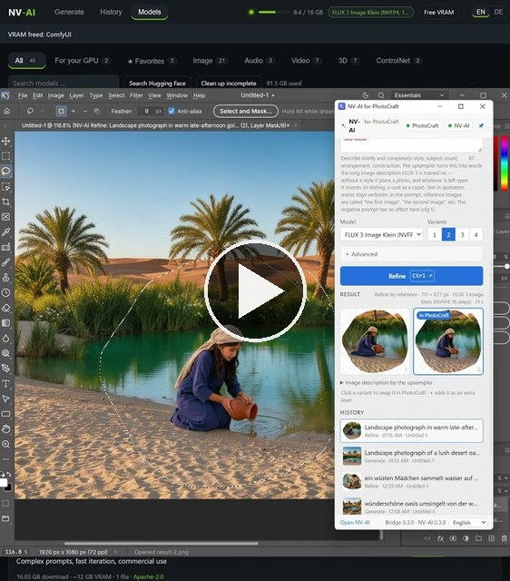</a>
</p>

<p align="center">NVAI-open and the PhotoCraft add-on in action, a short on YouTube.<br>
NVAI-open und das PhotoCraft-Add-on in Aktion, ein kurzes Video auf YouTube.<br>
<a href="https://www.youtube.com/shorts/e9jSTwgwnrI">youtube.com/shorts/e9jSTwgwnrI</a></p>

<p align="center">
  <a href="https://www.youtube.com/watch?v=UYrT4YY8gDo"></a>
</p>

<p align="center">The Studio in action: a tutorial made completely on a local GPU, on YouTube.<br>
Das Studio in Aktion: ein Tutorial, komplett auf der eigenen Grafikkarte gemacht, auf YouTube.<br>
<a href="https://www.youtube.com/watch?v=UYrT4YY8gDo">youtube.com/watch?v=UYrT4YY8gDo</a></p>

<p align="center">
  <a href="https://www.youtube.com/watch?v=xseQ42CFneY"></a>
</p>

<p align="center">The update: the Studio for Mac and new local AI models, on YouTube.<br>
Das Update: das Studio für den Mac und neue lokale KI-Modelle, auf YouTube.<br>
<a href="https://www.youtube.com/watch?v=xseQ42CFneY">youtube.com/watch?v=xseQ42CFneY</a></p>

---

## Deutsch

### Hallo

Ich habe diese App „vibegecodet“, weil ich sie selbst brauchte: Bilder, Sounds und 3D-Modelle für meine Spieleprojekte, ohne pro Bild zu zahlen oder alles in die Cloud zu schicken. Jetzt teile ich sie. Alles rechnet auf deiner eigenen Grafikkarte, nichts verlässt deinen Rechner.

Getestet ist sie auf meiner eigenen Hardware: Windows mit RTX 5060 Ti (16 GB) und ein Mac mini M1 (8 GB). Über Feedback als [Issue](https://github.com/Mantux775/NVAI-open/issues) freue ich mich sehr, am einfachsten mit „Problem melden“ in der App, das hängt einen anonymisierten Bericht an. Ich habe einen Vollzeitjob, Antworten können also dauern. Alle Apps gibt es auf Deutsch und Englisch.

### Was geht damit?

- **Studio:** ein ganzes Video aus Szenen bauen, schneiden und mit dem Encoder der Grafikkarte exportieren.
- **Gesicht tauschen:** eine Person aus einem Foto (die damit einverstanden ist) in einer neuen Rolle, als Startbild von FLUX 3 und als Video mit Ton von LTX-2.5.
- **Bilder:** FLUX 3, Qwen-Image-2512, Krea 2, MOSS-Image und viele weitere. Mit Referenzbildern bearbeiten, Bereiche füllen, Bilder erweitern.
- **LoRAs:** von Hugging Face, Civitai oder aus eigenem Training; NVAI-open liest den Dateikopf und zeigt, zu welchen Modellen eine LoRA passt.
- **Video mit Ton:** LTX-2.5 macht Bild und Ton in einem Durchgang, samt Sprache: Clips bis 20 Sekunden, bis 1080p.
- **Musik und Sounds:** instrumentale Musik bis 5 Minuten, Soundeffekte.
- **Sprache:** eine Sprecherstimme, die du in einem Satz beschreibst oder aus einer Aufnahme übernimmst, in 10 Sprachen. Im Studio behält ein Sprecher über viele Zeilen dieselbe Stimme.
- **3D-Modelle:** aus einem Bild ein texturiertes Modell für Unity, Blender oder jede Engine.
- **Alte Fotos:** Kratzer, Risse und Wasserflecken entfernen, einfärben, schärfen.
- **Ein paar Worte reichen:** „Prompt ausbauen“ schreibt die volle Beschreibung für dich.
- **Claude Code:** Claude erzeugt deine Assets, während es an deinem Projekt arbeitet.
- **Kein eigener Filter:** unzensierte Modelle sind einen Klick entfernt. Für das, was du erzeugst, bist du selbst verantwortlich.
- **Windows und Mac**, NVIDIA und AMD Radeon, dazu ein Add-on für den Bildeditor PhotoCraft.

### Studio: ganze Videos aus Szenen

Das Studio ist der erste Reiter, wenn NVAI-open startet. Oben komponierst du: Szenen mit Prompt auf Bahnen für Bild, Sprecher, Musik und Klang, dazu Marker, die sagen, was wohin kommt. Unten schneidest du die echten Clips. „Szenen erzeugen“ macht alle Clips, Standbilder und Musikstücke mit deinen lokalen Modellen, „Übernehmen“ legt die Takes in den Schnitt, und der Export nutzt den Video-Encoder deiner Grafikkarte, in der Lautheit von YouTube.

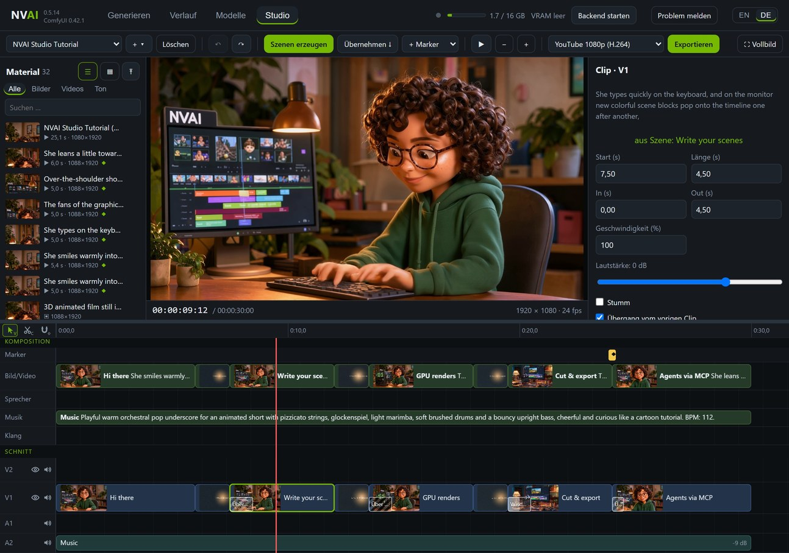

- **Schneiden:** Auswahl, Schneiden und Magnet mit ihren Tasten, Rechtsklick-Menüs, Geschwindigkeit in Prozent, Überblendung, Abblende und Wischblende, Zoomen mit Keyframes, Video- und Tonspuren mit Auge und Stummschalter.
- **Erzeugen:** Neben „Übernehmen“ siehst du, welche Szene gerade entsteht und wie weit sie ist; „✕ Abbrechen“ beendet den Lauf, fertige Takes bleiben.
- **Nahtlose Einstellungen:** Ein Anschluss-Marker lässt einen Clip den vorigen fortsetzen, so gehen zwei Einstellungen ohne Sprung ineinander über.
- **Sprecherstimme:** Sprecher-Szenen sprechen ihren Text mit Qwen3-TTS; „Gleiche Stimme wie“ hält einen Sprecher über alle Zeilen, und jede Szene wird so lang wie ihre Zeile.
- **Figuren:** Aussehen aus einer LoRA (auch einer selbst trainierten) und Stimme in einem. Bildszenen zeigen sie, Sprecher-Szenen sprechen mit ihrer Stimme, und eine Videoszene spricht einen Satz mit den Lippen.
- **Material:** Jedes Projekt hat einen eigenen Ordner für das, was es erzeugt, exportiert und hochlädt. Ganze Projekte lassen sich als ZIP-Datei packen und auf einem anderen Rechner öffnen.
- **Qualität:** Videoszenen laufen in der höchsten Qualität von LTX-2.5 und werden zusätzlich verlustfrei aufbewahrt; komprimiert wird erst beim Export (42,3 statt 37,7 dB PSNR bei einem YouTube-Export).
- **Export:** YouTube 1080p und 4K, Shorts, AV1, ein verlustfreier Master (MKV) oder ProRes 4444 für andere Schnittprogramme.
- **Claude Code** baut dir auf Wunsch das ganze Video per MCP, während du zusiehst.
- **Mac:** NVAI-open für Mac hat das Studio auch, mit demselben Projektformat.

Schritt für Schritt: [docs/de/STUDIO.md](docs/de/STUDIO.md)

**Der Kurzfilm mit dem Hasen:** Suomi begann als schnelle Handskizze. FLUX 3 machte daraus eine Figur und gab ihr als Bearbeitung eine müde Stimmung; jede Einstellung bekam ein Startbild, Qwen3-TTS sprach seinen Satz, Stable Audio 3 machte die Musik, und LTX-2.5 bewegte die Einstellungen im Studio, den Satz mit seinen Lippen. Claude Code bediente die App über MCP, die Entscheidungen traf ein Mensch, und die 30 Sekunden brauchten rund 50 Minuten auf einer Grafikkarte. [Schritt für Schritt mit Bildern](docs/de/KURZFILM.md) · [Der Film auf YouTube](https://www.youtube.com/watch?v=cDhmiLMU6WQ)

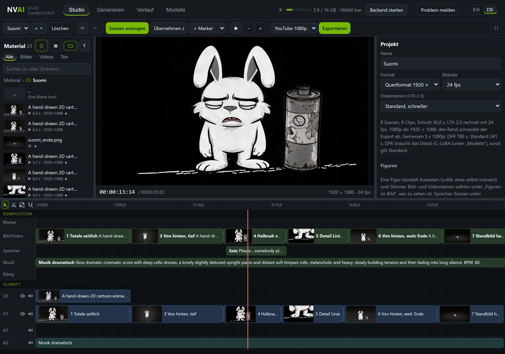

<p align="center">
  <a href="https://www.youtube.com/watch?v=UYrT4YY8gDo"></a>
  <a href="https://www.youtube.com/watch?v=xseQ42CFneY"></a>
</p>
<p align="center"><sub>Ein Tutorial, komplett auf der eigenen Grafikkarte mit dem Studio gemacht, und das Update mit dem Studio für den Mac und neuen lokalen KI-Modellen (YouTube).</sub></p>

### Vom Porträt zum Video

<p align="center"></p>
<p align="center"><sub>Mit NVAI-open gemacht: Aus einem erzeugten Foto wird ein Schiffskapitän, der im Sturm spricht. <a href="docs/videos/photo-to-video-captain.mp4">Mit Ton</a></sub></p>

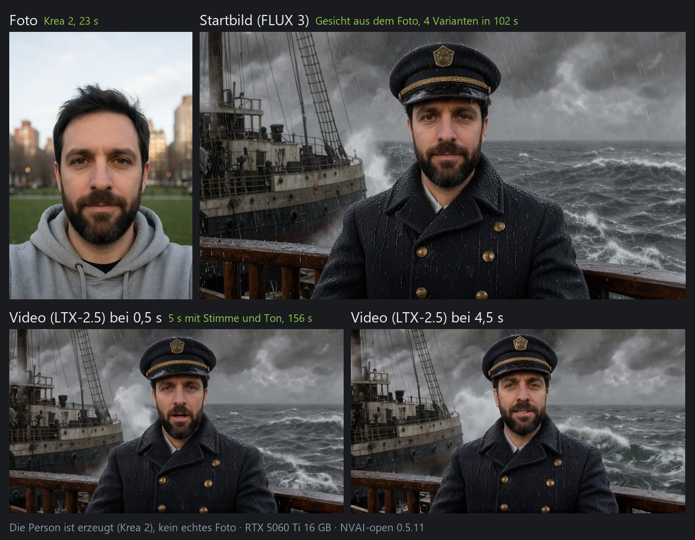

1. **Generieren → Bild:** ein Porträt erzeugen oder das Foto eines Menschen nehmen, der damit einverstanden ist.
2. **Generieren → Video:** das Porträt als Startbild wählen.
3. **Person aus einem Foto:** die Rolle beschreiben. FLUX 3 übernimmt das Gesicht und macht vier Startbilder; das ähnlichste auswählen.
4. **Prompt:** beschreiben, was sich bewegt, was die Kamera macht und was die Person sagt. LTX-2.5 macht daraus das Video mit Sprache und Ton.
5. **Gesicht halten:** „Schleife“ anhaken (mit ruhiger Kamera) oder ein Endbild mitgeben. Ohne veränderte sich das Gesicht im Test nach einer Sekunde. Der Preis: Wasser und Rauch stehen dann auch still.

Schritt für Schritt mit Screenshots: [docs/de/FOTO_ZU_VIDEO.md](docs/de/FOTO_ZU_VIDEO.md)

### Video mit Ton

LTX-2.5 von Lightricks macht Bild und Ton zusammen: Sprache, Schritte, Wind, Musik. Starten lässt es sich mit einem Text, einem Startbild oder einem Start- und einem Endbild; es macht nahtlose Schleifen, das Bild kann einem vorgegebenen Ton folgen, und ein vorhandener Clip lässt sich verlängern.

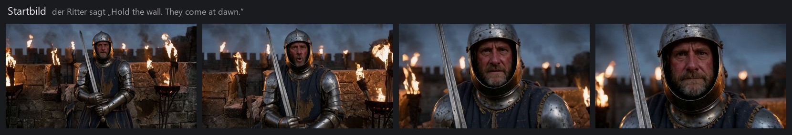

Unter dem Videomodell fügt „Empfohlene LoRAs“ Stile mit einem Klick hinzu, etwa gemalte Fantasy oder Anime:

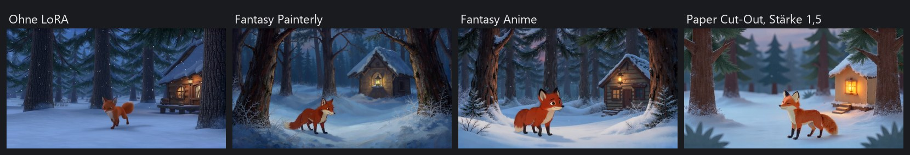

Ein fertiger Clip lässt sich danach verdoppeln: „Hochskalieren ×2“ unter einem Video im Verlauf (RelayVSR, 5 s von 1080p auf 4K in unter zwei Minuten):


Alle Wege und gemessenen Zeiten: [docs/de/MODELLE.md](docs/de/MODELLE.md#ltx-25)

### 3D: vom Bild zum Modell

Ein Bild eines Objekts erzeugen und daraus ein GLB-Modell machen. TRELLIS.2 malt die Texturen gleich mit, TripoSG baut nur die Form.

<p align="center">
  
  
</p>

Schrift geht auf dem Weg zum Mesh verloren. „Vorderseite aus dem Bild übernehmen“ legt das Quellbild auf die Vorderseite des Modells:


### Bilder

Vier Modelle sind empfohlen, jedes für etwas anderes. **Krea 2** wirkt am ehesten wie ein Foto (rund 18 s je Bild). **MOSS-Image** ist am stärksten bei Schrift und Layout (rund 57 s, Apache-2.0). **Qwen-Image-2512** trifft Details und Konstruktion (rund 100 s, Apache-2.0). **FLUX 3 Image Klein** bearbeitet ein Bild und lässt den Rest, wie er ist (rund 28 s). Gleicher Prompt und Seed, je ein Bild:

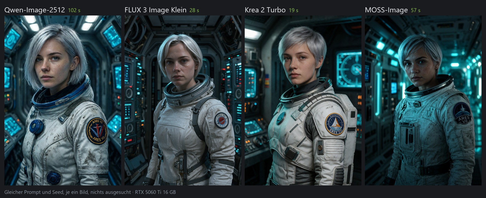

Auf dem Aufnäher soll „ARES VII“ stehen: MOSS-Image schrieb es am saubersten, Krea 2 schrieb „ARES VIII“.

Krea 2 nimmt auch ein Bild als Stilvorlage: Der Leuchtturm behält seinen Inhalt und wird zum Aquarell oder zum Holzschnitt.


MOSS-Image schreibt Plakate und Schilder buchstabengenau. Mit seinen 50 Schritten laufen die Seilgriffe der Kiste durch Bohrungen; mit 25 hingen sie in einem von drei Bildern ohne Halt:

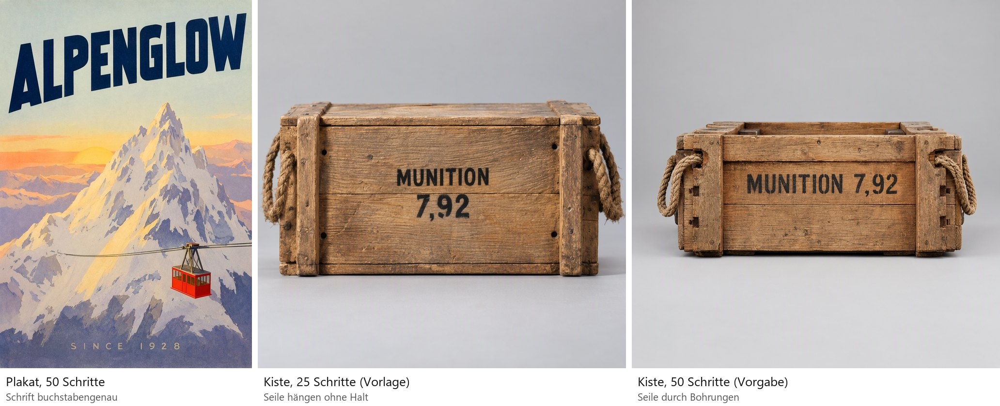

Bearbeiten mit FLUX 3: „replace the rope handles with iron handles, keep everything else unchanged“.


LoRAs bringen einem Modell einen Stil bei, zum Beispiel einen fotografischeren Look:


Welche Modelle LoRAs nehmen, eine selbst trainierte hinzufügen und die getesteten LoRAs: [docs/de/LORAS.md](docs/de/LORAS.md).

Die vier Modelle nebeneinander, mit Prompts und Zeiten (englisch): [docs/MODEL_COMPARISON.md](docs/MODEL_COMPARISON.md). Weitere Vergleiche und Prompt-Tipps: [docs/de/MODELLE.md](docs/de/MODELLE.md). Alle Bilder in diesem README hat NVAI-open erzeugt.

### Bilder bearbeiten: erweitern und füllen

Ein Bild breiter oder höher machen, und NVAI-open malt den neuen Rand passend dazu. Oder einen Bereich markieren und füllen: Dinge entfernen, neue hinzufügen. Der Rest des Bildes bleibt, wie er war.


### Alte Fotos restaurieren

Kratzer, Staub, Risse, Flecken und Ausbleichen verschwinden, auf Wunsch bekommt das Foto Farbe, und SeedVR2 schärft und vergrößert es. „Automatisch“ sieht sich das Foto an und entscheidet, wie viel neu gemalt wird: das ganze Bild bei flächiger Alterung wie Wasserflecken, nur die beschädigten Stellen bei Staub und Kratzern auf einem sonst guten Foto. Bei 20 von 21 Testfotos lag es richtig. Beim Einfärben kommt nur die Farbe dazu, Helligkeit und Detail bleiben die des Fotos. NVAI-open für Mac kann alles davon nativ. Mehr dazu: [docs/de/MODELLE.md](docs/de/MODELLE.md#alte-fotos)


### Prompt ausbauen

Ein paar Worte eintippen, auf „Prompt ausbauen“ klicken, und NVAI-open schreibt die volle Beschreibung: Ort, Material, Licht, was passiert. Lesen, Ungewolltes streichen, generieren. Das geht für Bilder, Video, Sounds, Musik und 3D.


### Tipps

In jedem Reiter steht unter **Empfohlene Einstellungen**, was wir gemessen haben. Das Wichtigste:

- **Bilder:** Das beste Format ist vorgewählt; für eine stehende Figur Hochformat, für ein Fahrzeug Querformat. Ganze englische Sätze mit dem Stil vorn schreiben und 4 Bilder zum Auswählen machen.
- **FLUX 3:** „Prompt ausbauen lassen“ abschalten, wenn Bauweise oder Anzahl genau stimmen müssen (sonst kam in 4 von 6 Bildern eine zweite Angelschnur dazu).
- **Krea 2:** den Bildausschnitt nennen („medium shot from the waist up, his whole head inside the frame“), sonst fehlt womöglich der Kopf.
- **MOSS-Image:** das fertige Bild beschreiben, die Schrift in Anführungszeichen mit Ort und Schriftart angeben und bei 50 Schritten lassen.
- **Video:** den Prompt kurz halten (4–8 Sätze) und laute Geräusche ausdrücklich nennen; leise beschriebene kommen fast unhörbar.
- **Gesichter im Video:** das Gesicht groß halten, das Startbild mit FLUX 3 aus einem frontalen Foto machen und „Schleife“ anhaken oder ein Endbild mitgeben. Personen nur mit Gesicht im Bild sprechen lassen, rund 2 Wörter je Sekunde, und ein paar Varianten nach Gehör wählen.
- **Zwei Clips ohne Naht:** den Anschluss-Marker im Studio oder „Verlängern“ nehmen; der zweite Clip übernimmt die letzte Sekunde des ersten.
- **Hochskalieren:** „Hochskalieren ×2“ im Verlauf verdoppelt ein fertiges Video (5 s von 1080p auf 4K in 104 s). Direkt in 1080p erzeugt ist es noch etwas feiner; gut für 4K-Exporte und kleinere Clips.
- **MiniMax H3:** in der EU, in Großbritannien, Südkorea und den USA nur mit eigener Lizenz von MiniMax, und nichts damit Erzeugtes veröffentlichen. Es neigt zu Zeitlupe, also jede Bewegung mit Tempo beschreiben.
- **Sprecherstimme:** Geschlecht, Alter, Tonlage, Tempo und Stimmung in einem Satz beschreiben. Dieselbe Beschreibung klingt mit jedem Seed anders, also die beste Probe wählen und sie als Aufnahme für alle weiteren Zeilen nehmen.
- **3D:** ein Objekt vor schlichtem Hintergrund, ohne Boden und Schatten; beides landet sonst im Mesh.
- **FLUX 3 und LTX-2.5:** die Lizenz auf Hugging Face annehmen und unter „Modelle“ einen Token mit Leserecht eintragen. Schritt für Schritt: [docs/de/HUGGINGFACE.md](docs/de/HUGGINGFACE.md)
- **Alte Fotos:** auf „Automatisch“ lassen, bekannte Farben in die Hinweise schreiben („his suit is dark brown“) und die zwei Varianten in voller Größe vergleichen.

Dieselbe Liste mit den Messwerten, geschrieben für Claude Code: [docs/CLAUDE_CODE.md](docs/CLAUDE_CODE.md#recommended-settings-at-a-glance) (englisch)

### Claude Code: Assets auf Zuruf

NVAI-open bringt einen MCP-Server mit. Einmal eintragen:

```
claude mcp add --scope user nvai -- "<Installationsordner>\server\.venv\Scripts\python.exe" -m nvai.mcp_server
```

Dann einfach sagen: „Mach ein verwittertes Holzfass als 3D-Modell und leg es nach Assets/Generated/Meshes“. Claude wählt ein Modell, fragt vor einem Download, generiert und kopiert das Ergebnis ins Projekt. Einrichtung und alle Werkzeuge: [docs/CLAUDE_CODE.md](docs/CLAUDE_CODE.md) (englisch)

### Grafikkarten und unzensierte Modelle

NVAI-open wählt die passenden Modellfassungen für deine Karte: NVFP4 auf einer RTX 50, INT8 auf RTX 20, 30 und 40. Mit mehreren Karten rechnet die stärkste. AMD Radeon läuft experimentell (PyTorch mit ROCm); Tester sind in [#2](https://github.com/Mantux775/NVAI-open/issues/2) sehr willkommen. Details: [docs/de/INSTALL.md](docs/de/INSTALL.md)

NVAI-open hat keinen eigenen Inhaltsfilter. Die Modellliste kennzeichnet jedes Modell als zensiert, teilweise zensiert oder unzensiert, und weitere Modelle und LoRAs von Hugging Face und Civitai gibt es unter „Modelle“ → „Modelle und LoRAs suchen“. Gesetze und die Lizenz des Modells gelten; die FLUX-3-Lizenz etwa verlangt, jedes Bild vor der Veröffentlichung zu prüfen. Überblick: [docs/de/MODELLE.md](docs/de/MODELLE.md#zensiert-oder-unzensiert)

### Mac-App, PhotoCraft-Add-on, iOS

- **Mac:** eine native App für Apple Silicon. Bilder mit FLUX.2 Klein und Z-Image Turbo (generieren, überarbeiten, füllen, Referenzbilder, LoRAs), alte Fotos restaurieren, Musik und Klänge mit Stable Audio 3, kurze Videos mit LTX-Video (größere Videomodelle mit Ton ab 16 GB Speicher) und das Studio. Auf einem Mac mini M1 mit 8 GB dauern 30 Sekunden Musik rund 13 Sekunden und 2 Sekunden Video rund 95 Sekunden.
- **Add-on für [PhotoCraft](https://github.com/storytold/photocraft):** in diesem tollen Open-Source-Bildeditor einen Bereich auswählen, füllen, überarbeiten oder restaurieren, das Ergebnis kommt als Ebene zurück. Braucht PhotoCraft ab 0.10.0. Danke an die PhotoCraft-Entwickler für einen so gut steuerbaren Editor.
- **iOS (geschlossene Beta):** ein 3D-Scanner, der aus Fotos echter Gegenstände Modelle macht. Schreibt mir gern in einem Issue, wenn ihr ihn nutzen würdet.

### Voraussetzungen

| | Windows | macOS |
|---|---|---|
| System | Windows 10 (ab 2004) oder 11, 64 Bit | macOS 15 oder neuer, Apple Silicon |
| Grafik / Speicher | empfohlen ab 12 GB VRAM (8 GB gehen mit den INT8-Modellen). NVIDIA: Treiber ab 580.88. AMD Radeon: Treiber ab 26.2.2 | empfohlen ab 16 GB RAM (8 GB reichen für kleine Bilder) |
| Platte | rund 10 GB für das Programm, dazu 5 bis 40 GB pro Modell | rund 1 GB für die App, dazu etwa 10 GB für FLUX.2 Klein |
| Internet | fürs Einrichten (rund 3 GB) und die Modelle | für die Modelle |

Das Windows-Setup ist nicht signiert. Windows zeigt deshalb eventuell „Der Computer wurde durch Windows geschützt“: auf „Weitere Informationen“ und dann „Trotzdem ausführen“ klicken.

### Lizenzen

Der Code steht unter der [MIT-Lizenz](LICENSE): Jeder darf damit machen, was er will. Fremde Komponenten behalten ihre eigenen Lizenzen, siehe [THIRD_PARTY_NOTICES.txt](THIRD_PARTY_NOTICES.txt); ComfyUI (GPL-3.0) wird als eigenständiges Programm mit vollständigem Quelltext mitgeliefert. Modelle sind nicht Teil dieses Repos; jedes hat seine eigene Lizenz, die die Modellliste anzeigt.

### Weiterlesen

- [docs/de/INSTALL.md](docs/de/INSTALL.md): Installation, Bauen aus dem Quelltext, PhotoCraft-Add-on
- [docs/de/MODELLE.md](docs/de/MODELLE.md): die Modelle im Detail, Prompt-Tipps, Testergebnisse
- [docs/de/FOTO_ZU_VIDEO.md](docs/de/FOTO_ZU_VIDEO.md): vom Foto zum Video, Schritt für Schritt
- [docs/de/STUDIO.md](docs/de/STUDIO.md): das Studio, ganze Videos aus Szenen
- [docs/CLAUDE_CODE.md](docs/CLAUDE_CODE.md): NVAI-open aus Claude Code nutzen (englisch)
- [docs/de/MAKING_OF.md](docs/de/MAKING_OF.md): wie Claude ein Video im Studio gebaut hat
- [docs/de/KURZFILM.md](docs/de/KURZFILM.md): ein Kurzfilm von der Handskizze an, Schritt für Schritt mit Bildern
- [photocraft-addon/](photocraft-addon/): Quelltext des PhotoCraft-Add-ons
