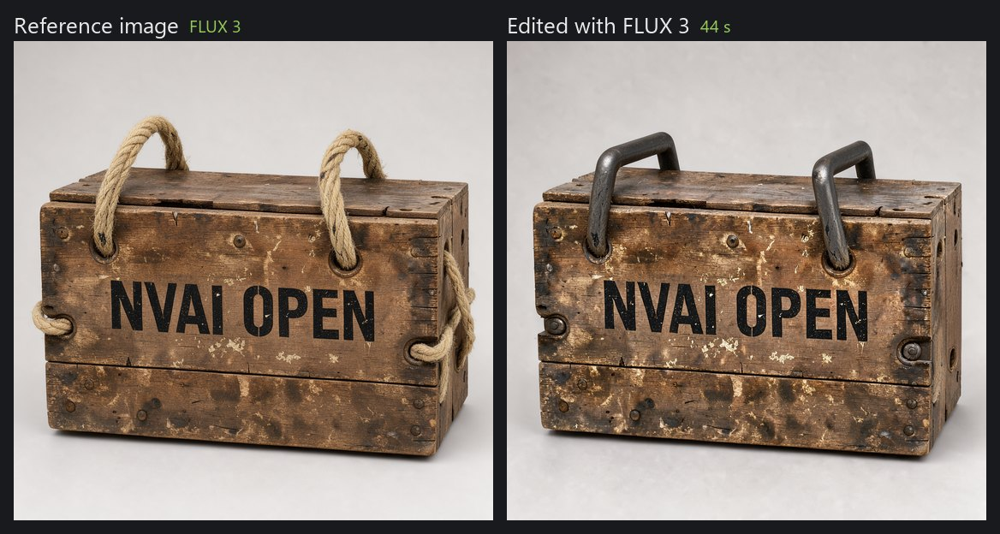
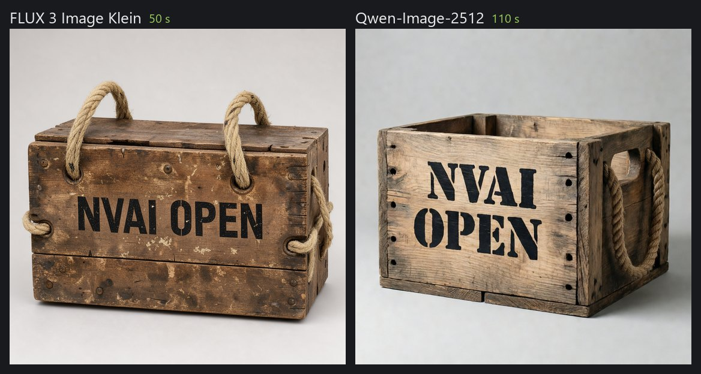
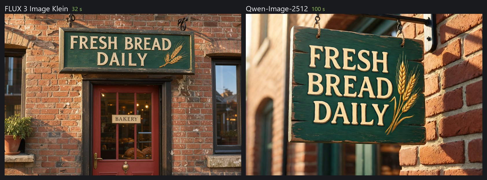
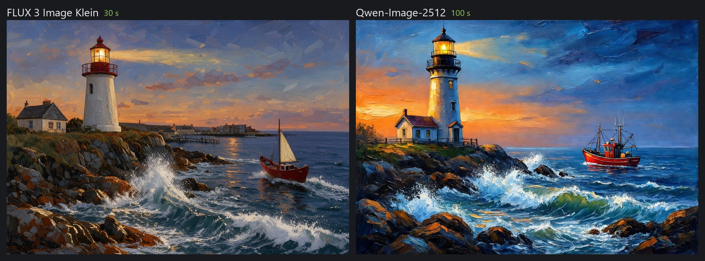
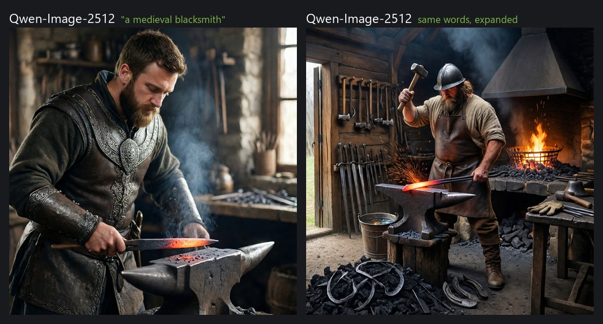

# NVAI-open

Local image, audio, video and 3D generation on your own computer. No cloud, no subscription, no account.

**Download**

| | |
|---|---|
| **Windows 10/11** with an NVIDIA graphics card | [NV-AI-Setup-0.3.1.exe](https://github.com/Mantux775/NVAI-open/releases/download/v0.3.1/NV-AI-Setup-0.3.1.exe) |
| **macOS 15+** on Apple Silicon (signed and notarized) | NV-AI-0.3.0.dmg follows shortly – Apple is still checking the signed build. / Wird in Kürze nachgereicht. |

All releases: [github.com/Mantux775/NVAI-open/releases](https://github.com/Mantux775/NVAI-open/releases)

[English](#english) · [Video](#video) · [Deutsch](#deutsch)

---

## English

### Hi

I vibe-coded this app because I needed it myself, and I'd like to share it.

A bit about me: I used to build small web apps for everyday needs and did all sorts of little projects with Raspberry Pis. The usual IT admin life. NV-AI started the same way: I wanted to make images, sounds and 3D models for my own game projects without paying per picture or sending everything to the cloud.

It has only been tested on my modest hardware: a Windows PC with an RTX 5060 Ti (16 GB) and 64 GB RAM, and a Mac mini M1 with 8 GB. Feedback is very welcome, please open an [issue](https://github.com/Mantux775/NVAI-open/issues). Just keep in mind that I have a full-time job, so answers and fixes can take a while.

NV-AI was built primarily in German. The English interface and docs are new, so you may still find German code comments or a clumsy phrase here and there. Hints are welcome. German stays available as an option in all apps.

### What it does

**On Windows** (NVIDIA graphics card) NV-AI runs a small local server with a web interface in your browser:

- **Images**: FLUX 3 Image Klein, Qwen-Image-2512 and more. Text to image, editing with reference images, inpainting with a mask.
- **✨ Expand prompt**: turns a few words into a full image description, for every image model (next version).
- **3D models**: turn an image into a 3D model (GLB), with PBR textures via TRELLIS.2 or as a plain shape via TripoSG.
- **Audio and video**: sound effects and music (Stable Audio Open, ACE-Step), short clips (Wan, LTX-Video).
- **Model manager**: downloads models from Hugging Face, suggests the ones that fit your graphics card, and has a search for more models. Before anything is downloaded, NV-AI checks whether the file will actually run.
- **Claude Code**: an MCP server, so Claude can generate assets for you directly (see [docs/CLAUDE_CODE.md](docs/CLAUDE_CODE.md)).

**On the Mac** (Apple Silicon) NV-AI is a native app. It runs FLUX.2 Klein 4B with MLX: generate, refine, fill with a mask, and use up to three reference images. Smaller Stable Diffusion models run through Core ML.

**PhotoCraft add-on**: [PhotoCraft](https://github.com/storytold/photocraft) is a great open-source photo editor. The optional add-on connects it to NV-AI. Select an area in PhotoCraft and fill it, generate something new or rework it, and the result comes back as a layer with a mask. Thanks a lot to the PhotoCraft developers for building such a well-scriptable editor. The add-on needs PhotoCraft 0.10.0 or newer.

Everything runs on your own machine. Models are downloaded from Hugging Face the first time you use them.

### FLUX 3 Image Klein: the new favorite

FLUX 3 Image Klein from Black Forest Labs came out in October 2026 and it works really well. It is fast (about 30 seconds for a new prompt on my RTX 5060 Ti, around 15 seconds when you only change the seed), and it does something none of the other models here can do: it edits images. Give it a picture, say what should change and what should stay, and it keeps the rest of the image intact.

*Prompt: "Replace the rope handles with forged iron handles bolted to the side boards; keep everything else unchanged." One reference image, 44 seconds.*

It also takes up to ten reference images, keeps characters consistent across pictures, and lets you place objects with bounding boxes. A built-in prompt upsampler turns a short prompt into a full image description before rendering.

On RTX 50 cards NV-AI uses the NVFP4 version. On RTX 20, 30 and 40 cards it recommends the official INT8 version instead, which according to Black Forest Labs runs on 8 GB cards.

### Where Qwen-Image-2512 is better

Qwen-Image-2512 is slower (about 100 seconds at full quality), but it has its strengths:

- **Construction details**: how things are built usually makes more sense. In my tests, rope handles went through drilled holes and boots matched the outfit.
- **Text**: lettering comes out reliably.
- **License**: Apache-2.0, without the revenue limit and review duty of the FLUX license.

Same prompt and seed, left FLUX 3, right Qwen-Image-2512:

*"Studio product photograph of a weathered wooden crate. Black stenciled letters on the front read "NVAI OPEN". Rope handles pass through drilled holes in the side boards. Plain light grey background, soft even light."*

*"A hand-painted wooden shop sign hangs above a bakery door. The sign reads "FRESH BREAD DAILY" in cream letters on dark green paint, with a small painted wheat sheaf. Morning sunlight falls on the red brick wall."*

The explorer also has a third column: Qwen-Image 2.1, same prompt, seed and size (832 × 1216). It is in the catalog from the next NV-AI version on. **Its license (Qwen Research License) allows no commercial use**, so it is for trying things out, not for assets in a product you sell.

*"Full body studio photograph of a woman explorer in a 1920s safari outfit with a pith helmet, leather boots and a canvas satchel, standing in three-quarter view, both boots fully inside the frame. Plain light grey background, even soft studio light."*

*"A painted illustration in oil on canvas with visible brush strokes. A lighthouse stands on a rocky coast at dusk, waves crash against the rocks, and warm light glows in the lantern room. A small red fishing boat returns to the harbor. The sky fades from orange to deep blue."*

Times were measured on my PC: NVIDIA GeForce RTX 5060 Ti with 16 GB VRAM, 64 GB RAM, Windows 11, with the model already loaded (the first image after a start takes longer because the model has to load). For the explorer at 832 × 1216:

| Model | Steps | Time |
|---|---|---|
| FLUX 3 Image Klein (NVFP4) | 16, plus the prompt upsampler | about 32 s |
| Qwen-Image-2512 (NVFP4) | 50 | about 98 s |
| Qwen-Image 2.1 (INT8, non-commercial) | 25 | about 21 s |

All images in this README were generated with NV-AI.

### ✨ Expand prompt: from a few words to a real picture

New in the next version. Type a few words, click **✨ Expand prompt**, and NV-AI writes a full image description from them: setting, materials, light, what happens in the picture. You read it, remove what you don't want, and generate. It works with every image model, not just FLUX 3, and also in the PhotoCraft add-on on Windows and for Claude Code (`expand_prompt`).

It uses the prompt upsampler that comes with FLUX 3 Image Klein (Qwen3.5-9B, Apache-2.0), so FLUX 3 has to be downloaded once. On my RTX 5060 Ti it takes about 15 seconds; the very first time after a start, with ComfyUI starting up, about 35.

Same model, same seed (31), left only the three words, right the expanded text after I removed what the upsampler had invented:

With just the words, Qwen-Image-2512 made a warrior in decorated leather armor holding a glowing blade over the anvil, with neither hammer nor tongs. The upsampler turned the three words into a whole forge, but it also invented things nobody asked for: an iron helmet on the smith's head, a rack of swords and spearheads, sparks before the hammer even strikes, and a bar bending into a hook. In an earlier test those details made the image worse; the hammer even fused with the glowing bar. So I deleted them from the text and generated again: now the smith holds the glowing bar on the anvil with tongs and has the hammer ready, with hearth, water bucket and tools on the wall around him. That is the intended way to use it: expand, read, delete what is wrong, generate.

### 3D: from an image to a model

Make an image of an object, then turn it into a 3D model. **For textures, use TRELLIS.2** (MIT license): it builds the geometry and paints color, metal and roughness as PBR textures (2048²) with UVs, so the GLB file goes straight into Unity, Blender or the game engine of your choice. On my card a model takes about 75 seconds, the first one after a start about two and a half minutes because the model has to load. It needs about 14 GB VRAM and a 16 GB download once. TripoSG (MIT) only builds the grey shape; it is the choice if you put your own materials on anyway.

  
  

Left the image (FLUX 3), right the 3D model made from it: TRELLIS.2, PBR textures, 95,000 faces.

Wood grain, wear, the iron handles and the bolts come out well. Lettering does not: TRELLIS.2 paints its own texture instead of copying the photo. On this crate "NVAI OPEN" turned into made-up characters, even at the higher 1024 resolution (which took 15 minutes instead of 75 seconds). So I had FLUX 3 remove the lettering from the image first, with a single edit. Put text and decals on afterwards in your engine, and plan some cleanup (retopology) before a model goes into a game.

3D is part of the Windows setup (choose "Full installation"). TRELLIS.2 is available when you install from source; the 3D page of the web interface points this out and offers the download.

### iOS app (closed beta)

There is also an iOS app with a 3D model scanner that turns photos of real objects into 3D models. It is in closed beta for now. If enough people are interested, I'll make it public, so tell me in an issue if you would use it.

### Requirements

| | Windows | macOS |
|---|---|---|
| System | Windows 10 (2004+) or 11, 64-bit | macOS 15 or newer, Apple Silicon |
| Graphics / memory | NVIDIA card with driver 580.88+, 12 GB+ VRAM recommended (8 GB works with the INT8 models) | 16 GB RAM or more recommended (8 GB works for small images) |
| Disk | about 10 GB for the program, plus 5 to 30 GB per model | about 1 GB for the app, plus about 10 GB for FLUX.2 Klein |
| Internet | for setup (about 3 GB) and model downloads | for model downloads |

The Windows setup is not code-signed yet, so Windows may show "Windows protected your PC". Click "More info", then "Run anyway". Details: [docs/INSTALL.md](docs/INSTALL.md).

### Licenses

The code in this repository is under the [MIT License](LICENSE): do whatever you want with it. Third-party components keep their own licenses, see [THIRD_PARTY_NOTICES.txt](THIRD_PARTY_NOTICES.txt). ComfyUI (GPL-3.0) is shipped as a separate program with its full source code.

Models are not part of this repository. Each model has its own license, which NV-AI shows in its model list. Two to know about:

- **FLUX 3 Image Klein**: FLUX Kommunity License. Commercial use of the images only below USD 5 million annual revenue, and every image has to be checked before publishing.
- **Qwen-Image-2512** and **FLUX.2 Klein 4B**: Apache-2.0.

### More

- [docs/INSTALL.md](docs/INSTALL.md): installing, building from source, the PhotoCraft add-on
- [docs/MODELS.md](docs/MODELS.md): the image models in detail, prompt tips, test results
- [docs/CLAUDE_CODE.md](docs/CLAUDE_CODE.md): using NV-AI from Claude Code
- [photocraft-addon/](photocraft-addon/): source of the PhotoCraft add-on

---

## Video

  

<b>NV-AI and the PhotoCraft add-on in action</b>, a short on YouTube. 
<b>NV-AI und das PhotoCraft-Add-on in Aktion</b>, ein kurzes Video auf YouTube. 
<a href="https://www.youtube.com/shorts/e9jSTwgwnrI">youtube.com/shorts/e9jSTwgwnrI</a>

---

## Deutsch

### Hallo

Ich habe diese App aus eigenem Bedarf „vibegecodet“ und möchte sie mit anderen teilen.

Kurz zu mir: Früher habe ich kleine Webapps für alltägliche Bedürfnisse gebastelt und mit dem Raspberry Pi diverse kleine Projekte umgesetzt. Der Alltag in der IT als Admin eben. NV-AI ist genauso entstanden: Ich wollte Bilder, Sounds und 3D-Modelle für meine eigenen Spieleprojekte erzeugen, ohne pro Bild zu zahlen oder alles in die Cloud zu schicken.

Getestet ist die App nur auf meiner bescheidenen Hardware: einem Windows-PC mit RTX 5060 Ti (16 GB) und 64 GB RAM und einem Mac mini M1 mit 8 GB. Über Feedback freue ich mich sehr, am besten als [Issue](https://github.com/Mantux775/NVAI-open/issues). Bitte habt Verständnis, dass ich einen Vollzeitjob habe. Antworten und Korrekturen können also etwas dauern.

NV-AI ist primär auf Deutsch entstanden. Die englische Oberfläche und Doku sind neu, deshalb finden sich im Code noch deutsche Kommentare. Deutsch bleibt in allen Apps als Sprache wählbar.

### Was es kann

**Unter Windows** (NVIDIA-Grafikkarte) läuft NV-AI als kleiner lokaler Server mit Weboberfläche im Browser:

- **Bilder**: FLUX 3 Image Klein, Qwen-Image-2512 und weitere. Text zu Bild, Bearbeiten mit Referenzbildern, Füllen mit Maske.
- **✨ Prompt ausbauen**: macht aus wenigen Worten eine volle Bildbeschreibung, für jedes Bildmodell (nächste Version).
- **3D-Modelle**: aus einem Bild ein 3D-Modell (GLB), mit PBR-Texturen über TRELLIS.2 oder als reine Form über TripoSG.
- **Audio und Video**: Soundeffekte und Musik (Stable Audio Open, ACE-Step), kurze Clips (Wan, LTX-Video).
- **Modellverwaltung**: lädt Modelle von Hugging Face, schlägt die zur Grafikkarte passenden vor und hat eine Suche nach weiteren Modellen. Vor jedem Download prüft NV-AI, ob die Datei hier überhaupt läuft.
- **Claude Code**: ein MCP-Server, über den Claude direkt Assets erzeugen kann (siehe [docs/CLAUDE_CODE.md](docs/CLAUDE_CODE.md)).

**Auf dem Mac** (Apple Silicon) ist NV-AI eine native App. Sie rechnet FLUX.2 Klein 4B mit MLX: Generieren, Überarbeiten, Füllen mit Maske und bis zu drei Referenzbilder. Kleinere Stable-Diffusion-Modelle laufen über Core ML.

**PhotoCraft-Add-on**: [PhotoCraft](https://github.com/storytold/photocraft) ist ein toller Open-Source-Bildeditor. Das optionale Add-on verbindet ihn mit NV-AI. Einen Bereich in PhotoCraft auswählen und füllen, neu generieren oder überarbeiten, das Ergebnis kommt als Ebene mit Maske zurück. Vielen Dank an die PhotoCraft-Entwickler für einen so gut steuerbaren Editor. Das Add-on braucht PhotoCraft ab Version 0.10.0.

Alles läuft auf dem eigenen Rechner. Modelle lädt NV-AI bei der ersten Nutzung von Hugging Face.

### FLUX 3 Image Klein: der neue Favorit

FLUX 3 Image Klein von Black Forest Labs ist im Oktober 2026 erschienen und funktioniert richtig gut. Es ist schnell (auf meiner RTX 5060 Ti rund 30 Sekunden bei einem neuen Prompt, etwa 15 Sekunden, wenn nur der Seed wechselt), und es kann etwas, was die anderen Modelle hier nicht können: Bilder bearbeiten. Man gibt ein Bild vor, sagt, was sich ändern und was bleiben soll, und der Rest des Bildes bleibt erhalten.

*Prompt: „Replace the rope handles with forged iron handles bolted to the side boards; keep everything else unchanged.“ Ein Referenzbild, 44 Sekunden.*

Dazu nimmt es bis zu zehn Referenzbilder, hält Figuren über mehrere Bilder gleich und platziert Objekte per Bounding-Box. Ein eingebauter Prompt-Upsampler baut einen kurzen Prompt vorher zur vollständigen Bildbeschreibung aus.

Auf RTX-50-Karten nutzt NV-AI die NVFP4-Fassung. Auf RTX 20, 30 und 40 empfiehlt es stattdessen die offizielle INT8-Fassung, die laut Black Forest Labs schon auf 8-GB-Karten läuft.

### Wo Qwen-Image-2512 besser ist

Qwen-Image-2512 ist langsamer (rund 100 Sekunden in voller Qualität), hat aber seine Stärken:

- **Konstruktive Details**: Wie Dinge gebaut sind, stimmt meist besser. In meinen Tests liefen Seilgriffe durch gebohrte Löcher, und die Stiefel passten zur Kleidung.
- **Schrift**: Beschriftungen kommen zuverlässig.
- **Lizenz**: Apache-2.0, ohne Umsatzgrenze und Prüfpflicht der FLUX-Lizenz.

Gleicher Prompt und Seed, links FLUX 3, rechts Qwen-Image-2512:

*Prompt: „Studio product photograph of a weathered wooden crate. Black stenciled letters on the front read "NVAI OPEN". Rope handles pass through drilled holes in the side boards. Plain light grey background, soft even light.“*

*Prompt: „A hand-painted wooden shop sign hangs above a bakery door. The sign reads "FRESH BREAD DAILY" in cream letters on dark green paint, with a small painted wheat sheaf. Morning sunlight falls on the red brick wall.“*

Bei der Entdeckerin gibt es eine dritte Spalte: Qwen-Image 2.1, gleicher Prompt, Seed und Format (832 × 1216). Es steht ab der nächsten NV-AI-Version im Katalog. **Seine Lizenz (Qwen Research License) erlaubt keine kommerzielle Nutzung**, es ist also zum Ausprobieren da, nicht für Assets in einem Produkt, das man verkauft.

*Prompt: „Full body studio photograph of a woman explorer in a 1920s safari outfit with a pith helmet, leather boots and a canvas satchel, standing in three-quarter view, both boots fully inside the frame. Plain light grey background, even soft studio light.“*

*Prompt: „A painted illustration in oil on canvas with visible brush strokes. A lighthouse stands on a rocky coast at dusk, waves crash against the rocks, and warm light glows in the lantern room. A small red fishing boat returns to the harbor. The sky fades from orange to deep blue.“*

Die Zeiten sind auf meinem PC gemessen: NVIDIA GeForce RTX 5060 Ti mit 16 GB VRAM, 64 GB RAM, Windows 11, mit bereits geladenem Modell (das erste Bild nach dem Start dauert länger, weil das Modell erst geladen wird). Für die Entdeckerin in 832 × 1216:

| Modell | Schritte | Zeit |
|---|---|---|
| FLUX 3 Image Klein (NVFP4) | 16, dazu der Prompt-Upsampler | rund 32 s |
| Qwen-Image-2512 (NVFP4) | 50 | rund 98 s |
| Qwen-Image 2.1 (INT8, nicht kommerziell) | 25 | rund 21 s |

Alle Bilder in diesem README hat NV-AI erzeugt.

### ✨ Prompt ausbauen: aus wenigen Worten ein richtiges Bild

Neu in der nächsten Version. Ein paar Worte eintippen, auf **✨ Prompt ausbauen** klicken, und NV-AI schreibt daraus eine volle Bildbeschreibung: Ort, Material, Licht, was im Bild passiert. Man liest sie, streicht, was nicht passt, und generiert. Das geht mit jedem Bildmodell, nicht nur mit FLUX 3, und auch im PhotoCraft-Add-on unter Windows und für Claude Code (`expand_prompt`).

Dahinter steckt der Prompt-Upsampler, der mit FLUX 3 Image Klein kommt (Qwen3.5-9B, Apache-2.0). FLUX 3 muss also einmal geladen sein. Auf meiner RTX 5060 Ti dauert das Ausbauen rund 15 Sekunden, beim allerersten Mal nach dem Start, wenn ComfyUI noch hochfährt, rund 35.

Gleiches Modell, gleicher Seed (31), links nur die drei Worte, rechts der ausgebaute Text, nachdem ich gestrichen hatte, was der Upsampler erfunden hatte:

Mit den drei Worten machte Qwen-Image-2512 einen Krieger in verzierter Lederrüstung, der eine glühende Klinge über den Amboss hält, ohne Hammer und ohne Zange. Der Upsampler machte aus den drei Worten eine ganze Schmiede, erfand aber auch Dinge, die niemand verlangt hatte: einen Eisenhelm auf dem Kopf des Schmieds, einen Ständer mit Schwertern und Speerspitzen, Funken, bevor der Hammer überhaupt trifft, und einen Stab, der sich zum Haken biegt. In einem früheren Versuch machten genau diese Details das Bild schlechter, der Hammer verschmolz sogar mit dem glühenden Stab. Also habe ich sie aus dem Text gestrichen und neu generiert: Jetzt hält der Schmied den glühenden Stab mit der Zange auf dem Amboss und hat den Hammer bereit, ringsum Esse, Wassereimer und Werkzeug an der Wand. So ist es gedacht: ausbauen, lesen, Falsches streichen, generieren.

### 3D: vom Bild zum Modell

Erst ein Bild eines Objekts erzeugen, dann daraus ein 3D-Modell machen. **Für Texturen TRELLIS.2 nehmen** (MIT-Lizenz): Es baut die Geometrie und malt Farbe, Metall und Rauheit als PBR-Texturen (2048²) mit UVs, die GLB-Datei geht also direkt nach Unity, Blender oder in die Engine der Wahl. Auf meiner Karte dauert ein Modell rund 75 Sekunden, das erste nach dem Start rund zweieinhalb Minuten, weil das Modell erst geladen wird. Es braucht etwa 14 GB VRAM und einmal 16 GB Download. TripoSG (MIT) baut nur die graue Form; das passt, wenn ohnehin eigene Materialien draufkommen.

  
  

Links das Bild (FLUX 3), rechts das daraus gebaute 3D-Modell: TRELLIS.2, PBR-Texturen, 95.000 Faces.

Holzmaserung, Abnutzung, die Eisengriffe und die Schrauben kommen gut heraus. Schrift nicht: TRELLIS.2 malt die Textur selbst, statt das Foto zu kopieren. Auf dieser Kiste wurde „NVAI OPEN“ zu erfundenen Zeichen, auch in der höheren Auflösung 1024 (die 15 Minuten statt 75 Sekunden brauchte). Deshalb hat FLUX 3 die Schrift vorher mit einer einzigen Bearbeitung aus dem Bild entfernt. Schrift und Aufkleber besser nachträglich in der Engine aufbringen, und vor dem Einsatz im Spiel etwas Nacharbeit einplanen (Retopologie).

3D gehört zum Windows-Setup (Auswahl „Vollständige Installation“). TRELLIS.2 gibt es bei der Installation aus dem Quelltext; die 3D-Seite der Weboberfläche weist darauf hin und bietet den Download an.

### iOS-App (geschlossene Beta)

Es gibt auch eine iOS-App mit 3D-Modell-Scanner, die aus Fotos echter Gegenstände 3D-Modelle macht. Sie ist vorerst eine geschlossene Beta. Wenn genug Interesse da ist, stelle ich sie öffentlich bereit. Schreibt mir gern in einem Issue, wenn ihr sie nutzen würdet.

### Voraussetzungen

| | Windows | macOS |
|---|---|---|
| System | Windows 10 (ab 2004) oder 11, 64 Bit | macOS 15 oder neuer, Apple Silicon |
| Grafik / Speicher | NVIDIA-Karte mit Treiber ab 580.88, empfohlen ab 12 GB VRAM (8 GB gehen mit den INT8-Modellen) | empfohlen ab 16 GB RAM (8 GB reichen für kleine Bilder) |
| Platte | rund 10 GB für das Programm, dazu 5 bis 30 GB pro Modell | rund 1 GB für die App, dazu etwa 10 GB für FLUX.2 Klein |
| Internet | fürs Einrichten (rund 3 GB) und die Modelle | für die Modelle |

Das Windows-Setup ist noch nicht signiert. Windows zeigt deshalb eventuell „Der Computer wurde durch Windows geschützt“: auf „Weitere Informationen“ und dann „Trotzdem ausführen“ klicken. Details: [docs/de/INSTALL.md](docs/de/INSTALL.md).

### Lizenzen

Der Code in diesem Repo steht unter der [MIT-Lizenz](LICENSE): Jeder darf damit machen, was er will. Fremde Komponenten behalten ihre eigenen Lizenzen, siehe [THIRD_PARTY_NOTICES.txt](THIRD_PARTY_NOTICES.txt). ComfyUI (GPL-3.0) wird als eigenständiges Programm mit vollständigem Quelltext mitgeliefert.

Modelle sind nicht Teil dieses Repos. Jedes Modell hat seine eigene Lizenz, die NV-AI in der Modellliste anzeigt. Zwei sollte man kennen:

- **FLUX 3 Image Klein**: FLUX Kommunity License. Kommerzielle Nutzung der Bilder nur unter 5 Millionen US-Dollar Jahresumsatz, und jedes Bild muss vor der Veröffentlichung geprüft werden.
- **Qwen-Image-2512** und **FLUX.2 Klein 4B**: Apache-2.0.

### Weiterlesen

- [docs/de/INSTALL.md](docs/de/INSTALL.md): Installation, Bauen aus dem Quelltext, PhotoCraft-Add-on
- [docs/de/MODELLE.md](docs/de/MODELLE.md): die Bildmodelle im Detail, Prompt-Tipps, Testergebnisse
- [docs/CLAUDE_CODE.md](docs/CLAUDE_CODE.md): NV-AI aus Claude Code nutzen (englisch)
- [photocraft-addon/](photocraft-addon/): Quelltext des PhotoCraft-Add-ons
