# NVAI-open

A studio for whole videos, plus images, video with sound, speech, music and 3D models on demand, all made on your own computer. Free, private, no account, no subscription, no cloud.

## Download

| | |
|---|---|
| Windows 10/11, NVIDIA or AMD Radeon | [NVAI-open-Setup-0.5.34.exe](https://github.com/Mantux775/NVAI-open/releases/download/v0.5.34/NVAI-open-Setup-0.5.34.exe) |
| macOS 15+ on Apple Silicon, signed and notarized | [NVAI-open-0.5.13.dmg](https://github.com/Mantux775/NVAI-open/releases/download/v0.5.32/NVAI-open-0.5.13.dmg) |

Install, open, download a model under "Models", generate. The setup brings everything else along. [Installation details](docs/INSTALL.md) · [All releases](https://github.com/Mantux775/NVAI-open/releases)

## What's new? / Was gibt's Neues?

November 2026: NVAI-open 0.5.34 for Windows ([release notes](https://github.com/Mantux775/NVAI-open/releases/tag/v0.5.34))

- **Choose the engine** (0.5.35): under Models → Your hardware, or with a click on the memory bar, ComfyUI or stable-diffusion.cpp through CUDA or Vulkan computes images and videos. Auto keeps the fastest way for the card, and only what runs on it is offered. [Details](docs/DIRECTML.md#stable-diffusioncpp-on-nvidia-too)
- **Older Radeons and Intel cards through Vulkan** (0.5.35, experimental): images, videos, sound and the narrator voice now compute on the Radeon RX 5000, Vega and Polaris and on Intel cards through Vulkan, with stable-diffusion.cpp and audio.cpp instead of DirectML. On a real RX 5700 XT an SDXL image with the second pass took 6 minutes through DirectML; through Vulkan we expect about 3.5. [Details](docs/DIRECTML.md)
- **Generate, tidier** (0.5.35): optional parts such as reference images, LoRAs, end image, extending a video and given sound fold away, the model info sits under the tip, extending an image has its own button and needs no prompt, the width of the settings can be dragged, and the Generate button stays in view.
- **Video on older Radeons through Vulkan** (0.5.34, experimental): Wan 2.1 T2V 1.3B now computes on the Radeon RX 5000, Vega and Polaris through a second engine, stable-diffusion.cpp with Vulkan; on the same card it was 1.7 times slower than CUDA and six times faster than DirectML. [Details](docs/DIRECTML.md#video-through-vulkan)
- **Older Radeons through DirectML** (0.5.33, experimental): the Radeon RX 5000, Vega and Polaris, which AMD's PyTorch for Windows does not support, now compute images and sound on the card instead of the processor; the SDXL models and Stable Audio Open are marked as recommended. [Details](docs/DIRECTML.md)
- **ComfyUI 0.46.0** (0.5.32): NVAI-open runs on the latest ComfyUI; compared with the same seeds, the recommended image, video and audio models came out bit-identical. Audio read from the middle of an MP3 file is no longer 23 ms late, and the review app reads 32-bit integer tracks, which the Mac (0.5.13) now stores bit-exact. [Details](https://github.com/Mantux775/NVAI-open/releases/tag/v0.5.32)

<details><summary><kbd>&nbsp;Read more&nbsp;▾&nbsp;</kbd></summary>

- **Video on older Radeons through Vulkan** (0.5.34, experimental): DirectML stops on video models (its PyTorch plugin handles only five tensor dimensions), so the setup also downloads stable-diffusion.cpp for these cards, and Wan 2.1 T2V 1.3B computes through Vulkan. 2 s at 832 × 480: 117 s with CUDA, 194 s through Vulkan on the same card limited to 8 GB. Vulkan also runs on Intel cards. [Details](docs/DIRECTML.md#video-through-vulkan)
- **Older Radeons through DirectML** (0.5.33, experimental): the setup gives the Radeon RX 5000, Vega and Polaris a second ComfyUI environment with PyTorch 2.4.1 and Microsoft's torch-directml and checks it on the card. Recommended are the SDXL models and Stable Audio Open, Stable Audio 3 is marked as slow, video does not run yet. On the same card DirectML was 2 to 6 times slower than CUDA (SDXL 1024²: 83 instead of 16 s). [Details and measurements](docs/DIRECTML.md)
- **ComfyUI 0.46.0** (0.5.32): bit-identical results for Krea 2, Qwen-Image-2512, FLUX 3, MOSS-Image, LTX-2.5 and Stable Audio 3 in a comparison with the same seeds; reading from the middle of MP3 and MPEG-TS files at the right time; the review app reads 32-bit integer tracks. [Release notes](https://github.com/Mantux775/NVAI-open/releases/tag/v0.5.32)
- **Bug fixes** (0.5.31, Mac 0.5.12): fixes from five independent reviews of the Studio, LoRA training, audio forensics, the web interface and the Mac app; the full list is in the [release notes](https://github.com/Mantux775/NVAI-open/releases/tag/v0.5.31).
- **Scenes by hand in the Studio** (0.5.30, Mac 0.5.11): a new scene gets the best downloaded model of its lane (LTX-2.5, Qwen3-TTS, Stable Audio 3, Stable Audio Open), music as long as the film and sound effects 4 s. "Expand prompt" turns a few words into a full English description, and "Generate start image" makes two start images from the prompt as the assistant does (with the characters of the scene, without black bars). Notes under the properties warn about a clip longer than 6 s at 1080p on a card with 16 GB, a character without a start image, a prompt not in English and a voice line under a video that makes its own sound. [Details](docs/STUDIO.md#step-by-step)
- **Mac 0.5.11, audio forensics:** "New case …" makes a case from audio or video files, "Import VDR export …" from a voyage data recorder (VR-7000) with heading, speed, alarms, AIS and radar pictures; it shows the space the case needs first and stops before the drive runs full. "Recognise speech" runs Whisper large-v3 (Core ML) where Silero VAD hears speech, "Translate" uses Qwen3.5 (9B from 16 GB of memory, otherwise 4B). Everything runs on the Mac. [Details](docs/AUDIO.md#review-package-and-review-app)
- **Older Radeons** (0.5.30): cards that AMD's PyTorch for Windows does not support (RX 5000, Vega, Radeon VII, Polaris and older) no longer hang at the start. The setup installs PyTorch for the processor, and the top bar says that NVAI-open runs on the CPU; hovering over it explains what that means and what helps. [Details](docs/INSTALL.md#amd-radeon-and-several-graphics-cards-experimental)
- **Mac 0.5.10:** the History also shows music, sounds and speech with a play button, and "Clear history" deletes everything at once; whatever a Studio project uses stays. The Hugging Face token is checked with Hugging Face when you save it, and "Check" also tells you whether LTX-2.5 is unlocked. Interrupted downloads continue where they stopped, and uploads over the API are no longer limited to 64 MB. The review app can burn subtitles into an exported video, and its SRT files now load in the Windows Media Player. [Details](https://github.com/Mantux775/NVAI-open/releases/tag/v0.5.29)
- **Mac 0.5.9:** a face from a photo now lands reliably in a new scene: put the photo under "Reference images" and say who it is (woman or man, age, hair). A start image is cropped to the format instead of stretched, and the assistant asks who is in the photo. A full bug hunt fixed, among other things: Studio projects from Windows with video now open on the Mac, FLUX.2 no longer tears an image when two sizes with the same number of pixels follow each other, Studio exports below 1080p no longer get stuck, the Hugging Face token has a field in the settings, and deleting a file no longer breaks a clip in a project. [All fixes](https://github.com/Mantux775/NVAI-open/releases/tag/v0.5.29)
- **Audio forensics** (0.5.29): a long recording with many channels becomes a case: tracks, spectrogram, speech activity, events, notes and a translation track. Whisper large-v3 writes down what is said, Qwen3.5-9B translates it, and every block stays a draft until a person has checked it; a note says which models, under which license and on which graphics card. It also reads the data files of a voyage data recorder (VR-7000 format). [Details](docs/AUDIO.md#audio-forensics)
- **Review app** (0.5.29): "Export" → "Review package" gives a folder with the case, the original audio and the review app NVAI-Pruefer.html, for people without NVAI-open, a law firm for example. It runs in Edge or Chrome without installation, internet or AI; changes go into a subfolder together with a chained log, and the reviewer's name can be changed at the top right. On the Mac (0.5.7) in the new "Audio forensics" tab. [Details](docs/AUDIO.md#review-package-and-review-app)
- **Audio** (0.5.29): separate voices from music and speech from noise, and remove one recurring sound such as an alarm, learned from a few examples you mark. [Details](docs/AUDIO.md)
- **Train your own LoRA** (0.5.29): the area "Create/Edit LoRA" puts a dataset together (from the History, from files, or drawn from one template in 24 poses), trains it on your graphics card and adds the result to the model list. [Details](docs/LORAS.md#training-your-own-lora)
- **File name in the Studio** (0.5.29): the properties of a file show its name; one click selects it, "Copy" copies it. Windows and Mac.
- **An assistant for beginners** (0.5.28): "✨ Assistant" in the Studio guides you through a whole video in seven short steps. You pick a path (from one continuous shot to a face from a photo), write your idea, describe a character or go without one, choose how many scenes, pick the music from 22 suggestions or write your own prompt, and the assistant suggests the best models for your hardware with the expected time. Missing models it downloads only after asking. Then it makes two start images per scene to choose from, and the videos. Windows and Mac. [Details](docs/STUDIO.md#the-assistant)
- **Your hardware** (0.5.28): a catalog of 110 graphics cards and Apple chips estimates how long each model takes on your computer; "Models" shows your card and the time per model. [Details](docs/MODELS.md#your-hardware)
- **Start image in the Studio** (0.5.27): a video scene's properties now have a "Start image" field. Drag an image from the media list onto it or pick one from the project folder. The clip begins with it, so a character looks the same in every shot. Before, only Claude Code could set it over MCP. [Details](docs/STUDIO.md#step-by-step)
- **Kandinsky 6 Pro and Lite, with sound** (0.5.25): two more video models that make picture and sound in one pass, 5 s at 864 × 480, from text or a start image (NVIDIA only). What can be heard goes into its own "Sound" field. In the test Pro kept the action and the face, but it takes about 17 minutes for 5 s. **The sound may not be used commercially, and its video VAE is not licensed in the EU.** [Details](docs/MODELS.md#other-video-models)
- **Your own LoRAs** (0.5.24): "Models" → "Add LoRA file" takes a LoRA you trained yourself or got elsewhere. NVAI-open reads the file header first and shows which models it fits; you confirm or change the assignment, also later. When generating, "+ Add your own LoRA file" sits right in the LoRA list. On the Mac for FLUX.2 Klein 4B. [All about LoRAs](docs/LORAS.md)
- **Characters in the Studio** (0.5.24): a character bundles a look (one or more LoRAs) and a voice. Picture scenes show it, voice scenes speak with its voice, and on Windows a video scene with LTX-2.5 speaks a voice line with its lips. [Details](docs/STUDIO.md#characters)
- **MiniMax H3, with a license warning** (since 0.5.18): video with stereo sound, 9 seconds in about 7 minutes. **Its license forbids any use in the EU, the UK, South Korea and the USA without a separate license from MiniMax, and nothing made with it may be published.** The app marks it in red. [Details](docs/MODELS.md#minimax-h3-since-0518)

</details>

**Deutsch:** [Was gibt's Neues?](#was-gibts-neues) (Neuigkeiten im deutschen Teil)

[English](#english) · [Video](#video) · [Deutsch](#deutsch)

---

## English

### Hi

I vibe-coded this app because I needed it myself: images, sounds and 3D models for my game projects, without paying per picture or sending everything to the cloud. Now I'm sharing it. Everything runs on your own graphics card, and nothing leaves your computer.

It is tested on my own hardware: Windows with an RTX 5060 Ti (16 GB) and a Mac mini M1 (8 GB). Feedback is very welcome as an [issue](https://github.com/Mantux775/NVAI-open/issues), easiest with "Report a problem" in the app, which attaches an anonymized report. I have a full-time job, so answers can take a while. All apps are in English and German.

### What you can do

- **Studio:** build a whole video from scenes, cut it and export it with your graphics card's encoder.
- **Swap in a face:** a person from a photo (someone who agreed to it) in a new role, as a start image from FLUX 3 and a video with sound from LTX-2.5.
- **Images:** FLUX 3, Qwen-Image-2512, Krea 2, MOSS-Image and many more. Edit with reference images, fill in or extend a picture.
- **LoRAs:** from Hugging Face, Civitai or your own training; NVAI-open reads the file header and shows which models a LoRA fits.
- **Video with sound:** LTX-2.5 makes picture and sound in one pass, speech included: clips of up to 20 seconds, in up to 1080p.
- **Music and sounds:** instrumental music up to 5 minutes, sound effects.
- **Speech:** a narrator voice you describe in one sentence or take over from a recording, in 10 languages. In the Studio one speaker keeps the same voice over many lines.
- **3D models:** from an image to a textured model for Unity, Blender or any engine.
- **Old photos:** remove scratches, tears and water stains, colorize, sharpen.
- **Audio and audio forensics:** separate voices from music, speech from noise, remove one recurring sound such as an alarm, also in recordings of many hours; examine a case with a translation track and hand it over as a review package. [Details](docs/AUDIO.md)
- **A few words are enough:** "Expand prompt" writes the full description for you.
- **Claude Code:** Claude creates your assets while it works on your project.
- **No filter of its own:** uncensored models are one click away. You are responsible for what you make.
- **Windows and Mac**, NVIDIA and AMD Radeon, and an add-on for the photo editor PhotoCraft.

### Studio: whole videos from scenes

The Studio is the first tab when NVAI-open starts. At the top you compose: scenes with a prompt on lanes for picture, voice, music and sound, plus markers that say what goes where. At the bottom you edit the real clips. "Generate scenes" makes every clip, still image and piece of music with your local models, "Conform" puts the takes into the edit, and the export uses your graphics card's video encoder at YouTube loudness.


- **Assistant:** new to it? "✨ Assistant" walks you through a whole video in seven steps, with the best models for your hardware and the expected time.
- **Editing:** selection, razor and magnet with their keys, right-click menus, speed in percent, cross dissolve, dips and wipes, zoom with keyframes, video and audio tracks with eye and mute.
- **Generating:** next to "Conform" you see which scene is being made and how far it is; "✕ Cancel" stops the run, finished takes stay.
- **Seamless shots:** a chain marker makes a clip continue the one before it, so two shots join without a jump.
- **Narrator voice:** voice scenes speak their text with Qwen3-TTS; "Same voice as" keeps one speaker over all lines, and each scene takes the length of its line.
- **Characters:** a look from a LoRA (also one you trained yourself) and a voice in one. Picture scenes show them, voice scenes speak with their voice, and a video scene can speak a voice line with its lips.
- **Media:** every project has its own folder for what it generates, exports and uploads. Whole projects can be packed into a ZIP file and opened on another computer.
- **Quality:** video scenes run in the best LTX-2.5 quality and are also kept losslessly; only the export compresses (42.3 instead of 37.7 dB PSNR for a YouTube export).
- **Export:** YouTube 1080p and 4K, Shorts, AV1, a lossless master (MKV) or ProRes 4444 for other editing software.
- **Claude Code** can build the whole video for you over MCP while you watch.
- **Mac:** NVAI-open for Mac has the Studio too, with the same project format.

Step by step: [docs/STUDIO.md](docs/STUDIO.md)

**The short film with the rabbit:** Somi began as a quick hand sketch. FLUX 3 made a character of it and, as an edit, gave him a tired mood; each shot got a start image, Qwen3-TTS spoke his line, Stable Audio 3 made the music, and LTX-2.5 animated the shots in the Studio, the line with his lips. Claude Code operated the app over MCP, every decision was made by a person, and the 30 seconds took about 50 minutes on one graphics card. [Step by step with screenshots](docs/SHORT_FILM.md) · [The film on YouTube](https://www.youtube.com/watch?v=cDhmiLMU6WQ)

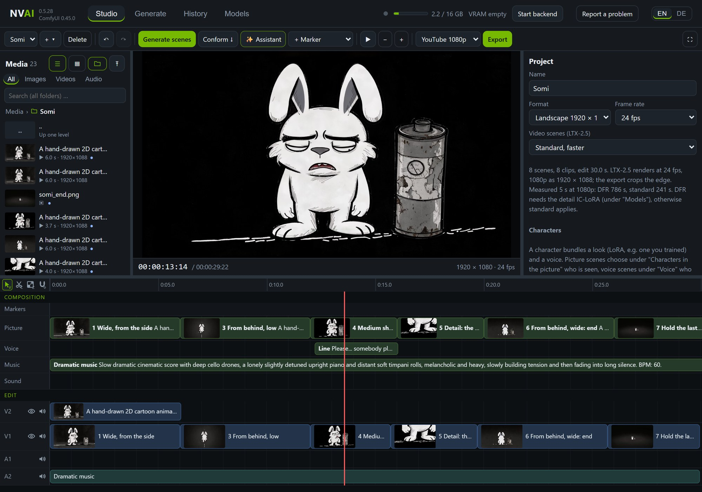

<p align="center">
  <a href="https://www.youtube.com/watch?v=UYrT4YY8gDo"></a>
  <a href="https://www.youtube.com/watch?v=xseQ42CFneY"></a>
</p>
<p align="center"><sub>A tutorial made completely on a local GPU with the Studio, and the update with the Studio for Mac and new local AI models (YouTube).</sub></p>

### From a portrait to a video

<p align="center">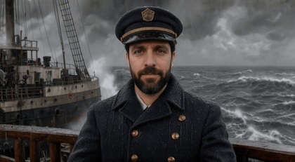</p>
<p align="center"><sub>Made with NVAI-open: a generated photo becomes a ship captain who speaks in a storm. <a href="docs/videos/photo-to-video-captain.mp4">With sound</a></sub></p>


1. **Generate → Image:** create a portrait, or use a photo of someone who agreed to it.
2. **Generate → Video:** pick the portrait as the start image.
3. **Person from a photo:** describe the role. FLUX 3 keeps the face and makes four start images; pick the one that looks most alike.
4. **Prompt:** describe what moves, what the camera does and what the person says. LTX-2.5 makes the video with speech and sound.
5. **Keep the face:** tick "Loop" (with a still camera) or give an end image. Without one, the face changed after a second in our test. The price: water and smoke stand still too.

Step by step with screenshots: [docs/PHOTO_TO_VIDEO.md](docs/PHOTO_TO_VIDEO.md)

### Video with sound

LTX-2.5 by Lightricks makes picture and sound together: speech, footsteps, wind, music. Start from a text, a start image or a start and an end image, make a seamless loop, let the picture follow a sound you give it, or extend a clip you already have.

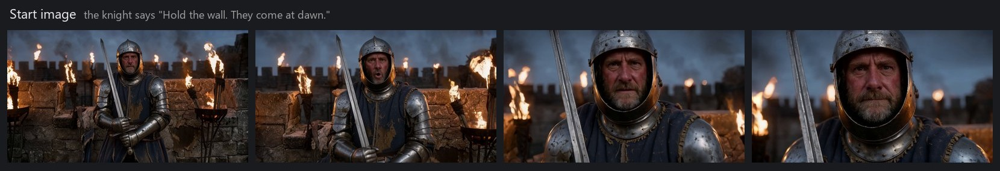

Under the video model, "Recommended LoRAs" adds styles with one click, such as painted fantasy or anime:

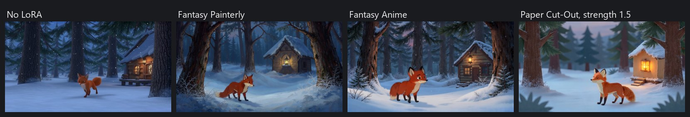

A finished clip can be doubled afterwards: "Upscale ×2" under a video in the History (RelayVSR, 5 s from 1080p to 4K in under two minutes):

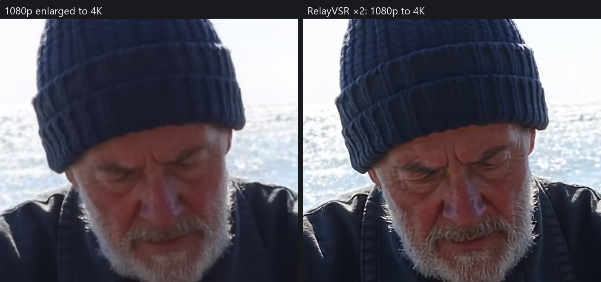

All ways and measured times: [docs/MODELS.md](docs/MODELS.md#ltx-25)

### 3D: from an image to a model

Generate an image of an object and turn it into a GLB model. TRELLIS.2 paints the textures too, TripoSG builds the shape only.

<p align="center">
  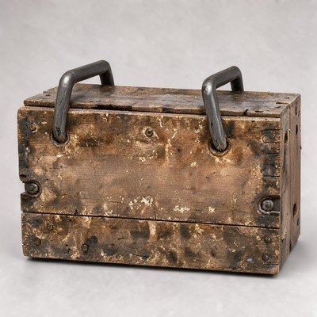
  
</p>

Lettering gets lost on the way to the mesh. "Take the front from the image" puts the source image onto the front of the model:

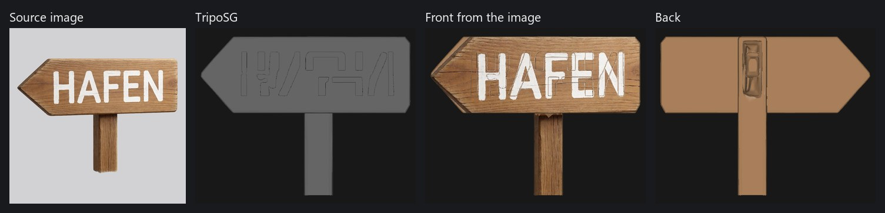

### Images

Four models are recommended, each for something else. **Krea 2** looks the most like a photo (about 18 s per image). **MOSS-Image** is strongest at lettering and layout (about 57 s, Apache-2.0). **Qwen-Image-2512** gets details and construction right (about 100 s, Apache-2.0). **FLUX 3 Image Klein** edits a picture and keeps the rest intact (about 28 s). Same prompt and seed, one image each:


The patch should read "ARES VII": MOSS-Image wrote it the cleanest, Krea 2 wrote "ARES VIII".

Krea 2 also takes an image as a style template: the lighthouse keeps its content and becomes a watercolor or a woodcut.


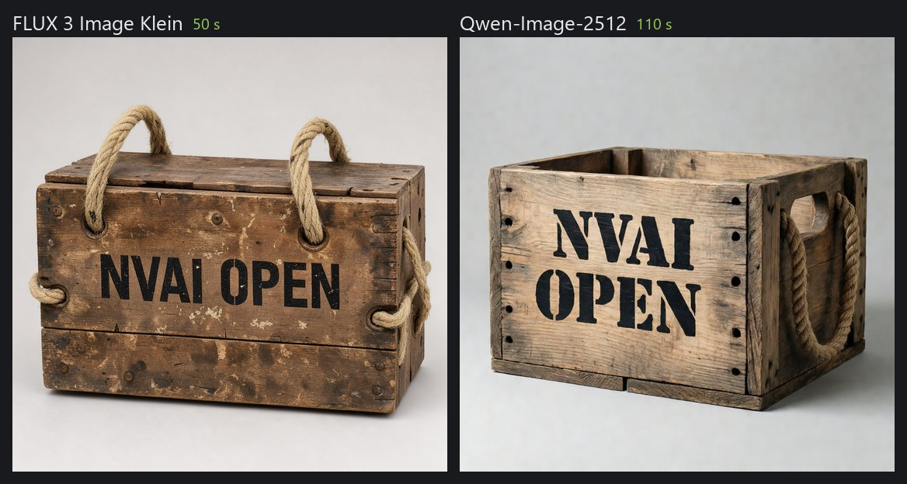

MOSS-Image writes posters and signs letter-perfect. With its 50 steps the crate's rope handles pass through drilled holes; with 25 they hung without a hold in one of three images:


Editing with FLUX 3: "replace the rope handles with iron handles, keep everything else unchanged".

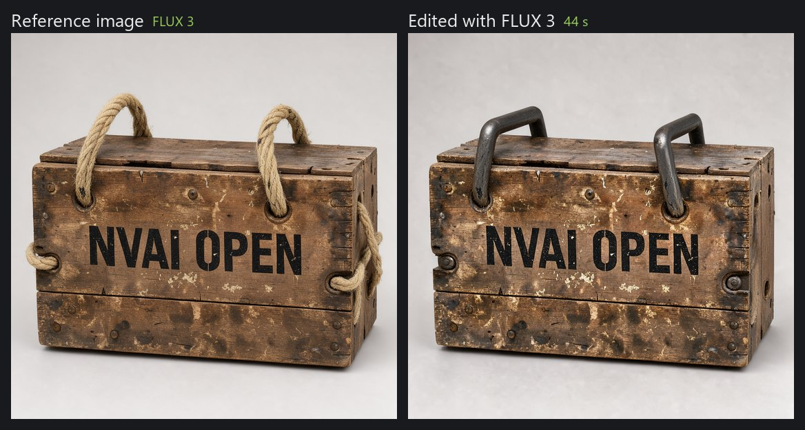

LoRAs teach a model a style, for example a more photographic look:


Which models take LoRAs, adding one you trained yourself and the LoRAs we tested: [docs/LORAS.md](docs/LORAS.md).

The four models side by side, with prompts and times: [docs/MODEL_COMPARISON.md](docs/MODEL_COMPARISON.md). More comparisons and prompt tips: [docs/MODELS.md](docs/MODELS.md). All images in this README were made with NVAI-open.

### Edit pictures: extend and fill

Make a picture wider or taller, and NVAI-open paints the new border to match. Or mark an area and fill it: remove things, add new ones. The rest of the picture stays as it was.

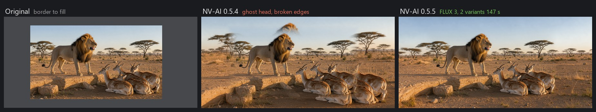


### Restore old photos

Scratches, dust, tears, stains and fading go away, the photo gets color if you like, and SeedVR2 sharpens and enlarges it. "Automatic" looks at the photo and decides how much to redraw: the whole picture for overall aging such as water stains, only the damaged spots for dust and scratches on an otherwise good photo. It chose right on 20 of 21 test photos. Colorizing only adds color; brightness and detail stay the photo's own. NVAI-open for Mac does all of it natively. Details: [docs/MODELS.md](docs/MODELS.md#old-photos)


### Expand prompt

Type a few words, click "Expand prompt", and NVAI-open writes the full description: setting, materials, light, what happens. Read it, delete what you don't want, generate. Works for images, video, sounds, music and 3D.

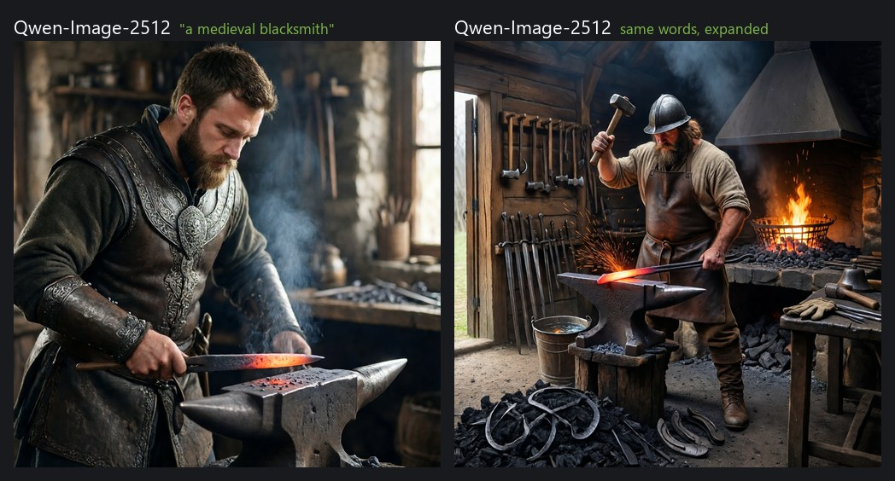

### Tips

Every tab has a **Recommended settings** box with what we measured. The most important points:

- **Images:** the best size is preselected; pick portrait for a standing figure and landscape for a vehicle. Write whole English sentences with the style first, and make 4 images to choose from.
- **FLUX 3:** switch off "Expand the prompt" when construction or counts must be exact (otherwise it added a second fishing line in 4 of 6 images).
- **Krea 2:** name the framing ("medium shot from the waist up, his whole head inside the frame"), or the head may be cut off.
- **MOSS-Image:** describe the finished picture, put the text in quotation marks with position and typeface, and leave it at 50 steps.
- **Video:** keep the prompt short (4–8 sentences) and name loud sounds explicitly; sounds described as soft come out almost inaudible.
- **Faces in video:** keep the face large, make the start image with FLUX 3 from a frontal photo and tick "Loop" or give an end image. Let people speak only with their face in the shot, about 2 words per second, and make a few variants to pick by ear.
- **Two clips without a seam:** use the chain marker in the Studio or "Extend"; the second clip takes over the last second of the first.
- **Your own LoRA:** the assistant under "Create/Edit LoRA" leads through it; 24 images of the character in different poses and settings, every one checked at full size;
  20 epochs take about 2 h 10 min on an RTX 5060 Ti; with the preset our characters showed at strength 1. Name colors
  such as ears and nose in the prompt. No images from FLUX 3, its license forbids training other models with them. [How it works](docs/LORAS.md#training-your-own-lora)
- **Upscaling:** "Upscale ×2" in the History doubles a finished video (5 s from 1080p to 4K in 104 s). Generated directly at 1080p it is still a little finer, so use it for 4K exports and smaller clips.
- **MiniMax H3:** only with a separate license from MiniMax in the EU, the UK, South Korea and the USA, and never publish what it makes. It tends to slow motion, so describe the pace of every movement.
- **Narrator voice:** describe gender, age, pitch, pace and mood in one sentence. The same description sounds different with every seed, so pick the best take and use it as the recording for all further lines.
- **A face in a new scene on the Mac:** put the photo under "Reference images", not "Start image", say who it is (woman or man, age, hair) and describe the new scene. The assistant's "A face from a photo" asks for this.
- **3D:** one object on a plain background, without floor or shadow; both would end up in the mesh.
- **FLUX 3 and LTX-2.5:** accept the license on Hugging Face and store a read token under "Models". Step by step: [docs/HUGGINGFACE.md](docs/HUGGINGFACE.md)
- **Old photos:** leave it on "Automatic", put known colors into the hints ("his suit is dark brown") and compare both variants at full size.

The same list with the measurements, written for Claude Code: [docs/CLAUDE_CODE.md](docs/CLAUDE_CODE.md#recommended-settings-at-a-glance)

### Claude Code: your assets on request

NVAI-open comes with an MCP server. Register it once:

```
claude mcp add --scope user nvai -- "<install folder>\server\.venv\Scripts\python.exe" -m nvai.mcp_server
```

Then just ask: "Make a weathered wooden barrel as a 3D model and put it into Assets/Generated/Meshes". Claude picks a model, asks before a download, generates, and copies the result into your project. Setup and all tools: [docs/CLAUDE_CODE.md](docs/CLAUDE_CODE.md)

### Graphics cards and uncensored models

NVAI-open picks the right model versions for your card: NVFP4 on an RTX 50, INT8 on RTX 20, 30 and 40. With several cards it uses the strongest one. AMD Radeon works experimentally (PyTorch with ROCm); testers are very welcome in [#2](https://github.com/Mantux775/NVAI-open/issues/2). Details: [docs/INSTALL.md](docs/INSTALL.md)

NVAI-open has no content filter of its own. The model list marks every model as censored, partly censored or uncensored, and more models and LoRAs from Hugging Face and Civitai are under "Models" → "Search models and LoRAs". Respect the law and each model's license; the FLUX 3 license, for example, requires a review of every image before it is published. Overview: [docs/MODELS.md](docs/MODELS.md#censored-or-uncensored)

### Mac app, PhotoCraft add-on, iOS

- **Mac:** a native app for Apple Silicon. Images with FLUX.2 Klein and Z-Image Turbo (generate, edit, fill, reference images, LoRAs), restoring old photos, music and sounds with Stable Audio 3, short videos with LTX-Video (bigger video models with sound from 16 GB of memory), the Studio, and review packages from audio forensics. On a Mac mini M1 with 8 GB, 30 seconds of music take about 13 seconds and 2 seconds of video about 95 seconds.
- **[PhotoCraft](https://github.com/storytold/photocraft) add-on:** select an area in this great open-source photo editor, fill it, rework it or restore it, and the result comes back as a layer. Tested with PhotoCraft 0.23.1. Thanks to the PhotoCraft developers for such a well-scriptable editor.
- **iOS (closed beta):** a 3D scanner that turns photos of real objects into models. Tell me in an issue if you would use it.

### Requirements

| | Windows | macOS |
|---|---|---|
| System | Windows 10 (2004+) or 11, 64-bit | macOS 15 or newer, Apple Silicon |
| Graphics / memory | 12 GB+ VRAM recommended (8 GB works with the INT8 models). NVIDIA: driver 580.88+. AMD Radeon RX 7000/9000 (RX 6000 experimental): driver 26.2.2+; older Radeons only on the CPU, very slow | 16 GB RAM or more recommended (8 GB works for small images) |
| Disk | about 10 GB for the program, plus 5 to 40 GB per model | about 1 GB for the app, plus about 10 GB for FLUX.2 Klein |
| Internet | for setup (about 3 GB) and model downloads | for model downloads |

The Windows setup is not code-signed, so Windows may show "Windows protected your PC": click "More info", then "Run anyway".

### Licenses

The code is under the [MIT License](LICENSE): do whatever you want with it. Third-party components keep their own licenses, see [THIRD_PARTY_NOTICES.txt](THIRD_PARTY_NOTICES.txt); ComfyUI (GPL-3.0) is shipped as a separate program with its full source. Models are not part of this repository; each has its own license, shown in the model list.

### More

- [docs/INSTALL.md](docs/INSTALL.md): installing, building from source, the PhotoCraft add-on
- [docs/DIRECTML.md](docs/DIRECTML.md): older Radeons and Intel cards through Vulkan, with measurements
- [docs/MODELS.md](docs/MODELS.md): the models in detail, prompt tips, test results
- [docs/PHOTO_TO_VIDEO.md](docs/PHOTO_TO_VIDEO.md): from a photo to a video, step by step
- [docs/STUDIO.md](docs/STUDIO.md): the Studio, whole videos from scenes
- [docs/CLAUDE_CODE.md](docs/CLAUDE_CODE.md): using NVAI-open from Claude Code
- [docs/MAKING_OF.md](docs/MAKING_OF.md): how Claude built a video in the Studio
- [docs/SHORT_FILM.md](docs/SHORT_FILM.md): a short film from a hand sketch, step by step with screenshots
- [docs/DOCK_ORGANIZER_VIDEO.md](docs/DOCK_ORGANIZER_VIDEO.md): a promo video for a Mac app, with automated screen recordings
- [photocraft-addon/](photocraft-addon/): source of the PhotoCraft add-on

---

## Video

<p align="center">
  <a href="https://www.youtube.com/watch?v=t4dyqInjm1M"></a>
</p>

<p align="center">A promo video for the Mac app Dock Organizer: music from Stable Audio 3, cut in the Studio, on YouTube (<a href="docs/DOCK_ORGANIZER_VIDEO.md">how it was made</a>).<br>
Ein Werbevideo für die Mac-App Dock Organizer: Musik von Stable Audio 3, geschnitten im Studio, auf YouTube (<a href="docs/de/DOCK_ORGANIZER_VIDEO.md">wie es entstand</a>).<br>
<a href="https://www.youtube.com/watch?v=t4dyqInjm1M">youtube.com/watch?v=t4dyqInjm1M</a></p>

<p align="center">
  <a href="https://www.youtube.com/watch?v=cDhmiLMU6WQ"></a>
</p>

<p align="center">A short film with the rabbit Somi, from a hand sketch to the export in the Studio, on YouTube (<a href="docs/SHORT_FILM.md">how it was made</a>).<br>
Ein Kurzfilm mit dem Hasen Somi, von der Handskizze bis zum Export im Studio, auf YouTube (<a href="docs/de/KURZFILM.md">wie er entstand</a>).<br>
<a href="https://www.youtube.com/watch?v=cDhmiLMU6WQ">youtube.com/watch?v=cDhmiLMU6WQ</a></p>

<p align="center">
  <a href="https://www.youtube.com/shorts/e9jSTwgwnrI">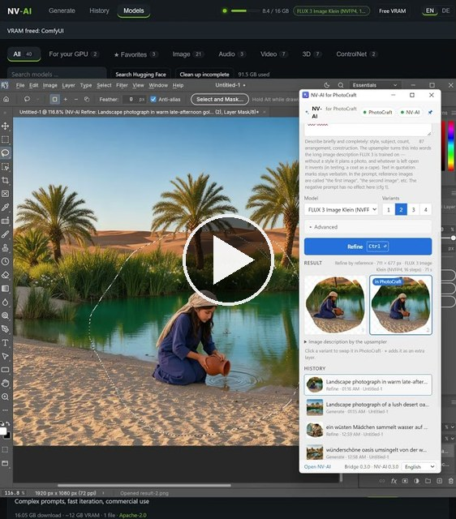</a>
</p>

<p align="center">NVAI-open and the PhotoCraft add-on in action, a short on YouTube.<br>
NVAI-open und das PhotoCraft-Add-on in Aktion, ein kurzes Video auf YouTube.<br>
<a href="https://www.youtube.com/shorts/e9jSTwgwnrI">youtube.com/shorts/e9jSTwgwnrI</a></p>

<p align="center">
  <a href="https://www.youtube.com/watch?v=UYrT4YY8gDo"></a>
</p>

<p align="center">The Studio in action: a tutorial made completely on a local GPU, on YouTube.<br>
Das Studio in Aktion: ein Tutorial, komplett auf der eigenen Grafikkarte gemacht, auf YouTube.<br>
<a href="https://www.youtube.com/watch?v=UYrT4YY8gDo">youtube.com/watch?v=UYrT4YY8gDo</a></p>

<p align="center">
  <a href="https://www.youtube.com/watch?v=xseQ42CFneY"></a>
</p>

<p align="center">The update: the Studio for Mac and new local AI models, on YouTube.<br>
Das Update: das Studio für den Mac und neue lokale KI-Modelle, auf YouTube.<br>
<a href="https://www.youtube.com/watch?v=xseQ42CFneY">youtube.com/watch?v=xseQ42CFneY</a></p>

---

## Deutsch

### Hallo

Ich habe diese App „vibegecodet“, weil ich sie selbst brauchte: Bilder, Sounds und 3D-Modelle für meine Spieleprojekte, ohne pro Bild zu zahlen oder alles in die Cloud zu schicken. Jetzt teile ich sie. Alles rechnet auf deiner eigenen Grafikkarte, nichts verlässt deinen Rechner.

Getestet ist sie auf meiner eigenen Hardware: Windows mit RTX 5060 Ti (16 GB) und ein Mac mini M1 (8 GB). Über Feedback als [Issue](https://github.com/Mantux775/NVAI-open/issues) freue ich mich sehr, am einfachsten mit „Problem melden“ in der App, das hängt einen anonymisierten Bericht an. Ich habe einen Vollzeitjob, Antworten können also dauern. Alle Apps gibt es auf Deutsch und Englisch.

### Was gibt's Neues?

November 2026: NVAI-open 0.5.34 für Windows ([Release-Notizen](https://github.com/Mantux775/NVAI-open/releases/tag/v0.5.34))

- **Rechenweg wählen** (0.5.35): Unter Modelle → Deine Hardware oder mit einem Klick auf die Speicher-Anzeige rechnet ComfyUI oder stable-diffusion.cpp über CUDA oder Vulkan Bilder und Videos. Auto nimmt den schnellsten Weg für die Karte, und zur Wahl steht nur, was dort läuft. [Einzelheiten](docs/de/DIRECTML.md#stable-diffusioncpp-auch-auf-nvidia)
- **Ältere Radeons und Intel-Karten über Vulkan** (0.5.35, experimentell): Bilder, Videos, Ton und Sprecherstimme rechnen jetzt auf der Radeon RX 5000, Vega und Polaris und auf Intel-Karten über Vulkan, mit stable-diffusion.cpp und audio.cpp statt DirectML. Auf einer echten RX 5700 XT brauchte ein SDXL-Bild mit zweitem Durchgang über DirectML 6 Minuten; über Vulkan erwarten wir rund 3,5. [Einzelheiten](docs/de/DIRECTML.md)
- **Generieren aufgeräumt** (0.5.35): Optionales wie Referenzbilder, LoRAs, Endbild, Video verlängern und Ton vorgeben ist zugeklappt, die Modell-Infos stehen unter dem Tipp, Bild erweitern hat einen eigenen Knopf und braucht keinen Prompt, die Breite der Einstellungen lässt sich ziehen, und der Knopf „Generieren“ bleibt sichtbar.
- **Video auf älteren Radeons über Vulkan** (0.5.34, experimentell): Wan 2.1 T2V 1.3B rechnet jetzt auf der Radeon RX 5000, Vega und Polaris über eine zweite Engine, stable-diffusion.cpp mit Vulkan; auf derselben Karte war es 1,7-mal langsamer als CUDA und sechsmal schneller als DirectML. [Einzelheiten](docs/de/DIRECTML.md#video-über-vulkan)
- **Ältere Radeons über DirectML** (0.5.33, experimentell): Die Radeon RX 5000, Vega und Polaris, die AMDs PyTorch für Windows nicht kennt, rechnen Bilder und Ton jetzt auf der Karte statt auf dem Prozessor; die SDXL-Modelle und Stable Audio Open sind als empfohlen markiert. [Einzelheiten](docs/de/DIRECTML.md)
- **ComfyUI 0.46.0** (0.5.32): NVAI-open läuft auf dem neuesten ComfyUI; mit gleichen Seeds verglichen, kamen die empfohlenen Bild-, Video- und Tonmodelle bitgleich heraus. Ton aus der Mitte einer MP3-Datei liegt nicht mehr 23 ms zu spät, und die Prüf-App liest Spuren mit 32-Bit-Ganzzahl, die der Mac (0.5.13) jetzt bitgenau speichert. [Einzelheiten](https://github.com/Mantux775/NVAI-open/releases/tag/v0.5.32)

<details><summary><kbd>&nbsp;Weiterlesen&nbsp;▾&nbsp;</kbd></summary>

- **Video auf älteren Radeons über Vulkan** (0.5.34, experimentell): An Videomodellen scheitert DirectML (seine PyTorch-Erweiterung kennt nur fünf Tensor-Dimensionen), deshalb lädt das Setup für diese Karten auch stable-diffusion.cpp, und Wan 2.1 T2V 1.3B rechnet über Vulkan. 2 s in 832 × 480: 117 s mit CUDA, 194 s über Vulkan auf derselben, auf 8 GB begrenzten Karte. Vulkan läuft auch auf Intel-Karten. [Einzelheiten](docs/de/DIRECTML.md#video-über-vulkan)
- **Ältere Radeons über DirectML** (0.5.33, experimentell): Das Setup gibt der Radeon RX 5000, Vega und Polaris eine zweite ComfyUI-Umgebung mit PyTorch 2.4.1 und Microsofts torch-directml und prüft sie auf der Karte. Empfohlen sind die SDXL-Modelle und Stable Audio Open, Stable Audio 3 ist als langsam markiert, Video läuft noch nicht. Auf derselben Karte war DirectML 2- bis 6-mal langsamer als CUDA (SDXL 1024²: 83 statt 16 s). [Einzelheiten und Messungen](docs/de/DIRECTML.md)
- **ComfyUI 0.46.0** (0.5.32): bitgleiche Ergebnisse für Krea 2, Qwen-Image-2512, FLUX 3, MOSS-Image, LTX-2.5 und Stable Audio 3 im Vergleich mit gleichen Seeds; Lesen aus der Mitte von MP3- und MPEG-TS-Dateien an der richtigen Stelle; die Prüf-App liest Spuren mit 32-Bit-Ganzzahl. [Release-Notizen](https://github.com/Mantux775/NVAI-open/releases/tag/v0.5.32)
- **Fehlerbehebungen** (0.5.31, Mac 0.5.12): Korrekturen aus fünf unabhängigen Durchsichten von Studio, LoRA-Training, Ton-Forensik, Weboberfläche und Mac-App; die ganze Liste steht in den [Release-Notizen](https://github.com/Mantux775/NVAI-open/releases/tag/v0.5.31).
- **Szenen von Hand im Studio** (0.5.30, Mac 0.5.11): Eine neue Szene bekommt das beste geladene Modell ihrer Bahn (LTX-2.5, Qwen3-TTS, Stable Audio 3, Stable Audio Open), Musik so lang wie der Film, Geräusche 4 s. „Prompt ausbauen“ macht aus ein paar Worten eine volle englische Beschreibung, und „Startbild erzeugen“ macht wie der Assistent zwei Startbilder aus dem Prompt (mit den Figuren der Szene, ohne schwarze Balken). Hinweise unter den Eigenschaften warnen vor einem Clip über 6 s in 1080p auf einer Karte mit 16 GB, einer Figur ohne Startbild, einem Prompt nicht auf Englisch und einem Sprechersatz unter einem Video, das eigenen Ton macht. [Einzelheiten](docs/de/STUDIO.md#schritt-für-schritt)
- **Mac 0.5.11, Ton-Forensik:** „Neuer Fall …“ legt einen Fall aus Audio- oder Videodateien an, „VDR-Export einlesen …“ aus einem Schiffsdatenschreiber (VR-7000) mit Kurs, Geschwindigkeit, Alarmen, AIS und Radarbildern; vorher zeigt es den Platzbedarf und bricht ab, bevor der Datenträger voll ist. „Sprache erkennen“ lässt Whisper large-v3 (Core ML) dort hören, wo Silero VAD Sprache findet, „Übersetzen“ nimmt Qwen3.5 (ab 16 GB Speicher 9B, sonst 4B). Alles läuft auf dem Mac. [Einzelheiten](docs/de/AUDIO.md#prüfpaket-und-prüf-app)
- **Ältere Radeons** (0.5.30): Karten, die AMDs PyTorch für Windows nicht kennt (RX 5000, Vega, Radeon VII, Polaris und älter), hängen nicht mehr beim Start. Das Setup installiert PyTorch für den Prozessor, und oben in der Leiste steht, dass NVAI-open auf der CPU rechnet; mit der Maus darüber steht, was das bedeutet und was hilft. [Einzelheiten](docs/de/INSTALL.md#amd-radeon-und-mehrere-grafikkarten-experimentell)
- **Mac 0.5.10:** Der Verlauf zeigt auch Musik, Klänge und Sprache mit Abspielknopf, und „Verlauf leeren“ löscht alles auf einmal; was ein Studio-Projekt nutzt, bleibt. Das Hugging-Face-Token wird beim Speichern bei Hugging Face geprüft, und „Prüfen“ sagt auch, ob LTX-2.5 freigeschaltet ist. Abgebrochene Downloads setzen dort fort, wo sie standen, und Uploads über die Schnittstelle sind nicht mehr auf 64 MB begrenzt. Die Prüf-App brennt Untertitel auf Wunsch ins exportierte Video, und ihre SRT-Dateien laden jetzt im Windows Media Player. [Einzelheiten](https://github.com/Mantux775/NVAI-open/releases/tag/v0.5.29)
- **Mac 0.5.9:** Ein Gesicht aus einem Foto kommt jetzt zuverlässig in eine neue Szene: das Foto unter „Referenzbilder“ legen und sagen, wer es ist (Frau oder Mann, Alter, Haare). Ein Ausgangsbild wird aufs Format zugeschnitten statt gestreckt, und der Assistent fragt, wer auf dem Foto ist. Eine große Fehlersuche hat unter anderem behoben: Studio-Projekte von Windows mit Video öffnen jetzt auf dem Mac, FLUX.2 zerreißt kein Bild mehr, wenn zwei Formate mit gleich vielen Bildpunkten aufeinander folgen, Studio-Exporte unter 1080p bleiben nicht mehr stehen, das Hugging-Face-Token hat ein Feld in den Einstellungen, und Löschen zerstört keinen Clip in einem Projekt mehr. [Alle Korrekturen](https://github.com/Mantux775/NVAI-open/releases/tag/v0.5.29)
- **Ton-Forensik** (0.5.29): Aus einer langen Aufnahme mit vielen Kanälen wird ein Fall: Spuren, Spektrogramm, Sprachaktivität, Ereignisse, Notizen und eine Übersetzer-Spur. Whisper large-v3 schreibt auf, was gesprochen wird, Qwen3.5-9B übersetzt es, und jeder Block bleibt Entwurf, bis ein Mensch ihn geprüft hat; ein Vermerk nennt Modelle, Lizenzen und Grafikkarte. Sie liest auch die Datendateien eines Schiffsdatenschreibers (Format VR-7000). [Einzelheiten](docs/de/AUDIO.md#ton-forensik)
- **Prüf-App** (0.5.29): „Export“ → „Prüfpaket“ ergibt einen Ordner mit dem Fall, dem Originalton und der Prüf-App NVAI-Pruefer.html, für Menschen ohne NVAI-open, etwa eine Kanzlei. Sie läuft in Edge oder Chrome ohne Installation, Internet und KI; Änderungen kommen mit einem verketteten Protokoll in einen Unterordner, und der Name des Bearbeiters lässt sich oben rechts ändern. Auf dem Mac (0.5.7) im neuen Reiter „Ton-Forensik“. [Einzelheiten](docs/de/AUDIO.md#prüfpaket-und-prüf-app)
- **Audio** (0.5.29): Stimmen von Musik trennen und Sprache von Rauschen, dazu ein wiederkehrendes Geräusch wie einen Alarm entfernen, gelernt aus ein paar markierten Beispielen. [Einzelheiten](docs/de/AUDIO.md)
- **Eigene LoRA trainieren** (0.5.29): Der Bereich „LoRA erstellen/Bearbeiten“ stellt einen Datensatz zusammen (aus dem Verlauf, aus Dateien oder aus einer Vorlage in 24 Haltungen gezeichnet), trainiert ihn auf deiner Grafikkarte und nimmt das Ergebnis in die Modellliste. [Einzelheiten](docs/de/LORAS.md#eigene-lora-trainieren)
- **Dateiname im Studio** (0.5.29): Die Eigenschaften einer Datei zeigen ihren Namen; ein Klick markiert ihn, „Kopieren“ kopiert ihn. Windows und Mac.
- **Ein Assistent für Einsteiger** (0.5.28): „✨ Assistent“ im Studio führt in sieben kurzen Schritten durch ein ganzes Video. Du wählst einen Weg (von der durchgehenden Einstellung bis zum Gesicht aus einem Foto), schreibst deine Idee, beschreibst eine Figur oder lässt sie weg, wählst die Anzahl der Szenen, nimmst die Musik aus 22 Vorschlägen oder schreibst einen eigenen Prompt, und der Assistent schlägt die besten Modelle für deine Hardware mit der zu erwartenden Zeit vor. Fehlende Modelle lädt er erst nach Rückfrage. Danach erzeugt er je Szene zwei Startbilder zur Auswahl und die Videos. Windows und Mac. [Einzelheiten](docs/de/STUDIO.md#der-assistent)
- **Deine Hardware** (0.5.28): Ein Katalog mit 110 Grafikkarten und Apple-Chips schätzt, wie lange jedes Modell auf deinem Rechner braucht; „Modelle“ zeigt deine Karte und die Zeit je Modell. [Einzelheiten](docs/de/MODELLE.md#deine-hardware)
- **Startbild im Studio** (0.5.27): In den Eigenschaften einer Videoszene gibt es jetzt das Feld „Startbild“. Ein Bild aus dem Material darauf ziehen oder aus dem Projektordner wählen. Der Clip beginnt damit, so sieht eine Figur in jeder Einstellung gleich aus. Bisher ging das nur über Claude Code per MCP. [Einzelheiten](docs/de/STUDIO.md#schritt-für-schritt)
- **Kandinsky 6 Pro und Lite, mit Ton** (0.5.25): zwei weitere Videomodelle, die Bild und Ton in einem Durchgang machen, 5 s in 864 × 480, aus Text oder einem Startbild (nur NVIDIA). Was zu hören ist, kommt in ein eigenes Feld „Ton“. Pro hielt im Test Handlung und Gesicht, braucht aber rund 17 Minuten für 5 s. **Der Ton ist nicht kommerziell nutzbar, und die Video-VAE ist in der EU nicht lizenziert.** [Einzelheiten](docs/de/MODELLE.md#weitere-videomodelle)
- **Eigene LoRAs** (0.5.24): „Modelle“ → „LoRA-Datei hinzufügen“ nimmt eine LoRA, die du selbst trainiert oder anderswo gefunden hast. NVAI-open liest zuerst den Dateikopf und zeigt, zu welchen Modellen sie passt; du bestätigst oder änderst die Zuordnung, auch später. Beim Generieren steht „+ Eigene LoRA-Datei hinzufügen“ direkt in der LoRA-Liste. Auf dem Mac für FLUX.2 Klein 4B. [Alles zu LoRAs](docs/de/LORAS.md)
- **Figuren im Studio** (0.5.24): Eine Figur bündelt Aussehen (eine oder mehrere LoRAs) und Stimme. Bildszenen zeigen sie, Sprecher-Szenen sprechen mit ihrer Stimme, und unter Windows spricht eine Videoszene mit LTX-2.5 einen Satz mit den Lippen. [Einzelheiten](docs/de/STUDIO.md#figuren)
- **MiniMax H3 mit Lizenzwarnung** (seit 0.5.18): Video mit Stereoton, 9 Sekunden in rund 7 Minuten. **Die Lizenz verbietet jede Nutzung in der EU, in Großbritannien, Südkorea und den USA ohne eigene Lizenz von MiniMax, und nichts damit Erzeugtes darf veröffentlicht werden.** Die App markiert es rot. [Einzelheiten](docs/de/MODELLE.md#minimax-h3-seit-0518)

</details>

### Was geht damit?

- **Studio:** ein ganzes Video aus Szenen bauen, schneiden und mit dem Encoder der Grafikkarte exportieren.
- **Gesicht tauschen:** eine Person aus einem Foto (die damit einverstanden ist) in einer neuen Rolle, als Startbild von FLUX 3 und als Video mit Ton von LTX-2.5.
- **Bilder:** FLUX 3, Qwen-Image-2512, Krea 2, MOSS-Image und viele weitere. Mit Referenzbildern bearbeiten, Bereiche füllen, Bilder erweitern.
- **LoRAs:** von Hugging Face, Civitai oder aus eigenem Training; NVAI-open liest den Dateikopf und zeigt, zu welchen Modellen eine LoRA passt.
- **Video mit Ton:** LTX-2.5 macht Bild und Ton in einem Durchgang, samt Sprache: Clips bis 20 Sekunden, bis 1080p.
- **Musik und Sounds:** instrumentale Musik bis 5 Minuten, Soundeffekte.
- **Sprache:** eine Sprecherstimme, die du in einem Satz beschreibst oder aus einer Aufnahme übernimmst, in 10 Sprachen. Im Studio behält ein Sprecher über viele Zeilen dieselbe Stimme.
- **3D-Modelle:** aus einem Bild ein texturiertes Modell für Unity, Blender oder jede Engine.
- **Alte Fotos:** Kratzer, Risse und Wasserflecken entfernen, einfärben, schärfen.
- **Audio und Ton-Forensik:** Stimmen von Musik trennen, Sprache von Rauschen, ein wiederkehrendes Geräusch wie einen Alarm entfernen, auch in Aufnahmen von vielen Stunden; einen Fall mit Übersetzer-Spur untersuchen und als Prüfpaket weitergeben. [Einzelheiten](docs/de/AUDIO.md)
- **Ein paar Worte reichen:** „Prompt ausbauen“ schreibt die volle Beschreibung für dich.
- **Claude Code:** Claude erzeugt deine Assets, während es an deinem Projekt arbeitet.
- **Kein eigener Filter:** unzensierte Modelle sind einen Klick entfernt. Für das, was du erzeugst, bist du selbst verantwortlich.
- **Windows und Mac**, NVIDIA und AMD Radeon, dazu ein Add-on für den Bildeditor PhotoCraft.

### Studio: ganze Videos aus Szenen

Das Studio ist der erste Reiter, wenn NVAI-open startet. Oben komponierst du: Szenen mit Prompt auf Bahnen für Bild, Sprecher, Musik und Klang, dazu Marker, die sagen, was wohin kommt. Unten schneidest du die echten Clips. „Szenen erzeugen“ macht alle Clips, Standbilder und Musikstücke mit deinen lokalen Modellen, „Übernehmen“ legt die Takes in den Schnitt, und der Export nutzt den Video-Encoder deiner Grafikkarte, in der Lautheit von YouTube.


- **Assistent:** neu im Studio? „✨ Assistent“ führt dich in sieben Schritten durch ein ganzes Video, mit den besten Modellen für deine Hardware und der zu erwartenden Zeit.
- **Schneiden:** Auswahl, Schneiden und Magnet mit ihren Tasten, Rechtsklick-Menüs, Geschwindigkeit in Prozent, Überblendung, Abblende und Wischblende, Zoomen mit Keyframes, Video- und Tonspuren mit Auge und Stummschalter.
- **Erzeugen:** Neben „Übernehmen“ siehst du, welche Szene gerade entsteht und wie weit sie ist; „✕ Abbrechen“ beendet den Lauf, fertige Takes bleiben.
- **Nahtlose Einstellungen:** Ein Anschluss-Marker lässt einen Clip den vorigen fortsetzen, so gehen zwei Einstellungen ohne Sprung ineinander über.
- **Sprecherstimme:** Sprecher-Szenen sprechen ihren Text mit Qwen3-TTS; „Gleiche Stimme wie“ hält einen Sprecher über alle Zeilen, und jede Szene wird so lang wie ihre Zeile.
- **Figuren:** Aussehen aus einer LoRA (auch einer selbst trainierten) und Stimme in einem. Bildszenen zeigen sie, Sprecher-Szenen sprechen mit ihrer Stimme, und eine Videoszene spricht einen Satz mit den Lippen.
- **Material:** Jedes Projekt hat einen eigenen Ordner für das, was es erzeugt, exportiert und hochlädt. Ganze Projekte lassen sich als ZIP-Datei packen und auf einem anderen Rechner öffnen.
- **Qualität:** Videoszenen laufen in der höchsten Qualität von LTX-2.5 und werden zusätzlich verlustfrei aufbewahrt; komprimiert wird erst beim Export (42,3 statt 37,7 dB PSNR bei einem YouTube-Export).
- **Export:** YouTube 1080p und 4K, Shorts, AV1, ein verlustfreier Master (MKV) oder ProRes 4444 für andere Schnittprogramme.
- **Claude Code** baut dir auf Wunsch das ganze Video per MCP, während du zusiehst.
- **Mac:** NVAI-open für Mac hat das Studio auch, mit demselben Projektformat.

Schritt für Schritt: [docs/de/STUDIO.md](docs/de/STUDIO.md)

**Der Kurzfilm mit dem Hasen:** Somi begann als schnelle Handskizze. FLUX 3 machte daraus eine Figur und gab ihr als Bearbeitung eine müde Stimmung; jede Einstellung bekam ein Startbild, Qwen3-TTS sprach seinen Satz, Stable Audio 3 machte die Musik, und LTX-2.5 bewegte die Einstellungen im Studio, den Satz mit seinen Lippen. Claude Code bediente die App über MCP, die Entscheidungen traf ein Mensch, und die 30 Sekunden brauchten rund 50 Minuten auf einer Grafikkarte. [Schritt für Schritt mit Bildern](docs/de/KURZFILM.md) · [Der Film auf YouTube](https://www.youtube.com/watch?v=cDhmiLMU6WQ)

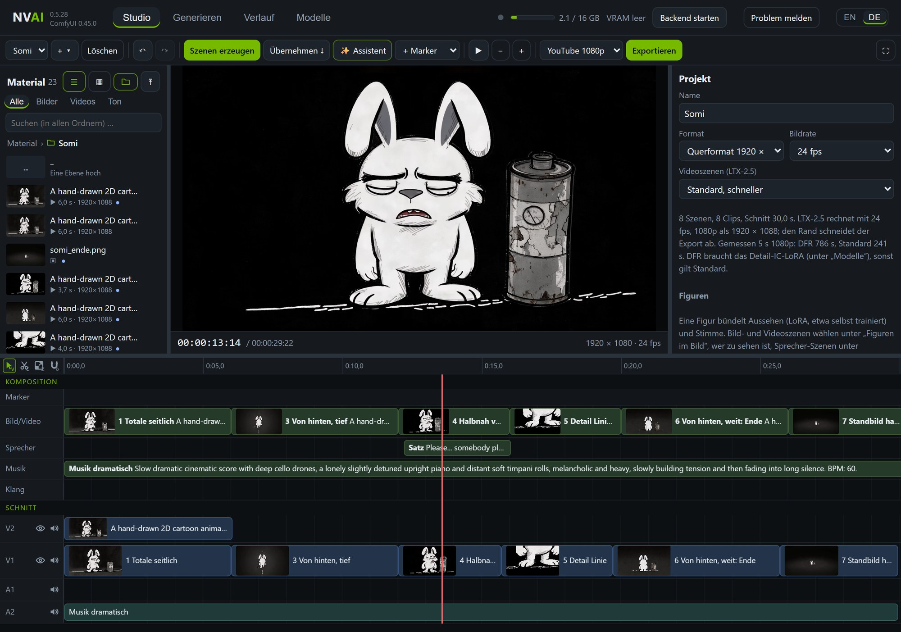

<p align="center">
  <a href="https://www.youtube.com/watch?v=UYrT4YY8gDo"></a>
  <a href="https://www.youtube.com/watch?v=xseQ42CFneY"></a>
</p>
<p align="center"><sub>Ein Tutorial, komplett auf der eigenen Grafikkarte mit dem Studio gemacht, und das Update mit dem Studio für den Mac und neuen lokalen KI-Modellen (YouTube).</sub></p>

### Vom Porträt zum Video

<p align="center"></p>
<p align="center"><sub>Mit NVAI-open gemacht: Aus einem erzeugten Foto wird ein Schiffskapitän, der im Sturm spricht. <a href="docs/videos/photo-to-video-captain.mp4">Mit Ton</a></sub></p>


1. **Generieren → Bild:** ein Porträt erzeugen oder das Foto eines Menschen nehmen, der damit einverstanden ist.
2. **Generieren → Video:** das Porträt als Startbild wählen.
3. **Person aus einem Foto:** die Rolle beschreiben. FLUX 3 übernimmt das Gesicht und macht vier Startbilder; das ähnlichste auswählen.
4. **Prompt:** beschreiben, was sich bewegt, was die Kamera macht und was die Person sagt. LTX-2.5 macht daraus das Video mit Sprache und Ton.
5. **Gesicht halten:** „Schleife“ anhaken (mit ruhiger Kamera) oder ein Endbild mitgeben. Ohne veränderte sich das Gesicht im Test nach einer Sekunde. Der Preis: Wasser und Rauch stehen dann auch still.

Schritt für Schritt mit Screenshots: [docs/de/FOTO_ZU_VIDEO.md](docs/de/FOTO_ZU_VIDEO.md)

### Video mit Ton

LTX-2.5 von Lightricks macht Bild und Ton zusammen: Sprache, Schritte, Wind, Musik. Starten lässt es sich mit einem Text, einem Startbild oder einem Start- und einem Endbild; es macht nahtlose Schleifen, das Bild kann einem vorgegebenen Ton folgen, und ein vorhandener Clip lässt sich verlängern.

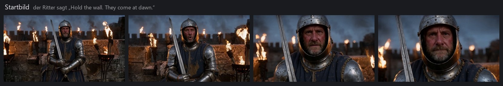

Unter dem Videomodell fügt „Empfohlene LoRAs“ Stile mit einem Klick hinzu, etwa gemalte Fantasy oder Anime:

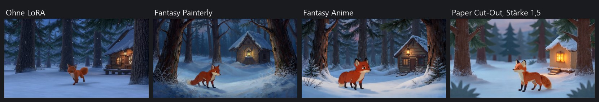

Ein fertiger Clip lässt sich danach verdoppeln: „Hochskalieren ×2“ unter einem Video im Verlauf (RelayVSR, 5 s von 1080p auf 4K in unter zwei Minuten):


Alle Wege und gemessenen Zeiten: [docs/de/MODELLE.md](docs/de/MODELLE.md#ltx-25)

### 3D: vom Bild zum Modell

Ein Bild eines Objekts erzeugen und daraus ein GLB-Modell machen. TRELLIS.2 malt die Texturen gleich mit, TripoSG baut nur die Form.

<p align="center">
  
  
</p>

Schrift geht auf dem Weg zum Mesh verloren. „Vorderseite aus dem Bild übernehmen“ legt das Quellbild auf die Vorderseite des Modells:


### Bilder

Vier Modelle sind empfohlen, jedes für etwas anderes. **Krea 2** wirkt am ehesten wie ein Foto (rund 18 s je Bild). **MOSS-Image** ist am stärksten bei Schrift und Layout (rund 57 s, Apache-2.0). **Qwen-Image-2512** trifft Details und Konstruktion (rund 100 s, Apache-2.0). **FLUX 3 Image Klein** bearbeitet ein Bild und lässt den Rest, wie er ist (rund 28 s). Gleicher Prompt und Seed, je ein Bild:


Auf dem Aufnäher soll „ARES VII“ stehen: MOSS-Image schrieb es am saubersten, Krea 2 schrieb „ARES VIII“.

Krea 2 nimmt auch ein Bild als Stilvorlage: Der Leuchtturm behält seinen Inhalt und wird zum Aquarell oder zum Holzschnitt.


MOSS-Image schreibt Plakate und Schilder buchstabengenau. Mit seinen 50 Schritten laufen die Seilgriffe der Kiste durch Bohrungen; mit 25 hingen sie in einem von drei Bildern ohne Halt:


Bearbeiten mit FLUX 3: „replace the rope handles with iron handles, keep everything else unchanged“.


LoRAs bringen einem Modell einen Stil bei, zum Beispiel einen fotografischeren Look:


Welche Modelle LoRAs nehmen, eine selbst trainierte hinzufügen und die getesteten LoRAs: [docs/de/LORAS.md](docs/de/LORAS.md).

Die vier Modelle nebeneinander, mit Prompts und Zeiten (englisch): [docs/MODEL_COMPARISON.md](docs/MODEL_COMPARISON.md). Weitere Vergleiche und Prompt-Tipps: [docs/de/MODELLE.md](docs/de/MODELLE.md). Alle Bilder in diesem README hat NVAI-open erzeugt.

### Bilder bearbeiten: erweitern und füllen

Ein Bild breiter oder höher machen, und NVAI-open malt den neuen Rand passend dazu. Oder einen Bereich markieren und füllen: Dinge entfernen, neue hinzufügen. Der Rest des Bildes bleibt, wie er war.


### Alte Fotos restaurieren

Kratzer, Staub, Risse, Flecken und Ausbleichen verschwinden, auf Wunsch bekommt das Foto Farbe, und SeedVR2 schärft und vergrößert es. „Automatisch“ sieht sich das Foto an und entscheidet, wie viel neu gemalt wird: das ganze Bild bei flächiger Alterung wie Wasserflecken, nur die beschädigten Stellen bei Staub und Kratzern auf einem sonst guten Foto. Bei 20 von 21 Testfotos lag es richtig. Beim Einfärben kommt nur die Farbe dazu, Helligkeit und Detail bleiben die des Fotos. NVAI-open für Mac kann alles davon nativ. Mehr dazu: [docs/de/MODELLE.md](docs/de/MODELLE.md#alte-fotos)


### Prompt ausbauen

Ein paar Worte eintippen, auf „Prompt ausbauen“ klicken, und NVAI-open schreibt die volle Beschreibung: Ort, Material, Licht, was passiert. Lesen, Ungewolltes streichen, generieren. Das geht für Bilder, Video, Sounds, Musik und 3D.


### Tipps

In jedem Reiter steht unter **Empfohlene Einstellungen**, was wir gemessen haben. Das Wichtigste:

- **Bilder:** Das beste Format ist vorgewählt; für eine stehende Figur Hochformat, für ein Fahrzeug Querformat. Ganze englische Sätze mit dem Stil vorn schreiben und 4 Bilder zum Auswählen machen.
- **FLUX 3:** „Prompt ausbauen lassen“ abschalten, wenn Bauweise oder Anzahl genau stimmen müssen (sonst kam in 4 von 6 Bildern eine zweite Angelschnur dazu).
- **Krea 2:** den Bildausschnitt nennen („medium shot from the waist up, his whole head inside the frame“), sonst fehlt womöglich der Kopf.
- **MOSS-Image:** das fertige Bild beschreiben, die Schrift in Anführungszeichen mit Ort und Schriftart angeben und bei 50 Schritten lassen.
- **Video:** den Prompt kurz halten (4–8 Sätze) und laute Geräusche ausdrücklich nennen; leise beschriebene kommen fast unhörbar.
- **Gesichter im Video:** das Gesicht groß halten, das Startbild mit FLUX 3 aus einem frontalen Foto machen und „Schleife“ anhaken oder ein Endbild mitgeben. Personen nur mit Gesicht im Bild sprechen lassen, rund 2 Wörter je Sekunde, und ein paar Varianten nach Gehör wählen.
- **Zwei Clips ohne Naht:** den Anschluss-Marker im Studio oder „Verlängern“ nehmen; der zweite Clip übernimmt die letzte Sekunde des ersten.
- **Eigene LoRA:** Der Assistent unter „LoRA erstellen/Bearbeiten“ führt hindurch; 24 Bilder der Figur in verschiedenen Haltungen und Umgebungen, jedes in voller Größe geprüft;
  20 Epochen dauern auf einer RTX 5060 Ti rund 2 h 10 min; mit der Vorgabe zeigten sich unsere Figuren bei Stärke 1.
  Farben wie Ohren und Nase im Prompt nennen. Keine Bilder aus FLUX 3, dessen Lizenz verbietet, damit andere Modelle zu
  trainieren. [So geht's](docs/de/LORAS.md#eigene-lora-trainieren)
- **Hochskalieren:** „Hochskalieren ×2“ im Verlauf verdoppelt ein fertiges Video (5 s von 1080p auf 4K in 104 s). Direkt in 1080p erzeugt ist es noch etwas feiner; gut für 4K-Exporte und kleinere Clips.
- **MiniMax H3:** in der EU, in Großbritannien, Südkorea und den USA nur mit eigener Lizenz von MiniMax, und nichts damit Erzeugtes veröffentlichen. Es neigt zu Zeitlupe, also jede Bewegung mit Tempo beschreiben.
- **Sprecherstimme:** Geschlecht, Alter, Tonlage, Tempo und Stimmung in einem Satz beschreiben. Dieselbe Beschreibung klingt mit jedem Seed anders, also die beste Probe wählen und sie als Aufnahme für alle weiteren Zeilen nehmen.
- **Gesicht in neuer Szene auf dem Mac:** das Foto unter „Referenzbilder“ legen, nicht als „Ausgangsbild“, sagen, wer es ist (Frau oder Mann, Alter, Haare), und die neue Szene beschreiben. Der Assistent fragt im Weg „Gesicht aus einem Foto“ danach.
- **3D:** ein Objekt vor schlichtem Hintergrund, ohne Boden und Schatten; beides landet sonst im Mesh.
- **FLUX 3 und LTX-2.5:** die Lizenz auf Hugging Face annehmen und unter „Modelle“ einen Token mit Leserecht eintragen. Schritt für Schritt: [docs/de/HUGGINGFACE.md](docs/de/HUGGINGFACE.md)
- **Alte Fotos:** auf „Automatisch“ lassen, bekannte Farben in die Hinweise schreiben („his suit is dark brown“) und die zwei Varianten in voller Größe vergleichen.

Dieselbe Liste mit den Messwerten, geschrieben für Claude Code: [docs/CLAUDE_CODE.md](docs/CLAUDE_CODE.md#recommended-settings-at-a-glance) (englisch)

### Claude Code: Assets auf Zuruf

NVAI-open bringt einen MCP-Server mit. Einmal eintragen:

```
claude mcp add --scope user nvai -- "<Installationsordner>\server\.venv\Scripts\python.exe" -m nvai.mcp_server
```

Dann einfach sagen: „Mach ein verwittertes Holzfass als 3D-Modell und leg es nach Assets/Generated/Meshes“. Claude wählt ein Modell, fragt vor einem Download, generiert und kopiert das Ergebnis ins Projekt. Einrichtung und alle Werkzeuge: [docs/CLAUDE_CODE.md](docs/CLAUDE_CODE.md) (englisch)

### Grafikkarten und unzensierte Modelle

NVAI-open wählt die passenden Modellfassungen für deine Karte: NVFP4 auf einer RTX 50, INT8 auf RTX 20, 30 und 40. Mit mehreren Karten rechnet die stärkste. AMD Radeon läuft experimentell (PyTorch mit ROCm); Tester sind in [#2](https://github.com/Mantux775/NVAI-open/issues/2) sehr willkommen. Details: [docs/de/INSTALL.md](docs/de/INSTALL.md)

NVAI-open hat keinen eigenen Inhaltsfilter. Die Modellliste kennzeichnet jedes Modell als zensiert, teilweise zensiert oder unzensiert, und weitere Modelle und LoRAs von Hugging Face und Civitai gibt es unter „Modelle“ → „Modelle und LoRAs suchen“. Gesetze und die Lizenz des Modells gelten; die FLUX-3-Lizenz etwa verlangt, jedes Bild vor der Veröffentlichung zu prüfen. Überblick: [docs/de/MODELLE.md](docs/de/MODELLE.md#zensiert-oder-unzensiert)

### Mac-App, PhotoCraft-Add-on, iOS

- **Mac:** eine native App für Apple Silicon. Bilder mit FLUX.2 Klein und Z-Image Turbo (generieren, überarbeiten, füllen, Referenzbilder, LoRAs), alte Fotos restaurieren, Musik und Klänge mit Stable Audio 3, kurze Videos mit LTX-Video (größere Videomodelle mit Ton ab 16 GB Speicher), das Studio und Prüfpakete aus der Ton-Forensik. Auf einem Mac mini M1 mit 8 GB dauern 30 Sekunden Musik rund 13 Sekunden und 2 Sekunden Video rund 95 Sekunden.
- **Add-on für [PhotoCraft](https://github.com/storytold/photocraft):** in diesem tollen Open-Source-Bildeditor einen Bereich auswählen, füllen, überarbeiten oder restaurieren, das Ergebnis kommt als Ebene zurück. Getestet mit PhotoCraft 0.23.1. Danke an die PhotoCraft-Entwickler für einen so gut steuerbaren Editor.
- **iOS (geschlossene Beta):** ein 3D-Scanner, der aus Fotos echter Gegenstände Modelle macht. Schreibt mir gern in einem Issue, wenn ihr ihn nutzen würdet.

### Voraussetzungen

| | Windows | macOS |
|---|---|---|
| System | Windows 10 (ab 2004) oder 11, 64 Bit | macOS 15 oder neuer, Apple Silicon |
| Grafik / Speicher | empfohlen ab 12 GB VRAM (8 GB gehen mit den INT8-Modellen). NVIDIA: Treiber ab 580.88. AMD Radeon RX 7000/9000 (RX 6000 experimentell): Treiber ab 26.2.2; ältere Radeons nur auf dem Prozessor, sehr langsam | empfohlen ab 16 GB RAM (8 GB reichen für kleine Bilder) |
| Platte | rund 10 GB für das Programm, dazu 5 bis 40 GB pro Modell | rund 1 GB für die App, dazu etwa 10 GB für FLUX.2 Klein |
| Internet | fürs Einrichten (rund 3 GB) und die Modelle | für die Modelle |

Das Windows-Setup ist nicht signiert. Windows zeigt deshalb eventuell „Der Computer wurde durch Windows geschützt“: auf „Weitere Informationen“ und dann „Trotzdem ausführen“ klicken.

### Lizenzen

Der Code steht unter der [MIT-Lizenz](LICENSE): Jeder darf damit machen, was er will. Fremde Komponenten behalten ihre eigenen Lizenzen, siehe [THIRD_PARTY_NOTICES.txt](THIRD_PARTY_NOTICES.txt); ComfyUI (GPL-3.0) wird als eigenständiges Programm mit vollständigem Quelltext mitgeliefert. Modelle sind nicht Teil dieses Repos; jedes hat seine eigene Lizenz, die die Modellliste anzeigt.

### Weiterlesen

- [docs/de/INSTALL.md](docs/de/INSTALL.md): Installation, Bauen aus dem Quelltext, PhotoCraft-Add-on
- [docs/de/DIRECTML.md](docs/de/DIRECTML.md): ältere Radeons und Intel-Karten über Vulkan, mit Messungen
- [docs/de/MODELLE.md](docs/de/MODELLE.md): die Modelle im Detail, Prompt-Tipps, Testergebnisse
- [docs/de/FOTO_ZU_VIDEO.md](docs/de/FOTO_ZU_VIDEO.md): vom Foto zum Video, Schritt für Schritt
- [docs/de/STUDIO.md](docs/de/STUDIO.md): das Studio, ganze Videos aus Szenen
- [docs/CLAUDE_CODE.md](docs/CLAUDE_CODE.md): NVAI-open aus Claude Code nutzen (englisch)
- [docs/de/MAKING_OF.md](docs/de/MAKING_OF.md): wie Claude ein Video im Studio gebaut hat
- [docs/de/KURZFILM.md](docs/de/KURZFILM.md): ein Kurzfilm von der Handskizze an, Schritt für Schritt mit Bildern
- [docs/de/DOCK_ORGANIZER_VIDEO.md](docs/de/DOCK_ORGANIZER_VIDEO.md): ein Werbevideo für eine Mac-App, mit automatischen Bildschirmaufnahmen
- [photocraft-addon/](photocraft-addon/): Quelltext des PhotoCraft-Add-ons
