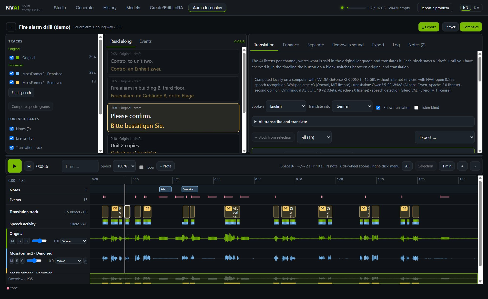
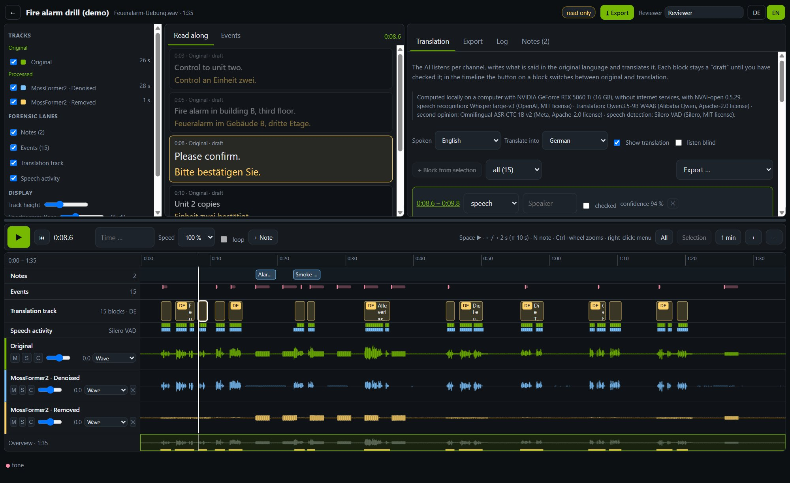

# Audio: separate voices, remove noise, remove one sound

The **Audio** area works on recordings of any length, also tapes or videos of several hours. The original stays
untouched: every operation becomes a new track that you can play next to the original, mute, solo, make louder or
quieter, and export as a mix, also back into the video.

[Deutsch](de/AUDIO.md)

## How it works

1. **Add a recording:** upload a file, pick one from the History, or give the path of a large file on this computer
   (it is not copied). Audio and video work; from a video only the sound is used.
2. **Reading:** NVAI-open writes a lossless working copy, the waveform and a playback preview, and measures loudness
   (EBU R 128), noise floor, peak and mains hum. Suggestions follow from these numbers. A 12-hour video took about
   15 minutes on one CPU core.
3. **Listen and select:** drag in the timeline to select, click to set the playhead, Ctrl + mouse wheel zooms, the
   overview at the bottom moves through hours. The space bar plays.
4. **Process:** first a selection of 30 to 60 seconds (a preview track at its place), then the whole track.
   AI steps run in sections: "Pause" keeps what is finished, "Resume" continues there.
5. **Export:** what you hear is mixed (WAV, FLAC, MP3, M4A, Opus, mono if you like), or the sound of the video is
   replaced while the picture is copied unchanged.

## Tools

| Tool | Model | Good for |
|---|---|---|
| Separate voice / accompaniment | Mel-Band RoFormer by Kimberley Jensen (weights MIT) | singing or speech over music |
| Separate speech / music / effects | Bandit v2 (code Apache-2.0, weights CC BY-SA 4.0) | films, recordings, talks with an audience |
| Remove noise from speech | MossFormer2_SE_48K (Apache-2.0) | hiss, hum leftovers, room noise |
| Fast noise removal | DeepFilterNet3 (MIT/Apache-2.0, CPU) | pure speech; it also removes music |
| Remove one sound | learned in the app from your examples | alarms, beeps, a machine, a bell |
| Filters | without AI | mains hum, line whistle, rumble, clicks, classic noise reduction, levelling, de-essing, loudness |

The suggested model per task is the best one whose license also allows selling the results (research November 2026).
Mask-based models only attenuate; they invent nothing. For music in four or more stems there is no model with a clean
commercial license: the widely used Demucs weights are released for research only.

## Remove one sound ("Learn the sound")

For one recurring sound such as an alarm: mark 4 to 10 examples as "unwanted sound" (places with talking over it are
fine), optionally "keep" markers where the sound is absent. "Find alarms and beeps" searches the whole recording for
steady tones and groups them by pitch, so you can mark examples with one click. A small network then learns the sound
on the graphics card and gives two tracks: without the sound, and only the sound.

Measured

A 3-minute test recording (narration over music) with nine synthetic two-tone alarms at different levels; five were
marked. After 3000 training steps the alarm was 19.9 to 21.8 dB quieter at the four unmarked places, speech between the
alarms changed by −0.04 dB, and the "only the sound" track matched the real alarm at 21.5 dB. The tone search found all
nine alarms as one group in 0.4 s.

## Speed (RTX 5060 Ti 16 GB, measured while other jobs shared the card)

| Step | Time per minute of audio |
|---|---|
| Reading | about 2 s |
| MossFormer2 (denoise) | about 1 s |
| DeepFilterNet3 (CPU) | about 5 s |
| Bandit v2 | about 8 s |
| Filters | about 4 s |

## Audio forensics

"Audio forensics" turns a recording into a case to examine: every channel as its own track, a spectrogram, where
speech is, events such as alarms, notes and a translation track. It is made for long recordings with several
microphones and radio channels, for example from a voyage data recorder.

- **Open a case:** a recording or a video, or the data files of a voyage data recorder (VR-7000 format). From a
  recorder every microphone and radio channel becomes a track, with heading, speed, rudder, engine, wind and alarms
  next to it, and the recorder's own checksums are verified. The original stays unchanged; NVAI-open records its
  checksum.
- **Look and listen:** a spectrogram in four zoom levels, speech activity (Silero VAD), events from the tone search
  and notes, each on its own lane. "Read along" shows the current block in large type, original and translation.
- **Translation track:** Whisper large-v3 writes down per channel what is said, in the original language, and
  Qwen3.5-9B translates it, first into English, then into the target language. Each block stays a "draft" until a
  person has checked it. Unsure words are marked, and a second recognizer (Omnilingual ASR) is shown as a hint. Under
  the tab NVAI-open notes which models, under which license and on which graphics card the track was computed; the
  note also goes into the exports. The translation is a draft and does not replace a certified translation.
- **Export:** audio as WAV (bit-exact when nothing was changed), the video with the chosen tracks as its sound, a
  situation video with all views, speech as text, CSV, SRT or VTT, notes as text or CSV.

## Review package and review app

For people who should check a case without NVAI-open, a law firm for example: "Export" → "Review package" writes a
folder with the case, the original audio as bit-exact WAV, optionally the video and images, a checksum for every file
(PRUEFSUMMEN.sha256) and the review app NVAI-Pruefer.html. The app runs in Microsoft Edge or Google Chrome, without
installation, internet or AI: listen to every track, watch the video, check and correct blocks, set notes, export WAV,
video with sound and subtitles. Changes go into the subfolder "bearbeitung" together with a review log in which every
line is chained to the one before by SHA-256; the delivered files stay unchanged. The reviewer's name sits at the top
right and can be changed at any time; the change goes into the log too. The review app is also attached to every
release as a single file.

On the Mac, NVAI-open 0.5.7 opens review packages in its "Audio forensics" tab, with the same review app. Speech
recognition and translation on the Mac will follow.

Measured with the demo case (95 s, three tracks, RTX 5060 Ti)

Spectrogram 2 s per track, speech activity for three tracks 6 s, MossFormer2 12 s, tone search 2 s, the translation
track with 15 blocks 34 s, the review package 2 s. In the review app in Chrome one minute of video with sound took
about 1.3 s: the picture is copied unchanged, and the sound comes from the original audio, lined up to the sample.

