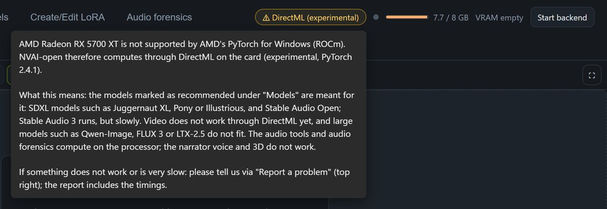
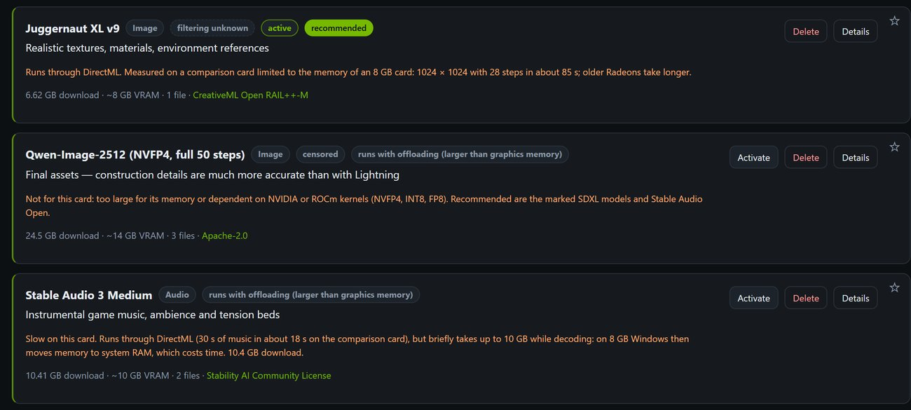

# Older Radeons: DirectML (experimental)

[Deutsch](de/DIRECTML.md)

AMD's PyTorch for Windows (ROCm) does not support the Radeon RX 5000 series, Vega, Radeon VII or Polaris (RX 400/500).
Since 0.5.33 NVAI-open computes on these cards through **DirectML**, the machine learning layer of DirectX 12. This is
experimental: NVAI-open has not run on such a card yet. Everything below was measured through DirectML on an NVIDIA card
whose memory was limited to what an 8 GB card gets. Reports in
[issue #3](https://github.com/Mantux775/NVAI-open/issues/3) help a lot.

## Setup

Install NVAI-open as usual, also over an older version. The setup recognises the card, adds a second ComfyUI
environment with PyTorch 2.4.1 and Microsoft's torch-directml (a download of about 200 MB) and checks it with a small calculation
on the card. The top bar then says "DirectML (experimental)"; hovering over it explains what that means.

If DirectML does not compute on the card, or ComfyUI does not start with it, NVAI-open computes on the processor as
before. The top bar then says "Running on the CPU", and the tooltip gives the reason. "Repair NVAI-open" in the Start
menu sets everything up again.

## Which models

Under "Models", the models that fit the card are marked as recommended, and every other model says why it does not.

- **Recommended:** the SDXL models (Juggernaut XL v9, SDXL base, Pony V6 XL, Illustrious XL, NoobAI XL) for images and
  Stable Audio Open for sound effects.
- **Slow:** Stable Audio 3 Medium for music. It runs, but needs up to 10 GB for a moment while decoding; on an 8 GB card
  Windows then moves memory to system RAM, which costs time.
- **Not yet:** video (Wan 2.1 1.3B stops inside DirectML), and the large models such as Qwen-Image, FLUX 3, Krea 2,
  MOSS-Image or LTX-2.5: too large for 8 GB, or they need NVIDIA or ROCm kernels (NVFP4, INT8, FP8). The narrator voice
  and 3D need CUDA or ROCm. The audio tools and audio forensics compute on the processor.

## Measured: DirectML and CUDA on the same card

The same jobs with the same seeds on an RTX 5060 Ti 16 GB, once with CUDA, once through DirectML with the memory
limited to 7.7 GB (the budget Windows gives an 8 GB card). Times per job, including loading the model.

| Job | CUDA | DirectML |
|---|---|---|
| SDXL (Juggernaut XL v9), 1024 × 1024, 28 steps | 16 s | 83 s |
| SDXL, 832 × 1216, 28 steps | 13 s | 81 s |
| Stable Audio Open, 6 s sound effect | 8 s | 17 s |
| Stable Audio 3 Medium, 30 s of music | 6 s | 16 s |

Through DirectML the same card was 2 to 6 times slower. An older Radeon has no matrix units, so expect its times to be
longer than the DirectML column; how much longer has not been measured yet.

Juggernaut XL v9 through DirectML: 1024 × 1024 and 832 × 1216, 28 steps.

## How it works

- torch-directml exists only for PyTorch 2.4.1, and ComfyUI removed DirectML in version 0.46.0. NVAI-open therefore
  keeps a second environment for the image ComfyUI (`external\comfyui\.venv-directml`) and adds DirectML back into
  ComfyUI before each start; without DirectML nothing changes.
- ComfyUI's old DirectML code assumed 1 GB of memory and kept every model loaded (SDXL took 13.6 GB). NVAI-open asks
  Windows for the memory budget of the process instead, so models are swapped as with CUDA, and the VAE decodes in tiles
  when it would not fit.
- DirectML queues work far ahead and keeps the memory of each queued step until it has run; without regular syncs SDXL
  swung between 6 and 15 GB. With them it took at most 8.5 GB, and it is faster.
- Text encoders run on the processor (DirectML cannot handle FP8 weights), and 3D convolutions are computed as 2D ones.
- `NVAI_DIRECTML=0` as an environment variable switches DirectML off; NVAI-open then computes on the processor.
