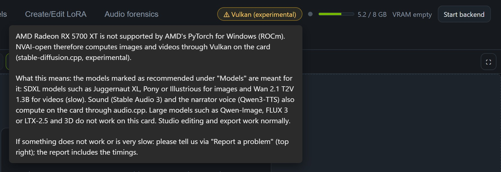
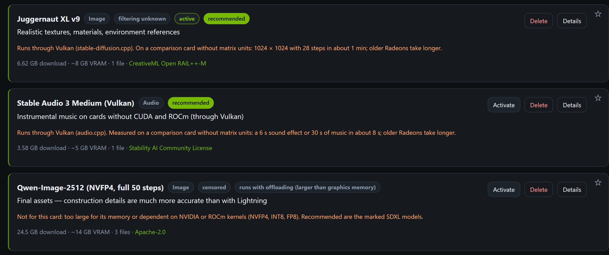
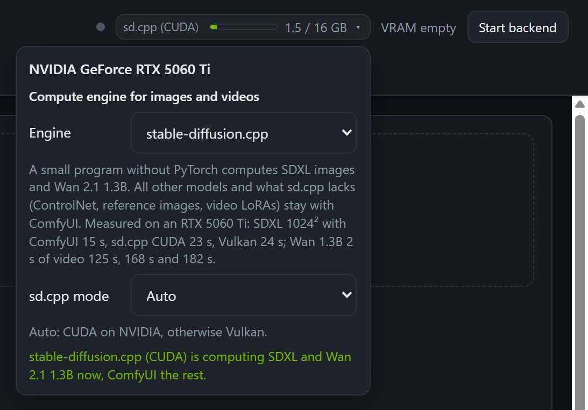

# Older Radeons and Intel cards: Vulkan (experimental)

[Deutsch](de/DIRECTML.md)

AMD's PyTorch for Windows (ROCm) does not support the Radeon RX 5000 series, Vega, Radeon VII or Polaris (RX 400/500),
and on Windows PyTorch has neither CUDA nor ROCm for Intel cards. Since 0.5.35 NVAI-open computes on these cards through
**Vulkan**, which all of them speak: images and videos with **stable-diffusion.cpp**, sound and the narrator voice with
**audio.cpp**. Both are small programs without PyTorch. This is experimental: everything below was measured on an NVIDIA
card limited to what an 8 GB card gets, partly with its matrix units switched off like on an RX 5700 XT. Reports in
[issue #3](https://github.com/Mantux775/NVAI-open/issues/3) help a lot.

## Why DirectML is gone

0.5.33 and 0.5.34 computed images and sound through DirectML. On a real RX 5700 XT, the reporter of issue #3 measured
an image with Pony Diffusion V6 XL, a LoRA, 1344 × 768 and the second pass: 5 min 40 s to 6 min 7 s per image, five
times in a row. The same job on the comparison card:

| Same job (SDXL, 1344 × 768, 28 steps, second pass) | Time |
|---|---|
| RX 5700 XT, DirectML (issue #3) | 5:40 to 6:07 min |
| Comparison card, DirectML | 166 s |
| Comparison card, Vulkan without matrix units | 100 s |
| Comparison card, Vulkan | 40 s |

On the RX 5700 XT that suggests about 3.5 minutes instead of 6 through Vulkan; the real figure comes with the next test.
Besides that, DirectML could not do video at all, needed a second Python environment with the old PyTorch 2.4.1 and
patches inside ComfyUI that any ComfyUI update could break. Vulkan is two programs with pinned checksums, and it brings
Intel cards along instead of leaving them on the processor.

## Setup

Install NVAI-open as usual, also over an older version. The setup recognises the card, downloads stable-diffusion.cpp
(28 MB) and audio.cpp (87 MB), and checks that Vulkan sees a graphics card of its own; integrated graphics stay on the
processor. The DirectML environment of 0.5.33 and 0.5.34 is removed. The top bar then says "Vulkan (experimental)", and
hovering over it explains what that means.

If Vulkan does not see the card, NVAI-open computes on the processor as before; the top bar then says "Running on the
CPU". "Repair NVAI-open" in the Start menu sets everything up again.

The setups of 0.5.34 to 0.5.36 never set up the Vulkan engines, whatever the card: Windows PowerShell 5.1 stopped at the
first line of the device list, so everything computed on the processor. Since 0.5.37 the setup reads the list properly.
If it still cannot set the engines up (no connection, say), NVAI-open downloads them itself on the next start, checks the
card the same way and shows the progress under Models → Your hardware.

## Which models

Generate and the Studio pick the models that run on the card by themselves, with sizes that fit into 8 GB. Under
"Models" they are marked as recommended, and every other model says why it does not run.

- **Images:** the SDXL models (Juggernaut XL v9, SDXL base, Pony V6 XL, Illustrious XL, NoobAI XL), preset to
  1024 × 1024. LoRAs, a start image, masks, extending and the second pass work; ControlNet and reference images do not.
- **Video:** Wan 2.1 T2V 1.3B, preset to 832 × 480 and 2 s, marked as slow. Since 0.5.36 also Wan 2.1 VACE 1.3B,
  which puts the character of a reference image into the scene of the prompt.
- **Sound:** Stable Audio 3 Small SFX (Vulkan) for sound effects, Stable Audio 3 Medium (Vulkan) for music.
- **Narrator voice:** Qwen3-TTS, from a description or from a recording, with the same model as on NVIDIA.
- **Not yet:** large models such as Qwen-Image, FLUX 3, Krea 2 or LTX-2.5 (too large for 8 GB or dependent on NVIDIA
  or ROCm kernels) and 3D, which needs CUDA or ROCm.

## Video through Vulkan

DirectML's plugin for PyTorch only handled tensors with up to five dimensions, and video models need more in a few
places: Wan 2.1 rebuilds its frames in eight. stable-diffusion.cpp computes directly through Vulkan, with the same model
files as ComfyUI (Wan 2.1 T2V 1.3B with its text encoder and VAE), and keeps the text encoder and the VAE in system RAM,
the video model on the card. Wan 2.1 VACE 1.3B (since 0.5.36) takes a reference image as well; it encodes its context in
tiles, otherwise the VAE would need about 10 GB for it.

Somi, the rabbit from our short film, in a moonlit graveyard: Wan 2.1 VACE 1.3B through Vulkan with Somi from his
own dataset as the reference image, 3 s at 832 × 480 in 7 minutes on the comparison card.

## Measured on the same card

An RTX 5060 Ti 16 GB, limited to the memory Windows gives an 8 GB card (7.7 GB); "without matrix units" switches off the
units an RX 5700 XT does not have. Times per job, including loading the model.

| Job | CUDA | DirectML (until 0.5.34) | Vulkan | Vulkan without matrix units |
|---|---|---|---|---|
| SDXL (Juggernaut XL v9), 1024 × 1024, 28 steps | 16 s | 83 s | 22 s | 57 s |
| SDXL, 1344 × 768, second pass | – | 166 s | 40 s | 100 s |
| Wan 2.1 T2V 1.3B, 832 × 480, 33 frames (2 s) | 117 s | stops | 194 s | – |
| Sound effect, 6 s (Stable Audio 3 Small SFX) | – | – | – | 8 s |
| Music, 30 s (Stable Audio 3 Medium) | 6 s | 16 s | – | 8 s |
| Narrator voice, about 7 s (Qwen3-TTS) | – | – | – | 21 s |

Somi from his own dataset stays exactly as he is; through Vulkan, Juggernaut XL paints only the scene around him,
with a mask: a banquet hall for one and a graveyard by moonlight, about 30 s each on the comparison card.

## stable-diffusion.cpp on NVIDIA too

Since 0.5.35 you choose what computes images and videos, under **Models → Your hardware** or with a click on the
memory bar at the top. **Auto** keeps the fastest way for the card: ComfyUI on NVIDIA and on Radeons with ROCm,
stable-diffusion.cpp through Vulkan on the cards above. On an NVIDIA card stable-diffusion.cpp can compute as well,
through CUDA or Vulkan. It then takes the SDXL models and Wan 2.1 T2V 1.3B; everything else, and jobs with ControlNet,
reference images or video LoRAs, stay with ComfyUI. The program downloads on the first switch: 30 MB for Vulkan, about
1 GB for CUDA with its runtime. Only what runs on the card is offered: no CUDA on a Radeon, no ComfyUI on a card without
CUDA or ROCm.

| Job (RTX 5060 Ti 16 GB, model loading included) | ComfyUI | sd.cpp CUDA | sd.cpp Vulkan |
|---|---|---|---|
| SDXL (Juggernaut XL v9), 1024 × 1024, 28 steps | 14–16 s | 23 s | 23–24 s |
| Wan 2.1 T2V 1.3B, 832 × 480, 33 frames (2 s) | 122–128 s | 168 s | 182 s |

On NVIDIA, ComfyUI stays the fastest. stable-diffusion.cpp is there to compare, and through Vulkan an NVIDIA card shows
how a job runs on a Radeon or Intel card.

## How it works

- Each image or video is one run of stable-diffusion.cpp (`external\sdcpp\sd-cli.exe`) with the model files from the
  model list. Above about 1 megapixel the VAE decodes in tiles: in one piece, 1728 × 960 needed 4 GB and 127 s for
  decoding alone; in tiles the whole job took 40 s.
- Sound and voice are one run of audio.cpp (`external\audiocpp\audiocpp_cli.exe`). Music and sound effects go into the
  history as MP3 with peaks at most −1 dB, like on NVIDIA.
- ComfyUI stays on the processor for prompt expansion and the audio tools.
- On a machine with integrated graphics plus a card, both engines compute only on the card.
- The logs are `sdcpp.log` and `audiocpp.log` in the data folder, and "Report a problem" includes them.
- The environment variables `NVAI_SDCPP_ENGINE=0` and `NVAI_AUDIOCPP_ENGINE=0` switch the engines off.
