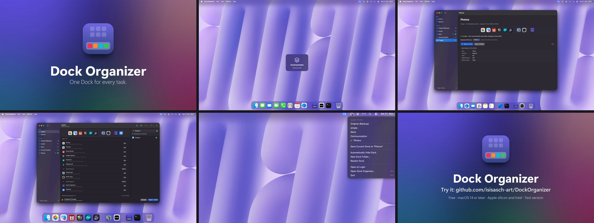

# Making of: a promo video for Dock Organizer

[Deutsch](de/DOCK_ORGANIZER_VIDEO.md)

A 39-second video for [Dock Organizer](https://github.com/isisasch-art/DockOrganizer), a free macOS app that saves
the Dock as profiles and switches between them by keyboard shortcut. Claude Code made it in one session: the music
with Stable Audio 3 in NVAI-open, the title cards with a small script, the screen recordings automated on a Mac mini,
the cut in the NVAI-open Studio. The last trim was done by hand in the Studio. Everything ran locally, the music on an
RTX 5060 Ti, the recordings on a Mac mini M1. The video on YouTube:
[youtube.com/watch?v=zeig-Rml4gA](https://www.youtube.com/watch?v=zeig-Rml4gA).

## English first

The app was German only, so the first step was a translation: all 179 texts of the interface, and the app follows
the system language. On the way, the known limitations listed in its README were fixed. Both went to the author as a
[pull request](https://github.com/isisasch-art/DockOrganizer/pull/4), and the Mac mini was switched to English for
the recordings.

## Music

Stable Audio 3 Medium, one sentence ending in the tempo:

> Upbeat 8-bit chiptune arcade music with a catchy square-wave lead melody, fast pulse-wave arpeggios, a bouncy
> triangle-wave bassline and punchy noise-channel drums with snappy snares, playful, energetic retro video game style.
> BPM: 124.

An electro take came first; the 8-bit take was chosen by ear. Claude cannot hear, so it measured the take instead:
123.8 BPM, one bar lasts 1.94 s, the bass comes in at 6.3 s. The video is cut in whole bars: one bar for each card in
between and for each shortcut, three bars for each longer scene.

## Title cards

A short Python script draws the six cards at 1920 × 1080: a color gradient with soft glows, the app icon and white
text. The icon came from the app's own icon script, rendered on the Mac. In the Studio every card zooms in slowly by
4.5 % (two scale keyframes).

## Screen recordings on the Mac mini

Each scene is a short shell script, so a take can be repeated exactly.

- **The stage:** three demo profiles (Work, Communication, Photos) with the shortcuts ⌃⌥1, ⌃⌥3 and ⌃⌥4, a calm
  wallpaper, no icons on the desktop. Profiles, Dock, wallpaper and language were backed up first and restored
  afterwards.
- **Clicks and keys:** a small Swift command-line tool posts mouse and keyboard events (CGEvent) and finds buttons
  through the accessibility tree. `screencapture -v` records the screen.
- **Pitfalls:** modifier keys have to be pressed and released as real key events; a Control key left pressed turned
  clicks into right-clicks. SwiftUI ignores synthetic drag and drop, so the video adds apps with the "+" button. macOS
  records with a variable frame rate and stops about two seconds early; every clip was converted to a constant 60 fps
  before the cut.

## A bug turned up

In the first shortcut take, the Photos profile did not reach the Dock. Claude measured it: with switches 4 s apart,
only 5 of 9 were right after 2 s. The cause: when the Dock quits, it writes its old state back. The fix writes the
profile once more as soon as the old Dock has quit (9 of 9 right) and went to the author as an
[issue](https://github.com/isisasch-art/DockOrganizer/issues/3) and a
[pull request](https://github.com/isisasch-art/DockOrganizer/pull/5). The shortcut scene was recorded again with 7 s
between the switches.

## The cut in the Studio

Claude built the edit with the Studio's REST commands: cards and recordings on V1, the music on A1. In the menu bar
scene the picture zooms to 170 % around the top right corner (`anchor` and four scale keyframes), and a half-second
dissolve leads into the end card. The first version took too long to get going; the second gave each shortcut a
single bar (41.6 s). The last trim of the intro was done by hand in the Studio: 39 s, exported as youtube-1080p at
60 fps and −14 LUFS.

## What carried over

- **Translate before recording.** The English build is what makes an English video possible, and it helps every user.
- **Script every scene.** A take can be repeated in a minute, also after a bug fix.
- **Constant frame rate first.** Convert screen recordings before cutting them.
- **Measure the tempo and cut in whole bars.** Claude cannot hear, but it can count.
- **Back up the Mac before staging it** and restore it afterwards.

The recording scripts were written for this one video and are not part of NVAI-open.
