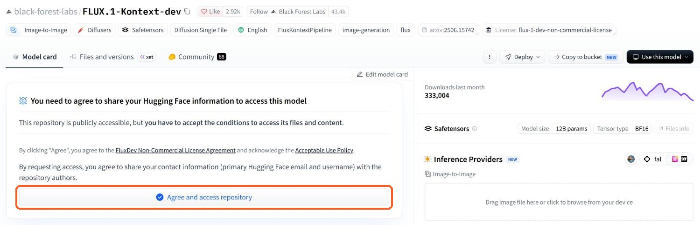
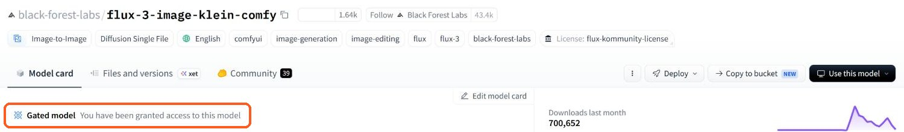
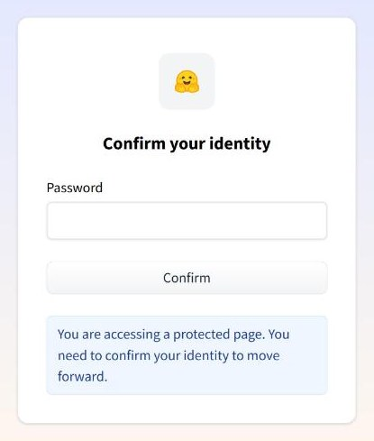
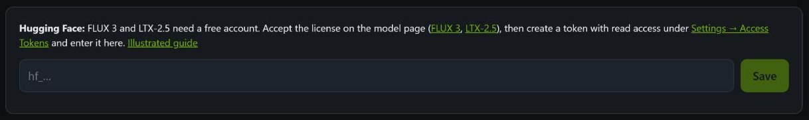
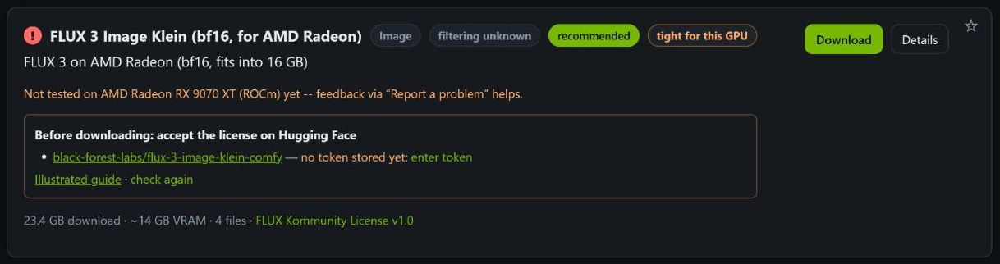

# Hugging Face: account, license, token

*Deutsch: [de/HUGGINGFACE.md](de/HUGGINGFACE.md)*

Most models in NVAI-open download without an account. Two are **gated** on Hugging Face: their files are
only handed out once you have accepted the license with your account. Before NVAI-open can download them,
you do three things once (about five minutes):

1. create a free Hugging Face account,
2. accept the license on each model page,
3. create a token with read access and store it in NVAI-open.

Access is granted immediately after accepting: all repositories below approve automatically, nobody
checks your request by hand.

| Repository on Hugging Face | Needed for |
|---|---|
| [black-forest-labs/flux-3-image-klein-comfy](https://huggingface.co/black-forest-labs/flux-3-image-klein-comfy) | FLUX 3 Image Klein, every variant (NVFP4, INT8, bf16 for AMD Radeon, Base) |
| [Lightricks/LTX-2.5](https://huggingface.co/Lightricks/LTX-2.5) | LTX-2.5, video with sound (NVFP4, INT8) |
| [Lightricks/LTX-2.5-22b-IC-LoRA-Pixel-Spatial-Upscaler](https://huggingface.co/Lightricks/LTX-2.5-22b-IC-LoRA-Pixel-Spatial-Upscaler) | optional: "Highest quality (DFR)" for LTX-2.5 |
| [Lightricks/LTX-2.5-22b-LoRA-Cinemagraph](https://huggingface.co/Lightricks/LTX-2.5-22b-LoRA-Cinemagraph) | optional LoRA: cinemagraph (still picture, single parts move) |
| [Lightricks/LTX-2.5-22b-LoRA-Slow-Motion-Control](https://huggingface.co/Lightricks/LTX-2.5-22b-LoRA-Slow-Motion-Control) | optional LoRA: slow motion |

You only need the repositories of the models you want to download.

## 1. Create an account

Sign up on [huggingface.co/join](https://huggingface.co/join). The account is free; Hugging Face sends a
link to confirm your e-mail address.

## 2. Accept the license

Open the model page from the table while signed in. As long as you have not accepted the license, the page
shows this box above the model card:

*The example is FLUX.1 Kontext dev, a model NVAI-open does not use: on the FLUX 3 page the box looks the
same. On the Lightricks pages (LTX-2.5) the button reads "Agree and Access".*

Read the license (the link in the box), then click the button. What you agree to:

- Hugging Face shares your username and primary e-mail address with the authors of the model.
- **FLUX 3** (FLUX Kommunity License): images may be used commercially only below US$5 million annual
  revenue; before publishing, every image has to be checked by hand (or a content filter used).
- **LTX-2.5** (LTX-2 Community License): free below US$10 million annual revenue. With "Agree and Access"
  you also agree to receive offers and updates from Lightricks; you can unsubscribe at any time.

Afterwards the page shows that you have access:

Repeat this for every repository you need (for LTX-2.5 at least `Lightricks/LTX-2.5`).

## 3. Create a token

A token lets NVAI-open download in the name of your account. Open
[Settings → Access Tokens → Create new token](https://huggingface.co/settings/tokens/new?tokenType=read).
Hugging Face may first ask for your password again:

Then:

1. Token type: **Read**.
2. Token name: anything, for example `NVAI-open`.
3. Click **Create token** and copy the token. It starts with `hf_` and is shown only once.

A fine-grained token works as well if "Read access to contents of all public gated repos you can access"
is ticked. More on tokens: [User access tokens](https://huggingface.co/docs/hub/security-tokens) in the
Hugging Face documentation.

Treat the token like a password: do not post it and do not put it in screenshots.

## 4. Store the token in NVAI-open

In NVAI-open under **Models**, the "Hugging Face" box sits above the list of models. Paste the token and
click **Save**:

NVAI-open checks the token with Hugging Face and stores it the way `hf auth login` does (in your user
folder under `.cache\huggingface\token`). After that the box only shows "Hugging Face: signed in as …"
with a link to sign out; the token itself is never displayed again.

## 5. Check and download

Every model from a gated repository shows a box on its card under **Models** until it is downloaded.
It tells you, for each repository, whether your token already has access:

| The box says | What to do |
|---|---|
| no token stored yet | "enter token" jumps to the token field (step 4) |
| not accepted yet | open the repository link and accept the license (step 2), then click "check again" |
| access granted | click **Download** |
| state unknown | no connection to Hugging Face; try again later |

## If the download still fails

- **"No access to … the repo is gated"**: the license is not accepted yet, or it was accepted with a
  different account than the one the token belongs to. The account name is shown under "Hugging Face:
  signed in as …". Accept the license with that account, then download again.
- **"Hugging Face rejected the token"** when saving: the token was copied incompletely, deleted, or has
  no read access. Create a new one (step 3).
- Changed your mind: "sign out" in the Hugging Face box removes the token from this computer. You can
  delete the token itself on Hugging Face under [Settings → Access Tokens](https://huggingface.co/settings/tokens).
