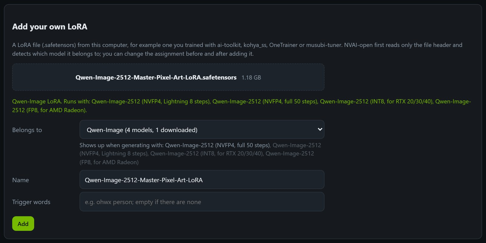
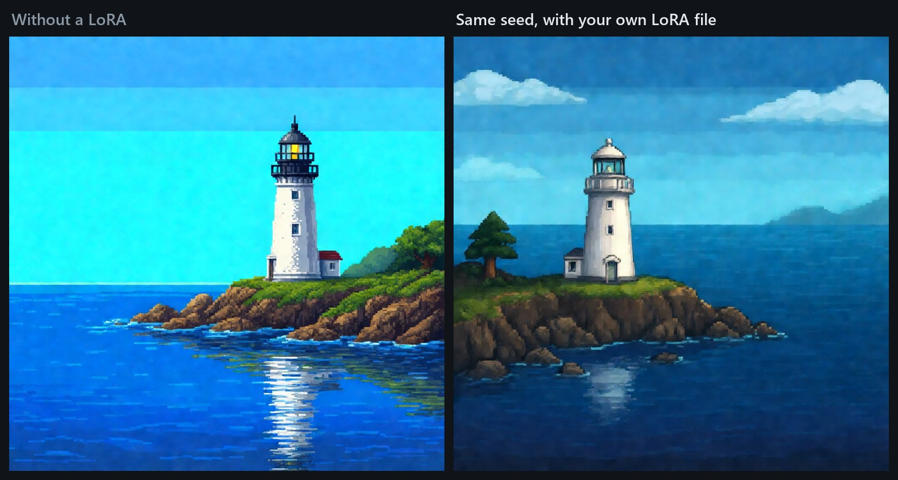
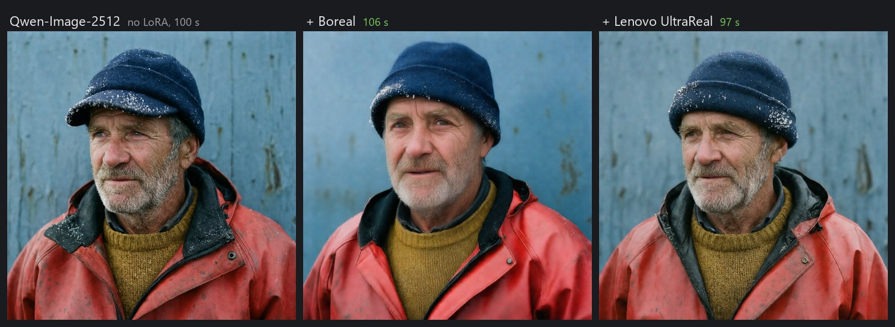
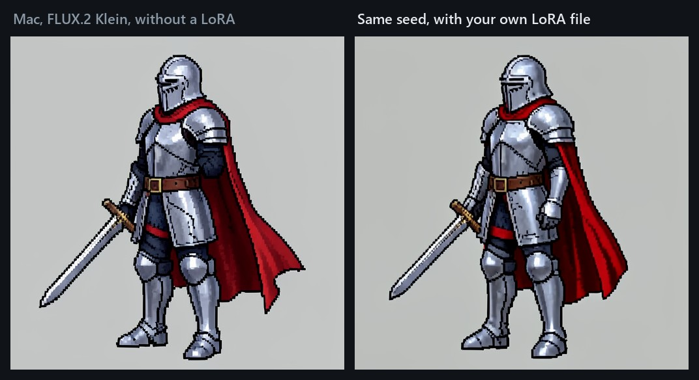

# LoRAs

[Deutsch](de/LORAS.md)

A LoRA is a small add-on (usually 50 MB to 1 GB) for a large model. It teaches the model one thing it cannot do as
well on its own: a style such as pixel art or a film look, more realism, a camera move, or a particular person or
character. The model itself stays unchanged; the LoRA is only switched on while generating.

Every LoRA is trained for one model family, and one made for another family usually has no effect at all. NVAI-open
therefore reads the header of each LoRA file and offers it only under the models it fits.

## Which models take LoRAs

| Family | Models | Good to know |
|---|---|---|
| Qwen-Image | Qwen-Image-2512 in every version (NVFP4, INT8, FP8, Lightning) | realism, style and speed LoRAs tested, see below |
| Z-Image | Z-Image, Z-Image INT8 | |
| SDXL | SDXL Base, Juggernaut XL, Pony V6 XL, Illustrious XL, NoobAI-XL | the largest choice; a LoRA works best on the checkpoint it was made for |
| FLUX.1 / Chroma | FLUX.1 schnell, Chroma1-HD | |
| LTX-2 / 2.3 | LTX-2.5, LTX-2.3 | most LTX LoRAs are made for LTX-2.3 and also work with LTX-2.5 |
| LTX-Video 0.9 | LTX-Video 2B | |
| Wan | Wan 2.1 T2V 1.3B, Wan 2.2 TI2V 5B, Wan 2.2 I2V A14B, Wan 2.1 I2V 14B | each size takes only its own LoRAs; for A14B they usually come as a pair (high and low noise) |
| MiniMax H3 | MiniMax H3, MiniMax H3 Reference | only its own turbo LoRAs, already preselected |

No LoRAs: FLUX 3 Klein, Krea 2 (apart from ostris' style LoRA for style templates under "Models" → "Download
extras"), MOSS-Image, Qwen-Image 2.1 and the other image models not listed. On the Mac only FLUX.2 Klein 4B takes
LoRAs, see [On the Mac](#on-the-mac).

## Where LoRAs come from

- **Recommended LoRAs:** under LTX-2.5, "Recommended LoRAs" downloads tested styles and switches them on.
- **Search:** "Models" → "Search models and LoRAs" finds LoRAs on Hugging Face and Civitai. Before downloading,
  NVAI-open reads the file header and says which models the LoRA fits. Civitai needs your own API key for most
  downloads (civitai.com → Settings → API Keys).
- **Your own file:** a LoRA you trained yourself (ai-toolkit, kohya_ss, OneTrainer, musubi-tuner …) or got elsewhere.

## Adding your own LoRA file



1. "Models" → "Add LoRA file". On the Generate page, "+ Add your own LoRA file" in the LoRA list under the model does
   the same, and the new LoRA is ticked right away.
2. Drop in or pick a `.safetensors` file. NVAI-open reads only the header, a few kilobytes, and shows the family the
   LoRA was trained for and the models it will appear with. Trigger words stored in the file are filled in.
3. Under "Belongs to", confirm or change the family, then set the name and the trigger words. For Wan 2.2 A14B also
   choose the expert: both, high noise only or low noise only.
4. "Add" copies the file into the models folder (`loras/`), with progress and a cancel button.

What NVAI-open checks:

- **Only `.safetensors`:** other formats (`.pt`, `.ckpt`, `.bin`) can run code when they are loaded.
- **Complete files:** a cut-off or damaged file is refused; its size has to match the header exactly.
- **No copies:** the same file a second time only updates its details.
- **A model to go with it:** a LoRA for a family that none of your models takes is refused, because it would show up
  nowhere (for example FLUX.2 Klein on Windows).
- **Every common format:** kohya, Diffusers, ComfyUI and PEFT files are all recognized.

**Changing it later:** "Assignment" on the LoRA under "Models" changes the family, name, trigger words and expert. That
works for every LoRA you added yourself or from the search; the LoRAs that come with the catalog stay as they are.
Deleting a LoRA you added removes the file and its entry.

## Using LoRAs

On the Generate page every matching LoRA appears under the selected model (if the model takes none, the LoRA section
says so and names your models that do):

- **Tick it** and set the strength, usually 0.6 to 1.0.
- **Put its trigger words into the prompt**, "+ trigger" does that. Without them a pixel-art LoRA for Qwen-Image-2512
  left the picture almost unchanged; with "Pixel Art." in the prompt it made clean pixel art.
- **Several at once** work, each a little weaker: Boreal and Lenovo UltraReal at 0.6 each.
- **Speed LoRAs** need their own settings: `steps=4, cfg=1` for Wuli Turbo and for Wan2.2-Lightning.
- A LoRA hardly costs time: 94 to 106 instead of 100 seconds with Qwen-Image-2512.



## Tested LoRAs

Measured on an RTX 5060 Ti with 16 GB:

| LoRA | Model | Setting | Result |
|---|---|---|---|
| Boreal (Civitai) | Qwen-Image-2512 | 0.9 | looks most like a real photo |
| Lenovo UltraReal (Apache-2.0) | Qwen-Image-2512 | 0.9; with Boreal 0.6 each | more natural, closest to the prompt |
| Real Life, flymy realism | Qwen-Image-2512 | | replaced the background the prompt asked for |
| Skin Fix | Qwen-Image-2512 | | draws soft |
| Qwen-Image-2512 Master Pixel Art | Qwen-Image-2512 | 1.0, "Pixel Art." in the prompt | clean pixel art instead of color bands |
| Wuli Turbo | Qwen-Image-2512 | `steps=4, cfg=1` | 18 instead of 100 s, almost the same quality |
| Wan2.2-Lightning I2V (high and low) | Wan 2.2 I2V A14B | `steps=4, cfg=1` | 90 instead of 585 s at 640 × 640; 5 s at 1280 × 560 in 6.5 instead of 55 min, in slow motion (which stayed without it, too) |
| Cinemagraph | LTX-2.5 | only with "Loop" | 6 % of the picture moved, the face stood still |
| Slow Motion | LTX-2.5 | | real slow motion: spray fell over 5 s instead of 1.5 s |
| Fantasy Anime, Fantasy Painterly | LTX-2.5 | | change the look clearly |
| Paper Cut-Out | LTX-2.5 | 1.5 | visible only at 1.5 |
| Claymation, Transition | LTX-2.5 | | hardly any effect |



## Characters in the Studio

In the Studio a character bundles one or more LoRAs with a voice. Each scene uses the LoRAs that fit its model, so a
character can have one for still images (Qwen-Image) and one for clips (LTX-2), and their trigger words go in front of
the prompt by themselves. In a clip that speaks a given voice line, Fantasy Anime at 0.8 showed no visible effect.
How to set it up: [STUDIO.md](STUDIO.md#characters).

## On the Mac

NVAI-open for Mac loads LoRAs only into FLUX.2 Klein 4B. The catalog has some (pixel art, sprite sheet, anime …), and
since Mac 0.5.5 your own files work as on Windows. LoRAs for FLUX.2 Klein 9B and files in the kohya format are refused
with a message, because the Mac version cannot apply them. Switching a LoRA on loads the model once more: on a Mac mini
M1 the first image at 512² took 50 seconds, the next one with the same LoRA 37.



## Licenses

Every LoRA has its own license, shown next to it under "Models", and it applies on top of the license of the model.
"not stated" means you cannot assume you may sell what you make with it. For files you add yourself NVAI-open cannot
know the license, it shows "own file".

## For Claude Code and other programs

Over MCP, `list_models(kind="lora")` lists the LoRAs with family and trigger words, and a model's `lora_bases` says
which families it takes. Generate with `loras=[{"model_id": "…", "strength": 0.8}]` and the trigger words in the
prompt. `add_lora(path)` adds a file from this computer, `update_lora` changes its assignment.

Over REST:

```
# read only the header (the first 8 bytes and the header as the body): family, matching models, trigger words
POST /api/loras/inspect?file_name=my-lora.safetensors

# add a file: the file is the body, the details go in the address (family empty = as detected)
curl -X POST "http://127.0.0.1:8100/api/loras/upload?file_name=my-lora.safetensors&trigger=ohwx%20person" \
  -H "Content-Type: application/octet-stream" --data-binary @my-lora.safetensors

# change the assignment (the id comes back when adding)
curl -X PUT http://127.0.0.1:8100/api/loras/lora-upload-my-lora -H "Content-Type: application/json" \
  -d '{"family": "qwenimage", "trigger": "ohwx person"}'
```

`DELETE /api/models/{id}` removes a LoRA you added, with its file.
