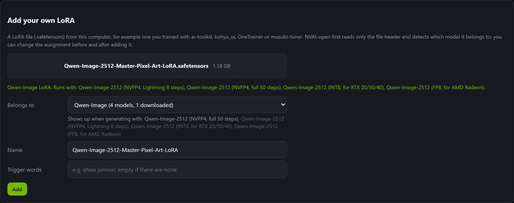
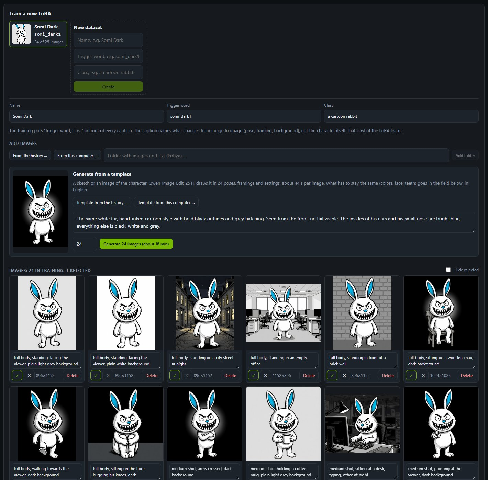
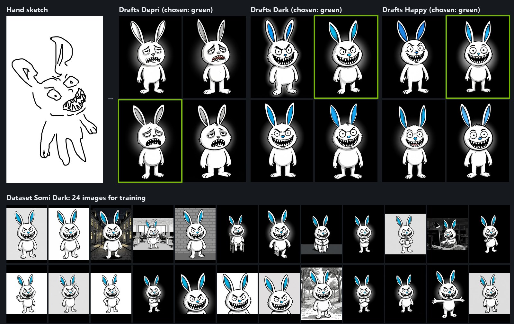
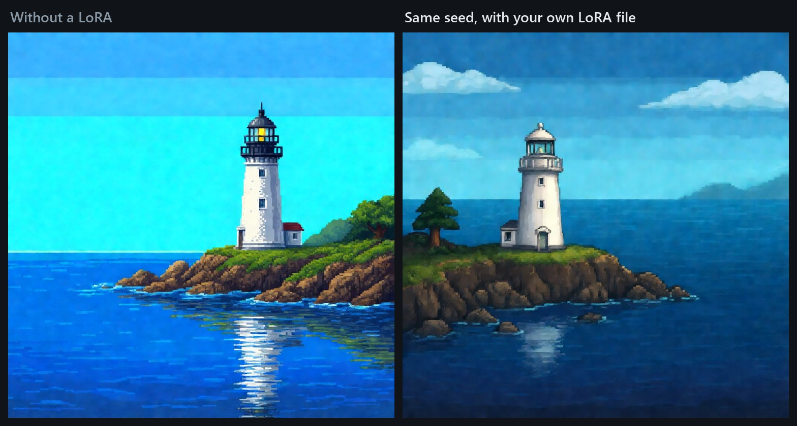
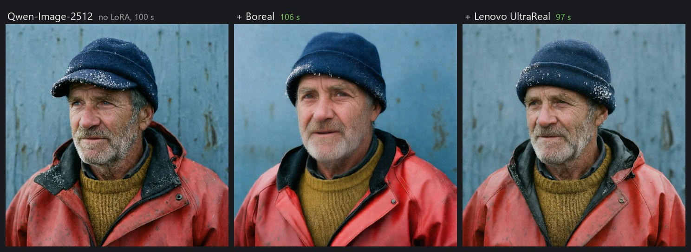
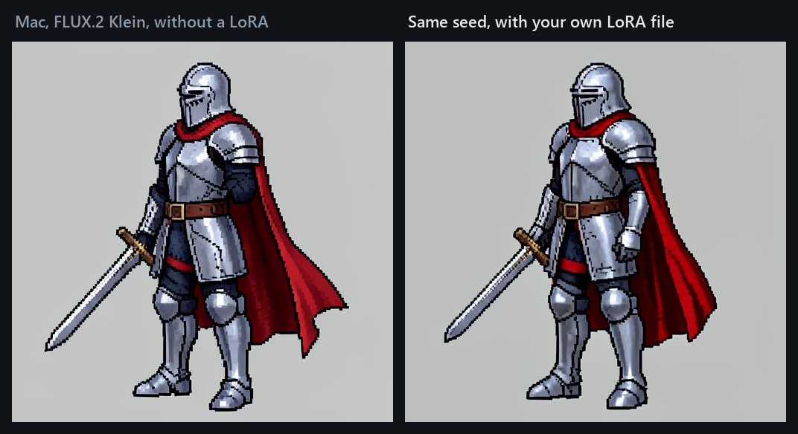

# LoRAs

[Deutsch](de/LORAS.md)

A LoRA is a small add-on (usually 50 MB to 1 GB) for a large model. It teaches the model one thing it cannot do as
well on its own: a style such as pixel art or a film look, more realism, a camera move, or a particular person or
character. The model itself stays unchanged; the LoRA is only switched on while generating.

Every LoRA is trained for one model family, and one made for another family usually has no effect at all. NVAI-open
therefore reads the header of each LoRA file and offers it only under the models it fits.

## Which models take LoRAs

| Family | Models | Good to know |
|---|---|---|
| Qwen-Image | Qwen-Image-2512 in every version (NVFP4, INT8, FP8, Lightning) | realism, style and speed LoRAs tested, see below |
| Z-Image | Z-Image, Z-Image INT8 | |
| SDXL | SDXL Base, Juggernaut XL, Pony V6 XL, Illustrious XL, NoobAI-XL | the largest choice; a LoRA works best on the checkpoint it was made for |
| FLUX.1 / Chroma | FLUX.1 schnell, Chroma1-HD | |
| LTX-2 / 2.3 | LTX-2.5, LTX-2.3 | most LTX LoRAs are made for LTX-2.3 and also work with LTX-2.5 |
| LTX-Video 0.9 | LTX-Video 2B | |
| Wan | Wan 2.1 T2V 1.3B, Wan 2.2 TI2V 5B, Wan 2.2 I2V A14B, Wan 2.1 I2V 14B | each size takes only its own LoRAs; for A14B they usually come as a pair (high and low noise) |
| MiniMax H3 | MiniMax H3, MiniMax H3 Reference | only its own turbo LoRAs, already preselected |

No LoRAs: FLUX 3 Klein, Krea 2 (apart from ostris' style LoRA for style templates under "Models" → "Download
extras"), MOSS-Image, Qwen-Image 2.1 and the other image models not listed. On the Mac only FLUX.2 Klein 4B takes
LoRAs, see [On the Mac](#on-the-mac).

## Where LoRAs come from

- **Recommended LoRAs:** under LTX-2.5, "Recommended LoRAs" downloads tested styles and switches them on.
- **Search:** "Models" → "Search models and LoRAs" finds LoRAs on Hugging Face and Civitai. Before downloading,
  NVAI-open reads the file header and says which models the LoRA fits. Civitai needs your own API key for most
  downloads (civitai.com → Settings → API Keys).
- **Your own file:** a LoRA you trained yourself (ai-toolkit, kohya_ss, OneTrainer, musubi-tuner …) or got elsewhere.
- **Trained here:** the area "Create/Edit LoRA" trains one for Qwen-Image-2512 from your own images, see
  [Training your own LoRA](#training-your-own-lora).

## Adding your own LoRA file



1. "Models" → "Add LoRA file". On the Generate page, "+ Add your own LoRA file" in the LoRA list under the model does
   the same, and the new LoRA is ticked right away.
2. Drop in or pick a `.safetensors` file. NVAI-open reads only the header, a few kilobytes, and shows the family the
   LoRA was trained for and the models it will appear with. Trigger words stored in the file are filled in.
3. Under "Belongs to", confirm or change the family, then set the name and the trigger words. For Wan 2.2 A14B also
   choose the expert: both, high noise only or low noise only.
4. "Add" copies the file into the models folder (`loras/`), with progress and a cancel button.

What NVAI-open checks:

- **Only `.safetensors`:** other formats (`.pt`, `.ckpt`, `.bin`) can run code when they are loaded.
- **Complete files:** a cut-off or damaged file is refused; its size has to match the header exactly.
- **No copies:** the same file a second time only updates its details.
- **A model to go with it:** a LoRA for a family that none of your models takes is refused, because it would show up
  nowhere (for example FLUX.2 Klein on Windows).
- **Every common format:** kohya, Diffusers, ComfyUI and PEFT files are all recognized.

**Changing it later:** "Assignment" on the LoRA under "Models" changes the family, name, trigger words and expert. That
works for every LoRA you added yourself or from the search; the LoRAs that come with the catalog stay as they are.
Deleting a LoRA you added removes the file and its entry.

## Training your own LoRA

The area **Create/Edit LoRA** trains a LoRA for Qwen-Image-2512 on your own computer: a character or a style from 20
to 30 images. It runs with musubi-tuner (kohya-ss, Apache-2.0) and needs an NVIDIA card. Measured on an RTX 5060 Ti
with 16 GB and 64 GB of RAM; with less memory it is untested. An assistant leads through it in five steps (describe
the character, choose a template, collect images, sort out, train), each with a short recommendation; "Everything on
one page" shows all settings at once.



1. **Set up** once: the trainer (its own environment with PyTorch, about 6.5 GB) and Qwen-Image-2512 in bf16 for
   training (57.5 GB; the NVFP4 file the app generates with cannot be trained). For images from a template also
   Qwen-Image-Edit-2511 (21.4 GB).
2. **Dataset:** a name, a trigger word that is not a real word (such as `somi_dark1`) and the class
   (`a cartoon rabbit`). Images come from the history, from this computer or from a folder with `.txt` captions
   (kohya), or Qwen-Image-Edit-2511 draws your template in 24 poses, framings and settings, about 44 s per image. A
   caption names what changes from image to image (pose, framing, background), not the character itself; trigger word
   and class go in front by themselves. Without a finished drawing, a sketch, a photo or only the description is
   enough: "Make 4 drafts" draws the character frontally in full, and one draft becomes the template. A description
   in English that names how the character differs from the ordinary (body shape, ears, what is missing) decides more
   than the sketch. Images that came out well can be ticked to generate more from them.
3. **Sort out:** look at every image at full size and reject what does not fit. The LoRA learns mistakes too.
   "Replace rejected" draws the same pose again with a new seed.
4. **Train:** 20 epochs, rank 16 with alpha 16, learning rate 2e-4, a checkpoint every 5 epochs. 24 images make 480
   steps, about 2 h 10 min. The graphics card is busy all that time, other jobs wait. With these settings our Somi LoRAs
   showed the character at strength 1 from epoch 15 on. Name colors such as ears and nose in the prompt, otherwise they
   drift. "Schedule for" starts the training at a set time, for example at night, as soon as NVAI-open is running; the
   images at the start count, so sorting out can go on until then. While it runs, the training view shows the loss
   curve; "Pause after this epoch" frees the graphics card without losing anything (a resume point is saved after
   every epoch, about 0.9 GB), "Resume" continues there with the dataset as it is then, also with more epochs. To try
   another learning rate, start a new training from any checkpoint.
5. **Compare and add:** afterwards NVAI-open renders test images for every checkpoint with a fixed seed, and one
   without the LoRA. "Add as LoRA" under the best column puts it among your LoRAs with its trigger word. From there it
   works like any other LoRA, also for characters in the Studio.

**Licenses:** images from FLUX 3 cannot go into a dataset, because the FLUX Kommunity License forbids in 4(b) training
another image model with its images. Qwen-Image-Edit-2511, Qwen-Image-2512 and musubi-tuner are under Apache-2.0.
Images from Krea 2 or Qwen-Image 2.1 are marked: their terms carry over to the LoRA.

### How the Somi LoRAs were made

Somi is the rabbit from the [short film](SHORT_FILM.md). Its first variants came from FLUX 3 and could not be used for
training, so everything started again from the hand sketch.



1. Qwen-Image-Edit-2511 made four to eight drafts per type from the sketch (Depri, Dark, Happy), and one per type was
   chosen.
2. From each chosen draft came 24 images: 20 poses and settings shared by all types and four that suit the type, such
   as Depri slumped over his desk.
3. Sorting out showed what the prompt had not fixed. In most rejected Depri images the face had tipped into grumpy, the
   ears changed color, once a tail showed up. One sentence about the expression and one about the colors fixed that,
   and the replacements fit.
4. Each LoRA trained for 2 h 7 min to 2 h 18 min (24 images, 20 epochs), at most 14.3 GB of graphics memory.
5. The test images showed the catch: the LoRAs were too weak. At strength 1 Qwen-Image drew an ordinary black rabbit
   (the "dark" in the trigger word pulls that way); only at 2.5 did Somi appear. Alpha 16 instead of 1 helped, but not
   enough, also on an fp8 model instead of NVFP4.
6. Before the third run, Depri and Happy were brought closer to the look of the short film. Qwen-Image-Edit-2511 got
   only a description of the features (tired heavy lids and a small grumpy mouth for Depri, a friendly grin with flat
   teeth for Happy), and their datasets were drawn again. With learning rate 2e-4 instead of 1e-4 all three LoRAs hit the
   character at strength 1 from epoch 15 on. Without a sentence about the colors the ears often came out pink.

## Using LoRAs

On the Generate page every matching LoRA appears under the selected model (if the model takes none, the LoRA section
says so and names your models that do):

- **Tick it** and set the strength, usually 0.6 to 1.0.
- **Put its trigger words into the prompt**, "+ trigger" does that. Without them a pixel-art LoRA for Qwen-Image-2512
  left the picture almost unchanged; with "Pixel Art." in the prompt it made clean pixel art.
- **Several at once** work, each a little weaker: Boreal and Lenovo UltraReal at 0.6 each.
- **Speed LoRAs** need their own settings: `steps=4, cfg=1` for Wuli Turbo and for Wan2.2-Lightning.
- A LoRA hardly costs time: 94 to 106 instead of 100 seconds with Qwen-Image-2512.



## Tested LoRAs

Measured on an RTX 5060 Ti with 16 GB:

| LoRA | Model | Setting | Result |
|---|---|---|---|
| Boreal (Civitai) | Qwen-Image-2512 | 0.9 | looks most like a real photo |
| Lenovo UltraReal (Apache-2.0) | Qwen-Image-2512 | 0.9; with Boreal 0.6 each | more natural, closest to the prompt |
| Real Life, flymy realism | Qwen-Image-2512 | | replaced the background the prompt asked for |
| Skin Fix | Qwen-Image-2512 | | draws soft |
| Qwen-Image-2512 Master Pixel Art | Qwen-Image-2512 | 1.0, "Pixel Art." in the prompt | clean pixel art instead of color bands |
| Wuli Turbo | Qwen-Image-2512 | `steps=4, cfg=1` | 18 instead of 100 s, almost the same quality |
| Wan2.2-Lightning I2V (high and low) | Wan 2.2 I2V A14B | `steps=4, cfg=1` | 90 instead of 585 s at 640 × 640; 5 s at 1280 × 560 in 6.5 instead of 55 min, in slow motion (which stayed without it, too) |
| Cinemagraph | LTX-2.5 | only with "Loop" | 6 % of the picture moved, the face stood still |
| Slow Motion | LTX-2.5 | | real slow motion: spray fell over 5 s instead of 1.5 s |
| Fantasy Anime, Fantasy Painterly | LTX-2.5 | | change the look clearly |
| Paper Cut-Out | LTX-2.5 | 1.5 | visible only at 1.5 |
| Claymation, Transition | LTX-2.5 | | hardly any effect |



## Characters in the Studio

In the Studio a character bundles one or more LoRAs with a voice. Each scene uses the LoRAs that fit its model, so a
character can have one for still images (Qwen-Image) and one for clips (LTX-2), and their trigger words go in front of
the prompt by themselves. In a clip that speaks a given voice line, Fantasy Anime at 0.8 showed no visible effect.
How to set it up: [STUDIO.md](STUDIO.md#characters).

## On the Mac

NVAI-open for Mac loads LoRAs only into FLUX.2 Klein 4B. The catalog has some (pixel art, sprite sheet, anime …), and
since Mac 0.5.5 your own files work as on Windows. LoRAs for FLUX.2 Klein 9B and files in the kohya format are refused
with a message, because the Mac version cannot apply them. Switching a LoRA on loads the model once more: on a Mac mini
M1 the first image at 512² took 50 seconds, the next one with the same LoRA 37.



## Licenses

Every LoRA has its own license, shown next to it under "Models", and it applies on top of the license of the model.
"not stated" means you cannot assume you may sell what you make with it. For files you add yourself NVAI-open cannot
know the license, it shows "own file".

## For Claude Code and other programs

Over MCP, `list_models(kind="lora")` lists the LoRAs with family and trigger words, and a model's `lora_bases` says
which families it takes. Generate with `loras=[{"model_id": "…", "strength": 0.8}]` and the trigger words in the
prompt. `add_lora(path)` adds a file from this computer, `update_lora` changes its assignment.

Over REST:

```
# read only the header (the first 8 bytes and the header as the body): family, matching models, trigger words
POST /api/loras/inspect?file_name=my-lora.safetensors

# add a file: the file is the body, the details go in the address (family empty = as detected)
curl -X POST "http://127.0.0.1:8100/api/loras/upload?file_name=my-lora.safetensors&trigger=ohwx%20person" \
  -H "Content-Type: application/octet-stream" --data-binary @my-lora.safetensors

# change the assignment (the id comes back when adding)
curl -X PUT http://127.0.0.1:8100/api/loras/lora-upload-my-lora -H "Content-Type: application/json" \
  -d '{"family": "qwenimage", "trigger": "ohwx person"}'
```

`DELETE /api/models/{id}` removes a LoRA you added, with its file.
