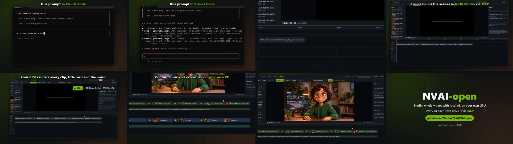
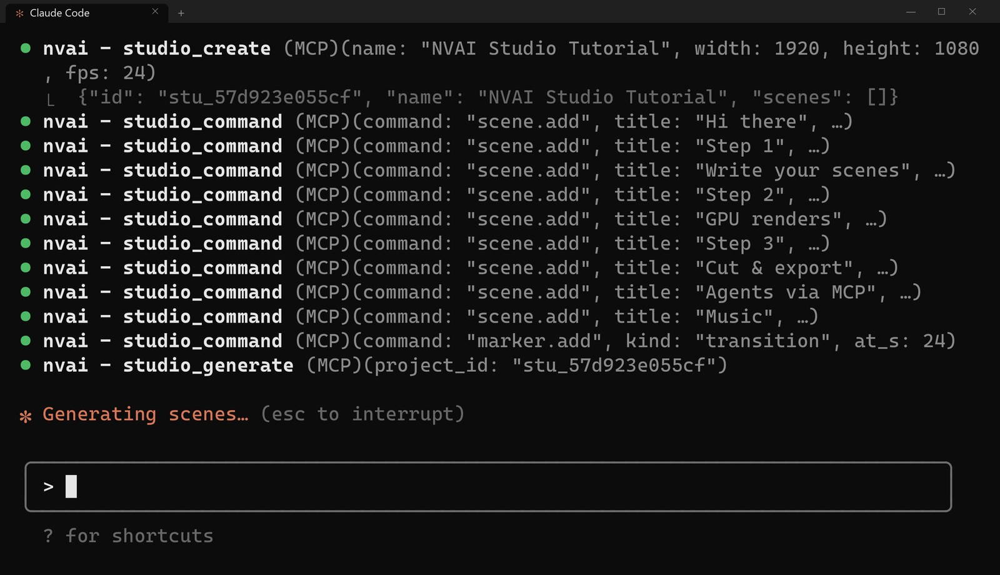
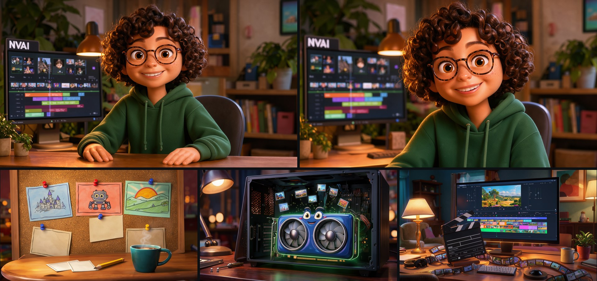
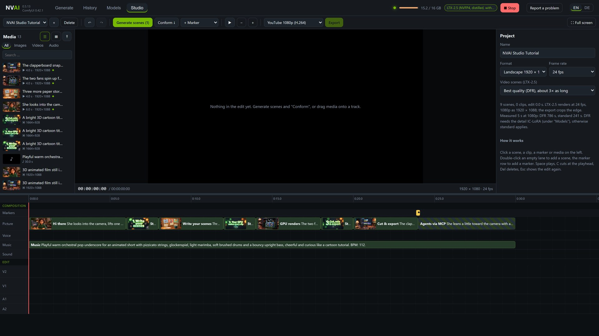
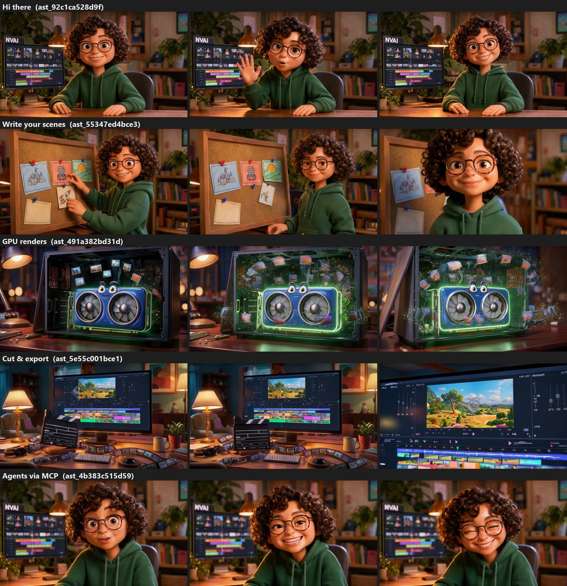
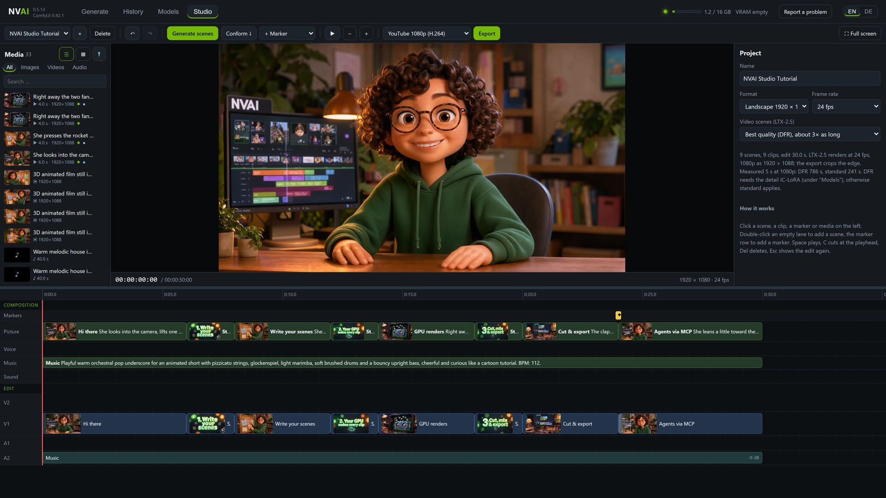
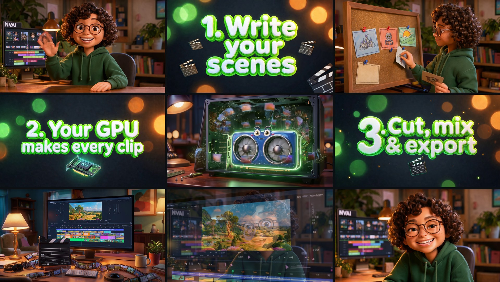
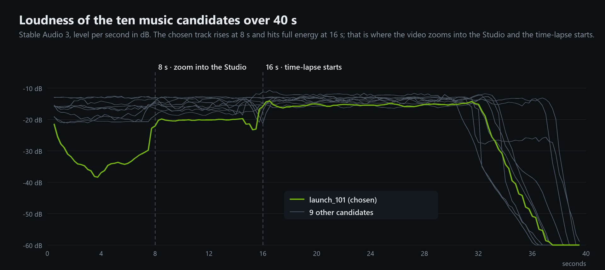
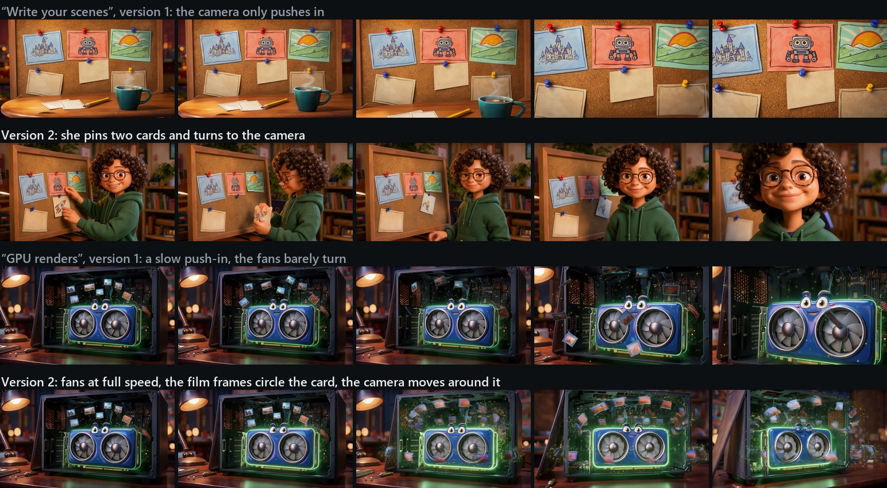
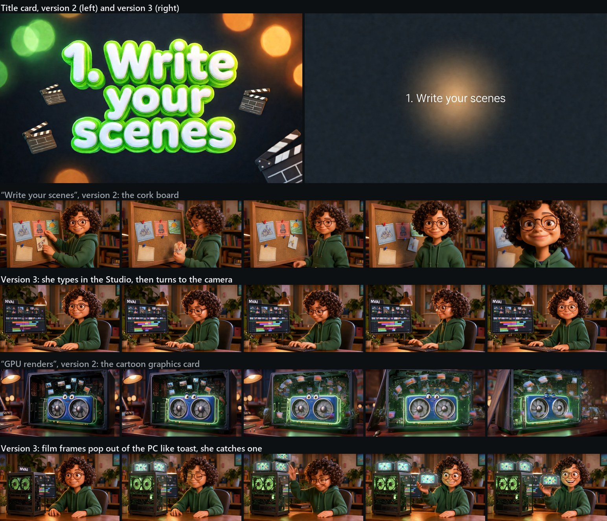

# Making of: the Studio video, built by Claude over MCP

[Deutsch](de/MAKING_OF.md)

The one-minute video that presents the Studio was made almost entirely with NVAI-open itself. One request
in Claude Code; Claude made the start images, laid out the scenes in the Studio, let the GPU render clips,
title cards and music, conformed the edit and exported a 30-second tutorial. Around that tutorial Claude then
cut the video for Reddit: the console, a zoom into the Studio, the generation as a time-lapse and the
finished tutorial at the end.

This page follows the whole process step by step, with the prompts, the times and what was checked on the
way. Sections 1 to 7 describe the first version; sections 8 and 9 show what the first viewer found and how two
more versions fixed it. Everything ran locally on an **RTX 5060 Ti 16 GB**.

| Step | Tool | Time on the GPU |
|---|---|---|
| Five start images (FLUX 3) | `generate_image` | about 10 min |
| Nine Studio scenes: two shots with speech (DFR), three illustrating shots, three title cards, music | `studio_command`, `studio_generate` | 74 min |
| Conform and export of the 30-second tutorial | `studio_command`, `studio_export` | 30 s |
| Ten music candidates for the Reddit video (Stable Audio 3) | `generate_audio` | about 1.5 min |
| Version 2: three shots again, conform and export (section 8) | `studio_command`, `studio_generate`, `studio_export` | 33 min |
| Version 3: two new start images, the whole project again (section 9) | `generate_image`, `studio_*` | 105 min |

## 1. The request

The request was short: a tutorial video made with NVAI, to post on Reddit, in English, about the Studio
itself, in the style of an animated explainer (a 3D cartoon presenter, title cards, quick cuts). In the
video it appears as the prompt typed into Claude Code:

The console in the video is drawn, not filmed: a small program renders the Claude Code window frame by frame
and types the prompt. The lines below it are the MCP calls that were really made for this video, with their
real results (number of images, seconds, the project ID).

## 2. Start images with FLUX 3

LTX-2.5 invents a new face in every text-to-video scene. A presenter who appears twice therefore needs start
images, and the scenes get them as their first frame.

- **The presenter:** `flux3-klein-nvfp4`, 1920 × 1088 (the video size), `batch_size=4`, 178 s. Style first:
  "3D animated film still in the style of a modern Pixar movie, soft warm cinematic lighting, rich colors. A
  friendly young woman presenter with short curly dark brown hair, big expressive brown eyes, light freckles
  and round tortoiseshell glasses, wearing a plain dark green hoodie without any print, sits at a wooden desk
  in a cozy home studio … Behind her on the left a computer monitor shows a video editing timeline … and the
  bold white word "NVAI" at the top of the screen." All four came out usable; the one with the clearest face
  and calm hands was picked at full resolution.
- **The same person once more, closer:** the chosen image as `reference_asset_ids`, "The woman from the first
  image, with exactly the same face, glasses, curly hair and dark green hoodie, in the same cozy home studio.
  Medium close-up from the chest up …", 4 images in 204 s. All 4 kept face, glasses, hair, clothing and room.
- **Three illustrating shots** in the same style, 2 images each in about 80 s: a cork board with storyboard
  cards, a cute graphics card in an open PC case, an editing desk with a clapperboard.

## 3. The scenes in the Studio

Claude created the project with `studio_create("NVAI Studio Tutorial")` and then one `scene.add` per shot.
The Studio showed every scene the moment it was added.

| Time | Scene | Kind | Model | Quality |
|---|---|---|---|---|
| 0–6 s | Hi there | video with speech, start image: presenter | LTX-2.5 | DFR |
| 6–8 s | Step 1 | title card | Qwen-Image-2512 | 50 steps |
| 8–12 s | Write your scenes | video, start image: cork board | LTX-2.5 | standard |
| 12–14 s | Step 2 | title card | Qwen-Image-2512 | 50 steps |
| 14–18 s | GPU renders | video, start image: graphics card | LTX-2.5 | standard |
| 18–20 s | Step 3 | title card | Qwen-Image-2512 | 50 steps |
| 20–24 s | Cut & export | video, start image: editing desk | LTX-2.5 | standard |
| 24–30 s | Agents via MCP | video with speech, start image: close-up | LTX-2.5 | DFR |
| 0–30 s | Music | music lane | Stable Audio 3 | |

A `transition` marker at 24 s adds a half-second dissolve into the last shot.

**The prompts, shortened:**

- *Speech, first shot:* "She looks into the camera, lifts one hand in a small friendly wave and says in a warm,
  cheerful, clear female voice: "Hi! Want a whole video, made right on your own PC?" Then she smiles and nods
  once. Static camera, a locked-off shot; the framing stays exactly as in the first frame. Quiet room tone …"
  (Version 1 ended with "Let me show you how."; see section 8.)
- *Speech, last shot:* "… says … "And the best part? Every AI agent can now drive this through MCP." Then she
  smiles and nods once." The product name is not spoken (how a model pronounces an acronym is a gamble); it is
  on the monitor behind her and on the end card.
- *Title cards:* "A bright 3D cartoon title card in the style of an animated movie, centered composition. Big
  glossy rounded 3D letters in white with a lime green outline read "1. Write your scenes" … nothing else
  written anywhere." Size 1664 × 928, Qwen's native 16:9.
- *Music:* "Playful warm orchestral pop underscore for an animated short with pizzicato strings, glockenspiel,
  light marimba, soft brushed drums and a bouncy upright bass, cheerful and curious like a cartoon tutorial.
  BPM: 112."

## 4. Generating

`studio_generate(wait=False)`, then `studio_get` every few seconds. The queue runs sound first, then the
title cards, then the videos:

| Scene | Time |
|---|---|
| Music, 30 s | 12.5 s |
| Title cards | 188–201 s each |
| Illustrating shots, 4 s standard | 239–257 s each |
| Shots with speech, 6 s DFR | 1519 s and 1599 s (version 2 of the first: 1248 s) |

In all, 74 minutes on the GPU; the two DFR shots make up most of it. Their first DFR step alone took
6½ minutes, while LTX-2.5 with the detail IC-LoRA was loaded into the 16 GB card.

## 5. Checking the takes

Before conforming, Claude looked at three frames of every video take at full resolution (start, middle,
end) and checked the sound. Claude cannot hear a take, so for the two shots with speech it measured when the
300–3400 Hz band rises above the room tone: four phrases with pauses in the first shot, matching the commas
and the question mark of the line; in the last shot the line ends after 4 s, then a quiet laugh. The
wording itself is for human ears.

The findings: the presenter stays the same person in both shots, the "NVAI" on the monitor stays readable.
The storyboard cards did not fly onto the board as the prompt asked; the camera pushed in instead, which
still works for "Write your scenes". The graphics card shot leaves a dark film frame on a fan for the last
moments. Claude judged none of it worth a second take; the first viewer did not agree (section 8).
Version 2 of the takes: the image above shows the current ones.

## 6. Conform, music level, export

`edit.conform` put the nine takes on the tracks (one dissolve at 24 s). `clip.update` lowered the music on
A2 by 9 dB so the speech stays in front, and `studio_export(preset="youtube-1080p")` rendered the tutorial
from the lossless copies: 30 s at 1920 × 1080, rendered in 24 s with NVENC, −14.7 LUFS, true peak −2.3 dBTP.

## 7. The video around it

**Recording the Studio.** An invisible Chrome (headless, its own profile) showed the Studio at 1920 × 1080
with device scale 2, so every frame is a 4K image and the zooms stay sharp. A script took screenshots over
the Chrome DevTools Protocol, about six per second while scenes were being added and one every 3 s during
generation, and made the same MCP calls as above, writing down when it made each one. The cut follows these timestamps. The
recording ran on a separate NVAI-open server with an empty data folder, so the media list only shows what was
made for this video.

**The cut.** A small program puts the console and the Studio as windows on a dark stage and moves a camera
over it: in the console it dives into the MCP calls, crossfades into the Studio zoomed in on the first scene
and pulls back. Adding the scenes runs 1.3× faster than real time, the 74 minutes of generation run 445×
faster with the real GPU clock in the corner, then conform and export, a zoom into the Studio monitor where
the tutorial starts playing, and the tutorial full screen with subtitles. The subtitles were placed by the
measured speech, not guessed.

**The music.** Stable Audio 3 made ten candidates of 40 s (five styles, two seeds each). Claude cannot hear
them either, so they were measured: beat strength, tempo, highs, loudness and its course over time. Most
run at the same level from start to end. One, `launch_101` ("Upbeat modern electronic pop instrumental …
BPM: 120."), has a quiet intro, rises at exactly 8.0 s and reaches full energy at exactly 16.0 s, so the
video was cut to it: the camera dives into the Studio at 8 s and the time-lapse starts at 16 s. The end card
uses its last full bars and its own ending.

**The sound.** Music, typing clicks and a soft whoosh at the zoom were mixed with the tutorial's own sound,
brought to −14 LUFS and limited at −2.5 dBFS like a Studio export (AAC overshoots by up to 2 dB on dense
sound). The quiet intro of the music was raised by 6 dB so the first seconds don't sound empty. Result:
−14.8 LUFS, peak −2.0 dBFS; intro −21 LUFS, Studio part −15.5, tutorial −14.0, end card −14.8.

## 8. Version 2: what the first viewer noticed

The first person to watch the video found three things, and all three were fixed with the same tools:

- **The last word was cut off.** "Let me show you h…": the 15 words filled the 6 s shot to the last frame. The
  new line has 11 words, "Hi! Want a whole video, made right on your own PC?", followed by "Then she smiles and
  nods once." Measured in the 300–3400 Hz band, the speech now runs in three phrases (0.6–1.1 s, 1.7–3.1 s,
  3.4–5.7 s) and ends 0.3 s before the cut; the shot ends on her smile. LTX-2.5 spoke 2.2 words per second
  here and 3.3 in the closing line, so plan about two words per second. 1248 s with DFR.
- **Two shots showed too little.** In "Write your scenes" the camera only pushed in to the cork board, in "GPU
  renders" the fans barely turned. The new prompts describe a sequence of actions: she presses the rocket card
  on, takes a second card from the desk, pins it next to the first and turns to the camera with a proud smile;
  the card's fans spin up with motion blur, it blinks twice, and the film frames above it fly around it like a
  merry-go-round while the camera moves around the card. The first try for the graphics card asked for "a burst
  of glowing film frames … like confetti" and got a swarm of glassy green shards that covered the whole
  picture from the second second on; a calmer description and a new seed fixed it. 205 s and 246 s per try.
- **The zoom into the monitor was not clean.** Version 1 zoomed into the small playback in the browser and
  crossfaded into the video. Now the first frame of the tutorial sits sharp in the Studio monitor, the camera
  moves in at an even rate (the scale grows exponentially and the monitor travels on a straight line to the
  centre), and the tutorial only starts once the monitor fills the picture.

`scene.update` with the new prompt and seed, `studio_generate(scene_ids=[…])` for the three scenes, and
`edit.conform` swapped the new takes into the edit without touching the cut; the old takes stay in each scene's
list. The export took 22 s with NVENC (−14 LUFS, peak −2.5 dBFS). The new Reddit video is 65.6 s long, −14.7 LUFS,
peak −2.0 dBFS.

## 9. Version 3: shorter gestures, simpler cards, new shots

The same viewer looked at version 2 and found four more things. The whole run was built and recorded again on a
fresh test server, so the media list and the time-lapse only show the new material:

- **The hand waved far too long.** In version 2 she waved for about four seconds while she talked. "Raises one hand
  for a single quick wave and lowers it back onto the desk right away" still gave 2.5 s of waving, the first 1.4 s
  of them silent. The take in the video has no wave: "her hands stay resting on the desk, and right away she says
  …". She starts talking at 0.6 s and finishes at 4.5 s.
- **A dropout after one second.** The picture had no jump (measured frame by frame). It was the sound: after "Hi!"
  LTX-2.5 paused 0.6 s, with only the quiet music underneath. "Hi there, want a whole video made right on your own
  PC?" with a comma pauses 0.3 s. The music of the Reddit video now also fades out 0.9 s into the tutorial instead
  of 0.2 s, so the half second before the first word is no longer almost silent (quietest point −32 instead of −40
  dBFS).
- **The title cards were too present.** Big glossy 3D letters with a lime green outline became small white text on a
  dark background with a soft warm light, 1.5 instead of 2 seconds: "A minimal, calm title card … one line of small
  clean white sans-serif text reads "1. Write your scenes" …". Qwen-Image-2512, three of three letter-perfect.
- **The notes and GPU shots had to be completely different.** Now she types at her keyboard in front of the Studio
  and then turns to the camera, and glowing film frames pop out of the top of a PC with a glass side panel like toast
  from a toaster; she catches one and holds it up. Both start images came from FLUX 3 with the presenter as the
  reference image (206 s and 164 s for four each); the clips run 4.5 s (113 frames, standard).

Version 3 took 99 minutes on the GPU including the second intro take: the DFR shots with speech 17–19 minutes
each, the first one 42 minutes because LTX-2.5 with the detail IC-LoRA was loaded right after the title cards; the
4.5 s shots 3.5–4.4 minutes, the cards 2.6–2.8 minutes, the music 14 s. The Reddit video: 65.6 s, −14.9 LUFS, peak
−2.1 dBFS.

## 10. What carried over

- **Start images first** when a person appears more than once; further shots of the same person with
  `reference_asset_ids`.
- **Short spoken lines.** About two words per second: 15 words ran past the end of a 6 s shot and were cut off
  mid-word, 11 ended 0.3 s before the cut. Give the person something to do after the line. Keep product names
  out of the speech.
- **Leave gestures out of shots with speech.** LTX-2.5 stretches them: even "a single quick wave" lasted 2.5 s.
  Commas instead of exclamation marks keep a line flowing (0.3 instead of 0.6 s of pause).
- **Title cards in the background.** Small text on a calm background, 1.5 s, is enough between shots.
- **Something must happen in every shot.** Describe a sequence of actions; a camera push-in alone reads as
  nothing happening. Avoid swarms ("a burst of … like confetti"): LTX-2.5 turned it into noise over the
  whole picture.
- **DFR only where it shows:** a face and speech. It is three to six times slower.
- **Title cards as image scenes with Qwen-Image**, the text in quotation marks: three of three letter-perfect.
- **Long runs with `studio_generate(wait=False)`** and `studio_get`; `wait=True` waits at most an hour.
- **Check every take** at full resolution before conforming, and let a person listen to the speech.
- **Choose music by its structure** and cut to it.

The same in short, for other AI agents: [CLAUDE_CODE.md, recipe](CLAUDE_CODE.md#recipe-an-explainer-video-with-a-presenter).
How the Studio works: [STUDIO.md](STUDIO.md).

The recording and editing scripts were written for this one video and are not part of NVAI-open. Two small
things came out of it for the next version: a project that an agent creates over MCP now opens in the Studio
by itself when no other project is open, and an export started over MCP shows its progress in the toolbar.
