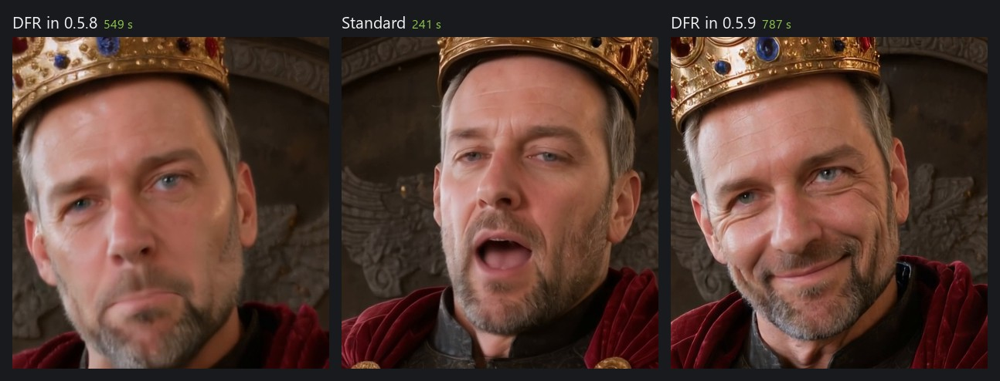

# Image models in NVAI-open: Qwen-Image-2512, FLUX 3 Image Klein and Krea 2

*Deutsch: [de/MODELLE.md](de/MODELLE.md)*

A reference for projects that generate images through NVAI-open. It applies to Claude Code with
the `nvai` MCP server as well as to your own programs using the REST API. It describes the three
image models NVAI-open recommends: what they can do, how to address them, how long they take and
where they fail.

As of October 18, 2026 (Krea 2: October 24). Measured on an RTX 5060 Ti 16 GB (ComfyUI 0.41.3, PyTorch 2.11 cu130).
All times and findings were measured there. Statements that come from the vendor are marked as
such ("according to BFL").

---

## 1. At a glance

| | **Qwen-Image-2512** | **FLUX 3 Image Klein** | **Krea 2 Turbo** |
|---|---|---|---|
| Model ID | `qwen-image-2512-nvfp4` | `flux3-klein-nvfp4` | `krea2-turbo-nvfp4` |
| Vendor | Alibaba (Qwen) | Black Forest Labs, October 2026 | Krea.ai, June 2026 |
| Size | 20B parameters, NVFP4 | 5.6B parameters, NVFP4 | 12B parameters, NVFP4 |
| Text encoder | Qwen2.5-VL-7B | Qwen3-VL-4B, plus a prompt upsampler (Qwen3.5-9B) | Qwen3-VL-4B (the same file as FLUX 3) |
| Steps / CFG | 50 / 4.0 | 16 / 1 (distilled) | 8 / 1 (distilled) |
| Negative prompt | works; empty = default from Qwen's model card | has **no** effect | has **no** effect |
| Reference images | — | up to 10 | — |
| Placement by box | — | yes | — |
| Text in the image | letter-perfect | 3 of 3 error-free in testing | letter-perfect in the test |
| Time per 1024² image | ~100 s | ~30 s for a new prompt, 13–16 s for a known one | ~20 s |
| License | **Apache-2.0** | **FLUX Kommunity License** — revenue cap, review obligation | **Krea 2 Community License** — below US$1M revenue, review obligation |
| Strengths | final assets, structural details, text | editing, consistent characters, layout, speed | photographic look, natural hands and faces, speed |

## 2. Which model for what

| Task | Model |
|---|---|
| Final asset without a template: object, figure, icon, scene | **Qwen** |
| Text, lettering, signs | **Qwen** |
| Construction must be right (fastenings, hinges, handles) | **Qwen** |
| Photographic image with little AI look, natural hands and faces | **Krea 2** (~20 s), name the framing; license only below US$1M revenue |
| Change an existing image in a targeted way: replace a part, color, material | **FLUX 3** with the image as a reference |
| The same character or object across several images | **FLUX 3** with a reference image |
| Combine subjects from several images | **FLUX 3** with several references |
| Several objects at fixed positions | **FLUX 3** with bounding boxes |
| Quick drafts | FLUX 3 (13–16 s), Krea 2 (~20 s) or Qwen Lightning (`qwen-image-2512-lightning`, ~17 s) |
| Historically accurate vehicles (Panzer IV, Sd.Kfz. 251 …) | **none** — see section 9 |
| Only a few words of prompt, model without its own upsampler | first **✨ Expand prompt** (`expand_prompt`), see section 5 |
| Trying out Qwen-Image 2.1 (`qwen-image-2.1-int8`) | **non-commercial only** (Qwen Research License); editing looked overprocessed in the test |

Without a `model_id`, NVAI-open uses the active image model.

### New in 0.5.9

Video quality, measured on an RTX 5060 Ti with LTX-2.5 (1920 × 1088 unless stated otherwise):

| What | Measured |
|---|---|
| Best quality (DFR) | The default once Lightricks' detail LoRA is installed (accept its license on Hugging Face). ComfyUI's template inserts the start image at a quarter of the size, which made the whole video soft at 1080p; NVAI-open now uses the full image. Same seed: faces and fabric stay sharp over the whole clip (edge sharpness of the face after 2 s: 625 instead of 211), at about three times the time (5 s: 786 instead of 241 s). Not with an end image or a loop |
| Cinemagraph LoRA | Only works together with "Loop", which the web interface now switches on with it. A king in front of flickering torches, 4 s at 1280 × 704: with the loop 6 % of the picture moved and the face stood still; a loop without the LoRA 28 %; without a loop 82–84 % (also at strength 1.2), because the camera pushed in |
| Slow Motion LoRA | Tested with Lightricks' settings (a wave against rocks, 1920 × 1088, 5 s, slow motion 0.2): the spray fell over the whole 5 s instead of about 1.5 s at real time, with sharp droplets. Without the LoRA the spray stood almost still as a milky veil. At 1280 × 704 and 0.25 the effect was weaker |
| 48 fps | DFR with `temporal_upscale` keeps the sharpness of 24 fps (even and odd frames alike), at 294 instead of 118 s for 4 s at 1280 × 704 |
| 1080p first | The size list starts with 1920 × 1088 and says that it takes about 2.7 times as long (5 s in 251 s instead of 93 s at 1280 × 704) |
| Higher bitrate | MP4s are saved at CRF 12 instead of ComfyUI's 18: with the same seed 16.0 instead of 7.3 Mbit/s, 10 instead of 4.5 MB for 5 s. Fine detail barely changes, the softness comes from the model. `crf` per request |
| Face after a zoom out | An end image made with FLUX 3 (same references) keeps the face. Without one, the face of the king in the last frame (about 80 px wide) was soft and distorted; with one, the last frame matches the end image. 7 s took 648 instead of 509 s |
| Wider end image | Asked for a "wider shot", FLUX 3 kept the framing. Outpainting the end image (`outpaint=[320, 184, 320, 184]`, 1920 × 1088 → 2560 × 1456) gives a zoom out: the person ends at 75 % of the size |



Prompt traps seen in a scene with a speaking person and a crowd: "shouts" gives grimaces ("says
firmly in a rough, deep voice" is calmer). A gesture that "may rise out of the frame" makes the
camera follow it. "The camera holds a medium close-up" became a push-in to an extreme close-up;
"Static camera, a locked-off medium shot; the framing stays exactly as in the first frame." held the
framing. "Proud, calm expression" became a grin; "stern, determined expression and does not smile"
did not. Thin props such as rifles and flag poles that cross people in the start image morph into
each other in the video, so keep them apart in the start image and do not move them all at once.

**Krea 2 Turbo** (`krea2-turbo-nvfp4`) is the third recommended image model: the most photographic of the three, about 20 s per image, license only below US$1 million revenue. Comparison and prompt tips in section 6.


Qwen-Image-2512 now also comes in INT8 for RTX 20/30/40 (`qwen-image-2512-int8`, see section 4): on an
RTX 4060 with 8 GB 653 instead of 1095 s with NVFP4. Krea 2 on the same card was faster with NVFP4 (46
instead of 82 s), because 7.7 GB fit into its memory (section 6).
In the history, a click on a prompt shows it in full.

### New in 0.5.8

LTX-2.5 (`ltx25-distilled-nvfp4`) is now the recommended video model, with all of its ways. Measured
on an RTX 5060 Ti at 24 fps with sound; graphics memory is almost full and ComfyUI offloads.

| Way | Parameter | Measured |
|---|---|---|
| Text to video | — | 5 s at 1280 × 704 in 93 s (first run with loading 122 s); 1920 × 1088 in 251 s |
| Start image | `image_asset_id` | 5 s at 1280 × 704 in 109 s |
| Start and end image | `end_image_asset_id` | 5 s in 154 s; first and last frame match the two images |
| Loop | `loop=True` | 4 s in 125 s; first and last frame differ by 3.6/255 on average (12–44 without a loop). Only with a still camera: with a camera move the last frames fell apart |
| Automatic length | `auto_duration=True` | a door that opens slowly: 3 s, in 72 s |
| Given sound | `audio_asset_id` | 20 s of brass band → a 19.7 s clip at 1024 × 576 in 302 s, the sound unchanged |
| Several shots | `expand_prompt(target="video_multishot")` | 8 s in 170 s: two shots with a clean cut, the same lighthouse keeper in both |
| DFR, slow motion | `quality="dfr"`, `motion_speed` | not tested yet: they need LoRAs from Lightricks whose license has to be accepted on Hugging Face |

Describe sounds as loud as they should be: speech and a forge came out at −14 to −18 LUFS, a campfire
that "crackles softly" and a quiet village square at −41 to −52 LUFS, with or without a loop. The
generated sound now goes through the same limiter as all audio, for video at −2.5 dBFS because AAC
overshoots dense sound by up to 1.9 dB; it peaked at up to +1.7 dBTP before. New in the video tab:
"Person from a photo" lets FLUX 3 keep the face from a photo and create four start images in a role
you describe (95–98 s at 1280 × 704), which LTX-2.5 then brings to life; step by step in [PHOTO_TO_VIDEO.md](PHOTO_TO_VIDEO.md). Recommended LoRAs for LTX-2.5 and how they did: [INSTALL.md](INSTALL.md#loras-hugging-face-and-civitai).

### New in 0.5.7

| Model | Use for | Measured (RTX 5060 Ti) | License |
|---|---|---|---|
| Stable Audio 3 Medium (`stable-audio-3-medium`) | instrumental music, no vocals (a choir only without words); in NVAI-open up to 5 minutes | 60 s in 9–12 s (up to 9.7 GB graphics memory), 300 s in 64 s (16 GB card almost full) | Stability AI Community (below US$1M revenue) |

Write the prompt for Stable Audio 3 as one sentence: genre with the main instruments, layers and
percussion, the mood, then "BPM: 100.". NVAI-open appends "Length: N seconds" to match the duration.
"✨ Expand prompt" writes this form (`target="music_sa3"`).

ACE-Step 1.5 Turbo now runs like ComfyUI's template (8 steps, CFG 1, shift 3). Before, NVAI-open used
12 steps and CFG 2 without shift, which sounded harsh and compressed. Its license is MIT (the
catalog said Apache-2.0).

Every audio output now goes through NVAI-open's own limiter before it is saved (ceiling −1 dBFS, 5 ms
look-ahead, 80 ms release); ACE-Step is lowered by 3 dB first. Its raw output peaks up to +5.7
dBFS, and the MP3 encoder cut everything above 0 dB off hard. Measured with the same seed, true
peak of the MP3: industrial piece +2.3 → 0.0 dBTP, brass band +2.0 → +0.2 dBTP (with only the
3 dB: +1.3 and +0.9). What is left above −1 dB is MP3 overshoot.

### New in 0.5.3

| Model | Use for | Measured (RTX 5060 Ti) | License |
|---|---|---|---|
| LTX-2.3 (`ltx23-nvfp4`) | video with sound; the base most community LTX LoRAs are made for | 4 s at 1280 × 704 in 101 s, image to video 448 × 832 in 65 s | LTX-2 Community (below US$10M revenue) |
| Mochi 1 preview (`mochi-1-preview-fp8`) | text to video with smooth motion | 49 frames at 848 × 480 in 351 s | Apache-2.0 |
| Kandinsky 5.0 Video Lite, distilled (`kandinsky5-lite-t2v-distilled`) | small MIT video model, 5 s | 768 × 512 in about 300 s | MIT, VAE under Tencent's license |
| Kandinsky 5.0 Video Lite T2V / I2V | the same with 50 steps; I2V only in landscape 768 × 512 | about 26–27 minutes | MIT, VAE under Tencent's license |

LoRAs (also new in 0.5.3) work with SDXL, SD 1.5, Qwen-Image, Z-Image, FLUX.1/Chroma, Wan and
LTX-2/2.3; see [INSTALL.md](INSTALL.md#loras-hugging-face-and-civitai). Measured: a pixel-art LoRA
on Qwen-Image-2512 changed the style clearly at the same seed (168 s instead of 102 s); an orbit
LoRA pair on Wan 2.2 I2V A14B turned a slight turn into a full camera orbit.

### New in 0.5.2

| Model | Use for | Measured (RTX 5060 Ti) | License |
|---|---|---|---|
| Boogu-Image 0.1 Turbo (`boogu-image-turbo-nvfp4`) | fast drafts, 4 steps | 832 × 1216 in ~10 s | Apache-2.0 |
| Boogu-Image 0.1 Base (`boogu-image-nvfp4`) | full quality, negative prompt works | 832 × 1216 in ~66 s | Apache-2.0 |
| Boogu-Image 0.1 Edit (`boogu-image-edit-nvfp4`) | change an image by instruction; in the test only the hat changed | ~147 s | Apache-2.0 |
| HiDream-O1-Image Dev (`hidream-o1-dev-fp8`) | large images, trained at ~4 MP | 1728 × 2304 in ~41 s | MIT |
| HiDream-O1-Image (`hidream-o1-fp8`) | the same with 40 steps and negative prompt | ~142 s | MIT |
| LTX-2.5 (`ltx25-distilled-nvfp4`) | video with sound, text or start image | 4 s at 1280 × 704 in ~72 s | LTX-2 Community (below US$10M revenue) |

### Censored or uncensored

Every image and video model in the list carries a label: *uncensored*, *partly censored*,
*censored* or *filtering unknown*. The tooltip names the evidence and the source (model card,
technical report). NVAI-open itself filters nothing. The same information is in `GET /api/models`
(`content`, `content_note`, `content_source`).

| Label | Models (as of October 2026) |
|---|---|
| uncensored | Chroma1-HD, Pony Diffusion V6 XL, NoobAI-XL, Illustrious XL |
| partly censored | SDXL, Z-Image, Wan 2.1 / 2.2 |
| censored | Qwen-Image-2512, FLUX 3 Image Klein, Krea 2, FLUX.1 schnell |
| filtering unknown | Juggernaut XL, Qwen-Image 2.1, LongCat-Image, LTX-Video |

Removed from the catalog in 0.5.2 (installed files stay): SD 3.5 Medium/Large, FLUX.1 dev,
Chroma v37 (use Chroma1-HD), HunyuanVideo 1.5 (license excludes the EU; use Wan 2.2).

## 3. Access from other projects

### Prerequisite

The NVAI-open server must be running. It listens on `http://127.0.0.1:8100`. With the Windows setup,
start it from the Start menu (**NVAI-open**); in a source checkout:

```powershell
scripts\start.ps1     # reports if it is already running
```

The GPU backend (ComfyUI) starts by itself with the first job. That costs about 30 s once and
is not an error. `health` shows whether everything is running and which model is active.

### Via MCP (Claude Code)

Register the `nvai` MCP server once **at user scope**; it is then available in every Claude
Code project without further setup:

```
claude mcp add --scope user nvai -- "<install folder>\server\.venv\Scripts\python.exe" -m nvai.mcp_server
```

With the Windows setup, also pass your data folder (`-e "NVAI_DATA_DIR=<data folder>"`), see
[CLAUDE_CODE.md](CLAUDE_CODE.md).

The most important tools:

| Tool | Purpose |
|---|---|
| `health` | always first: backend, active models, queue |
| `list_models(kind="image", detailed=True)` | models with `features` (section 8), pros and cons, license |
| `generate_image(...)` | generates images and blocks until done. Returns `files`, `asset_ids`, `seed`, and for FLUX 3 also `caption` |
| `list_assets(kind="image")` | latest images with asset ID and path |
| `copy_asset(asset_id, destination)` | copy an image into your own project |

After an NVAI-open update, a running session only sees the new tool descriptions after `/mcp` and
reconnecting.

### Via REST

| Method and path | Purpose |
|---|---|
| `GET /api/health` | status |
| `GET /api/version` | program, ComfyUI and contract version (`api`), supported extensions (`features`: `mask`, `references`, `upsampler` …). Check before first use |
| `GET /api/models?kind=image` | models with `features`, plus `recommended` and `gpu_note` for the detected card |
| `GET /api/models/search?q=…` | more models on Hugging Face (repos with checkpoint files) |
| `GET /api/models/inspect?repo=…&file=…` | checks a file before downloading: architecture from the safetensors header, size. SDXL and SD 1.5 checkpoints can be downloaded |
| `POST /api/generate/image` | create a job (JSON, fields as in section 7). Response: job with `id` |
| `GET /api/jobs/{id}` | `status` (`queued`, `running`, `done`, `error`), `progress` 0–1, `stage` |
| `GET /api/jobs/{id}/assets` | generated images: `id`, `filename`, `url`, `meta` (seed, settings, and `caption` for FLUX 3) |
| `POST /api/upload` | upload your own image (multipart, field `file`). The returned `id` works as a reference image |
| `GET /files/{filename}` | image file |

The files are stored directly in `<data folder>\assets\<filename>`: `data\assets` in a source
checkout, `%LOCALAPPDATA%\NV-AI\assets` with the setup's default data folder.

From another device (server started with `scripts\start.ps1 -Lan`) this folder does not exist.
Load images via `GET /files/{filename}` instead. Every request needs the `X-NVAI-Token` header,
including those to `/files`; without a valid token the server answers with 401. `/api/version`
works without a token and shows under `authorized` whether the one you sent is valid. The REST
API is specified in `server/openapi.json` (contract version `api`).

```python
import json, time, urllib.request

API = "http://127.0.0.1:8100"

def call(method, path, body=None):
    req = urllib.request.Request(API + path, method=method,
                                 data=json.dumps(body).encode() if body is not None else None,
                                 headers={"Content-Type": "application/json"})
    with urllib.request.urlopen(req, timeout=60) as r:
        return json.loads(r.read())

job = call("POST", "/api/generate/image", {
    "model_id": "qwen-image-2512-nvfp4",
    "prompt": "Studio product photograph of a weathered wooden ammunition crate. ...",
    "width": 1024, "height": 1024, "seed": 42,
})
while (j := call("GET", f"/api/jobs/{job['id']}"))["status"] not in ("done", "error"):
    time.sleep(2)
for asset in call("GET", f"/api/jobs/{job['id']}/assets"):
    print(asset["id"], r"<data folder>\assets" + "\\" + asset["filename"])
```

The server processes GPU jobs one after another. If a job is `queued`, another one is currently
running.

## 4. Qwen-Image-2512 (`qwen-image-2512-nvfp4`)

### Key facts

- 20B parameters (MMDiT). In bf16 that would be 41 GB. The NVFP4 quantization used here
  (`Hippotes/Qwen-Image-2512-quants`, version v2) weighs 14.9 GB, and RTX 50 cards compute this
  format in hardware.
- Text encoder Qwen2.5-VL-7B (fp8, 9.4 GB), VAE from Qwen. Total download 24.5 GB.
- 50 steps, CFG 4.0, sampler `euler`, scheduler `simple`, shift 3.1. The values come from
  ComfyUI's template and Qwen's model card.
- License Apache-2.0: commercial use without restriction.

### What it does well

- **Letter-perfect text in the image.** Crate lettering and signs come out exactly as written in
  quotation marks in the prompt.
- **Construction.** In testing, the rope handles of an ammunition crate ran through drilled
  holes and under the battens. With the same seed, the distilled Lightning version laid them on
  the wood without any attachment.
- **Long prompts.** The encoder is a language model; there is no 77-token limit as with CLIP.
- **The negative prompt works** (CFG 4). If it is left empty, NVAI-open inserts the one from Qwen's
  model card:
  `低分辨率，低画质，肢体畸形，手指畸形，画面过饱和，蜡像感，人脸无细节，过度光滑，画面具有AI感。构图混乱。文字模糊，扭曲。`
  It stands for low resolution, deformed limbs and fingers, oversaturation, a waxy look, an AI
  look, a chaotic composition and distorted text.
- **Image as a starting point** (`image_asset_id` + `denoise`): an almost-right image is refined
  instead of rerolled.
- **Inpainting** (`image_asset_id` + `mask_asset_id` + `denoise=1.0`): only the white area of the
  mask is regenerated, black is kept, gray levels blend smoothly. Measured: inside the mask, a
  crate's lettering "MUNITION 7,92" became "FLAK 88" in the same stencil font. Outside the mask
  the image deviated by 0.6 out of 255 on average, i.e. only by the noise of the VAE round trip.
  With 28 steps this took 82 s including a cold start. Since 0.5.6 **FLUX 3** fills too
  (`features.mask` = `"reference"`): NVAI-open cuts out the area with 35 % surroundings, greys it, lets
  FLUX 3 paint it from the prompt, measures the offset and puts back only the area, outside pixel for
  pixel. Measured on a fish market: crates removed with the cobblestones running on, a seagull added,
  about 60–70 s each. To rewrite something already there (lettering on a sign), edit with a reference
  image instead: filled grey, FLUX painted a new, frontal sign; as an edit it kept position and angle.
  Use the full model for new objects. In
  testing, Lightning mostly just continued the surroundings, which is enough for retouching
  something out.
- **Outpainting** (since 0.5.4, `image_asset_id` + `outpaint=[left, top, right, bottom]` in pixels):
  the image is extended beyond its edges; the size is image plus border. **Use FLUX 3:** it gets the
  image on a grey border as a reference and continues the scene, then NVAI-open puts the original back.
  FLUX 3 never returns the picture exactly in place (per axis 0.97–1.055 scale and up to 43 px offset,
  with a border on all sides it zoomed in by 25–42 %), so NVAI-open extends one axis at a time, measures
  the offset after each pass, moves the result back and only then puts the original in. Measured on a
  lion scene extended on all sides: two variants in 147 s, clean seams at full resolution. Qwen-Image-2512 extends via a mask, but in testing it painted the border
  as a separate scene with a hard edge (also with a 128/256 px transition and 50 steps).
- **Second pass** (`hires=True`) for hands, faces and fine technical detail.

### Sizes

The general sizes around 1 megapixel work. But Qwen is trained at about 1.76 MP, and its
**native sizes** give visibly more detail:

| Native | Aspect ratio | Use for |
|---|---|---|
| 1328 × 1328 | 1:1 | objects, icons |
| 1056 × 1584 | 2:3 | standing figures |
| 1584 × 1056 | 3:2 | vehicles, scenes |
| 1104 × 1472 / 1472 × 1104 | 3:4 / 4:3 | |
| 928 × 1664 / 1664 × 928 | 9:16 / 16:9 | panoramas |

Measured at 1328² versus 1024²: finer rope twist and wood grain, at twice the time.

### Run times (measured)

| Run | Time |
|---|---|
| 1024², 50 steps | ~100 s (1.84 s per step) |
| 1328² native, 50 steps | ~200 s (3.79 s per step) |
| Lightning, 1024², 8 steps | ~17 s, four images ~40 s (measured with ComfyUI 0.30) |
| first job after startup | plus 15–30 s for loading |

### Writing the prompt

Full English sentences. First medium and style, then the subject with material, color,
condition and construction, then lighting and background. Text verbatim in quotation marks.

```
Studio product photograph of a weathered wooden ammunition crate. Black stenciled letters on
the front read "MUNITION 7,92". Rope handles pass through drilled holes in the side boards.
Plain light grey background, soft even light.
```

- **State the construction explicitly.** Whatever is not written down gets invented.
- **No weighting brackets** like `(full body:1.2)`. That is CLIP syntax and has no effect here.
- **Name the origin of people**, as region plus facial features: *Central European soldiers
  with pale northern European features*.
- Name **exactly one view** ("strict side view"), not two.

### Known limits

- It invents historical vehicles: in testing, "Kübelwagen" became a Willys Jeep.
- With Lightning (8 steps), structural details get lost. Lightning is only suitable for drafts.
- Encoder and model do not fit into 16 GB at the same time. Every new prompt reloads; that is
  already included in the measured times.

### INT8 version for RTX 20/30/40 (`qwen-image-2512-int8`)

Only RTX 50 cards compute NVFP4 in hardware; an RTX 4060 needed 1095 s per image with it. For older
cards there is an INT8 version, quantized with Comfy-Org's own tool comfy-quants (int8 tensorwise
with ConvRot, the same layer selection as the official exports). It loads in stock ComfyUI without
a custom node and computes in hardware on every NVIDIA card from the RTX 20 series on. It is a
community upload (LAXMAYDAY, a byte-identical copy at wazimondo), 20.6 GB; text encoder and VAE are
shared with the NVFP4 versions.

Measured on an RTX 5060 Ti (16 GB), 1024 × 1024, 50 steps: 119 s per image, 132 s with loading
(NVFP4: 101 and 108 s). The test crate came out just as well as with NVFP4: lettering exact, rope
handles through drilled holes. With 16 GB or less, ComfyUI streams parts of the model from system
memory. On an RTX 4060 with 8 GB (on a riser, PCIe 3.0 x4): 653 s including loading, the NVFP4
version 1095 s; neither fits into 8 GB, but INT8 is computed in hardware. Lettering and rope handles
came out clean there too.

## 5. FLUX 3 Image Klein (`flux3-klein-nvfp4`)

### Key facts

- Black Forest Labs, released on October 15, 2026. 5.6B parameters in the image model, official
  NVFP4 version from BFL (5.3 GB).
- Text encoder Qwen3-VL-4B (int8, 4.9 GB), prompt upsampler Qwen3.5-9B (int8, 9.8 GB), VAE from
  FLUX.2. Total download 20.2 GB.
- Distilled: 16 steps without guidance (CFG 1). According to BFL, it is the same model that runs
  behind their API.
- The repo on Hugging Face is gated. Accept the license once, then enter a Hugging Face token in
  the web UI under **Models**, or in a source checkout run
  `server\.venv\Scripts\hf.exe auth login`.

### The prompt upsampler

FLUX 3 is trained on long image descriptions written by its own upsampler. BFL advises never to
use the model without it. In NVAI-open it therefore runs automatically before every image:

1. From the request, the upsampler writes a description of 100 to 350 words. For non-square
   sizes it is told the aspect ratio and composes for it.
2. The image is generated from this description.
3. The description is returned as **`caption`**: directly in the return value via MCP, and in
   the asset's `meta.caption` via REST.

It decodes deterministically: the same prompt always yields the same description. NVAI-open caches
it, so a new seed with the same prompt only costs the image time. The cache lives in the server
process and is empty after a restart.

`upsample_prompt=False` turns the upsampler off. That is only worthwhile if the prompt itself is
already a full description in this style. Without the upsampler, the test crate came out plainer
and smaller.

**What this means for the prompt:** short and complete is enough. But the upsampler fills every
gap on its own. In testing it draped a greatcoat over soldiers' backs like a cape, gave them
lace-up shoes instead of marching boots, and let rope handles hang loosely across the front of a
crate. Everything that has to be right therefore belongs in the prompt, and the **style** belongs
at the beginning. Without a style, the upsampler plans a photo.

If something in the image is wrong, read `caption` first. If the error was already there, extend
the prompt instead of rerolling.

### Expand prompt: the upsampler for every model

The same upsampler also works for the other image models. In the web interface and in the
PhotoCraft add-on the **✨ Expand prompt** button writes the full description into the
prompt field; you read it, remove what is wrong, and generate with any model. Via MCP it is
`expand_prompt(prompt, width, height)`, via REST `POST /api/prompt/expand`. It needs a FLUX 3
model to be downloaded. Measured: 13–16 s, about 36 s right after a start.

NVAI-open for Mac (since 0.4) and the Mac PhotoCraft add-on have the same button and the same REST
route. There the Qwen3-4B text encoder of FLUX.2 Klein writes the description, with Black Forest
Labs' instructions for text-to-image prompts; no extra download. Measured on a Mac mini M1 with
8 GB: 22–25 s, 35 s the first time after starting the app.

With only "a medieval blacksmith", Qwen-Image-2512 painted a warrior portrait in leather armor;
with the expanded text it painted a working forge with hearth, anvil, tongs and sparks. The
upsampler fills every gap, though: it also gave the smith an iron helmet. Read the text first.

Since 0.5.3 the button is also on the **Video**, **Audio** and **3D** tabs (Windows). The same
upsampler then follows NVAI-open's own instructions (`target` in the API): for video it adds motion,
one camera move, setting and light; with LTX-2.5 also what can be heard; with a start image only
the motion. For Stable Audio it writes sound tags (source, material, room, microphone), for
ACE-Step genre, instrument and mood tags. On the 3D tab, "Object from text" first creates a
source image with the active image model: one closed object without floor or shadow. Measured
on the RTX 5060 Ti: 3–12 s per prompt. The model is trained on image descriptions; sound tags
sometimes still start with a full sentence.

### Reference images

`reference_asset_ids` takes up to ten asset IDs: generated images or your own uploads
(`POST /api/upload`). In the prompt they are called, in this order, "the first image", "the
second image", and so on.

**Editing** (one reference image): the prompt says what changes and what stays the same.

```
generate_image(
  prompt="Replace the rope handles with forged iron handles bolted to the side boards; "
         "keep everything else unchanged.",
  model_id="flux3-klein-nvfp4",
  reference_asset_ids=["ast_b2e2b512098a"],
)
```

In testing, the source stayed the same except for the handles: boards, stencil lettering and
battens were unchanged, and the new handles are bolted on with plates. However, the model added
three handles instead of two, one of them on the front batten.

**Combining and consistency** (several references):

```
prompt="Put the soldier from the first image into the trench from the second image, "
       "same uniform and helmet, seen from the side."
```

If FLUX 3 gets only an `image_asset_id` and no `reference_asset_ids`, the image becomes the first
reference; `denoise` does not apply then.
The output size is set by `width` and `height`, not by the reference. References are fed in at
about 1 MP.

According to BFL, references anchor the content but do not fix the shape. A blueprint as a
reference therefore does not turn an invented vehicle into a true-to-scale one.

### Placement with bounding boxes

Append a JSON list to the end of the prompt. Each box is `[top, left, bottom, right]` on a grid
from 0 to 1000, with the origin at the top left:

```
Studio product photograph of three separate weathered wooden ammunition crates standing side
by side on a plain light grey background, soft even light.
[{"id": "crate_1", "bbox": [430, 30, 820, 320], "desc": "a small crate with a hinged lid"},
 {"id": "crate_2", "bbox": [250, 350, 820, 650], "desc": "a tall crate with rope handles"},
 {"id": "crate_3", "bbox": [560, 680, 820, 970], "desc": "a flat, wide crate"}]
```

In testing, all three crates stood exactly at their boxes. This lets you fix count and
arrangement, which diffusion models do not reliably achieve from text alone.

- **Do not cite the ids in the text as `<crate_1>`.** The upsampler does that, and the boxes stay
  fixed. If the text cites all ids, it counts as a finished description and goes to the model
  without the upsampler. That is how BFL's reference code does it.
- The boxes steer position and size but are not a hard mask. An element can extend beyond its
  box; very small elements can be missing.

### Sizes

Sides must be multiples of 16. The general 1 MP sizes work. According to BFL, the model works
natively up to 4K; the NVAI-open API allows up to 2048 × 2048. In measurements, 1440² brought more
detail, for example a rope running through an eyelet with a metal ring, at 26 instead of 13 s.
FLUX 3 has no second pass (`hires`). If you want more detail, choose a larger size directly.

### Run times (measured)

| Run | Time |
|---|---|
| new prompt, 1024² | ~30 s (upsampler 8–15 s, image ~12 s) |
| same prompt, new seed | 13–16 s |
| four images in one run | ~37 s |
| 1440 × 1440 | ~26 s |
| editing with one reference image | ~45 s |
| box layout (upsampler in layout mode) | ~36 s |

In testing, FLUX 3 and Qwen ran alternately without out-of-memory errors. ComfyUI used up to
15.5 GB, because it keeps models in memory as long as there is room.

### Test findings (11 cases, images checked at full resolution)

| Checked | Result |
|---|---|
| Text "MUNITION 7,92" | 3 of 3 error-free (BFL itself warns that text may be inaccurate) |
| Soldiers, portrait format | 5 of 5 complete with feet, helmet shape correct. Invented: a greatcoat worn as a cape, and lace-up shoes |
| Rope handles | 3 of 3 without a sensible loop, only once (1440²) through an eyelet |
| Editing | source unchanged except for the handles |
| Boxes | 3 of 3 crates at the specified position |
| Scene "Kübelwagen" | oil painting, German helmets correct. Instead of the Kübelwagen, a small flatbed truck appeared |
| without a style | photorealistic |

### Base version (`flux3-klein-base-nvfp4`)

This version is undistilled: 50 steps, CFG 3.5, and the negative prompt works. BFL offers it
mainly for fine-tuning and LoRA training. Measured, it takes 53 s per image. In testing it
brought no visible gain over the distilled version.

### INT8 version for RTX 20/30/40 (`flux3-klein-int8`)

Only RTX 50 cards compute NVFP4 in hardware. Older cards can load it, but unpack it layer by
layer and are much slower. For them there is BFL's official INT8 version
(`flux3-image-klein-int8-convrot`, 5.8 GB). INT8 runs in hardware on every NVIDIA card from the
RTX 20 series on. As in BFL's own INT8 template, it comes with the smaller upsampler (w4a8,
6.7 instead of 9.8 GB). According to BFL, this runs on 8 GB cards such as the RTX 3070, and on an
RTX 4070 in under 9 s per image (16 steps, 1 MP). We have not measured this yet. Prompts,
reference images, boxes and the upsampler work as with NVFP4.

NVAI-open detects the card (`compute_cap` via nvidia-smi) and marks suitable models in
`list_models` with `recommended`: on RTX 50 Qwen, FLUX 3 and LTX-2.5 in NVFP4, on older cards
Qwen-Image-2512, FLUX 3, Z-Image and LTX-2.5 in INT8. A format that the detected card does not compute in hardware gets a note in
`gpu_note`.

### License: FLUX Kommunity License v1.0

This is not legal advice; the full text in the model repository (`LICENSE.md`) is authoritative.

- Commercial use of the images is only allowed for "Qualifying Users": annual revenue, together
  with affiliated companies, below US$5 million (sections 1.e and 2.a).
- Conditions (section 2.e): either use a content filter **or** review every image for unlawful
  and infringing content before publishing it. In addition, AI labeling where the law requires
  it.
- BFL can terminate the license at any time by notice (8.b).
- The images must not be used to train any other image model (4.b).
- No EU exclusion.
- The text encoder and the upsampler are under Apache-2.0.

Point out this license for every FLUX 3 image that goes into a product that is sold. If these
conditions don't work for you: Qwen.

## 6. Krea 2 Turbo (`krea2-turbo-nvfp4`)

### Key facts

- By Krea.ai, June 2026: a diffusion transformer with 12B parameters, released with open weights as
  Raw (for fine-tuning) and Turbo (distilled). NVAI-open uses Turbo with the values from ComfyUI's
  template `image_krea2_turbo_t2i.json`: 8 steps, CFG 1, sampler `euler`, scheduler `simple`.
- Text encoder Qwen3-VL-4B, byte for byte the file FLUX 3 uses; the VAE is Qwen-Image's, also
  identical (SHA-256 compared). With one of those models installed, only the 7.7 GB of Krea itself
  remain to download, otherwise 12.8 GB. The files come from Comfy-Org/Krea-2, which unlike Krea's
  own repositories is not gated.
- Output from 1 to 2 MP according to Krea. The negative prompt has no effect (CFG 1).
- No reference images, no mask, no second pass (`hires`). For editing, FLUX 3 remains the choice.
- License: Krea 2 Community License, see below.

### Compared with Qwen and FLUX 3 (measured)

Same prompt and seed, RTX 5060 Ti, images checked at full resolution:

| Subject | Qwen-Image-2512 | FLUX 3 | Krea 2 Turbo |
|---|---|---|---|
| Old fisherman mending a net, 1024² (first image, with loading) | 160 s | 36 s | 41 s |
| Ammunition crate with lettering, 1024² | 109 s | 31 s | 21 s |
| Explorer in full body, 832 × 1216 | 113 s | 32 s | 20 s |

- **The most photographic of the three.** Hands and faces looked natural; skin, wool and leather
  have texture instead of the smooth AI look.
- **Text:** "MUNITION 7,92" came out letter-perfect, and the rope handles pass through drilled holes.
  The crate came without a lid, which the prompt did not mention: name what has to be there.
- **Full figure:** the standing explorer has both boots in the frame.
- **Name the framing.** The fisherman prompt stresses his weathered hands, and Krea cut his head off
  at the top in three of three images (two seeds, also at 1408 × 1408). With the sentence "Medium shot
  from the waist up, his whole head and face inside the frame with free space above his head." the
  head was in the frame in two of two. Without that sentence, FLUX 3 had the best composition.

### Run times (measured)

| Run | Time |
|---|---|
| 1024², 8 steps | 20–21 s |
| 1408 × 1408 (2 MP) | 37 s |
| first image after FLUX 3 (loading) | 41 s |

### Writing the prompt

As for Qwen: full English sentences, style and medium first, then the subject with material, color
and construction, then light and background; text verbatim in quotation marks. State the framing
("medium shot from the waist up", "full body, both boots inside the frame"). Krea 2 is trained on
detailed descriptions; expand a few words with **✨ Expand prompt** first (Krea's own template does
the same).

### License: Krea 2 Community License

- Commercial use only below US$1 million annual revenue, including affiliated companies.
- A content filter or a review of every image by hand is required.
- Label images as AI-generated where the law requires it.
- Krea can terminate the license with 30 days' notice.
- Without these conditions: Qwen-Image-2512 (Apache-2.0).

### INT8 version for RTX 20/30/40 (`krea2-turbo-int8`)

Comfy-Org's INT8 version (ConvRot), computed in hardware on every NVIDIA card from the RTX 20 series
on. The model file is 13.5 GB (18.6 GB with text encoder and VAE); on cards with less memory ComfyUI
streams parts from system memory.

Measured on an RTX 4060 with 8 GB (on a riser, PCIe 3.0 x4), 1024 × 1024, the crate from above: 193 s for
the first image, then 82 s, lettering exact as with NVFP4. The NVFP4 version took 46 s on the same card
including loading, although the 4060 has no FP4 units: at 7.7 GB it fits into the graphics memory, the
INT8 version at 13.5 GB does not. **On 8 GB cards, use the NVFP4 version.** With 12 or 16 GB not
measured yet.

## 7. `generate_image` parameters

Applies equally to the MCP tool and to the body of `POST /api/generate/image`.

| Parameter | Qwen-50 | FLUX 3 | Note |
|---|---|---|---|
| `prompt` | detailed, full sentences | short and complete, style first | |
| `negative_prompt` | works; empty = model card default | no effect | ~10 terms, no style bans |
| `model_id` | `qwen-image-2512-nvfp4` | `flux3-klein-nvfp4` | empty = active model |
| `width`, `height` | multiples of 8, native ~1.76 MP | multiples of 16, up to 2048 | size by silhouette |
| `steps`, `cfg` | 50 / 4.0 | 16 / 1 | leave empty = model default |
| `sampler`, `scheduler` | euler / simple | euler / simple | avoid `karras` and `exponential` |
| `seed` | ✓ | ✓ | |
| `batch_size` | ✓ | ✓ (4 images ~37 s) | one model load instead of many |
| `hires`, `hires_scale`, `hires_denoise` | ✓ | — | |
| `image_asset_id` + `denoise` | refine an image | becomes the first reference | |
| `mask_asset_id` | ✓ inpainting (with `image_asset_id`, `denoise=1.0`) | ✓ since 0.5.6 via a reference: area greyed, put back aligned | white = new, black = keep; upload the mask via `POST /api/upload` |
| `outpaint` | ✓ via mask, often a hard edge | ✓ seamless, original pixel for pixel | `[left, top, right, bottom]`, the size follows |
| `reference_asset_ids` | — | up to 10 | error message with other models |
| `upsample_prompt` | — | on by default | |
| `slg`, `controlnet_*` | — | — | only for SD 3.5 models (no longer in the catalog) |

Size by silhouette: standing figure 832 × 1216 (Qwen native 1056 × 1584), vehicle in landscape
1216 × 832 (1584 × 1056), object and icon 1024 × 1024 (1328 × 1328).

## 8. The `features` field

`GET /api/models` and `list_models(detailed=True)` return a `features` field for each image
model. Other programs can adapt their controls to it, as the NVAI-open web UI does.

| Key | Meaning | Qwen-50 | FLUX 3 |
|---|---|---|---|
| `steps`, `cfg` | defaults | 50, 4.0 | 16, 1.0 |
| `negative_prompt` | does the negative prompt work? | true | false |
| `default_negative` | applies when none is given | Qwen's default | empty |
| `upsampler` | prompt upsampler available | false | true |
| `references` | maximum number of reference images | 0 | 10 |
| `bbox` | placement by box | false | true |
| `img2img` | start image with `denoise` | true | false |
| `mask` | inpainting with `mask_asset_id` (true = mask, `"reference"` = through a greyed reference image) | true | "reference" |
| `outpaint` | how extending works (`"mask"`, `"reference"`, null) | "mask" | "reference" |
| `hires` | second pass useful | true | false |
| `text_rendering` | text in the image | true | true |
| `sizes` | additional recommended sizes `{label, w, h}` | 7 native | 4, up to 2048² |
| `prompt_hint` | short prompt guide, in the request language (English by default) | ✓ | ✓ |
| `placeholder` | example prompt | ✓ | ✓ |

## 9. Known pitfalls

- **Historical vehicles:** no model knows the silhouette of a Panzer IV or a Kübelwagen. More
  seeds only give other fantasy vehicles. Fidelity would need a template plus a ControlNet, and
  none is integrated for either model.
- **The FLUX 3 upsampler fills gaps with inventions:** write what matters explicitly into the
  prompt and check `caption`.
- **Box ids cited in the text:** then no upsampler runs, see section 5.
- **Negative prompt with FLUX 3 and Lightning:** it is not computed at all. Phrase exclusions
  positively, e.g. *plain light grey background* instead of *no background*.
- **PyTorch cu130 is required for NVFP4.** With cu128, ComfyUI disables its NVFP4 kernels and
  everything becomes three to five times slower. `setup_comfyui.ps1` installs cu130.
- **ComfyUI 0.41 or newer** for FLUX 3. `install.ps1` pins v0.42.1.
- **Check results at full resolution:** downscaled previews hide exactly the errors that matter,
  such as a rope handle without a hole.

## 10. For maintainers

| What | Where |
|---|---|
| Catalog entries, `features`, texts | `server/nvai/catalog.py` |
| ComfyUI graphs (`build_qwen_image`, `build_flux3`, `build_krea2`) | `server/nvai/workflows.py` |
| Upsampler, box logic, cache | `server/nvai/flux3_prompt.py` (based on BFL's reference code, Apache-2.0) |
| BFL's upsampler system prompts | `server/nvai/flux3_pup_prompts.json` |
| Flow (upsampler, then image; providing references) | `server/nvai/jobs.py`, `_txt2img` |
| MCP instructions and tool texts | `server/nvai/mcp_server.py` |
| Model files | `external/comfyui/models/{diffusion_models,text_encoders,vae,loras}` (the Windows setup uses the model folder chosen during installation) |

The graphs are modeled on the templates that ship with ComfyUI: `image_qwen_Image_2512.json`,
`image_flux3_klein_*` and `image_krea2_turbo_t2i.json`. The CLIPLoader types are `qwen_image`,
`flux3` and `krea2`, the empty latent is `EmptySD3LatentImage`, `EmptyFlux2LatentImage` or
`EmptyLatentImage` respectively, references go through
`ReferenceMultiLatent`, the upsampler through `TextGenerate`.
