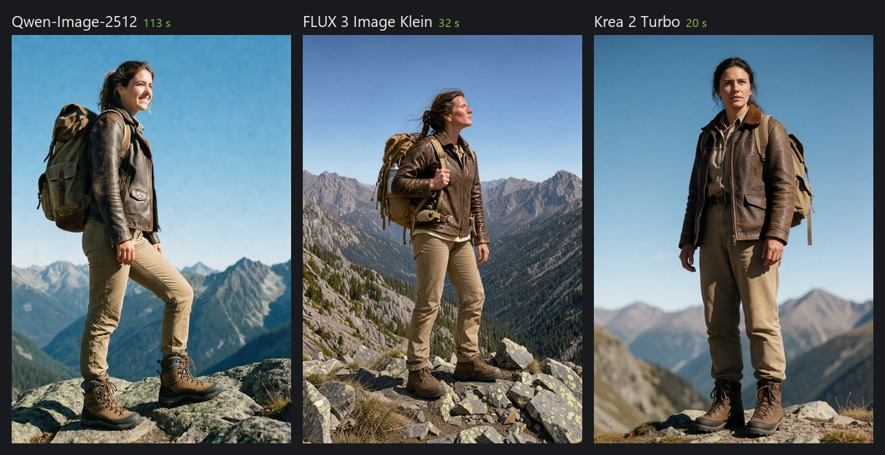
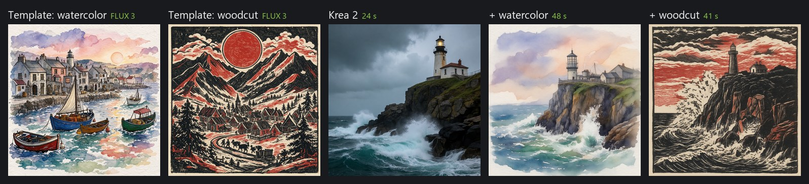
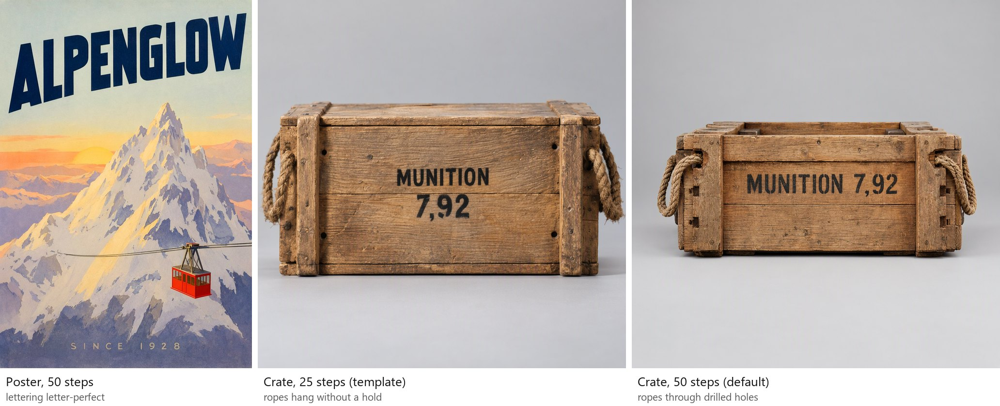
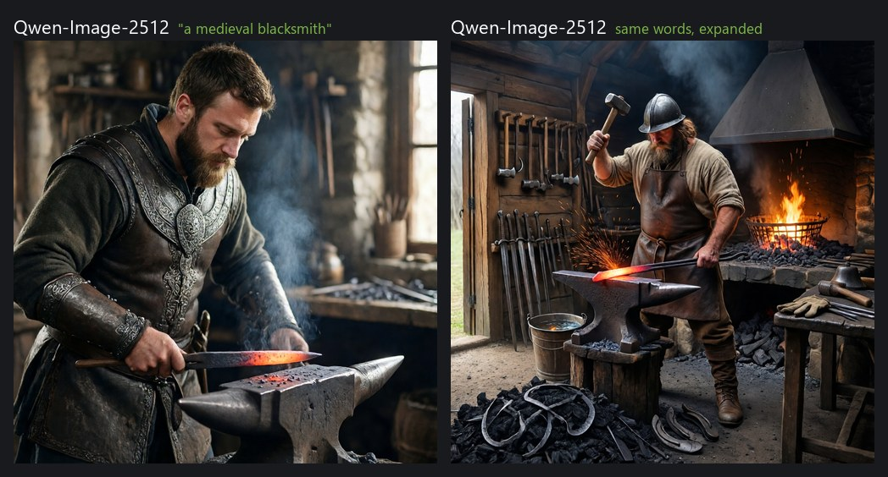
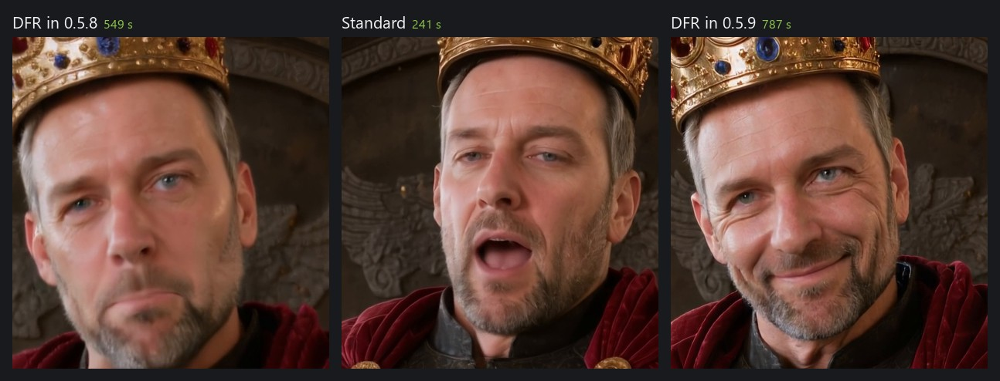
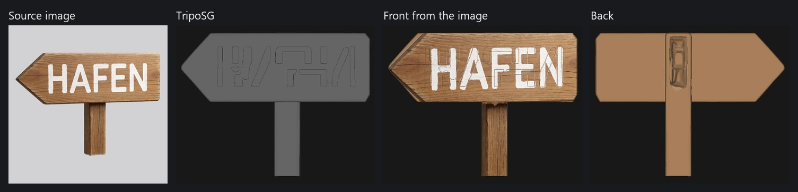
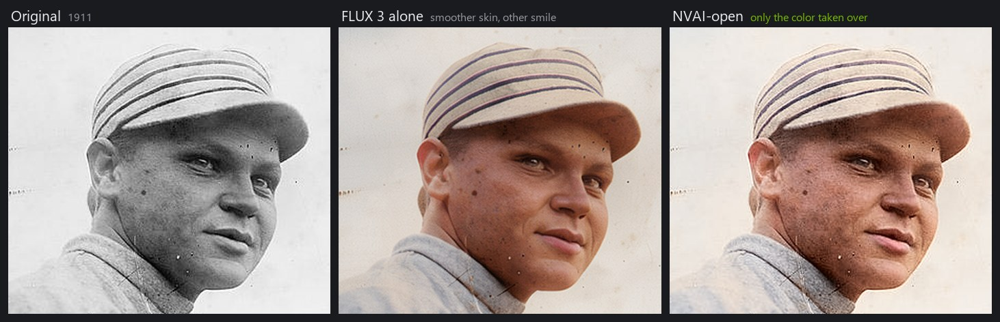
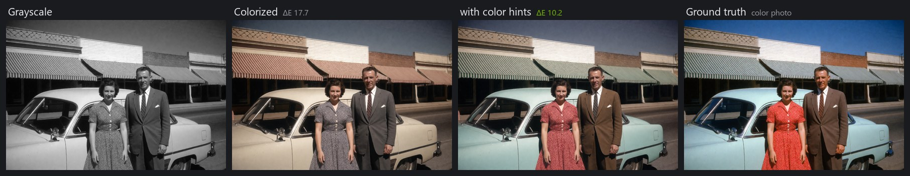
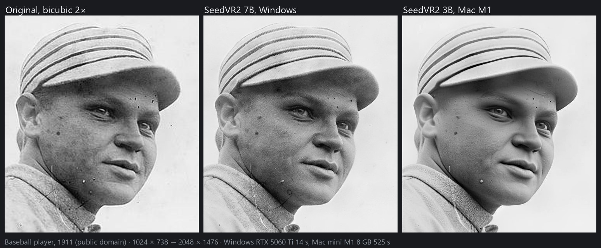

# The models in NVAI-open

*Deutsch: [de/MODELLE.md](de/MODELLE.md)*

What each model can do, how to address it, how long it takes and where it fails. It applies to the app, to Claude
Code with the `nvai` MCP server and to your own programs using the REST API. Everything was measured on an RTX 5060 Ti
with 16 GB unless stated otherwise; what comes from a vendor is marked as such. The four image models side by side,
with the same prompts and seeds: [MODEL_COMPARISON.md](MODEL_COMPARISON.md).

- [Images](#images): Qwen-Image-2512, FLUX 3 Image Klein, Krea 2, MOSS-Image
- [Video](#video): LTX-2.5, MiniMax H3, others
- [Sound](#sound), [3D](#3d), [Old photos](#old-photos)
- [Censored or uncensored](#censored-or-uncensored), [On the Mac](#on-the-mac), [For programs](#for-programs)

## At a glance

| | **Qwen-Image-2512** | **FLUX 3 Image Klein** | **Krea 2 Turbo** | **MOSS-Image** |
|---|---|---|---|---|
| Model ID | `qwen-image-2512-nvfp4` | `flux3-klein-nvfp4` | `krea2-turbo-nvfp4` | `moss-image-sft-int8` |
| Vendor | Alibaba (Qwen) | Black Forest Labs | Krea.ai | OpenMOSS |
| Steps / CFG | 50 / 4 | 16 / 1 | 8 / 1 | 50 / 3 |
| Negative prompt | works | no effect | no effect | works |
| Reference images | — | up to 10 | 1–2 as a style template | — |
| Text in the image | letter-perfect | correct in 3 of 3 | letter-perfect | letter-perfect, the cleanest |
| Time per 1024² image | ~100 s | ~30 s, 13–16 s for a known prompt | ~20 s | ~51 s |
| License | Apache-2.0 | FLUX Kommunity License: below US$5M revenue, review every image | Krea 2 Community License: below US$1M revenue, review every image | Apache-2.0 |
| Best for | final assets, construction, text | editing, the same character in several images, layout | photographic look, hands and faces | posters, signs, layout |

## Which model for what

| Task | Model |
|---|---|
| Final asset: object, figure, icon, scene | **Qwen-Image-2512** |
| Lettering, signs, posters, layout with a lot of text | **MOSS-Image** or Qwen-Image-2512 |
| Construction must be right (fastenings, hinges, handles) | **Qwen-Image-2512** |
| A photo with little AI look, natural hands and faces | **Krea 2**, name the framing |
| Change part of an existing image, keep the rest | **FLUX 3** with the image as a reference |
| The same character or object in several images | **FLUX 3** with a reference image |
| Several objects at fixed positions | **FLUX 3** with bounding boxes |
| Quick drafts | FLUX 3 (13–16 s), Krea 2 (~20 s) or `qwen-image-2512-lightning` (~17 s) |
| Only a few words of prompt | first **✨ Expand prompt**, then any model |
| Video with sound | **LTX-2.5** |
| Instrumental music / sound effects | **Stable Audio 3** / **Stable Audio Open** |
| Narrator voice, dialogue lines | **Qwen3-TTS** |
| 3D model from an image | **TripoSG** (shape) or **TRELLIS.2** (with textures) |
| Restore or colorize an old photo | the **Restore** tab: FLUX 3 and SeedVR2 |
| Historically accurate vehicles (Panzer IV, Kübelwagen …) | **none**, see [Known pitfalls](#known-pitfalls) |

Without a `model_id`, NVAI-open uses the active model of the kind. Every model starts with its measured best settings,
and a short tip under the model choice says what to watch for.

---

## Images

### Qwen-Image-2512 (`qwen-image-2512-nvfp4`)

20B parameters, in NVFP4 14.9 GB (RTX 50 computes this format in hardware); text encoder Qwen2.5-VL-7B, 24.5 GB
download in all. 50 steps, CFG 4, Apache-2.0.

- **Letter-perfect text** as written in quotation marks in the prompt.
- **Construction:** the rope handles of a crate ran through drilled holes; the distilled Lightning version laid them
  on the wood without any hold.
- **The negative prompt works.** Left empty, NVAI-open uses the one from Qwen's model card (low resolution, deformed
  hands, waxy or AI look, distorted text).
- **Refine instead of reroll:** `image_asset_id` with `denoise` (0.3 gentle, 0.5 clear). `hires=True` adds a second
  pass for hands, faces and fine technical detail.
- **Native sizes give more detail** (trained at about 1.76 MP), at twice the time:

| Native size | Use for |
|---|---|
| 1328 × 1328 | objects, icons |
| 1056 × 1584 | standing figures |
| 1584 × 1056 | vehicles, scenes |
| 928 × 1664 / 1664 × 928 | panoramas |

Times: 1024² about 100 s, 1328² about 200 s, Lightning (8 steps) about 17 s; the first job after a start adds 15–30 s.

Prompt in whole English sentences: medium and style first, then the subject with material, color, condition and
construction, then light and background; text verbatim in quotation marks.

```
Studio product photograph of a weathered wooden ammunition crate. Black stenciled letters on
the front read "MUNITION 7,92". Rope handles pass through drilled holes in the side boards.
Plain light grey background, soft even light.
```

State the construction (whatever is not written down gets invented), name exactly one view, describe people's origin
as region plus features ("with pale northern European features"), and leave out weighting brackets such as
`(full body:1.2)`: that is CLIP syntax and has no effect here.

**INT8 for RTX 20/30/40** (`qwen-image-2512-int8`, 20.6 GB): computed in hardware from the RTX 20 on. On the RTX
5060 Ti 119 s instead of 101 s, the same quality; on an RTX 4060 with 8 GB 653 instead of 1095 s with NVFP4.

### FLUX 3 Image Klein (`flux3-klein-nvfp4`)

Black Forest Labs, 5.6B parameters, official NVFP4 version (5.3 GB), text encoder Qwen3-VL-4B and a prompt upsampler
(Qwen3.5-9B), 20.2 GB download in all. 16 steps without guidance. The repository is gated: accept the license on
Hugging Face and store a token ([HUGGINGFACE.md](HUGGINGFACE.md)).

**The upsampler.** FLUX 3 is trained on long descriptions written by its own upsampler, and BFL advises against using it
without one. So the upsampler first turns your request into a description of 100 to 350 words, the image is made from
that, and the description comes back as **`caption`**. The same prompt always gives the same description, so a new seed
only costs the image time. The upsampler fills every gap by itself: it draped a greatcoat over soldiers like a cape and
gave them lace-up shoes. So put everything that must be right into the prompt, the **style first** (without one it
plans a photo), and if the image is wrong, read `caption` before rerolling. `upsample_prompt=False` switches it off;
do that when construction, counts or gaze must be exact (it added a second fishing line in 4 of 6 images, without it
0 of 2), and write a full description yourself.

**Reference images:** `reference_asset_ids` takes up to ten images; in the prompt they are "the first image", "the
second image" and so on. To edit, say what changes and what stays:

```
generate_image(
  prompt="Replace the rope handles with forged iron handles bolted to the side boards; "
         "keep everything else unchanged.",
  model_id="flux3-klein-nvfp4",
  reference_asset_ids=["ast_b2e2b512098a"],
)
```

Only the handles changed; boards, lettering and battens stayed. Several references combine subjects ("put the soldier
from the first image into the trench from the second image"). A single `image_asset_id` becomes the first reference.
References fix the content, not the shape: a blueprint does not make an invented vehicle true to scale.

**Placement with boxes:** append a JSON list; each box is `[top, left, bottom, right]` on a grid from 0 to 1000.

```
Studio product photograph of three separate weathered wooden ammunition crates standing side
by side on a plain light grey background, soft even light.
[{"id": "crate_1", "bbox": [430, 30, 820, 320], "desc": "a small crate with a hinged lid"},
 {"id": "crate_2", "bbox": [250, 350, 820, 650], "desc": "a tall crate with rope handles"},
 {"id": "crate_3", "bbox": [560, 680, 820, 970], "desc": "a flat, wide crate"}]
```

All three crates stood at their boxes. Do not cite the ids in the text as `<crate_1>`: the text then counts as a
finished description and skips the upsampler.

**Sizes and times:** multiples of 16, up to 2048 × 2048; a larger size gives more detail (1440² 26 s), there is no
second pass. New prompt at 1024² about 30 s, the same prompt with a new seed 13–16 s, four images 37 s, editing with a
reference about 45 s.

**INT8 for RTX 20/30/40** (`flux3-klein-int8`, BFL's official version with a smaller upsampler); according to BFL it
runs on 8 GB cards. The undistilled **Base** version (50 steps, negative prompt) brought no visible gain.

**License (FLUX Kommunity License v1.0, not legal advice):** commercial use of the images only below US$5 million annual
revenue including affiliated companies; a content filter **or** a review of every image before publishing; AI labeling
where the law requires it; BFL can terminate the license by notice; the images must not train another image model. No
EU exclusion. Without these conditions: Qwen-Image-2512.

### Krea 2 Turbo (`krea2-turbo-nvfp4`)

Krea.ai, 12B parameters, 8 steps without guidance. The text encoder is byte for byte the one of FLUX 3 and the VAE the
one of Qwen-Image, so with either installed only 7.7 GB remain to download. The files come from Comfy-Org and are not
gated. 1 to 2 MP; no negative prompt, no mask, no second pass.

| Same prompt and seed | Qwen-Image-2512 | FLUX 3 | Krea 2 Turbo |
|---|---|---|---|
| Fisherman mending a net, 1024² (with loading) | 160 s | 36 s | 41 s |
| Crate with lettering, 1024² | 109 s | 31 s | 21 s |
| Explorer in full body, 832 × 1216 | 113 s | 32 s | 20 s |



The most photographic of the three: natural hands and faces, texture instead of a smooth AI look, lettering exact.
**Name the framing:** the fisherman's head was cut off in 3 of 3 images; with "Medium shot from the waist up, his whole
head and face inside the frame" it was in the frame in 2 of 2. Krea 2 is trained on detailed descriptions, so expand a
few words with ✨ Expand prompt first. 2 MP (1408²) takes 37 s.

**Style template:** with ostris' style LoRA (0.46 GB, under "Models" → "Download extras") Krea 2 takes one or two
images in `reference_asset_ids` as a template: the way of painting, colors and light come from the image, the content
from the prompt. Describe only the content; light and colors come from the template even where the prompt says
otherwise, and with two templates the first one wins.



| Run (1024², a lighthouse in a storm) | Time | Result |
|---|---|---|
| without a template | 24 s | photographic, dark storm clouds |
| watercolor template | 48 s | watercolor in the template's pastel evening light |
| woodcut template | 41 s | woodcut in black, red and cream |

**License (Krea 2 Community License):** commercial use only below US$1 million annual revenue including affiliated
companies; a content filter or a review of every image; AI labeling where required; Krea can terminate with 30 days'
notice.

**INT8 for RTX 20/30/40** (`krea2-turbo-int8`, 13.5 GB): on a normal connection faster than NVFP4 on a card without
FP4 units (12–13 instead of 25 s).

### MOSS-Image (`moss-image-sft-int8`)

OpenMOSS, 5B parameters in INT8, Apache-2.0: text and layout without a revenue limit. Its text encoder (Qwen3.5-9B)
expands short prompts into a full description by itself, returned as `caption` (`upsample_prompt=False` switches it
off); according to OpenMOSS a JSON with "summary" and "items" sets the layout. 50 steps, cfg 3: 51 s per 1 MP image,
the first expansion about 11 s more. Text came out letter-perfect in every image; the crate's rope handles passed
through drilled holes in 3 of 3 images with 50 steps, in 2 of 3 with 25. Describe what the finished picture looks
like, with text in quotation marks and its position and typeface. Text to image only, no references or mask; an
existing character came out as a different person.



### Fill and extend

- **Fill** (`mask_asset_id`, white = new, black = keep, with `image_asset_id` and `denoise=1.0`): Qwen-Image-2512 turned
  "MUNITION 7,92" on a crate into "FLAK 88" in the same stencil font; outside the mask the image stayed as it was.
  FLUX 3 fills through a reference: NVAI-open greys the area, FLUX paints it, and only the area goes back in place. Good
  for removing and adding (crates removed, a seagull added, 60–70 s). To rewrite something that is already there, such
  as a sign, edit with a reference instead.
- **Extend** (`outpaint=[left, top, right, bottom]` in pixels): use FLUX 3. It continues the scene on a grey border;
  because it never returns the picture exactly in place (it zoomed in by 25–42 % with a border on all sides),
  NVAI-open extends one axis at a time, measures the offset, moves the result back and puts the original in pixel for
  pixel. Qwen-Image-2512 extends through a mask, but painted the border as a separate scene with a hard edge.

### Expand prompt

**✨ Expand prompt** (MCP `expand_prompt`, REST `POST /api/prompt/expand`) writes the full description from a few
words, with FLUX 3's upsampler (13–16 s, it has to be downloaded). It works for every tab: images, video (motion,
camera, setting, light; with LTX-2.5 also the sound; with a start image only the motion), several shots, sound effects,
music for Stable Audio 3 and 3D. With "a medieval blacksmith", Qwen-Image-2512 painted a warrior in leather armor; with
the expanded text a working forge with anvil, tongs and sparks. It also gave the smith a helmet: read the text and
delete what you don't want.



### Your own LoRAs

A LoRA you trained yourself (ai-toolkit, kohya_ss, OneTrainer, musubi-tuner …) or got elsewhere: "Models" → "Add LoRA
file". NVAI-open reads the file header first, shows which models the LoRA fits and lets you change the assignment
later. Which models take LoRAs, the steps, the tested LoRAs and the REST calls: [LORAS.md](LORAS.md).

### NVFP4 or INT8

Only RTX 50 computes NVFP4 in hardware; RTX 20, 30 and 40 compute INT8. NVAI-open marks the right version as
`recommended` and explains other ones in `gpu_note`. A model larger than the graphics memory still runs, because
ComfyUI streams parts from system memory: on a normal connection that cost little (Krea 2 INT8 with 8 GB 13.0 instead
of 12.2 s). Only on a slow connection such as a riser (PCIe 3.0 x4) was NVFP4 ahead where only it fit into the memory.

| First / next image, 1024² | Krea 2 NVFP4 | Krea 2 INT8 | Qwen NVFP4 | Qwen INT8 |
|---|---|---|---|---|
| without FP4 units, 16 GB, PCIe 4.0 x8 | 29.8 / 25.0 s | 17.5 / 12.2 s | 226.9 / 214.0 s | 127.2 / 118.6 s |
| RTX 4060, 8 GB, riser | 46 s | 193 / 82 s | 1095 s | 653 s |

---

## Video

### LTX-2.5

`ltx25-distilled-nvfp4` (RTX 50) or `-int8`: picture and sound in one pass, MP4 at 24 fps. LTX-2 Community License,
free below US$10 million revenue; the repository is gated. Sizes are multiples of 64 (1280 × 704, 1920 × 1088), lengths
8n+1 frames (97 = 4 s, 121 = 5 s), up to 20 s. On 16 GB keep a clip at 1920 × 832 to 6 s at most; longer scenes are
made of several clips.

| Way | Parameter | Measured |
|---|---|---|
| Text to video | — | 5 s at 1280 × 704 in 93 s; 1920 × 1088 in 251 s |
| Start image | `image_asset_id` | 5 s at 1280 × 704 in 109 s |
| Start and end image | `end_image_asset_id` | 5 s in 154 s; first and last frame match the two images |
| Loop | `loop=True` | 4 s in 125 s; only with a still camera, otherwise the last frames fall apart |
| Given sound | `audio_asset_id` | 20 s of brass band → a 19.7 s clip at 1024 × 576 in 302 s, the sound unchanged |
| Several shots | `expand_prompt(target="video_multishot")` | 8 s in 170 s, two shots with a clean cut, the same person |
| Extend | `extend_asset_id` | 5 s + 4 s at 1920 × 1088 in 255 s, no visible seam |
| Chain | `chain_asset_id` | the new clip takes over the last second of the given one and continues its motion |
| Automatic length | `auto_duration=True` | a door that opens slowly: 3 s |

- **Best quality (DFR)** (`quality="dfr"`): the default once Lightricks' detail LoRA is installed. Faces and fabric
  stay sharp over the whole clip (edge sharpness after 2 s 625 instead of 211), at about three times the time (5 s at
  1080p: 786 instead of 241 s). Not with an end image or a loop.



- **End image and loop hold the face and the framing** (similarity to the start image 0.80–1.0 over 5 s instead of
  0.3–0.4). The price: whatever is the same in both images stands still in between, water and smoke included, even if
  the prompt asks them to move. For a moving background give only a start image.
- **Sound:** describe it as loud as it should be. Speech and a forge came out at −14 to −18 LUFS, a campfire that
  "crackles softly" at −41 to −52. Every video's sound goes through a limiter at −2.5 dBFS.
- **LoRAs** ("Recommended LoRAs" under the video model): Cinemagraph only together with "Loop" (6 % of the picture
  moved, the face stood still); Slow Motion gives real slow motion (spray fell over 5 s instead of 1.5 s);
  `motion_speed` alone does not. Fantasy Anime and Painterly change the look clearly, Paper Cut-Out at strength 1.5.
- **48 fps** with `temporal_upscale`, **bitrate** CRF 12 (about 16 Mbit/s at 1080p; the softness comes from the
  model, not from the encoder).
- **Person from a photo:** FLUX 3 keeps the face from a photo and makes four start images in a role you describe
  (95–98 s), which LTX-2.5 brings to life: [PHOTO_TO_VIDEO.md](PHOTO_TO_VIDEO.md). The voice is never the person's real
  one.

**Writing the prompt** (after Lightricks): one paragraph in the present tense, 4–8 sentences: shot → place and light →
action with verbs → people by features, not feelings → camera → sound. Spoken words in quotation marks with the voice.
Keep it short: with 8 instead of 14 sentences the person moved 38–49 % less. Say stillness positively ("sits perfectly
still like a statue") and do not name what should not happen, not even negated. Traps we saw: "shouts" gives grimaces
("says firmly in a rough, deep voice" is calmer); "proud, calm expression" became a grin ("stern … does not smile" did
not); "static camera" alone still pushed in ("Static camera, a locked-off medium shot; the framing stays exactly as in
the first frame." held); thin props such as rifles that cross people morph into each other.

### MiniMax H3 (since 0.5.18)

> **⚠️ Not allowed in the EU, the UK, South Korea or the USA without a separate license from MiniMax.** The MiniMax H3
> Community License excludes these territories (sections I.3 and I.5) and prohibits any use of the weights and their
> outputs there, private use included (section V.4). **Videos and images from it must not be published**, stills and
> screenshots included; that is why there is no picture here. License request:
> <https://platform.minimax.io/h3-license>. The app marks the model and every result in red ("Do not publish") until
> the box "I have obtained a permission" is ticked under "Models". Anyone who offers third parties a tool for
> generating with MiniMax must prevent prohibited content under the license (section V.5); NVAI-open filters nothing.

Three versions, all with picture and stereo sound, 24 fps, 5 to 15 s, up to 768p: **start image** (text and optionally
a start image), **reference** (up to 9 reference images, in the prompt `<Picture 1>`, `<Picture 2>` …) and **FastH3**
(fixed 8 steps, hardly any slow motion), plus the turbo LoRAs by lightx2v.

**Preselected** is the fastest measured way without an image jump: turbo LoRA 8 steps v1.1, sol-attn and INT8
attention. The app, the Studio and MCP use it unless a job says otherwise. On cards older than RTX 30 sol-attn drops
out, older than RTX 20 also INT8 attention, and on AMD both.

In a first test (the same scene as with LTX-2.5, 9.4 s) MiniMax followed the description more closely, and the face
from the reference images stayed the same through the whole clip. It tends to slow motion: it moves about half as much
as LTX-2.5, so describe the pace of every movement (that made the explosion 30–55 % stronger).

| Same scene, 9.4 s at 1344 × 576 | Start image version | Reference version |
|---|---|---|
| 20 steps, no speed-up | 37.3 min | 37.1 min |
| **Preselected:** turbo 8 v1.1 + sol-attn + INT8 | **6.9 min** | **6.6 min** |
| Fastest: turbo 4 + sol-attn | 4.5 min | 4.8 min |
| Little slow motion: FastH3 | 7.9 min | – |
| Not recommended: Veda at this size | image jump near the end | image jump near the end |

Attention is the bottleneck, not memory: sol-attn and INT8 attention each halve the time. The download is about 39 GB
for the start image version and another 19.5 GB for the reference version; while rendering 14.9 GB of graphics memory
were in use and free system memory stayed above 31.8 GB of 64, so less than 64 GB of RAM is tight. MiniMax is not part
of NVAI-open for Mac.

<details>
<summary>The full test series (23 runs)</summary>

<!-- messreihe -->
| Run | Version | Speed-up | Steps | Render time | Sound (dBFS RMS) |
|---|---|---|---|---|---|
| Run 1 | start image | no LoRA | 20 | 37.3 min | wind from the start (−14 dBFS), explosion −4.8 at 2.5 s, no tail slap of its own |
| Run 2 | reference | no LoRA | 20 | 37.1 min | quiet start (−38), whistle, explosion −5.8, tail slap at 6.5 s (−18.8), then silence |
| Test 1 | start image | turbo 8 v1.0 (544p, shift 12/3, res_multistep like ComfyUI's template) | 8 | 15.8 min (2.4× faster) | loud from the start (−6 to −9), explosion −5.2, small peak at 6.75 s (+4 dB) |
| Test 2 | reference | turbo 8 v1.1 768p (shift 12/3, euler, "match") | 8 | 16.8 min (2.2× faster) | sampling 15:01 (113 s/step); quiet start (−37), whistle and explosion 1.25–2.5 s (−6.0), impact 3.75 s (−23), silence from 5.5 s, tail slap 6.5 s (−20.2), then silence |
| Test 3 | reference | like test 2 + sol-attn (tau 1.3 from 20 %) | 8 | 8.3 min (4.5× faster) | sampling 7:15 (dense 113, sparse ~34 s/step); start −30, explosion 1.25–2.5 s (−6.2), impact 3.5 s, silence from 5.5 s, tail slap 6.75 s (−19.9) |
| Test 4 | start image | turbo 8 v1.1 768p (shift 6/3, euler) | 8 | 15.8 min (2.4× faster) | sampling 14:25; loud from the start (−7 to −9), explosion 2.25–3 s (−7.2), decay to −40, small peak 7.0 s (+3.5 dB) |
| Test 5 | start image | like test 4 + sol-attn | 8 | 8.2 min (4.5× faster) | sampling 7:22; loud from the start (−7), explosion 2.25–2.5 s (−7.7), tail slap peak 6.75–7.0 s (+5 dB) |
| Test 6 | reference | turbo 4 v1.0 768p (shift 12/3, euler, "match") | 4 | 8.5 min (4.4× faster) | sampling 7:25 (112 s/step); quiet start (−42), explosion 1.25–2.0 s (−6.7), silence from 5 s, tail slap 6.5 s (−21.6), then silence |
| Test 7 | start image | turbo 4 v1.2 768p (shift 6/3, euler) | 4 | 8.7 min (4.3× faster) | sampling 6:53 (103 s/step; first run after a restart, cold start in the total); loud from the start (−7), explosion 1.25–2.5 s (−5.6), tail slap peak 6.75 s (+6 dB) |
| Test 8 | reference | like test 6 + sol-attn | 4 | 4.8 min (7.7× faster) | sampling 2:39 (dense 112, sparse ~16 s/step); quiet start (−40), explosion 1.25–2.0 s (−6.4), noise 5.75–6.5 s (−29), tail slap 6.75 s (−22.3), then silence |
| Test 9 | start image | like test 7 + sol-attn | 4 | 4.5 min (8.3× faster) | sampling 2:29; loud from the start (−8), explosion from 1.25 s (−5.3), peaks 6.5 and 7.0 s (−27), noise 7.75–8.25 s |
| Test 10 | reference | turbo 8 v1.0 768p (shift 12/3, euler, "match") | 8 | 15.7 min (2.4× faster) | sampling 14:21 (109 s/step; model switch in the total); start −33, explosion 1.25–2.5 s (−6.0), silence from 5 s, tail slap 6.5 s (−20.5), then silence |
| Test 11 | reference | like test 3 + INT8 attention | 8 | 6.6 min (5.6× faster) | sampling 5:38; start −27, explosion 1.25–2.5 s (−6.4), impact 3.5 s, silence from 5.5 s, tail slap 6.75 s (−20.7), then silence |
| Test 12 | reference | like test 2 + INT8 attention | 8 | 8.3 min (4.5× faster) | sampling 7:09 (without INT8 15:01); quiet start (−39), explosion 1.25–2.5 s (−5.8), impact 3.75 s, silence from 5.5 s, tail slap 6.5 s (−19.9), then silence |
| Test 13 | reference | like test 3, sol-attn tau 1.5 | 8 | 8.2 min (4.5× faster) | sampling 7:08 (tau 1.3: 7:15); start −28, explosion 1.25–2.5 s (−6.0), impact 3.5 s, silence from 5.5 s, tail slap 6.75 s (−19.4), then silence |
| Test 14 | reference | like test 2 + Veda (32 tiles) | 8 | 6.7 min (5.5× faster) | sampling 5:15 (R2VA predictor; cold start and compile in the total); motion 1–4 s 2.34 instead of 1.78 (test 2), but image jump at 7.75 s (5.1); sound: silence (−49), explosion 1.25–2.0 s (−5.4), tail slap 6.5 s (−19.8), then silence |
| Test 15 | start image | FastH3 8 steps (VSA, shift 10/3, fixed) | 8 | 7.9 min (4.7× faster) | sampling 6:50 (loading the new checkpoint in the total); motion 1–4 s 4.21 (other MiniMax 1.8–2.8, LTX 5.1), explosion 8.7 at 2.5 s (LTX 7.5); sound loud from the start (−6), explosion 2.25–3.0 s (−3.6), tail slap 7.0 s (+20 dB), then silence |
| Test 16 | start image | like test 4 + Veda (32 tiles) | 8 | 6.1 min (6.1× faster) | sampling 5:05 (38 s/step, including the one-off Triton kernel compile); loud from the start (−11), explosion 1.25–2.25 s (−5.7), tail slap peak 6.75 s (+6 dB), then silence (−40); Veda: 28 % padding tiles at 1344 × 576; image jump at 7.75 s (13.2) |
| Test 17 | reference | like test 14 + INT8 attention | 8 | 6.3 min (5.9× faster) | sampling 5:13; motion and sound identical to test 14: next to Veda, INT8 has no effect |
| Test 18 | start image | like test 4 + INT8 attention | 8 | 8.0 min (4.7× faster) | sampling 6:46 (without INT8 14:25); loud from the start (−8), explosion 1.25–2.5 s (−6.3), tail slap peak 6.75 s (+5 dB) |
| Test 19 | start image | like test 9, prompt with tempo (real time, fast, energetic) | 4 | 4.6 min (8.1× faster) | sampling 2:29; motion 1–4 s 2.48 instead of 2.19 (test 9), explosion 6.6 instead of 4.3 (LTX 5.1/7.5); sound loud from the start, explosion 1.25 s (−4.3), tail slap 7.0 s (+11 dB) |
| Test 20 | start image | like test 16, prompt with tempo | 8 | 6.1 min (6.1× faster) | sampling 5:05; motion 1–4 s 2.80 instead of 2.75 (test 16); again an image jump at the end (9.0 s, 10.1); sound loud from the start, explosion 1.25 s (−4.8), tail slap 6.75–7.0 s (+9 dB) |
| Test 21 | reference | like test 8, prompt with tempo | 4 | 4.8 min (7.7× faster) | sampling 2:33; motion 1–4 s 1.78 instead of 1.76 (test 8), explosion 3.7 instead of 2.8; sound: louder start (−24 instead of −40), explosion 1.5 s (−6.7), tail slap 6.75 s (−26.6), then silence |
| Test 22 | reference | like test 14, prompt with tempo | 8 | 6.3 min (5.9× faster) | sampling 5:14; motion 1–4 s 2.41 (test 14: 2.34), image jump at 9.0 s (6.1); sound: start −34, explosion 1.25–2.0 s (−5.0), tail slap 6.5 s (−21.5), then silence |
| Test 23 | start image | like test 5 + INT8 attention (default candidate) | 8 | 6.9 min (5.4× faster) | sampling 5:21 (test 5 without INT8: 7:22); motion: explosion 2.25 s (4.43), tail slap 7.0–7.25 s (2.0–2.3); sound: explosion from 1.25 s (−5.6), tail slap 7.0 s (−29.0), then silence (−40) |
<!-- /messreihe -->

Other hardware (from sources, not measured): RTX 30/40 run sol-attn and INT8 attention, RTX 20 only INT8 attention;
by Veda's measurement H3 also runs on an RTX 5070 with 12 GB. On AMD sol-attn is untested, so NVAI-open offers neither
switch there.

</details>

### Other video models

| Model | Use for | Measured | License |
|---|---|---|---|
| Wan 2.2 TI2V 5B, Wan 2.1 T2V 1.3B | text to video; 832 × 480 is the cheap standard, describe the motion explicitly | | Apache-2.0 |
| Wan 2.2 I2V A14B | image to video, two experts | 5 s at 1280 × 560 in 55 min, with the 4-step Lightning LoRA in 6.5 min; both came out in slow motion | Apache-2.0 |
| LTX-2.3 (`ltx23-nvfp4`) | the base most community LTX LoRAs are made for | 4 s at 1280 × 704 in 101 s | LTX-2 Community |
| Mochi 1 preview | text to video with smooth motion | 49 frames at 848 × 480 in 351 s | Apache-2.0 |
| Kandinsky 5.0 Video Lite | small video model, 5 s | 768 × 512 in about 300 s (distilled) | MIT, VAE under Tencent's license |

Tested and not included: **Kandinsky 6** (Pro took 928–966 s per 5 s clip against 114 s for LTX-2.5, Lite fell apart,
parts of it are non-commercial or not licensed in the EU) and the **LTX-2.5 IC-LoRAs Restore and Ingredients** (neither
kept a real person recognizable).

### Upscaling a video: RelayVSR (since 0.5.23)

| Model | Use for | Measured | License |
|---|---|---|---|
| RelayVSR ×2 (`relayvsr-x2-int8`, 5.3 GB) | doubling a finished video: 1080p to 4K, smaller clips to 1080p and beyond | 5 s: 1024 × 576 → 2048 × 1152 in 38 s, 1920 × 1088 → 4K in 104 s (up to 14.5 GB); about four times as sharp as plain enlarging, faces unchanged | Apache-2.0 |

A Wan 2.2 model computes every 15th frame in one step, a small decoder fills in the frames in between; sound and frame
rate stay. Generated directly at 1080p, LTX-2.5 was still a little finer, and still surfaces twitch slightly every 15
frames. Input at most 1920 × 1088, per run at most 4K × 121 frames (1080p: 5 s). In the web interface: **Upscale ×2**
under a video in the History; the result lands next to the original. Needs ComfyUI 0.45 (NVAI-open 0.5.23 brings
it). The ×2 version comes from LightX2V, whose model page states no license of its own; the RelayVSR project and
Comfy-Org's package are Apache-2.0.

```bash
curl -X POST http://127.0.0.1:8100/api/video/upscale -H "Content-Type: application/json" -d '{"asset_id": "ast_…"}'
```

---

## Sound

| Model | Use for | Measured | License |
|---|---|---|---|
| Stable Audio Open | sound effects and ambience up to 47 s | 6 s in about 12 s | Stability AI Community (below US$1M revenue) |
| Stable Audio 3 Medium | instrumental music up to 5 minutes, no singing | 60 s in 9–12 s, 300 s in 64 s | Stability AI Community (below US$1M revenue) |

- **Sound effects:** describe the sound, not the scene: "heavy metal sword clash, single impact, bright metallic ring,
  dry studio recording"; short effects 3–8 s.
- **Music:** one sentence with genre and instruments, percussion and mood, then "BPM: 100."; ✨ Expand prompt writes
  this form. NVAI-open adds the length itself. No model for songs with vocals is included.
- Every audio output goes through NVAI-open's limiter (−1 dBFS) before it is saved.

---

## Speech

| Model | Use for | Measured | License |
|---|---|---|---|
| Qwen3-TTS 1.7B (`qwen3-tts-1.7b`) | narrator voice and dialogue lines in 10 languages, including English and German | 5.8 s of speech in 2.3 s; a voice taken over in 2 s | Apache-2.0 |

The voice comes from a description or from a recording:

- **Describe it** in one sentence: gender, age, pitch, pace and mood, for example "a calm, deep male voice, about fifty,
  warm and slightly rough". The same description sounds different with every seed: in our test the deep male voice
  came out between 102 and 175 Hz. Listen to a few takes and keep the best one.
- **Take it over** from a recording (audio, video or upload, the first 20 s; three seconds are enough). With the exact
  words of the recording the model also copies the way of speaking, without them only the sound of the voice. Lines
  taken over from one reference stayed at a similarity of 0.99 to it; a different seed of the same description reached
  0.97–0.98 and a young female voice 0.96. Only take voices over from recordings whose speakers agreed.
- **One speaker for many lines:** make the first line from a description, then use it as the recording for all others.
  In the Studio this is "Same voice as" on the voice lane.
- Whisper understood every word of our German and English test lines (0 errors in 166 words). Punctuation sets the
  pauses; a voice taken over from a German line can also speak English. No singing.
- The first job of a session takes 20 to 65 s longer (loading), later ones only the time above. Qwen3-TTS runs in its own
  process with faster-qwen3-tts (MIT) and needs about 5 GB of graphics memory.

```bash
curl -X POST http://127.0.0.1:8100/api/generate/speech -H "Content-Type: application/json" -d '{
  "text": "Welcome to the old mill. Grain used to be ground here, today it tells stories.",
  "voice": "a calm, deep male voice, about fifty, warm and slightly rough", "language": "en", "seed": 7}'
# same voice for the next line: the asset id and the exact text of the first line
curl -X POST http://127.0.0.1:8100/api/generate/speech -H "Content-Type: application/json" -d '{
  "text": "Tomorrow morning we go on to the cellar.", "voice_asset_id": "<asset id of the first line>",
  "voice_text": "Welcome to the old mill. Grain used to be ground here, today it tells stories.", "language": "en"}'
```

From Claude Code the same works with the MCP tool `generate_speech`.

---

## 3D

Two steps: first an image of the object, then `image_to_3d` (or `text_to_3d`, which does both). What is in the image
ends up in the mesh: floor, table and cast shadows become plates, two objects merge. So: one closed object on a plain
background, without floor or shadow ("plain flat background, no cast shadow, not standing on a floor or table").

| Model | What | Time | License |
|---|---|---|---|
| TripoSG | geometry only, part of the setup | about 60 s warm, 180 s cold | MIT |
| TRELLIS.2 4B | geometry with PBR textures (2048²); only with an installation from source | about 75 s warm | MIT |

**Front from the image** (`project_front=True`): lettering does not survive the mesh stage; this puts the cut-out
source image onto the faces that point to the camera, so "HAFEN" on a direction sign became readable (under a second on
top of the 66 s). Both models give meshes that are not guaranteed watertight; retopologize before using them in a game.



---

## Old photos

The **Restore** tab (`POST /api/image/restore`, MCP `restore_image`, also in the PhotoCraft add-on), three optional
steps:

| Step | What happens | Measured |
|---|---|---|
| Remove damage | FLUX 3 removes scratches, dust, tears, stains and fading; the result is aligned with the photo. **Automatic** (default) asks FLUX's upsampler whether the photo shows water stains or crack networks: yes → **Thorough** (the whole picture from FLUX, for overall aging), no → **Gentle** (only the damage is replaced, sharpness and faces stay at full resolution, for dust, scratches, tears and light leaks). It chose right on 20 of 21 test photos | 2 variants at the 2 MP working size: 150 s |
| Colorize | FLUX 3 colorizes, but only the color is taken over; brightness, detail and faces stay the photo's | about 40 s per variant |
| Color hints | known colors in "Hints" ("her dress is red with white dots") | color error −40 % |
| Sharpen | SeedVR2 7B sharpens and enlarges up to 4× (at most 16 MP) | 1024 → 2048 in 6 s |

Choose by the kind of damage, not its amount. Faces can change slightly from variant to variant, so compare both at
full size; small marks such as a hyphen can disappear, so check lettering; color can bleed across edges of equal
brightness. What FLUX 3 computes falls under the FLUX Kommunity License.





---

## Censored or uncensored

Every image and video model in the list carries a label, with the evidence and source in the tooltip (also in
`GET /api/models` as `content`, `content_note`, `content_source`). NVAI-open itself filters nothing.

| Label | Models |
|---|---|
| uncensored | Chroma1-HD, Pony Diffusion V6 XL, NoobAI-XL, Illustrious XL |
| partly censored | SDXL, Z-Image, Wan 2.1 / 2.2 |
| censored | Qwen-Image-2512, FLUX 3 Image Klein, Krea 2, FLUX.1 schnell |
| filtering unknown | Juggernaut XL, Qwen-Image 2.1, LongCat-Image, LTX-Video |

Removed from the catalog (installed files stay): SD 3.5, FLUX.1 dev, Chroma v37 and HunyuanVideo 1.5, whose license
excludes the EU.

---

## On the Mac

NVAI-open for Mac runs its own native models on Apple Silicon (MLX). Measured on a Mac mini M1 with 8 GB:

| Model | What | Measured |
|---|---|---|
| FLUX.2 Klein 4B | images: generate, edit, fill, extend, up to 3 references; LoRAs (pixel art, sprite sheet, anime …) | 512² in 40.5 s |
| Z-Image Turbo | photographic images and lettering, 8 steps | 512² in 101 s, 1 MP in 399 s |
| LTX-Video 2B | video from text or a start image, 24 fps, no sound | 4 s at 768 × 512 in 174 s |
| Stable Audio 3 Medium | music and sounds up to 60 s on 8 GB | 30 s in 13 s |
| Qwen3-TTS (VoiceDesign 1.7B 4-bit, Base 0.6B 8-bit), since Mac 0.5.3 | narrator voice from a description or a recording | 0.9 times real time, at most 3.9 GB |
| Qwen3.5 4B, SeedVR2 3B | "Automatic" when restoring; sharpening | Automatic about 20 s; 1024 × 738 → 2× in 9 min |

FLUX.2 Klein removes less damage from old photos than FLUX 3 on Windows, and SeedVR2 3B smooths faces slightly more
than the 7B. Upscaling a video with RelayVSR is only in the Windows version.

Your own LoRA files (since Mac 0.5.5): "Models" → "Add LoRA file" works as on Windows, for LoRAs made for FLUX.2 Klein
4B, the only Mac model that loads LoRAs. LoRAs for the 9B model and the kohya format are refused with a message,
because they would not take effect ([LORAS.md](LORAS.md#on-the-mac)).



<a name="new-in-nvai-open-for-mac-050"></a>

### Video models by memory

| Unified memory | Recommended | Sound | Status |
|---|---|---|---|
| below 16 GB | LTX-Video 2B | no | measured |
| 16–23 GB | LTX-Video 13B, 4-bit | no | checked block by block against ComfyUI, not run whole |
| 24–31 GB | LTX-Video 13B, 8-bit | no | as above |
| 32–63 GB | LTX-2.3 distilled, 4-bit | yes | built in, not run; macOS 26.3 |
| 64 GB and more | LTX-2.5 distilled, 8-bit | yes | built in, not run; macOS 26.3, gated |

Below its minimum memory a model cannot be downloaded. In the Studio, video scenes use the model chosen under
"Generate → Video". Reports from Macs with more memory are welcome as an
[issue](https://github.com/Mantux775/NVAI-open/issues).

---

## For programs

The server listens on `http://127.0.0.1:8100`; the GPU backend starts with the first job (about 30 s once). From
Claude Code, use the MCP server ([CLAUDE_CODE.md](CLAUDE_CODE.md)). Over REST:

| Method and path | Purpose |
|---|---|
| `GET /api/health` | status, active models, queue |
| `GET /api/version` | versions, contract (`api`) and supported extensions (`features`) |
| `GET /api/models?kind=image` | models with `features`, `recommended` and `gpu_note` |
| `POST /api/generate/image` (`/video`, `/audio`, `/speech`) | create a job; the answer has its `id` |
| `GET /api/jobs/{id}` | `status` (`queued`, `running`, `done`, `error`), `progress` 0–1, `stage` |
| `GET /api/jobs/{id}/assets` | the results with `id`, `filename`, `url`, `meta` (seed, settings, `caption`) |
| `POST /api/upload` | upload your own image (multipart, field `file`), e.g. as a reference |
| `GET /files/{filename}` | the file |

```python
import json, time, urllib.request

API = "http://127.0.0.1:8100"

def call(method, path, body=None):
    req = urllib.request.Request(API + path, method=method,
                                 data=json.dumps(body).encode() if body is not None else None,
                                 headers={"Content-Type": "application/json"})
    with urllib.request.urlopen(req, timeout=60) as r:
        return json.loads(r.read())

job = call("POST", "/api/generate/image", {
    "model_id": "qwen-image-2512-nvfp4",
    "prompt": "Studio product photograph of a weathered wooden ammunition crate. ...",
    "width": 1024, "height": 1024, "seed": 42,
})
while (j := call("GET", f"/api/jobs/{job['id']}"))["status"] not in ("done", "error"):
    time.sleep(2)
for asset in call("GET", f"/api/jobs/{job['id']}/assets"):
    print(asset["id"], asset["url"])
```

GPU jobs run one after another; a `queued` job waits for the one in front of it. From another device (server started
with `scripts\start.ps1 -Lan`) every request needs the `X-NVAI-Token` header. The API is specified in
`server/openapi.json`.

### `generate_image` parameters

| Parameter | Qwen-Image-2512 | FLUX 3 | Note |
|---|---|---|---|
| `prompt` | detailed, whole sentences | short and complete, style first | |
| `negative_prompt` | works; empty = model card default | no effect | ~10 terms, no style bans |
| `width`, `height` | multiples of 8, native ~1.76 MP | multiples of 16, up to 2048 | size by silhouette |
| `steps`, `cfg` | 50 / 4 | 16 / 1 | empty = model default |
| `seed`, `batch_size` | ✓ | ✓ (4 images ~37 s) | one model load for several images |
| `hires` | ✓ | — | |
| `image_asset_id` + `denoise` | refine an image | becomes the first reference | |
| `mask_asset_id` | fill with a mask | fill through a reference | white = new, black = keep |
| `outpaint` | via mask, often a hard edge | seamless | `[left, top, right, bottom]` |
| `reference_asset_ids` | — | up to 10 | |
| `upsample_prompt` | — | on by default | |

Size by silhouette: a standing figure 832 × 1216, a vehicle in landscape 1216 × 832, an object or icon 1024 × 1024.

### The `features` field

`GET /api/models` and `list_models(detailed=True)` return `features` for each model, so a program can adapt its
controls, as the web interface does: `steps` and `cfg` (defaults), `negative_prompt` (does it work?),
`default_negative`, `upsampler`, `references` (maximum number), `bbox`, `img2img`, `mask` (true or `"reference"`),
`outpaint` (`"mask"`, `"reference"`), `hires`, `text_rendering`, `sizes` (recommended sizes), `recommended` (the measured
best settings), `prompt_hint` and `placeholder`, and `missing` for optional files that are not downloaded yet.

---

## Known pitfalls

- **Historical vehicles:** no model knows the silhouette of a Panzer IV or a Kübelwagen; more seeds only give other
  fantasy vehicles. Fidelity would need a template plus a ControlNet, and none is built in.
- **The FLUX 3 upsampler fills gaps with inventions:** write what matters into the prompt and check `caption`.
- **Negative prompt with FLUX 3, Krea 2 and Lightning:** it has no effect. Phrase exclusions positively ("plain light
  grey background" instead of "no background").
- **NVFP4 needs PyTorch with cu130:** with cu128 everything becomes three to five times slower. The setup installs
  cu130.
- **Check results at full resolution:** downscaled previews hide exactly the errors that matter, such as a rope handle
  without a hole.

## For maintainers

| What | Where |
|---|---|
| Catalog entries, `features`, texts | `server/nvai/catalog.py`, English texts `catalog_en.py` |
| ComfyUI graphs | `server/nvai/workflows.py` (modeled on ComfyUI's templates) |
| Upsampler, box logic, cache | `server/nvai/flux3_prompt.py` (based on BFL's reference code, Apache-2.0) |
| MiniMax H3 | `server/nvai/minimax.py` |
| Job flow | `server/nvai/jobs.py` |
| MCP instructions and tool texts | `server/nvai/mcp_server.py` |
