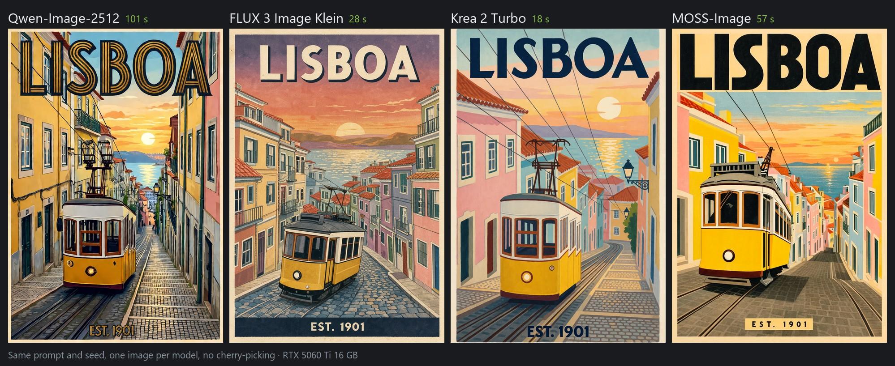
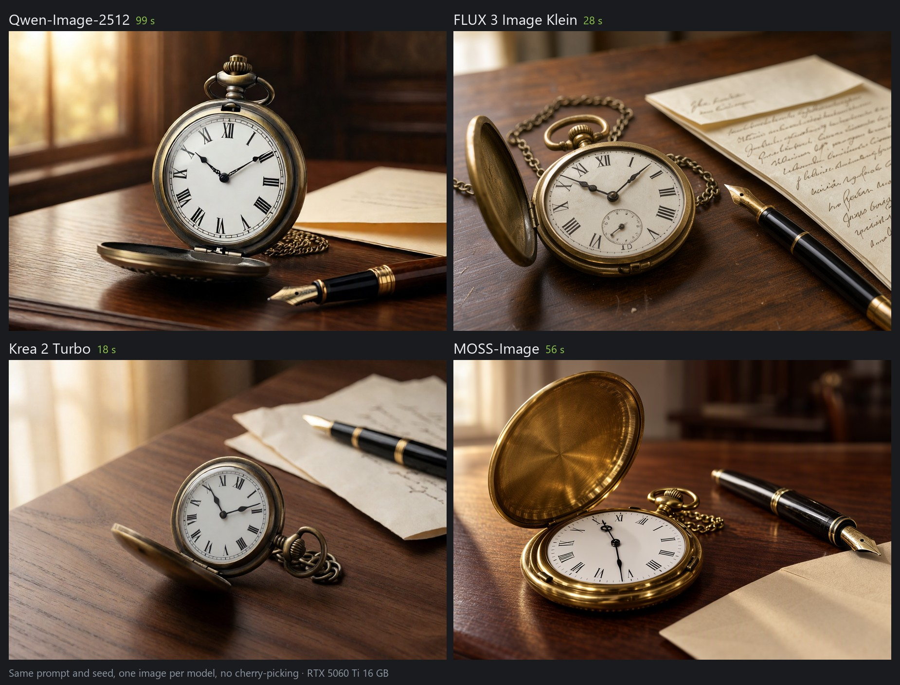
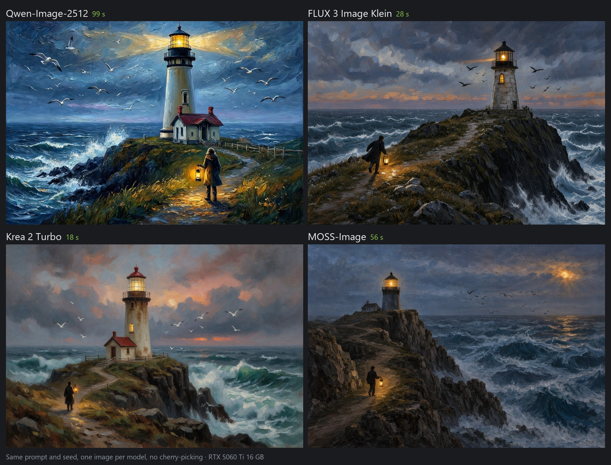

# Four image models side by side: Qwen-Image-2512, FLUX 3 Image Klein, Krea 2 Turbo and MOSS-Image

The four image models NVAI-open recommends, each given the same prompt and the same seed. One image per model,
no cherry-picking. At the end: from a photo to a video with voice and sound.

Measured on October 25, 2026 on an RTX 5060 Ti with 16 GB (Windows 11, NVAI-open 0.5.11, ComfyUI 0.42.1). Every
model ran with its default settings. The times are per image and include the prompt expansion of FLUX 3 and
MOSS-Image, but not the model loading (each model made one small warm-up image first).

| | Qwen-Image-2512 | FLUX 3 Image Klein | Krea 2 Turbo | MOSS-Image |
|---|---|---|---|---|
| Model ID | `qwen-image-2512-nvfp4` | `flux3-klein-nvfp4` | `krea2-turbo-nvfp4` | `moss-image-sft-int8` |
| Steps / CFG | 50 / 4 | 16 / 1, prompt upsampler | 8 / 1 | 50 / 3, own prompt expansion |
| Time per image (~1 MP) | 99–102 s | 28 s | 18–19 s | 56–57 s |
| Small lettering ("ARES VII" on a patch) | correct, twice | correct | "ARES VIII" | correct, the cleanest |
| Poster lettering | letter-perfect | letter-perfect | letter-perfect | letter-perfect |
| Watch hands at ten past ten | yes | close (about 10:05) | no | no |
| License | Apache-2.0 | FLUX Kommunity License: commercial use below US$5M revenue | Krea 2 Community License: commercial use below US$1M revenue | Apache-2.0 |

One seed per motif is a small sample: another seed can change details such as the watch hands. The same seed
does not give the same picture in different models; it only makes each result reproducible.

## 1. A person with small lettering


832 × 1216, seed 21:

```
Cinematic film still of a young female astronaut with short silver hair and light freckles, standing in a dim
spaceship corridor lit by cyan instrument panels. Medium shot from the waist up, her whole head inside the frame.
Her white spacesuit is scuffed, and a round mission patch on her shoulder reads "ARES VII". Soft rim light,
shallow depth of field.
```

- **Qwen-Image-2512** wrote "ARES VII" correctly, at the top and again at the bottom of the patch.
- **FLUX 3** wrote it correctly in a hand-painted style.
- **Krea 2** gave the most photographic face (skin, freckles, light), but the patch reads "ARES VIII", with
  unreadable small text above it.
- **MOSS-Image** made the cleanest patch, "ARES VII" on a banner, in a cool teal grade.

## 2. Poster typography



832 × 1216, seed 21:

```
Vintage travel poster in flat gouache colors: a yellow tram climbing a steep cobblestone street past pastel
houses at sunset, the sea glittering in the distance. Bold Art Deco lettering "LISBOA" across the top and
"EST. 1901" in small capitals at the bottom.
```

All four wrote "LISBOA" and "EST. 1901" letter-perfect. Qwen-Image-2512 drew the most Art Deco lettering,
MOSS-Image laid the poster out like a print, with "EST. 1901" on a band of its own.

## 3. A detail: a pocket watch at ten past ten



1216 × 832, seed 21:

```
Studio product photograph of a vintage brass pocket watch lying open on a dark walnut desk beside a fountain
pen and a folded letter. The white watch face has black Roman numerals, and the hands point to ten past ten.
Warm window light from the left, soft shadows, shallow depth of field.
```

- **Qwen-Image-2512** set the hands to ten past ten.
- **FLUX 3** came close at about 10:05 and added a small seconds dial.
- **Krea 2** pointed the hands at XI and II (about 1:55), and several numerals are wrong.
- **MOSS-Image** pointed them straight up and down (about 12:30).

## 4. An oil painting



1216 × 832, seed 21:

```
A painted illustration in oil on canvas with visible brush strokes: a lone lighthouse on a cliff above a stormy
sea at dusk. A small figure with a lantern walks the path toward it, warm light glows in the lighthouse window,
and seabirds circle in the wind.
```

All four painted the lighthouse with the lit window, the figure with the lantern and the seabirds. The brush
strokes are most visible with Qwen-Image-2512 (loose and expressive) and Krea 2 (classic oil). FLUX 3 and
MOSS-Image painted darker and closer to a photo.

## 5. From a photo to a video with sound


[The video with sound (5 s, MP4)](videos/photo-to-video-captain.mp4). The person is made up: the "photo" is a
Krea 2 image, not a real person.

1. **The photo** (Krea 2, 832 × 1216, seed 8, 23 s):

   ```
   Candid smartphone photo of a man in his late thirties with a short brown beard, warm brown eyes and slightly
   messy dark hair, wearing a grey hoodie, in a city park on an overcast afternoon. Medium close-up from the chest
   up, his whole head inside the frame with free space above his head. Natural soft daylight.
   ```

2. **The role** (FLUX 3 with the photo as the first reference image, 1280 × 704, seed 8, four variants in
   102 s). The face that looked most like the photo was taken:

   ```
   Cinematic film still. The person from the first image, with exactly the same face, eyes, nose, mouth and hair
   color: a ship captain in the 1920s, wearing a navy wool coat with brass buttons and a peaked captain's cap,
   standing at the wooden rail of an old steamship in a storm, rain on his face and coat. Medium shot from the
   waist up, the face clearly visible, free space above the head.
   ```

3. **The video** (LTX-2.5 with the start image, 1280 × 704, 121 frames at 24 fps, best quality (DFR), seed 8,
   156 s):

   ```
   The captain holds the wooden rail as the old steamship rolls in the storm. Rain streaks across the frame, and a
   wave breaks over the bow behind him. He looks straight into the camera and says in a rough, deep voice: "Hold
   fast, lads. We sail home tonight." Static camera, a locked-off medium shot; the framing stays exactly as in the
   first frame. Loud wind howls, heavy rain drums on the deck, and the waves crash.
   ```

In an earlier test, "the camera holds a medium close-up" turned into a push-in to an extreme close-up, while
"Static camera, a locked-off medium shot" kept the framing. More tips for this chain are in
[MODELS.md](MODELS.md#new-in-058).

## Reproduce it

In the web interface: "Generate" → "Image", pick the model, paste the prompt, set the size and seed 21.

Over the REST API:

```
POST http://127.0.0.1:8100/api/generate/image
{"prompt": "…", "model_id": "moss-image-sft-int8", "width": 832, "height": 1216, "seed": 21}
```

From Claude Code with the MCP server (see [CLAUDE_CODE.md](CLAUDE_CODE.md)):

```
generate_image(prompt="…", model_id="krea2-turbo-nvfp4", width=832, height=1216, seed=21)
```

More about each model, with prompt tips and further measurements: [MODELS.md](MODELS.md).
