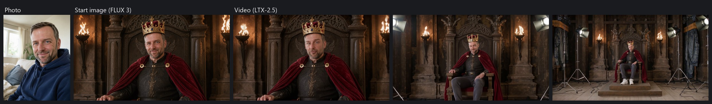
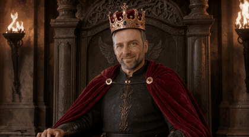
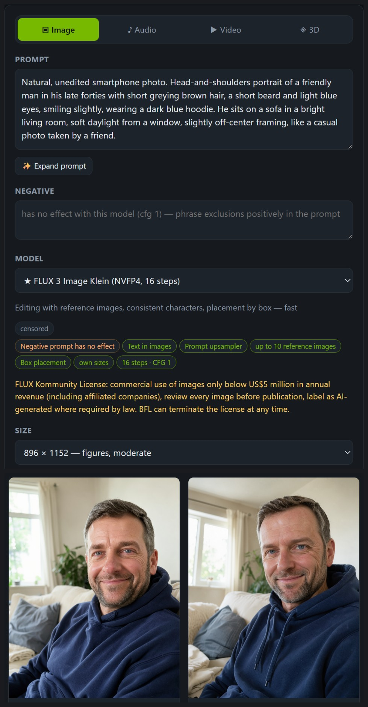
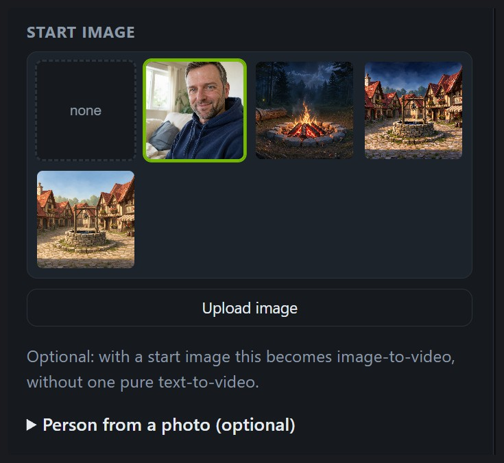
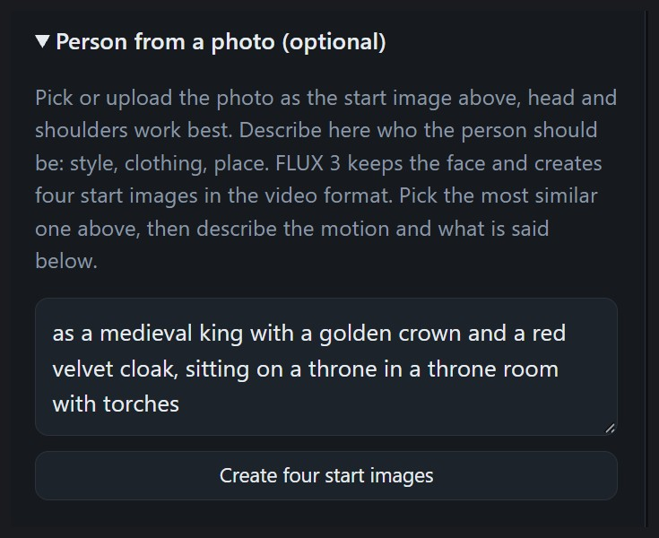
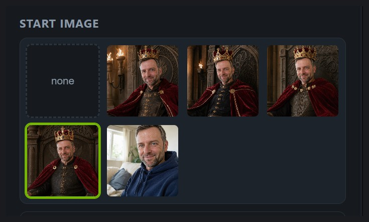
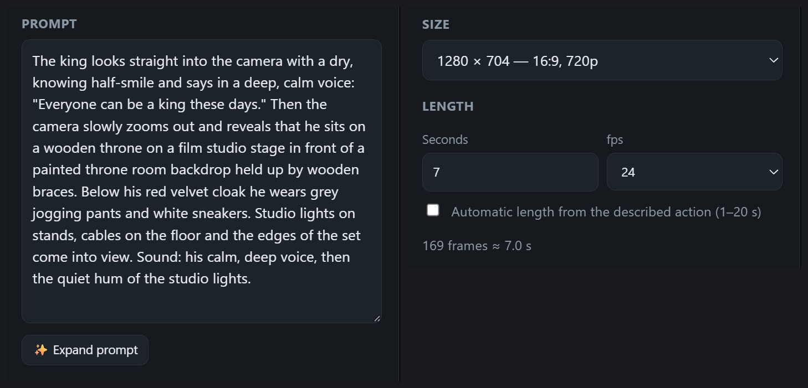

# From a photo to a video

*Deutsch: [de/FOTO_ZU_VIDEO.md](de/FOTO_ZU_VIDEO.md)*

Take a photo of a person, describe a role, and NVAI-open puts the person into that role and makes a
video in which they move and speak. In this example a casual portrait becomes a king who says
"Everyone can be a king these days." Then the camera zooms out to the film set: the throne room is a
painted backdrop, and under the velvet cloak he wears jogging pants and sneakers.

The video as a GIF, without sound. <a href="videos/photo-video-king.mp4">MP4 with sound</a> (3 MB).

The photo in this example was generated with NVAI-open as well: this man does not exist. Use only
photos of people who agreed to it.

## What you need

| | |
|---|---|
| FLUX 3 Image Klein | makes the start images from the photo; 20.2 GB download (NVFP4 for RTX 50, INT8 with 17.8 GB for RTX 20/30/40) |
| LTX-2.5 | turns the start image into a video with sound; 37.5 GB download |
| Time | measured on an RTX 5060 Ti with 16 GB: four start images in 96 s, the 7-second video in 144 s |

Both are under "Models". Their repositories on Hugging Face are gated: accept the license there
first and store your token in NVAI-open.

The whole chain takes five steps: the portrait is made under "Generate → Image", everything else
under "Generate → Video".

## Step 1: create the portrait (Generate → Image)

Under "Generate", choose "Image", pick FLUX 3 Image Klein and the size 896 × 1152, and describe a
casual photo. The prompt of the example:

> Natural, unedited smartphone photo. Head-and-shoulders portrait of a friendly man in his late
> forties with short greying brown hair, a short beard and light blue eyes, smiling slightly, wearing
> a dark blue hoodie. He sits on a sofa in a bright living room, soft daylight from a window, slightly
> off-center framing, like a casual photo taken by a friend.

With "Count" 2 under "Advanced settings" you get two portraits to choose from; the example continues
with the right one. With a real photo, skip this step and upload the photo in step 2.

## Step 2: pick the portrait as the start image (Generate → Video)

Switch to "Video" and click the portrait in the "Start image" list, or upload the photo there with
"Upload image". A picture that shows only head and shoulders works best, because FLUX 3 takes the face
from it.

## Step 3: describe the role

Below the start images, open "Person from a photo" and write who the person should be: clothing,
place, style, in English or German. Then click "Create four start images".

Name clothing and surroundings explicitly. Whatever you leave open, FLUX 3 invents.

## Step 4: pick the most similar start image

About a minute and a half later four start images in the video format are at the front of the list,
and the first one is selected. Click the one that looks most like the person, and look at them at
full resolution: FLUX 3 tends to make faces a little slimmer and younger.

## Step 5: describe what happens

In the prompt, write in one paragraph what moves, what the camera does, the spoken line in quotation
marks together with the voice, and the sounds. Set the length (7 s here) and click "Generate".
LTX-2.5 makes the video with speech and sound.

## Tips from our tests

- **Hold the face with an end image.** Tick "Loop: the start image is also the end image" and keep the
  camera still, or give an end image that FLUX 3 edited from the start image. In a close-up looking into the
  lens, the face stayed the person's for the whole 5 s (similarity to the start image 0.80–1.0); with the
  start image alone, the camera pushed in after a second despite "static camera", and LTX-2.5 redrew the face
  (0.3–0.4). The price: whatever is the same in both images stands still in between. Water and smoke moved as
  little as the shore, even with a sentence in the prompt asking them to move; with only a start image they kept
  moving. For a moving background, use neither a loop nor an end image.
- **With a real photo, use the photo itself.** FLUX 3 makes faces a little slimmer and younger. Under
  "Image → Extend an existing image (outpainting)", FLUX 3 extends the photo to the video format and puts the
  original back pixel for pixel, so the first frame is exactly the person.
- **Keep the person facing the camera.** If they turn away, LTX-2.5 redraws the face afterwards and it
  looks less like the photo.
- **Say exactly what the camera does.** "The camera holds a steady medium shot" keeps the framing;
  "pulls back a little" turned into a wide shot in our test. For a reveal like the one above, write
  "zooms out and reveals …".
- **Describe the voice and how loud things are**, for example "says in a deep, calm voice". Sounds
  described as quiet come out very quiet.
- **The voice is generated.** It is never the person's real voice.
- **Licenses:** FLUX 3 images may be used commercially only below US$5 million annual revenue, and
  every image has to be reviewed before it is published (FLUX Kommunity License). LTX-2.5 is free
  below US$10 million revenue (LTX-2 Community License).

## Over MCP (Claude Code)

The same in two calls: `generate_image` with `flux3-klein-nvfp4`, the photo in `reference_asset_ids`,
`batch_size=4`, the video size (`width=1280, height=704`) and the prompt "Cinematic film still. The
person from the first image, with exactly the same face, eyes, nose, mouth and hair color: <role>.
Medium shot from the waist up, the face clearly visible." Then `generate_video` with the chosen image
as `image_asset_id`. To keep the face to the end, also pass `loop=True` (still camera) or the same image as
`end_image_asset_id`; the background then stands still. More in
[CLAUDE_CODE.md](CLAUDE_CODE.md#person-from-a-photo-since-058).
