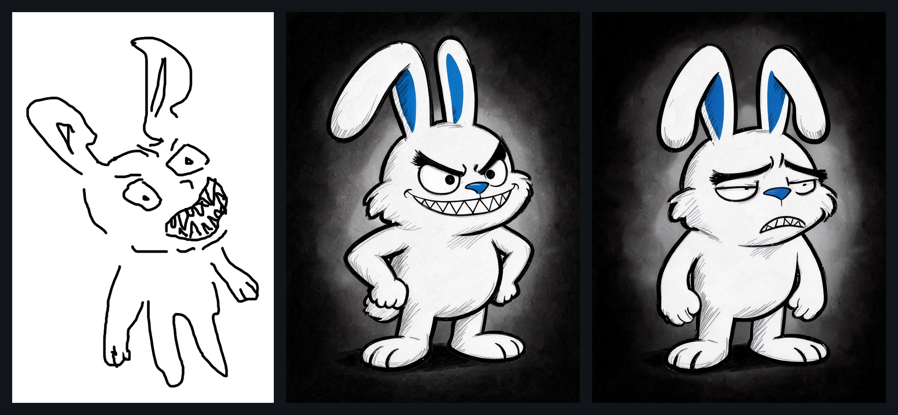
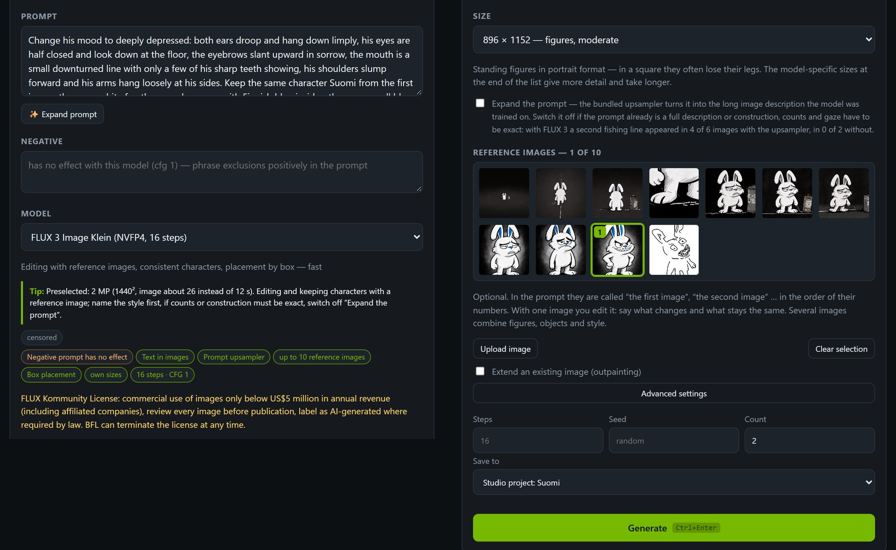
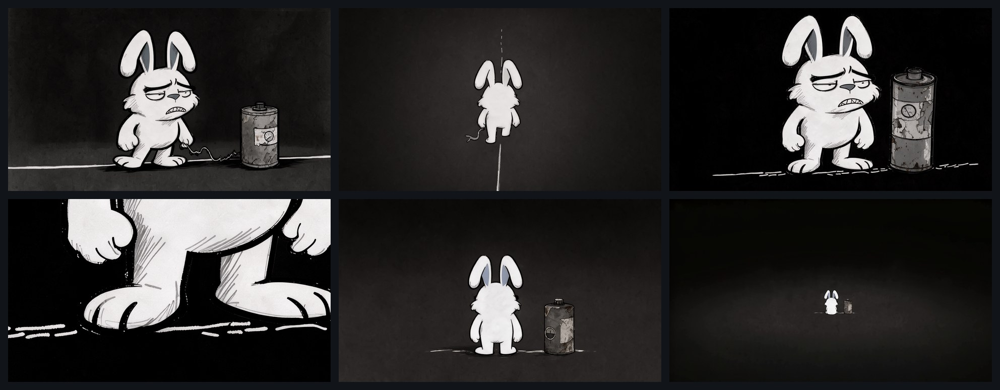
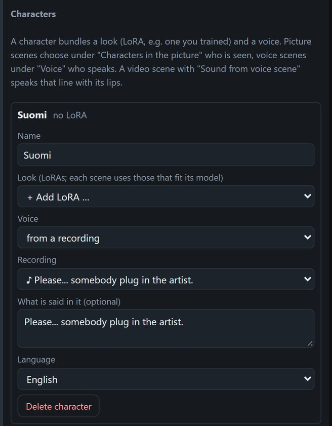
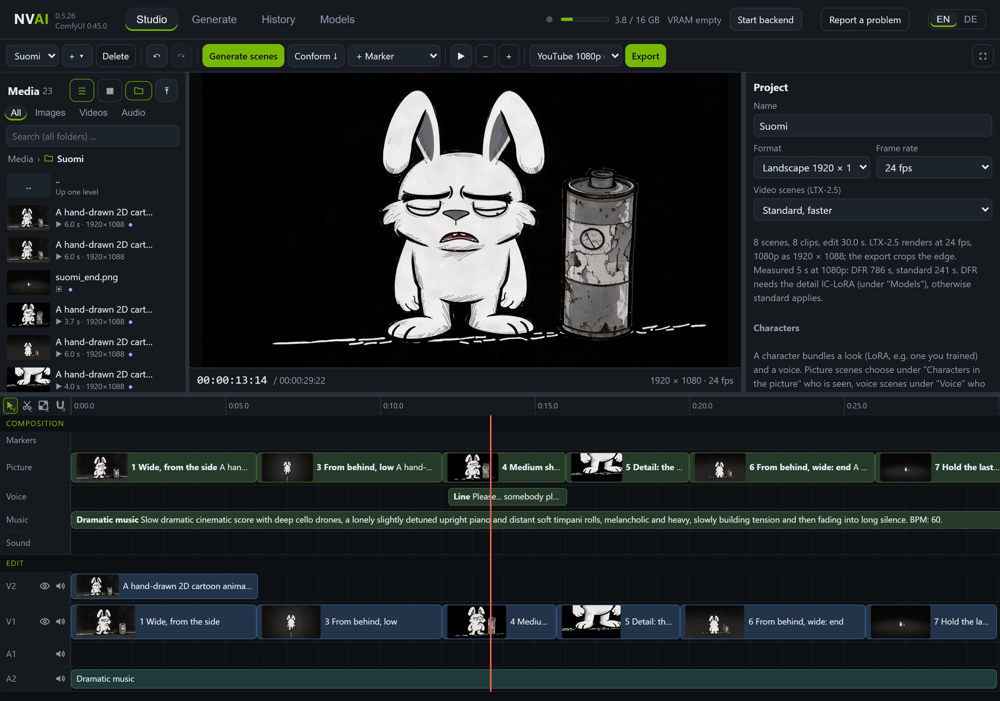
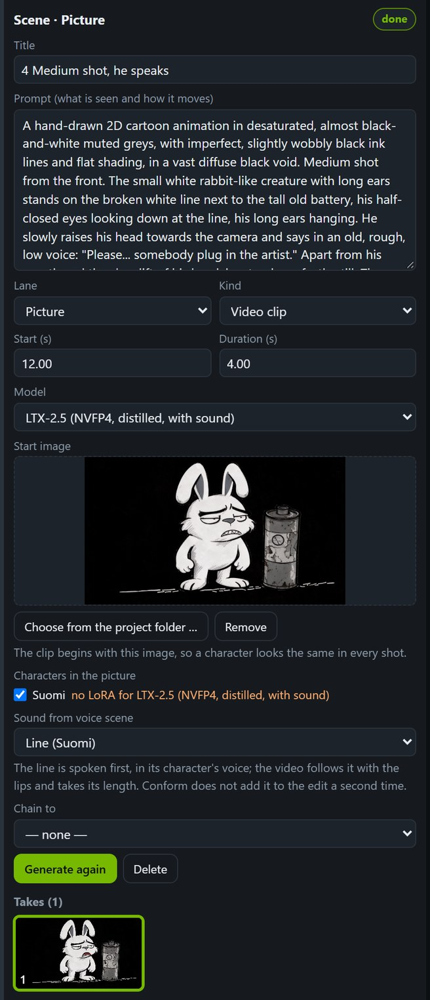
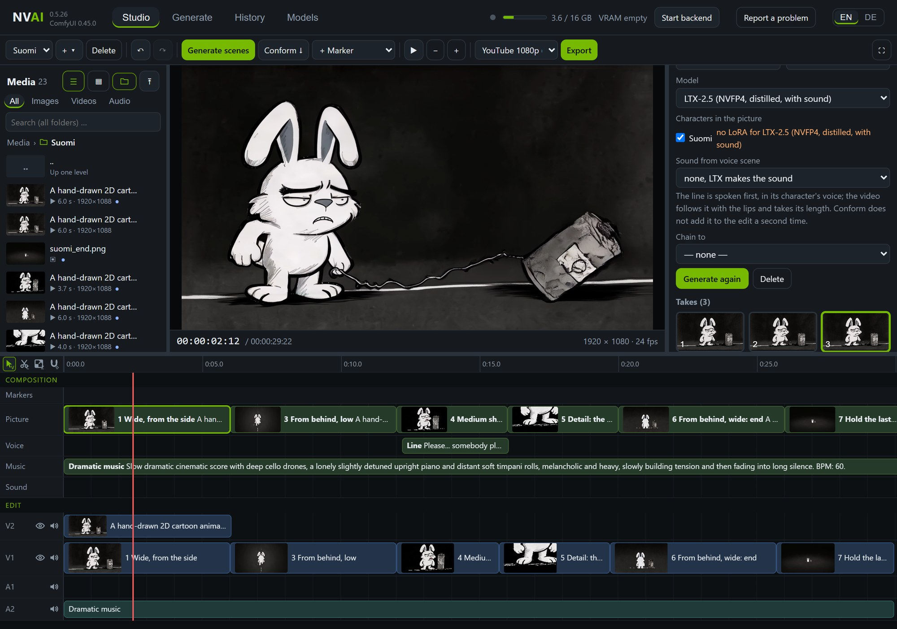

# Short film: from a hand sketch to a finished film

[Deutsch](de/KURZFILM.md)

A 30-second short film with a drawn character, made in one evening with NVAI-open. A tired white rabbit called
Suomi pulls an old battery along by a frayed cable. The line he walks on breaks apart. He looks up and says
"Please... somebody plug in the artist.", then sits down, and the battery goes dark.

  

The finished film on YouTube

The idea, the hand sketch and every decision came from a person: which character, which voice, which music, which
take. Claude Code wrote the prompts and operated NVAI-open over MCP. Every image, voice line, piece of music and clip
was made locally on one graphics card (RTX 5060 Ti 16 GB), in about 50 minutes of GPU time.

This page goes through the steps in the order they happened, with the prompts that were used and where to find each
step in the app.

| Step | Model | Time on the GPU |
|---|---|---|
| Character from the sketch, two rounds, 12 images | FLUX 3 Image Klein | 3 min |
| The tired mood as an edit, 2 images | FLUX 3 Image Klein | 47 s |
| Start images, 2 per shot, 1920 × 1088 | FLUX 3 Image Klein | 74–80 s per shot |
| The voice line, 3 tries | Qwen3-TTS 1.7B | 45 s for the first (loading), then 7 s each |
| Music, 60 s, 2 tries | Stable Audio 3 Medium | 8–11 s each |
| Five video scenes, standard quality | LTX-2.5 | 22 min (4 s scene: 3 min, 6 s scene: 5 min) |
| Shot 1 twice more | LTX-2.5 | 10 min |
| Export, 30 s in YouTube 1080p | NVENC | 24 s |

## 1. From the sketch to a character

The start was a quick sketch (left) and the wish: as simple as the sketch, but clear and expressive, on a diffuse
black background.

- **Round 1, with the sketch as reference image:** FLUX 3 traced the sketch almost line for line, wobbly lines and
  all. A reference image gets copied, not reinterpreted.
- **Round 2, without an image:** the character described in words, style first. That gave a clean design (middle),
  8 images in 4 poses, 22 s per two images:

  > Hand-inked cartoon illustration with confident black brush outlines of varying thickness, flat white fill, a few
  > loose grey hatching strokes for shading and a single accent color: Finnish flag blue. … The character is Suomi, an
  > original mischievous rabbit-like creature with white fur, two long ears with Finnish blue insides, the right ear
  > bent over halfway so that its tip hangs down, heavy angry slanted eyebrows, … a crooked grin full of sharp zigzag
  > shark teeth … He stands full body in a slightly turned three-quarter view, fists on his hips, grinning. Diffuse
  > black background with a faint soft grey glow behind the character; nothing else in the picture.

Give the character a few marks of his own (here the blue ears and nose, the shark teeth). They keep him recognizable
in every later shot, and he stays your own character.

## 2. A new mood as an edit

For the battery story Suomi had to be tired, not wicked. A new prompt would have drawn a different rabbit. An edit
of the chosen design keeps everything that is not mentioned:

1. **Generate → Image**, model **FLUX 3 Image Klein**.
2. Under **Reference images**, click the design. It gets the number 1 and is "the first image" in the prompt.
3. In the prompt, say what changes and what stays the same:

   > Change his mood to deeply depressed: both ears droop and hang down limply, his eyes are half closed and look down
   > at the floor, … his shoulders slump forward and his arms hang loosely at his sides. Keep the same character Suomi
   > from the first image: the same white fur, the same long ears with Finnish blue insides, … the same body
   > proportions, the same hand-inked black brush outlines … Change only his facial expression and posture as
   > described.

4. Switch off **Expand the prompt** (the prompt is already complete), pick a portrait size, **Count** 2, and under
   **Save to** the Studio project. Everything then lands in the project's media.

Two images took 47 s. In both, FLUX kept the ears upright instead of letting them droop: it stays close to the
reference. The one with tired, half-closed eyes became Suomi for this film (right in the strip above).

## 3. Storyboard: one start image per shot

Before spending GPU minutes on video, every shot got a start image. LTX-2.5 begins the clip with it, so the character
looks the same in every shot. The plan had six shots in grey on black and a long, quiet ending:

| Shot | Framing | What happens |
|---|---|---|
| 1 | Wide | Suomi on a thin white line takes a heavy step and pulls the battery after him; its gauge is almost empty |
| 2 | Close on the battery | cut later: the film got too long |
| 3 | From behind, low | he walks away; ahead the line breaks into dashes |
| 4 | Medium, from the front | he raises his head and says the line |
| 5 | Detail at floor level | the dashes under his feet fade away |
| 6 | From behind, very wide | he sits down, the gauge goes dark, the camera pulls back |
| 7 | Still image | the last frame of shot 6, held in silence |

Each start image is again an edit with FLUX 3: the tired Suomi (or the matching view of him, see below) as
reference image, 1920 × 1088 (the video size), two images per shot, 74–80 s. The prompts follow one pattern. The
style comes first, plus a sentence against the typical AI look, then the character from the reference, then the
shot:

> Hand-drawn 2D cartoon frame with imperfect, slightly wobbly black ink lines and a few loose grey hatching strokes,
> flat and simple. The whole picture is desaturated, almost black and white in muted greys … No glossy highlights,
> no glow effects, no lens flare, no blur, no extra details. The character is Suomi from the first image: … Wide shot
> from the side: … an old, worn-out cylindrical battery as tall as his chest, dented, with rust spots and a peeling
> paper label without any text, a small round charge gauge on its side, old-fashioned like from the 1950s … Diffuse
> black background, empty darkness all around.

What came up along the way:

- **Views from behind:** with only the front view as reference, Suomi stood facing the camera even in the shots
  planned from behind. So FLUX drew a character sheet with a front, side and back view, and each view, cut out,
  became the reference for its shots. The first sheet showed a small tail, which was not wanted; the second was drawn
  with "He has no tail at all, in none of the views.", and the prompts from behind end with "He has no tail."
- **Side views and profiles** looked strange on this character. Shot 1 was therefore kept frontal: instead of
  walking across the picture, he takes one heavy step and pulls the battery after him.
- **The detail of the feet** (shot 5) is an enlarged crop of the start image of shot 4, redrawn by FLUX with crisp
  lines at full resolution.
- **Check the details:** one image showed two lines like a road, and in one the battery gauge read almost full.
  Those were deleted, and the next best one was picked.

## 4. Voice and music

**The voice.** Under **Generate → Speech** with Qwen3-TTS, write the line and describe the voice:

> An old man with a rough, gravelly, deep voice, speaking slowly, quietly and wearily with a lowered, resigned tone.

The same description sounds a little different with every seed. So three tries (7 s each once the model is loaded),
listen, keep the best one. The chosen recording becomes Suomi's voice:

1. Drag it from the media list onto a scene on the **Voice** lane. It becomes the take of that scene.
2. Click an empty spot in the Studio. Under **Characters**, click **+ Character**, set **Voice: from a recording**,
   pick the recording and enter what is said in it, word for word.
3. Choose Suomi as the speaker of the voice scene. New lines for him then come in the same voice.

Suomi has no LoRA here, because the start images carry his look. A character can also bring a look as a LoRA, for
example one you trained yourself ([Characters](STUDIO.md#characters)).

**The music.** Stable Audio 3 Medium, one sentence with genre, instruments, mood and tempo, 60 s, two tries at
8–11 s each:

> Slow dramatic cinematic score with deep cello drones, a lonely slightly detuned upright piano and distant soft
> timpani rolls, melancholic and heavy, slowly building tension and then fading into long silence. BPM: 60.

In the Studio the music is a scene on the **Music** lane across the whole film. A file from the media list dragged
onto a scene becomes its take.

## 5. The scenes in the Studio

- **Project:** 1920 × 1080 at 24 fps. Video scenes on **Standard, faster**: the flat drawing style was already sharp
  in standard quality, and DFR takes about three times as long.
- **One video scene per shot** with LTX-2.5 and one paragraph of prompt: style, framing, the action with verbs, what
  stays still, the camera, the sound. Under **Characters in the picture**, Suomi is ticked; the orange note only
  says that he has no LoRA for this model.
- **The start image:** under **Start image** in the properties, drag the image from the media list onto the field
  or pick it with **Choose from the project folder …**. For this film Claude set it over MCP (`studio_command`,
  `scene.update` with `params.image_asset_id`); the field came with NVAI-open 0.5.27.
- **The spoken line:** a scene on the **Voice** lane with the line and Suomi as speaker, placed under shot 4. In
  shot 4, **Sound from voice scene** points to it. The video follows the line with the lips and takes its length:

- **The ending:** the last frame of shot 6 as a still image scene, held for 4.25 s in silence. The quiet end was part
  of the idea from the start.

## 6. Generate, check, choose takes

**Generate scenes** made the five videos in 22 minutes. Then every clip was checked frame by frame before anything
went into the edit:

- **Shot 1** was made twice more. In the first take his face smeared for two frames when he turned, and the battery
  tipped over. In the second, the battery jumped to his other side, and he turned into profile at the end. The third,
  calm version (he stands still, breathes, the needle trembles) was clean.
- In the end the first take was still the favorite. It lies on V2 above the calm take on V1. Every take stays in the
  scene, and a click switches between them.

## 7. Conform and export

**Conform** puts the chosen takes into the edit. The spoken line is not added a second time, because it already
sounds in shot 4. The music was trimmed to the last frame. The export with **YouTube 1080p** took 24 s for the 30
seconds, loudness normalized to −14 LUFS.

## Tips

- **Describe a new character in words.** A reference image gets copied; use it for edits.
- **Moods and poses as an edit** of the chosen design: say what changes and what stays the same.
- **Start images first, video after.** Two start images take about 75 s, a 6-second clip about 5 minutes.
- **Plan the shots around the character's good sides.** Here: front and back, no profile, and "He has no tail." for
  views from behind.
- **Check clips frame by frame and keep the takes.** Faults often last only two frames.
- **Listen to voice and music yourself.** An AI agent can measure them but not hear them.

How the Studio works in detail: [STUDIO.md](STUDIO.md). How Claude built the Studio's own explainer video:
[MAKING_OF.md](MAKING_OF.md).
