# Studio: whole videos from scenes

*Deutsch: [de/STUDIO.md](de/STUDIO.md)*

The Studio is the first tab when NVAI-open starts and fills the whole window. At the top you compose: scenes with a
prompt on lanes for picture, voice, music and sound, and markers that say what goes where. At the bottom you edit the
real clips. When the edit is done, the Studio exports with your graphics card's video encoder. It aims at high-quality
1080p: video scenes are generated in the best quality, every AI video is also kept losslessly, and only the export
compresses. Claude Code can do all of it too, and NVAI-open for Mac has the Studio as well ([On the Mac](#on-the-mac)).

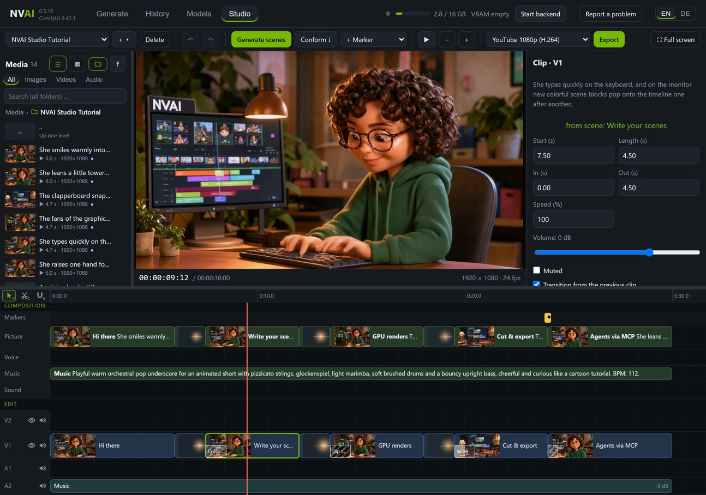

## The two timelines

**Composition** (top): every scene is a prompt, a model and a length on one of four lanes.

| Lane | What it makes |
|---|---|
| Picture | Video clips with sound (LTX-2.5) or still images (any image model) |
| Voice | Spoken lines with a voice you describe or take over (Qwen3-TTS), see [Narrator voice](#narrator-voice) |
| Music | Instrumental music up to 5 minutes (Stable Audio 3) |
| Sound | Sound effects and ambience (Stable Audio Open) |

**Edit** (bottom): the clips of the finished video on the tracks V1, V2 (above V1) … and A1, A2 …. Every clip has an
in and an out point, a speed, a volume and optionally a transition at its start.

**Conform** puts the chosen takes into the edit. A clip stays linked to its scene: generate the scene again, conform,
and the clip gets the new material while your cut stays.

## Step by step

1. **New project:** "+" next to the project list at the top left, then "New project". It starts at 1920 × 1080 and
   24 fps. Name, format and the quality of the video scenes are in the properties on the right; a click into empty
   space shows them.
2. **Add scenes:** double-click a lane and write the prompt in the properties. Drag a scene to move it, drag its right
   edge to change its length. A video scene can begin with a **start image** (since 0.5.27): drag an image from the
   media list onto the field in the properties, or pick one with "Choose from the project folder …". That keeps a
   character or a place the same across shots. A chain comes first: then the clip begins with the end of the scene
   before. An image dropped onto the scene itself still becomes a take.
3. **Set markers:** double-click the marker row, or press M for a note at the playhead.
4. **Generate scenes:** makes every scene that has no take yet. Sound and still images come first, then the videos; a
   chained scene waits for the one before it, a voice scene for the voice it
   takes over. While it runs, the bar next to "Conform" shows the scene being made,
   its percentage and how many are done (for example "Far view 63 % · 2/5"). "✕ Cancel" (click twice) stops every
   running and queued job of the project; finished takes stay.
5. **Conform**, then **edit:** with Selection (V) drag clips and their edges, with the Razor (C) click to cut; Ctrl+K
   cuts at the playhead. A right-click anywhere shows what you can do.
6. **Export:** pick a format and click "Export". The video also lands in the History.

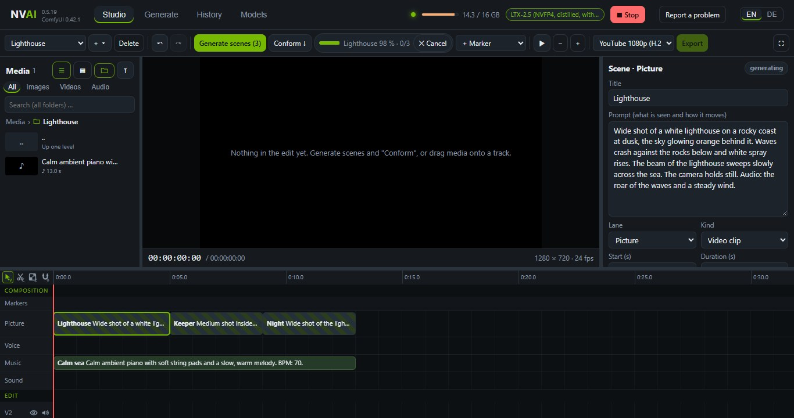

Every change is saved at once, and undo goes back up to 100 steps. "Delete" next to the project moves it into the
Studio's trash folder (`studio\papierkorb` in the data folder).

## Media

The list on the left shows your media, newest first, as a list or as tiles, with a filter and a search across all
folders. ◆ marks a video with a lossless copy, ● media that lies in the edit. Drag the line next to the list to make it
wider; the properties on the right can be dragged the same way, and a double-click resets them. The monitor always
keeps at least 320 pixels, so the Studio also works on a 14-inch notebook.

**Every project has its own folder** under `assets\Studio\<project name>` in the data folder. Takes, exports, the
last frames for chains and your uploads land there. In the Generate tab, "Save to" above the Generate button sends
images, videos and sound straight into a project's folder. The folder button next to the upload button shows the
folders; ".." goes up one level. "Clear history" leaves project folders alone, and a deleted project keeps its folder.

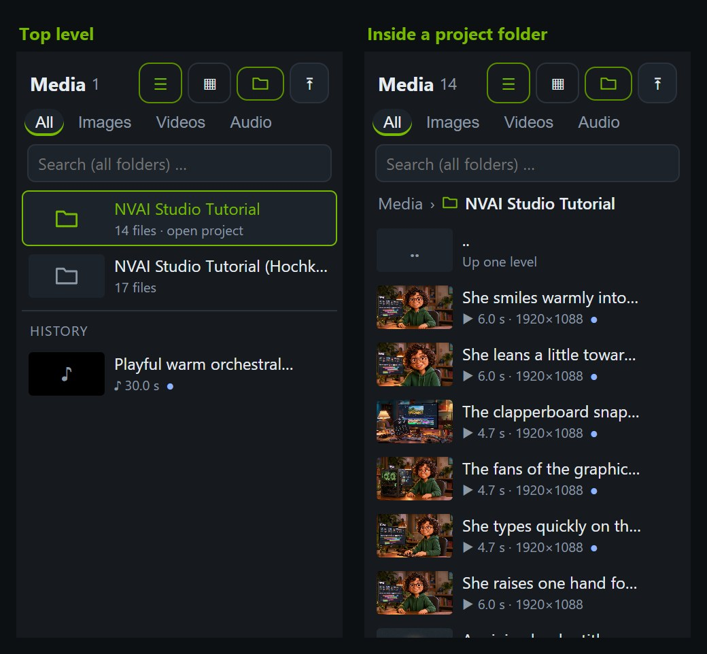

**Click** a file to play it in the monitor; Esc goes back to the edit. The properties show its details, a download of
the lossless copy, "Insert at the playhead" and "Delete". Drag a file onto a track to make a clip, or onto a scene to
add it as a take. A file that lies in the edit can only be deleted after its clip.

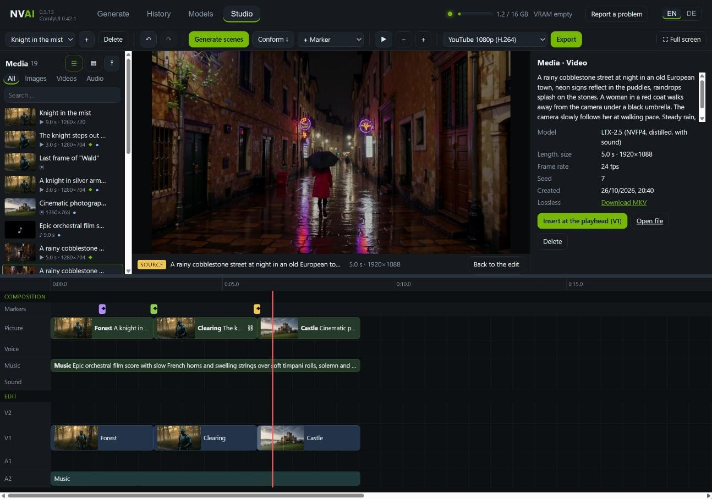

Lossless files and uploaded MKV, MOV or AVI files do not play in a browser, so NVAI-open makes an H.264 preview for
watching. The export and the download use the original.

## Narrator voice

Voice scenes speak their text with Qwen3-TTS (Apache-2.0, 10 languages including English and German). Write the text
into the field where other scenes have their prompt; punctuation sets the pauses. Under "Voice" choose where the voice
comes from:

- **describe:** one sentence with gender, age, pitch, pace and mood, for example "a calm, deep male voice, about
  fifty, warm and slightly rough". Every seed sounds a little different, so listen to a few takes of the first line.
- **same as scene …:** the chosen take of another voice scene is the reference, together with its text. The scene
  waits until that one has a take. This keeps one speaker over many lines: in our test the lines stayed at a
  similarity of 0.99 to their reference.
- **from a recording:** an audio or video file of the project; the first 20 s count, three seconds are enough. With the
  exact words of the recording the way of speaking is copied too. Only use recordings whose speakers agreed.

A voice scene takes the length of its take, so conforming never cuts off the end of a sentence. Conform puts the lines
on their own audio track "Voice" (on the Mac since 0.5.4), which it adds the first time; remove it like any other track, and the next conform
brings it back. The export brings the mix to −14 LUFS. In our test three lines took 30 s including loading the model.

## Characters

A character bundles a look and a voice, for example a person you trained as a LoRA. Click an empty spot to see the
project settings; under "Characters", "+ Character" adds one:

- **Look:** one or more LoRAs (add your own file under "Models" → "Add LoRA file", see [LORAS.md](LORAS.md)). Each
  scene uses the ones that fit its model, so a character can have one LoRA for still images (Qwen-Image) and one for
  clips (LTX-2); the trigger words go in front of the prompt by themselves.
- **Voice:** as with a voice scene: describe it, take it over from the take of a voice scene, or from a recording.
  Once a line sounds right, choose it as the reference, so every further line keeps that voice.

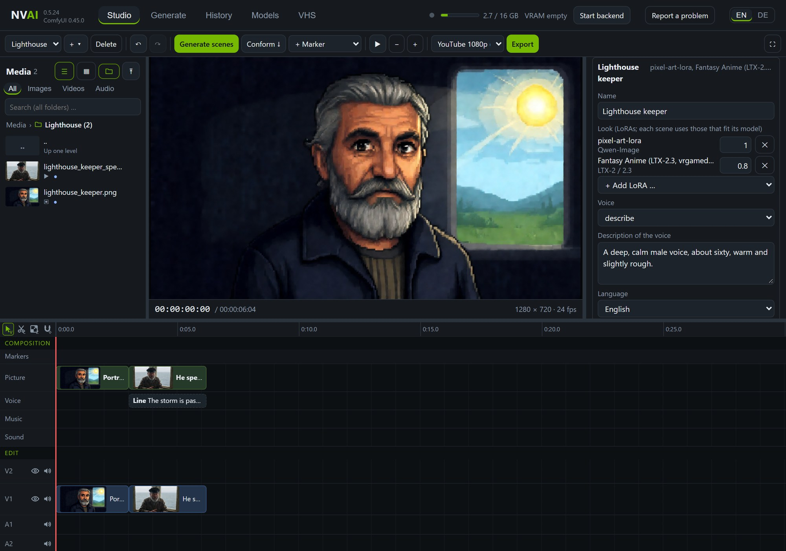

Then assign the character in the scenes:

- **Picture scenes:** tick it under "Characters in the picture". If none of its LoRAs fits the scene's model, the
  scene says so.
- **Voice scenes:** under "Voice" choose "of a character …"; the line is spoken with the character's voice.
- **Video scenes that speak (LTX-2.5):** "Sound from voice scene" takes that line as the clip's sound. The line is made
  first, the video follows it with the lips and fills the scene (if the line is longer than the scene, the clip gets
  the line's length). Conform does not lay the line on the voice track a second time.

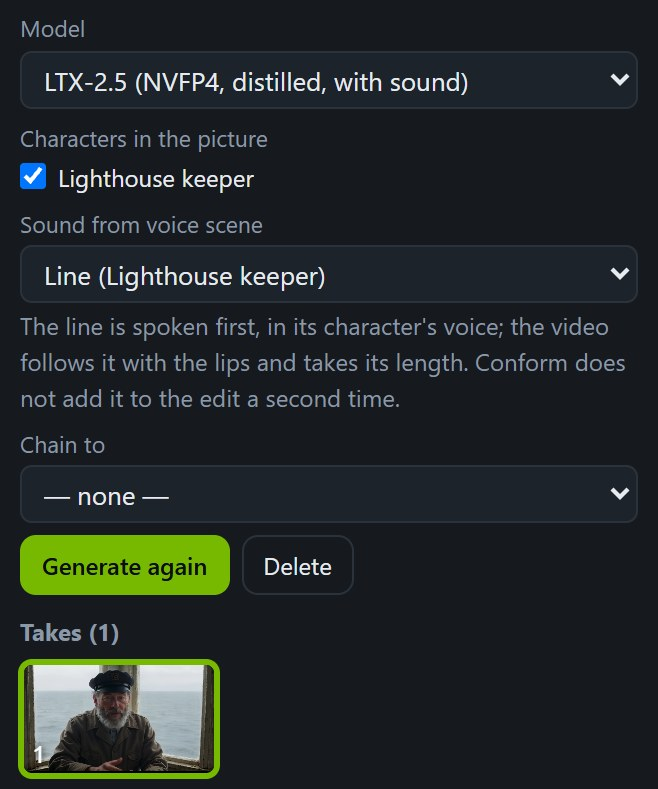

Claude Code does the same over MCP (`character.add`, `params.characters`, `params.character`, `params.audio_from`).

## Tools, right-click and tracks

- **Selection (V):** drag to move and trim, drag a box to select several; Shift- or Ctrl-click adds or removes one.
- **Razor (C):** a click cuts the clip, with Shift on all tracks.
- **Scale (Z):** zoom in the monitor, see below.
- **Magnet (S):** clips, scenes and markers dock to edges, markers and the playhead. When it is off, hold Shift to dock.

**Right-click** works everywhere: on clips (cut, copy, transition, speed, mute, delete …), transitions, empty spots,
track names (add, hide, mute or remove a track), scenes, markers and media.

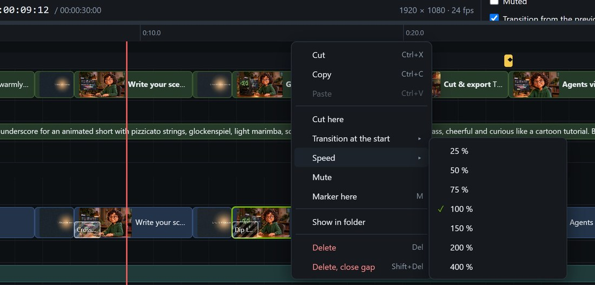

Ctrl+C and Ctrl+V copy and paste at the playhead. The eye hides a video track, the speaker mutes a track; both apply to
the preview and the export.

## Speed and transitions

**Speed** goes from 10 to 1000 % (in the clip's properties or with a right-click), and the sound keeps its pitch. If a
slower clip would run into the next one, the Studio asks whether to stop at the next clip, push the later clips back or
cover them.

**Transitions:** cross dissolve, dip to black, dip to white and wipe, computed without AI; the preview and the export
look the same. Add one with a right-click on the clip, with Ctrl+D or with a transition marker, and drag its edge to
change the length. The previous clip runs on past its end; if its material runs out, its last frame holds. So leave
every clip about half a second of spare material at its end.

## Scale and zoom with keyframes

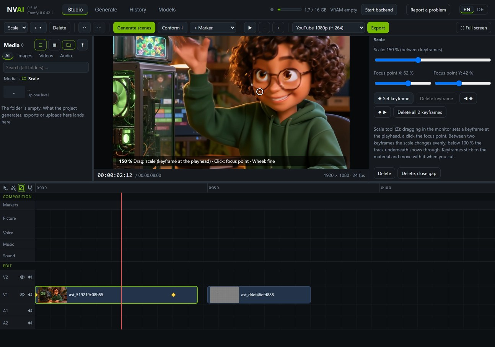

Every video clip can be scaled from 10 to 800 % around a **focus point**, so a zoom goes towards the face instead of
the middle. Below 100 % the clip becomes a picture in picture over the track below.

With the **Scale tool (Z)** drag up or down in the monitor; letting go sets a **keyframe** at the playhead. A click
sets the focus point, the mouse wheel scales finely. Between two keyframes the scale changes evenly. Keyframes show as
diamonds on the clip and stick to the material: cut the clip or change its speed, and the zoom stays on the same
moment.

## Markers

| Marker | What it does |
|---|---|
| Place | On conform, the chosen scene goes here, on the chosen track |
| Transition | The clip that starts here gets this transition |
| Chain | The video scene that starts here continues the one before it (see below) |
| Audio from here | On conform, the chosen audio scene starts here |
| AI task | A task for Claude: it reads it over MCP, does it and ticks it off |
| Note | Just a note |

**Chain:** with LTX-2.5 the chained scene takes over the last second (25 frames) of the scene before it and continues
its motion. Conform dissolves over exactly those frames, so the two shots join without a jump. With an end image, a
loop, a given sound or another model it starts from the last frame only. Measured with a sailboat: with only the last
frame, the motion at the seam dropped by more than half; with the last second carried over, it went on.

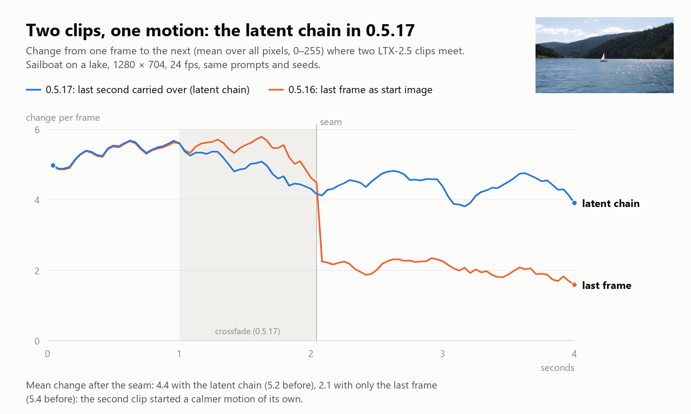

## Conform without surprises

If conforming would cover or change something, "Conform" shows a list first: new clips (with a warning if one would
cover an existing clip) and clips whose scene has a new take. Preselected is only what leaves your own cuts alone: a
clip that is still as long as its scene gets the new take, a shortened or split one only if you tick it.

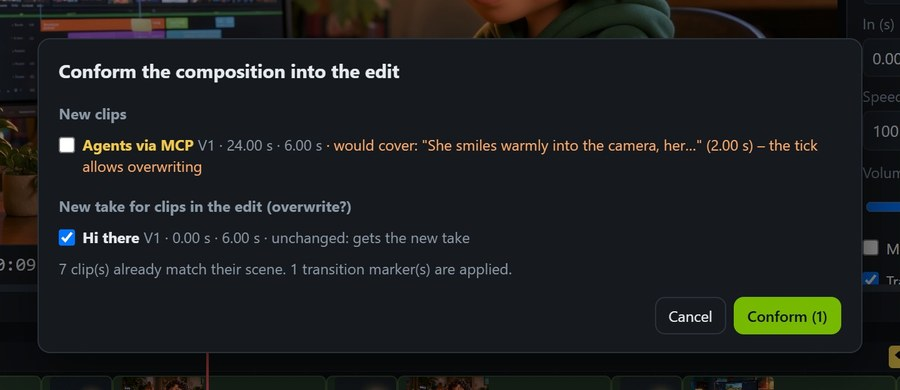

## Passing projects on

"+" → "Export project" packs the project with all its media into a ZIP file, on request with the lossless copies
(about 32 MB per second at 1080p). "Import project" opens such a package or a project file (.json), also on another
computer, NVAI-open for Mac included.

## Quality

- **Best quality (DFR):** with the detail IC-LoRA installed, LTX-2.5 scenes keep their detail over the whole clip, at
  about three times the time (5 s at 1080p: 786 instead of 241 s). The project setting "Video scenes" switches to
  "Standard, faster".
- **Lossless copy:** every AI video is also stored without compression, and the Studio cuts and exports from it. A
  YouTube export made from it reached 42.3 instead of 37.7 dB PSNR. It costs about 32 MB per second at 1080p; "Lossless
  copy for editing" under "Generate → Video" turns it off.
- **No needless rescaling:** clips within 5 % of the project's aspect ratio fill the frame (LTX-2.5 renders 1080p as
  1920 × 1088, and the export cuts off the 8 extra rows), others get black bars.

## Keyboard

| Key | |
|---|---|
| Space | Play and pause |
| V / C / Z | Selection / Razor / Scale tool |
| S | Magnet on and off |
| Shift (⇧) while dragging | Dock, also without the magnet |
| Ctrl+K | Cut at the playhead (with clips selected, only on their tracks) |
| Ctrl+C / Ctrl+X / Ctrl+V | Copy / cut / paste at the playhead |
| Ctrl+D | Dissolve on the selected clips or at the cut near the playhead |
| Ctrl+A | Select all clips |
| M | Note marker at the playhead |
| Del / Shift+Del | Delete the selection / delete clips and close the gap |
| Ctrl+Z / Ctrl+Y | Undo / redo |
| ← → | One frame; with Shift one second |
| Home / End | To the start / to the end |
| + / −, Ctrl+mouse wheel | Zoom the timeline |
| Esc | Cancel a drag, back to Selection, clear the selection, from the source monitor back to the edit |

"Full screen" at the top right hides everything but the Studio.

## Export

| Format | |
|---|---|
| YouTube 1080p (H.264) | 1920 × 1080, 24 Mbit/s |
| YouTube 4K (H.265) | 3840 × 2160, 40 Mbit/s |
| Vertical 1080 × 1920 (Shorts) | H.264, 10 Mbit/s |
| AV1 1080p (small) | 6 Mbit/s |
| Project format (H.264) | in the size of the project |
| Lossless master (MKV, FFV1) | pixel-exact, for archiving and further work |
| ProRes 4444 (MOV) | for other editing software |

The export uses your card's video encoder (NVENC, AMF or Quick Sync, otherwise software), mixes the sound to −14 LUFS,
the loudness YouTube plays at, and runs in its own queue, so you can keep generating. More than 24 Mbit/s hardly helps
at 1080p: 12, 24 and 40 Mbit/s measured 42.3, 42.8 and 43.0 dB.

## With Claude Code

The MCP server has six Studio tools: `studio_projects`, `studio_create`, `studio_get`, `studio_command`,
`studio_generate` and `studio_export`. Ask Claude for a story, and it writes the scenes, generates them, conforms,
cuts and exports while the Studio shows every change live. An "AI task" marker leaves Claude a note right in the
timeline. Details: [CLAUDE_CODE.md](CLAUDE_CODE.md#studio-whole-videos-from-scenes)

## Times

Measured on an RTX 5060 Ti 16 GB:

| | |
|---|---|
| LTX-2.5 clip, 5 s at 1920 × 1088, standard / best quality (DFR) | 241 s / 786 s |
| Still image with Krea 2 / 20 s of music with Stable Audio 3 | 25 s / about 7 s |
| Export of 5 s at 1080p for YouTube | 4 s |

Ten minutes made only of generated clips are 120 clips of 5 s: about 8 hours at 1080p, about a day with DFR. Still
images with music and voice are much cheaper.

## On the Mac

NVAI-open for Mac has the Studio too, natively on Apple Silicon, with the same tools, keys and menus, the progress and
cancel next to "Conform", and the same project format.

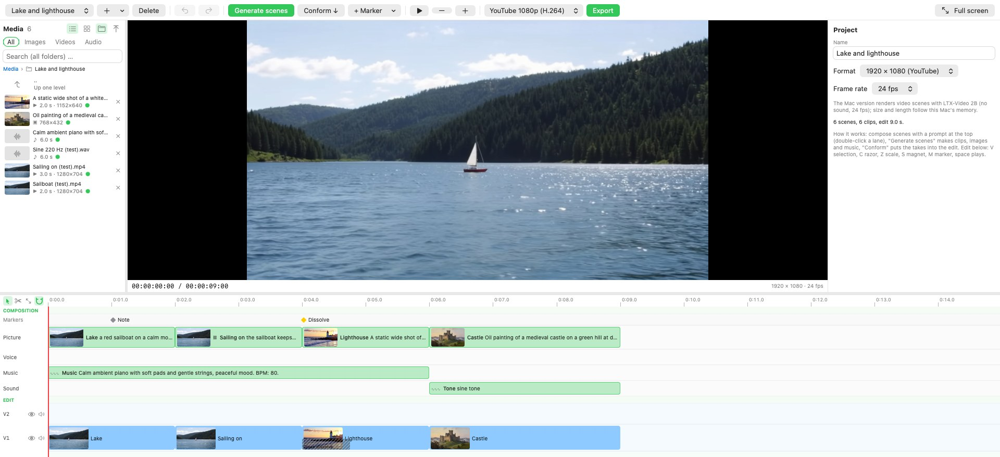

What the Mac does differently:

- **Models:** video scenes use the video model chosen under "Generate → Video". The Mac recommends one by memory:
  LTX-Video 2B, from 16 GB LTX-Video 13B, from 32 GB LTX-2.3 and from 64 GB LTX-2.5 with sound. On 8 GB a clip stays
  within 768 × 512 × 97 frames, for example 4 s at 768 × 512. Still images come from the active image model, music and
  sound from Stable Audio 3, voice scenes from Qwen3-TTS (since Mac 0.5.3; VoiceDesign 1.7B in 4-bit, Base 0.6B in 8-bit).
- **Chain:** starts from the last frame; carrying the last second over needs LTX-2.5 and stays on Windows.
- **Start image:** the field in a video scene's properties (Windows, since 0.5.27) is not in the Mac app yet.
- **Characters** (since Mac 0.5.5): the same as on Windows, with LoRAs for FLUX.2 Klein 4B. "Sound from voice scene"
  stays in the project but has no effect: no video model on the Mac takes a given sound, so Conform lays the line on
  the voice track as usual.
- **Export** with the Mac's own encoder: YouTube 1080p and 4K, Shorts, project format and ProRes 4444. There is no
  lossless copy, no AV1 and no MKV master.
- **REST:** the same `/api/studio/*` as on Windows, at `http://127.0.0.1:8100`.

Measured on a Mac mini M1 with 8 GB: three test scenes (a 2-second video, a still image, 6 s of music) took 320 s,
exporting 9 seconds at 1080p took 2 s.

## Not there yet

Titles and subtitles, panning, waveforms, export as image sequence, WAV or SRT, and exchange with
other editing software.

## Making of

How the Studio's own video was made, from the request in Claude Code to the export: [MAKING_OF.md](MAKING_OF.md).
A short film with a drawn character, from the hand sketch to the export, step by step:
[SHORT_FILM.md](SHORT_FILM.md).
