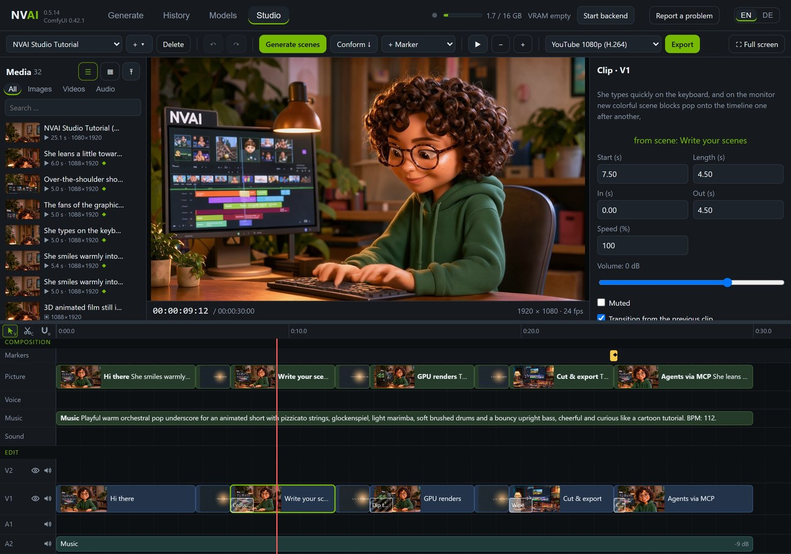
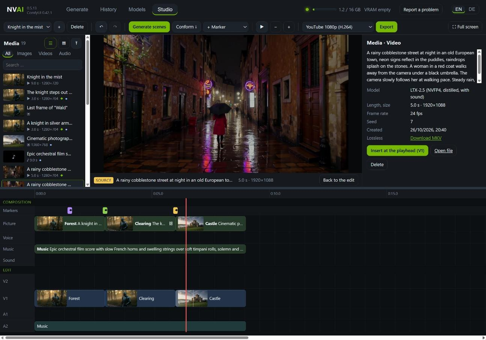
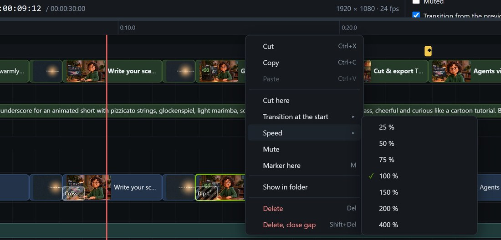
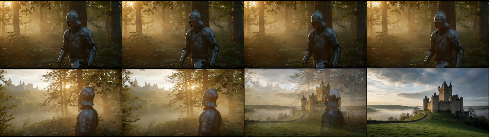
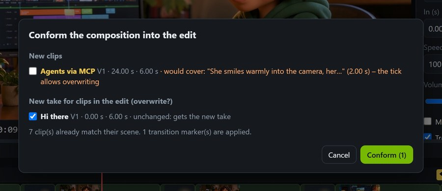

# Studio: whole videos from scenes

*Deutsch: [de/STUDIO.md](de/STUDIO.md)*

The Studio is a tab of its own that fills the whole window. At the top you compose: scenes with a
prompt on lanes for picture, voice, music and sound, and markers that say what goes where. At the
bottom you edit the real clips: cut, trim, dissolve, set the volume. When the edit is done, the Studio
exports with the video encoder of your graphics card. It aims at high-quality 1080p: video scenes are
generated in the best quality, every AI video is also kept losslessly, and only the export compresses.
Claude Code can do all of it as well.

## The two timelines

**Composition** (top): every scene is a prompt, a model and a length on one of four lanes.

| Lane | What it makes |
|---|---|
| Picture | Video clips with sound (LTX-2.5) or still images (any image model) |
| Voice | Nothing yet: NVAI-open has no text-to-speech so far. Drag a recorded audio file onto the scene instead |
| Music | Instrumental music up to 5 minutes (Stable Audio 3 Medium); no model sings yet |
| Sound | Sound effects and ambience (Stable Audio Open) |

**Edit** (bottom): the clips that end up in the video, on the tracks V1, V2 (above V1) … and A1, A2 …;
right-click a track name to add more. Every clip has an in and an out point, a speed, a volume, and
optionally a transition at its start.

**Conform** puts the chosen takes of the composition into the edit. A clip stays linked to its scene:
generate the scene again, conform, and the clip gets the new material while your cut stays. If the edit
already holds clips, the Studio asks first (see [Conform without surprises](#conform-without-surprises)).

## Step by step

1. **New project:** click **+** next to the project list at the top left, then "New project". Projects
   are called "New 1", "New 2" and so on and start at 1920 × 1080 and 24 fps. Name, format, frame rate and
   the quality of the video scenes are in the properties on the right: clicking the project list shows
   them, and so does a click into empty space.
2. **Add scenes:** double-click a lane, then write the prompt in the properties. Drag a scene to move
   it, drag its right edge to change its length. For video the length sets the number of frames
   (LTX-2.5 at 24 fps); a 1080p project gets 1920 × 1088.
3. **Set markers:** double-click the marker row, or "+ Marker", or M for a note at the playhead.
4. **Generate scenes:** generates every scene that has no take yet, with the model you chose in the
   properties or the active one. Short jobs come first (sound, still images), then the videos; a chained
   scene waits for the scene before it and follows by itself. Finished scenes show their takes in the
   properties; click a take to use it.
5. **Conform.**
6. **Edit:** with Selection (V), drag clips to move them and drag their edges to trim them; with the
   Razor (C), a click cuts the clip, and Ctrl+K cuts at the playhead. Del deletes, Shift+Del also closes the
   gap. A right-click anywhere shows what you can do; speed, transition, volume and mute are also in the
   properties.
7. **Export:** pick a format and click "Export". The finished video is also in the History.

The Studio saves every change at once. Undo and redo go back up to 100 steps; takes that finish in
the meantime stay. "Delete" next to the project moves it into the Studio's trash folder
(`studio\papierkorb` in the data folder).

## Media

The list on the left holds everything from the History, newest first: compact as a list or as tiles,
with a filter for images, videos and audio and a search field. It stays up to date by itself: finished
jobs, uploads and deletions show up right away. ◆ marks a video with a lossless copy, ● media that lies
in the edit. It loads 100 at a time; "Load 100 more" at the end fetches the next ones, and the filter and
the search look through all your media, not just what is loaded.

**Click** a file and the monitor becomes a source monitor: videos and sound play with their own
controls, images are shown in full. The properties show model, length, size, frame rate, seed and date,
a download of the lossless copy, "Insert at the playhead" (V1, or A2 for sound) and "Delete". Esc or
"Back to the edit" shows the edit again. Drag a file onto a track to make a clip there, or onto a scene
to add it as a take.

**Delete** asks in the button itself ("Delete?"), without a browser dialog. The file is gone afterwards,
together with its lossless copy and preview. Files that lie as a clip in the edit cannot be deleted from
here: delete the clip first. A deleted take disappears from its scene.

Lossless files (FFV1 in MKV, ProRes in MOV) and MKV, MOV or AVI files you upload do not play in a
browser. NVAI-open gives them an H.264 preview: Studio exports write it in the same pass, uploads get it
in the background a few seconds later. The preview is only for watching; the export and the download
use the original.

## Tools, right-click and tracks

Three tools sit at the top left above the track names, each with its key:

- **Selection (V):** drag to move, drag the edges to trim, drag a box in empty space to select several
  objects; Shift- or Ctrl-click adds or removes one. Whatever is selected moves together, clips also to
  another track of the same kind.
- **Razor (C):** a white line shows the spot, a click cuts the clip, with Shift on all tracks. Esc or V
  goes back to Selection.
- **Magnet:** when on, clips, scenes and markers dock to edges, markers, the playhead and 0; a white line
  shows where. When off, they dock while you hold Shift ⇧. Toggle it with a click or with S.

**Right-click** works everywhere:

| Where | What |
|---|---|
| Clip | Cut, Copy, Paste, Cut here, Transition at the start, Speed, Mute, Marker here, Show in folder, Delete |
| Transition | Kind, Duration, Remove |
| Empty spot in the edit | Paste here, Transition at a nearby cut, Marker here, Add track |
| Track name (V1, A1 …) | Add a video or audio track, hide, mute, remove the track |
| Scene, empty lane | Generate, Cut, Copy, Paste, Delete; new scene or new still image here |
| Marker, marker row | Done, Kind, Cut, Copy, Delete; Marker here |
| Media on the left | Show in the monitor, send to a track (at the playhead), Show in folder, Open file, Delete |

**Copy and paste:** Ctrl+C remembers the selected clips, scenes or markers, Ctrl+V puts them at the
playhead, clips on the same tracks; afterwards the playhead sits at their end. Cut (Ctrl+X) leaves a gap. A
clip that was cut stays linked to its scene when you paste it.

**Tracks:** V1 and A1 always stay. New video tracks go on top (V3 above V2), audio tracks at the bottom.
The eye hides the picture of a video track, the speaker mutes a track, on video tracks the sound of their
clips. Both apply to the preview and the export. Removing a track removes its clips too; undo brings both
back.

## Speed and transitions

Set the **speed** in percent (10 to 1000 %) in the clip's properties or with a right-click. As in
FilmCraft, in and out stay times in the material; the clip gets shorter or longer. Frames are repeated or
skipped, and the sound keeps its pitch, in the preview and in the export. If a slower clip runs into the
next one, the Studio asks: up to the next clip (the clip then shows less material), push the later clips of
the track back, or cover them. Measured: 80 % turns a 6 s clip into 7.5 s, and the export shows the right
spot in the material (checked 4 and 7 s into the clip).

**Transitions** come as cross dissolve, dip to black, dip to white and wipe (from the left, with a soft
edge). They are computed classically, without AI, and take effect at once; preview and export show the
same. A transition sits as a hatched block at the start of its clip, over the picture: click it to select
it, drag its right edge to change the duration. Add one with a right-click on the clip ("Transition at the
start") or on an empty spot above the cut ("Transition here", also in the top track), with Ctrl+D on the
selected clips or at the cut near the playhead, or with a transition marker. The previous clip runs on past
its end for it; if its material runs out, its last frame holds. Without a previous clip on the same track,
the clip fades in over the picture below, or over black.

## Markers

| Marker | What it does |
|---|---|
| Place | On conform, the chosen scene goes here, on the chosen track (V2 lies above V1) |
| Transition | The video clip that starts here gets this transition (kind and length): at once if it is already in the edit, otherwise on conform. Move the marker and the transition moves along |
| Chain | On generate, the video scene that starts here begins with the last frame of the scene before it: a seamless join |
| Audio from here | On conform, the chosen audio scene (music, voice, sound) starts here |
| AI task | A task for Claude: it reads it over MCP, does it and ticks it off |
| Note | Just a note |

In our test a knight walks through a misty forest (3 s). A chain marker at 3 s makes the clearing
scene start with the last frame of the forest scene, and a transition marker at 6 s dissolves to the
castle in 0.75 s. The exported video, frame by frame:

## Conform without surprises

"Conform" checks first what it would do. If everything is new and covers nothing, it just goes ahead.
Otherwise a list appears: **new clips**, with a warning when one would cover an existing clip (its tick then
allows overwriting) and a note when the take already lies in the edit; and **clips in the edit whose scene
has a new take**. Preselected is whatever does not change something you cut yourself: a clip that is still
as long as its scene gets the new take; a shortened or split one is swapped only if you tick it, and keeps
your cut.

## Passing projects on

**"+" → "Export project"** packs the project with all its media into a ZIP file: clips, takes, start and
end images, given sound and the previews, and on request the lossless copies too (about 32 MB per second at
1080p). The menu shows the size first. **"Import project"** reads such a package or a project file (.json),
also on another computer. Media that already exists there is not copied twice; if a project with that name
exists, the new one gets a number. Measured: the portrait tutorial with 17 files makes 63 MB, packed in
0.5 s, without compression because videos are compressed already.

## Quality: 1080p without loss along the way

- **Best quality for video scenes:** with the detail IC-LoRA installed (under "Models"), LTX-2.5 scenes
  run as "Best quality (DFR)": details hold over the whole clip, at about three times the time (5 s at
  1080p: 786 instead of 241 s). The project setting "Video scenes" switches to "Standard, faster".
- **Lossless copy of every AI video:** next to the MP4, NVAI-open stores every generated video
  frame by frame without compression (FFV1, sound as float PCM). The Studio cuts and exports from it, and
  a chain scene takes its start image from it. Measured against the original, a YouTube 1080p export
  made from the MP4 reached 37.7 dB PSNR, made from the lossless copy 42.3 dB at the same file size; a
  chain start image from the copy is pixel-exact. It costs space: about 32 MB per second at 1080p
  (5 s: 162 instead of 10 MB). The switch "Lossless copy for editing" under "Generate → Video" turns it off.
- **No needless rescaling:** LTX-2.5 renders 1080p as 1920 × 1088; the export cuts off the 8 extra rows
  instead of shrinking the whole picture. Clips whose aspect ratio is within 5 % of the project's fill the
  frame, others get black bars.

## Keyboard

| Key | |
|---|---|
| Space | Play and pause |
| V / C | Selection / Razor tool |
| S | Magnet on and off |
| Shift (⇧) while dragging | Dock, also without the magnet |
| Ctrl+K | Cut at the playhead (with clips selected, only on their tracks) |
| Ctrl+C / Ctrl+X / Ctrl+V | Copy / cut / paste at the playhead |
| Ctrl+D | Dissolve on the selected clips or at the cut near the playhead |
| Ctrl+A | Select all clips |
| M | Note marker at the playhead |
| Del / Shift+Del | Delete the selection / delete clips and close the gap |
| Ctrl+Z / Ctrl+Y | Undo / redo |
| ← → | One frame; with Shift one second |
| Home / End | To the start / to the end |
| + / −, Ctrl+mouse wheel | Zoom |
| Esc | Cancel a drag, back to Selection, clear the selection, from the source monitor back to the edit |

"Full screen" at the top right hides everything but the Studio.

## Export

| Format | |
|---|---|
| YouTube 1080p (H.264) | 1920 × 1080, 24 Mbit/s |
| YouTube 4K (H.265) | 3840 × 2160, 40 Mbit/s |
| Vertical 1080 × 1920 (Shorts) | H.264, 10 Mbit/s |
| AV1 1080p (small) | 6 Mbit/s |
| Project format (H.264) | in the size of the project |
| Lossless master (MKV, FFV1) | pixel-exact, sound as float PCM; for archiving and further work |
| ProRes 4444 (MOV) | for other editing software, sound 24 bit |

The Studio uses the video encoder of your card: NVENC on NVIDIA, AMF on AMD Radeon, Quick Sync on
Intel, and software when there is none. The sound of all clips is mixed and set to −14 LUFS, the
loudness YouTube plays at, with a limiter against clipping. The export runs in its own queue, so you
can go on generating meanwhile.

Why 24 Mbit/s for YouTube 1080p: measured against the lossless original, 12 Mbit/s reached 42.3 dB,
24 Mbit/s 42.8 dB and 40 Mbit/s 43.0 dB; the 4:2:0 color that every YouTube upload uses caps at 43.9 dB
even without compression. Above 24 Mbit/s the file grows, the picture hardly.

## With Claude Code

NVAI-open's MCP server has six Studio tools: `studio_projects`, `studio_create`, `studio_get`,
`studio_command`, `studio_generate` and `studio_export`. Ask Claude for a story and it writes the scenes,
generates them, conforms them, sets markers and cuts, and exports; the Studio shows every change live
while it works. With an "AI task" marker you leave Claude a note right in the timeline, such as "fade in
a title here": Claude finds open tasks with `studio_get` and ticks them off when they are done.
Setup and details: [CLAUDE_CODE.md](CLAUDE_CODE.md#studio-whole-videos-from-scenes-since-0513).

## Times

Measured on an RTX 5060 Ti 16 GB:

| | |
|---|---|
| LTX-2.5 clip, 5 s at 1920 × 1088, standard / best quality (DFR) | 241 s / 786 s |
| Four test scenes: two clips of 3 s at 1280 × 704 (the second chained), a still image, 9 s of music | 270 s together, the chained clip 78 s |
| Still image with Krea 2 / 20 s of music with Stable Audio 3 | 25 s / about 7 s |
| Lossless copy, 5 s at 1080p | written in about 1.6 s, 162 MB |
| Export 5 s at 1080p from the lossless copy: YouTube (NVENC) / master / ProRes 4444 | 4 s / 4.4 s / 11.9 s |
| Loudness of the export | −14.0 LUFS, true peak −2.5 dBTP |

A long video made only of generated clips takes long: 10 minutes are 120 clips of 5 s, at 1080p about
8 hours with the standard path and about a day with DFR. Still images with music and voice are much
cheaper.

## Not there yet

- Voice (text-to-speech). Until then, drag a recorded audio file onto the voice scene.
- Titles, subtitles, camera moves on still images, waveforms, export as PNG frames, WAV or SRT,
  exchange with other editors (OpenTimelineIO).
- The Studio in NVAI-open for Mac.

## Making of

How the video that presents the Studio was made, from the request in Claude Code to the export, with every prompt, time and check: [MAKING_OF.md](MAKING_OF.md).
