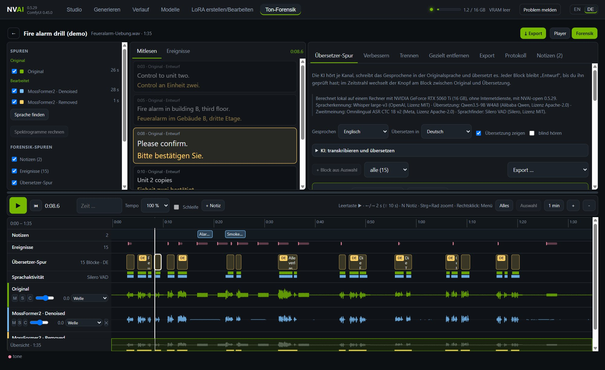
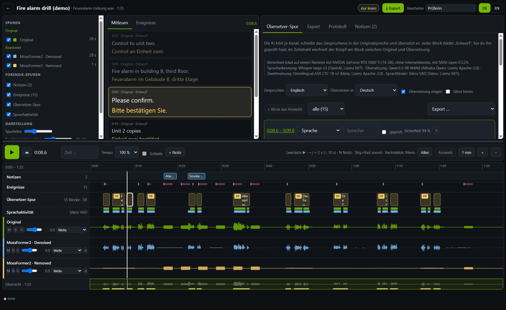

# Audio: Stimmen trennen, Rauschen entfernen, ein Geräusch entfernen

Der Bereich **Audio** arbeitet mit Aufnahmen jeder Länge, auch Bändern oder Videos von mehreren Stunden. Das Original
bleibt unverändert: Jede Bearbeitung wird eine neue Spur, die sich neben dem Original abspielen, stumm oder solo, lauter
oder leiser stellen und als Mischung exportieren lässt, auch zurück ins Video.

[English](../AUDIO.md)

## So geht's

1. **Aufnahme hinzufügen:** eine Datei hochladen, eine aus dem Verlauf wählen oder den Pfad einer großen Datei auf
   diesem Rechner angeben (sie wird nicht kopiert). Audio und Video gehen; bei Video zählt nur der Ton.
2. **Einlesen:** NVAI-open schreibt eine verlustfreie Arbeitskopie, die Wellenform und eine Abspiel-Vorschau und misst
   Lautheit (EBU R 128), Rauschboden, Spitze und Netzbrummen. Daraus kommen Vorschläge. Ein 12-Stunden-Video brauchte
   rund 15 Minuten auf einem Prozessorkern.
3. **Anhören und auswählen:** im Zeitstrahl ziehen wählt aus, Klicken setzt den Abspielkopf, Strg + Mausrad zoomt, die
   Übersicht unten fährt durch Stunden. Die Leertaste spielt ab.
4. **Bearbeiten:** erst eine Auswahl von 30 bis 60 Sekunden (eine Vorschau-Spur an ihrer Stelle), dann die ganze Spur.
   KI-Schritte laufen in Abschnitten: „Anhalten“ behält, was fertig ist, „Fortsetzen“ macht dort weiter.
5. **Export:** Gemischt wird, was zu hören ist (WAV, FLAC, MP3, M4A, Opus, auf Wunsch mono), oder der Ton im Video wird
   ersetzt, das Bild bleibt unverändert.

## Werkzeuge

| Werkzeug | Modell | Gut für |
|---|---|---|
| Stimme / Begleitung trennen | Mel-Band RoFormer von Kimberley Jensen (Gewichte MIT) | Gesang oder Sprache über Musik |
| Sprache / Musik / Geräusche trennen | Bandit v2 (Code Apache-2.0, Gewichte CC BY-SA 4.0) | Filme, Mitschnitte, Vorträge mit Publikum |
| Rauschen aus Sprache entfernen | MossFormer2_SE_48K (Apache-2.0) | Rauschen, Brumm-Reste, Raumgeräusch |
| Schnell entrauschen | DeepFilterNet3 (MIT/Apache-2.0, Prozessor) | reine Sprache; entfernt auch Musik |
| Ein Geräusch entfernen | in der App aus deinen Beispielen gelernt | Alarme, Piepser, eine Maschine, eine Klingel |
| Filter | ohne KI | Netzbrummen, Zeilenpfeifen, Trittschall, Knackser, klassisches Entrauschen, Pegel, Zischlaute, Lautheit |

Vorgeschlagen ist je Aufgabe das beste Modell, dessen Lizenz auch den Verkauf der Ergebnisse erlaubt (Recherche
November 2026). Masken-Modelle machen nur leiser, sie erfinden nichts. Für Musik in vier oder mehr Stems gibt es kein
Modell mit sauberer kommerzieller Lizenz: Die verbreiteten Demucs-Gewichte sind nur für die Forschung freigegeben.

## Ein Geräusch entfernen („Geräusch lernen“)

Für ein wiederkehrendes Geräusch wie einen Alarm: 4 bis 10 Beispiele als „Störgeräusch“ markieren (Stellen mit Gespräch
darüber sind in Ordnung), auf Wunsch „behalten“-Marken, wo es fehlt. „Alarme und Piepser suchen“ durchsucht die ganze
Aufnahme nach gleichbleibenden Tönen und gruppiert sie nach Tonhöhe, so lassen sich Beispiele mit einem Klick markieren.
Ein kleines Netz lernt das Geräusch dann auf der Grafikkarte und liefert zwei Spuren: ohne das Geräusch und nur das
Geräusch.

Gemessen

Eine 3-Minuten-Testaufnahme (Sprecher über Musik) mit neun synthetischen Zweiton-Alarmen in verschiedener Lautstärke,
fünf davon markiert. Nach 3000 Lernschritten war der Alarm an den vier nicht markierten Stellen 19,9 bis 21,8 dB
leiser, die Sprache dazwischen änderte sich um −0,04 dB, und die Spur „nur das Geräusch“ traf den echten Alarm mit
21,5 dB. Die Ton-Suche fand alle neun Alarme als eine Gruppe in 0,4 s.

## Tempo (RTX 5060 Ti 16 GB, gemessen, während andere Aufträge die Karte mitnutzten)

| Schritt | Zeit je Minute Ton |
|---|---|
| Einlesen | rund 2 s |
| MossFormer2 (entrauschen) | rund 1 s |
| DeepFilterNet3 (Prozessor) | rund 5 s |
| Bandit v2 | rund 8 s |
| Filter | rund 4 s |

## Ton-Forensik

Die „Ton-Forensik“ macht aus einer Aufnahme einen Fall zum Untersuchen: jeder Kanal als eigene Spur, ein
Spektrogramm, wo gesprochen wird, Ereignisse wie Alarme, Notizen und eine Übersetzer-Spur. Gedacht ist sie für lange
Aufnahmen mit mehreren Mikrofonen und Funkkanälen, etwa aus einem Schiffsdatenschreiber (VDR).

- **Fall öffnen:** eine Aufnahme oder ein Video oder die Datendateien eines Schiffsdatenschreibers (Format VR-7000).
  Aus einem Schreiber wird jeder Mikrofon- und Funkkanal eine Spur, daneben Kurs, Geschwindigkeit, Ruder, Maschine,
  Wind und Alarme, und die Prüfsummen des Schreibers werden geprüft. Das Original bleibt unverändert; NVAI-open hält
  seine Prüfsumme fest.
- **Ansehen und anhören:** ein Spektrogramm in vier Zoomstufen, die Sprachaktivität (Silero VAD), Ereignisse aus der
  Ton-Suche und Notizen, jedes in seiner eigenen Spur. „Mitlesen“ zeigt den aktuellen Block groß, Original und
  Übersetzung.
- **Übersetzer-Spur:** Whisper large-v3 schreibt je Kanal auf, was gesprochen wird, in der Originalsprache, und
  Qwen3.5-9B übersetzt es, erst ins Englische, dann in die Zielsprache. Jeder Block bleibt „Entwurf“, bis ein Mensch
  ihn geprüft hat. Unsichere Wörter sind markiert, eine zweite Spracherkennung (Omnilingual ASR) steht als Hinweis
  dabei. Unter dem Reiter vermerkt NVAI-open, mit welchen Modellen, unter welcher Lizenz und auf welcher Grafikkarte
  die Spur berechnet wurde; der Vermerk kommt auch in die Exporte. Die Übersetzung ist ein Entwurf und ersetzt keine
  beeidigte Übersetzung.
- **Export:** Ton als WAV (bitgenau, wenn nichts verändert wurde), das Video mit den gewählten Spuren als Ton, ein
  Lagebild-Video mit allen Ansichten, Sprache als Text, CSV, SRT oder VTT, Notizen als Text oder CSV.
- **Untertitel im Video:** Mit „ins Bild einbrennen“ stehen Original oder Übersetzung fest im exportierten Video, dann
  zeigt sie jeder Player; das Bild wird dafür neu kodiert (NVENC, sonst x264; in der Prüf-App der Kodierer des
  Browsers). Ohne den Haken bleibt das Bild unverändert, und die Untertitel kommen als SRT daneben. Untertitel haben
  höchstens zwei Zeilen zu 42 Zeichen; ein langer Block wird auf mehrere hintereinander verteilt. Der Windows Media
  Player lehnt eine ganze SRT-Datei ab, sobald eine Zeile 1024 Zeichen erreicht, was lange Übersetzungen vorher taten.

## Prüfpaket und Prüf-App

Für Menschen, die einen Fall ohne NVAI-open prüfen sollen, etwa eine Kanzlei: „Export“ → „Prüfpaket“ schreibt einen
Ordner mit dem Fall, dem Originalton als bitgenaue WAV, wahlweise Video und Bildern, einer Prüfsumme für jede Datei
(PRUEFSUMMEN.sha256) und der Prüf-App NVAI-Pruefer.html. Sie läuft in Microsoft Edge oder Google Chrome, ohne
Installation, Internet und KI: jede Spur anhören, das Video ansehen, Blöcke prüfen und korrigieren, Notizen setzen,
WAV, Video mit Ton und Untertitel exportieren (eingebrannt oder als SRT). Änderungen kommen in den Unterordner „bearbeitung“, zusammen mit einem
Prüfprotokoll, in dem jede Zeile per SHA-256 an die vorige gekettet ist; die gelieferten Dateien bleiben unverändert.
Der Name des Bearbeiters steht oben rechts und lässt sich jederzeit ändern; auch der Wechsel kommt ins Protokoll. Die
Prüf-App hängt außerdem als einzelne Datei an jedem Release.

Auf dem Mac öffnet NVAI-open Prüfpakete im Reiter „Ton-Forensik“, mit derselben Prüf-App. Seit NVAI-open für Mac
0.5.11 legt der Mac auch selbst Fälle an: „Neuer Fall …“ nimmt Audio- oder Videodateien, jeder Kanal wird eine Spur,
unkomprimierter Originalton bleibt bitgenau. „VDR-Export einlesen …“ liest die Daten eines Schiffsdatenschreibers
(VR-7000) wie unter Windows, mit Kurs, Geschwindigkeit, Alarmen, AIS sowie Radar- und ECDIS-Bildern; vorher zeigt es
Aufzeichnung, Kanäle und den Platzbedarf des Falls und bricht ab, bevor der Datenträger voll ist. „Sprache erkennen“ lässt
Whisper large-v3 (Core ML, 3,1 GB) dort hören, wo der Sprachfinder Silero VAD Sprache findet, und „Übersetzen“ übersetzt
die Blöcke über Englisch mit Qwen3.5 (ab 16 GB Speicher 9B, sonst 4B). Alles läuft auf dem Mac, und jeder Block bleibt
Entwurf, bis ein Mensch ihn geprüft hat. Ein Fall vom Mac ist selbst ein Prüfpaket und lässt sich als Ordner
weitergeben.

Gemessen am Demo-Fall (95 s, drei Spuren, RTX 5060 Ti)

Spektrogramm 2 s je Spur, Sprachaktivität für drei Spuren 6 s, MossFormer2 12 s, Ton-Suche 2 s, die Übersetzer-Spur
mit 15 Blöcken 34 s, das Prüfpaket 2 s. In der Prüf-App in Chrome brauchte eine Minute Video mit Ton rund 1,3 s: Das
Bild wird unverändert kopiert, der Ton kommt aus dem Originalton, auf die Probe genau angelegt.

