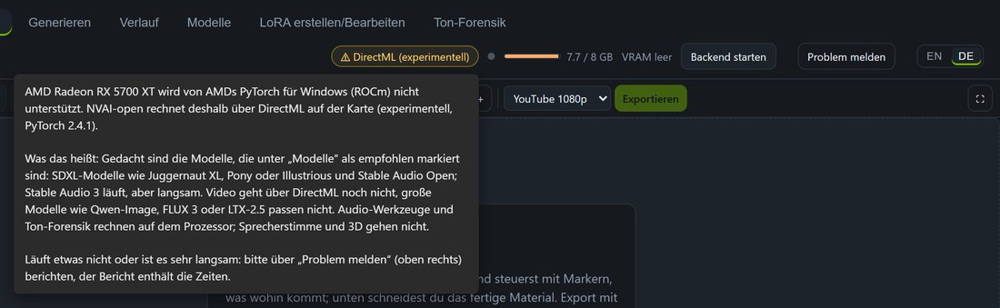
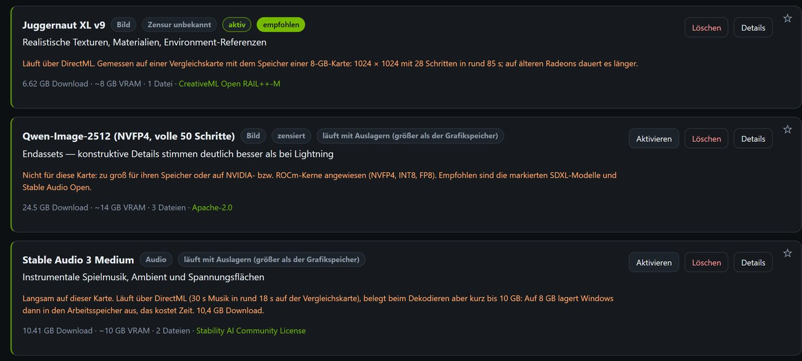

# Ältere Radeons: DirectML (experimentell)

[English](../DIRECTML.md)

AMDs PyTorch für Windows (ROCm) kennt die Radeon RX 5000, Vega, Radeon VII und Polaris (RX 400/500) nicht. Seit 0.5.33
rechnet NVAI-open auf diesen Karten über **DirectML**, die Schnittstelle von DirectX 12 für maschinelles Lernen. Das ist
experimentell: Auf so einer Karte lief NVAI-open noch nicht. Alles hier wurde über DirectML auf einer NVIDIA-Karte
gemessen, deren Speicher auf das begrenzt war, was eine 8-GB-Karte bekommt. Berichte in
[Issue #3](https://github.com/Mantux775/NVAI-open/issues/3) helfen sehr.

## Einrichten

NVAI-open wie gewohnt installieren, auch über eine ältere Fassung. Das Setup erkennt die Karte, legt eine zweite
ComfyUI-Umgebung mit PyTorch 2.4.1 und Microsofts torch-directml an (rund 200 MB Download) und prüft sie mit einer kleinen
Rechnung auf der Karte. Oben in der Leiste steht dann „DirectML (experimentell)“; mit der Maus darüber steht, was das
bedeutet.

Rechnet DirectML auf der Karte nicht oder startet ComfyUI damit nicht, rechnet NVAI-open wie bisher auf dem Prozessor.
Oben steht dann „Rechnet auf dem Prozessor“, und der Tooltip nennt den Grund. „NVAI-open reparieren“ im Startmenü
richtet alles neu ein.

## Welche Modelle

Unter „Modelle“ sind die Modelle, die zur Karte passen, als empfohlen markiert, und jedes andere sagt, warum nicht.

- **Empfohlen:** die SDXL-Modelle (Juggernaut XL v9, SDXL base, Pony V6 XL, Illustrious XL, NoobAI XL) für Bilder und
  Stable Audio Open für Geräusche.
- **Langsam:** Stable Audio 3 Medium für Musik. Es läuft, braucht beim Dekodieren aber kurz bis zu 10 GB; auf einer
  8-GB-Karte lagert Windows dann in den Arbeitsspeicher aus, das kostet Zeit.
- **Noch nicht:** Video (Wan 2.1 1.3B bricht in DirectML ab) und die großen Modelle wie Qwen-Image, FLUX 3, Krea 2,
  MOSS-Image oder LTX-2.5: zu groß für 8 GB oder auf NVIDIA- bzw. ROCm-Kerne angewiesen (NVFP4, INT8, FP8).
  Sprecherstimme und 3D brauchen CUDA oder ROCm. Audio-Werkzeuge und Ton-Forensik rechnen auf dem Prozessor.

## Gemessen: DirectML und CUDA auf derselben Karte

Dieselben Aufträge mit denselben Seeds auf einer RTX 5060 Ti 16 GB, einmal mit CUDA, einmal über DirectML mit auf
7,7 GB begrenztem Speicher (das Budget, das Windows einer 8-GB-Karte gibt). Zeiten je Auftrag, samt Laden des Modells.

| Auftrag | CUDA | DirectML |
|---|---|---|
| SDXL (Juggernaut XL v9), 1024 × 1024, 28 Schritte | 16 s | 83 s |
| SDXL, 832 × 1216, 28 Schritte | 13 s | 81 s |
| Stable Audio Open, 6 s Geräusch | 8 s | 17 s |
| Stable Audio 3 Medium, 30 s Musik | 6 s | 16 s |

Über DirectML war dieselbe Karte 2- bis 6-mal langsamer. Eine ältere Radeon hat keine Matrix-Einheiten; ihre Zeiten
liegen also eher über der DirectML-Spalte, wie weit, ist noch nicht gemessen.

Juggernaut XL v9 über DirectML: 1024 × 1024 und 832 × 1216, 28 Schritte.

## Wie es funktioniert

- torch-directml gibt es nur für PyTorch 2.4.1, und ComfyUI hat DirectML in Fassung 0.46.0 entfernt. NVAI-open hält
  deshalb eine zweite Umgebung für das Bild-ComfyUI (`external\comfyui\.venv-directml`) und setzt DirectML vor jedem
  Start wieder in ComfyUI ein; ohne DirectML ändert sich nichts.
- ComfyUIs alter DirectML-Code nahm 1 GB Speicher an und hielt alle Modelle zugleich (SDXL belegte 13,6 GB). NVAI-open
  fragt stattdessen Windows nach dem Speicherbudget des Prozesses: Modelle werden wie mit CUDA gewechselt, und das VAE
  dekodiert kachelweise, wenn es sonst nicht passt.
- DirectML reiht Arbeit weit voraus ein und hält den Speicher jedes eingereihten Schritts, bis er gelaufen ist; ohne
  regelmäßigen Abgleich schwankte SDXL zwischen 6 und 15 GB. Mit Abgleich belegte es höchstens 8,5 GB und ist schneller.
- Text-Encoder rechnen auf dem Prozessor (DirectML kann keine FP8-Gewichte), 3D-Faltungen werden als 2D-Faltungen
  gerechnet.
- Die Umgebungsvariable `NVAI_DIRECTML=0` schaltet DirectML ab; NVAI-open rechnet dann auf dem Prozessor.
