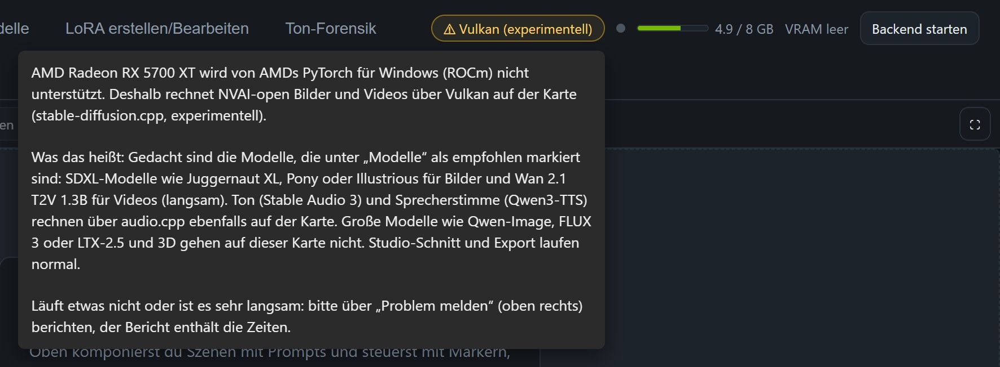
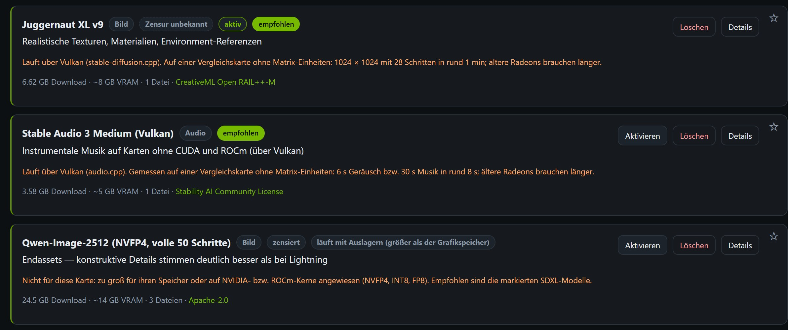
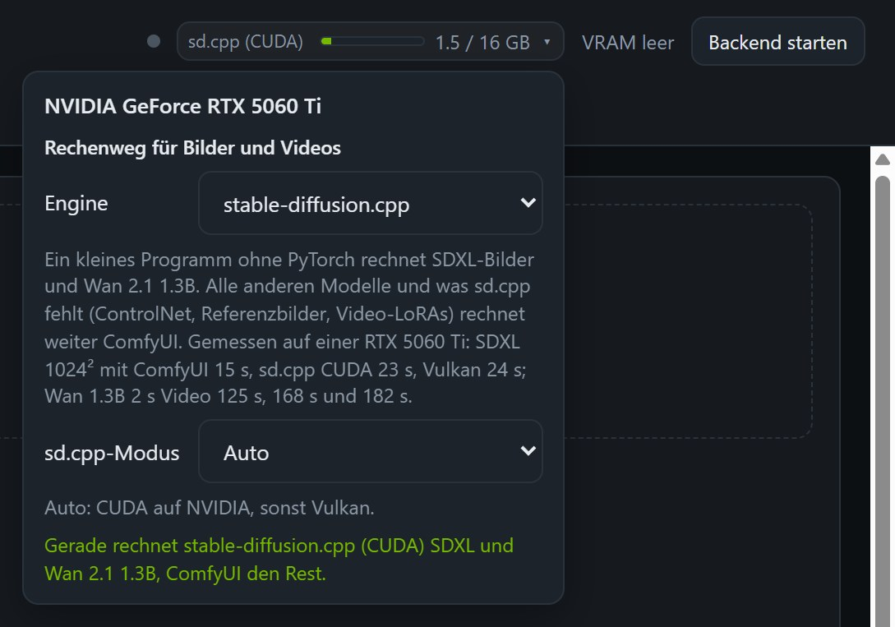

# Ältere Radeons und Intel-Karten: Vulkan (experimentell)

[English](../DIRECTML.md)

AMDs PyTorch für Windows (ROCm) kennt die Radeon RX 5000, Vega, Radeon VII und Polaris (RX 400/500) nicht, und für
Intel-Karten hat PyTorch unter Windows weder CUDA noch ROCm. Seit 0.5.35 rechnet NVAI-open auf diesen Karten über
**Vulkan**, das sie alle sprechen: Bilder und Videos mit **stable-diffusion.cpp**, Ton und Sprecherstimme mit
**audio.cpp**. Beides sind kleine Programme ohne PyTorch. Das ist experimentell: Alles hier wurde auf einer NVIDIA-Karte
gemessen, deren Speicher auf das begrenzt war, was eine 8-GB-Karte bekommt, teils mit abgeschalteten Matrix-Einheiten
wie bei einer RX 5700 XT. Berichte in [Issue #3](https://github.com/Mantux775/NVAI-open/issues/3) helfen sehr.

## Warum DirectML raus ist

0.5.33 und 0.5.34 rechneten Bilder und Ton über DirectML. Auf einer echten RX 5700 XT hat der Melder von Issue #3 ein
Bild mit Pony Diffusion V6 XL, einer LoRA, 1344 × 768 und zweitem Durchgang gemessen: 5 min 40 s bis 6 min 7 s je
Bild, fünfmal hintereinander. Derselbe Auftrag auf der Vergleichskarte:

| Gleicher Auftrag (SDXL, 1344 × 768, 28 Schritte, zweiter Durchgang) | Zeit |
|---|---|
| RX 5700 XT, DirectML (Issue #3) | 5:40 bis 6:07 min |
| Vergleichskarte, DirectML | 166 s |
| Vergleichskarte, Vulkan ohne Matrix-Einheiten | 100 s |
| Vergleichskarte, Vulkan | 40 s |

Auf der RX 5700 XT lässt das über Vulkan rund 3,5 statt 6 Minuten erwarten; die echte Zahl bringt der nächste Test.
Dazu kam: Video ging über DirectML gar nicht, es brauchte eine zweite Python-Umgebung mit dem alten PyTorch 2.4.1 und
Eingriffe in ComfyUI, die jedes ComfyUI-Update brechen konnte. Vulkan sind zwei Programme mit fester Prüfsumme, und es
nimmt Intel-Karten mit, statt sie auf dem Prozessor zu lassen.

## Einrichten

NVAI-open wie gewohnt installieren, auch über eine ältere Fassung. Das Setup erkennt die Karte, lädt
stable-diffusion.cpp (28 MB) und audio.cpp (87 MB) und prüft, ob Vulkan eine eigene Grafikkarte sieht; eine
Prozessorgrafik bleibt beim Prozessor. Die DirectML-Umgebung von 0.5.33 und 0.5.34 wird entfernt. Oben in der Leiste
steht dann „Vulkan (experimentell)“; mit der Maus darüber steht, was das bedeutet.

Sieht Vulkan die Karte nicht, rechnet NVAI-open wie bisher auf dem Prozessor; oben steht dann „Rechnet auf dem
Prozessor“. „NVAI-open reparieren“ im Startmenü richtet alles neu ein.

## Welche Modelle

Generieren und Studio wählen von selbst die Modelle, die auf der Karte laufen, mit Formaten, die in 8 GB passen. Unter
„Modelle“ sind sie als empfohlen markiert, und jedes andere sagt, warum nicht.

- **Bilder:** die SDXL-Modelle (Juggernaut XL v9, SDXL base, Pony V6 XL, Illustrious XL, NoobAI XL), vorgewählt mit
  1024 × 1024. LoRAs, Startbild, Masken, Erweitern und der zweite Durchgang gehen; ControlNet und Referenzbilder nicht.
- **Video:** Wan 2.1 T2V 1.3B, vorgewählt mit 832 × 480 und 2 s, als langsam markiert.
- **Ton:** Stable Audio 3 Small SFX (Vulkan) für Geräusche, Stable Audio 3 Medium (Vulkan) für Musik.
- **Sprecherstimme:** Qwen3-TTS, aus einer Beschreibung oder aus einer Aufnahme, mit demselben Modell wie auf NVIDIA.
- **Noch nicht:** große Modelle wie Qwen-Image, FLUX 3, Krea 2 oder LTX-2.5 (zu groß für 8 GB oder auf NVIDIA- bzw.
  ROCm-Kerne angewiesen) und 3D, das CUDA oder ROCm braucht.

## Video über Vulkan

Die DirectML-Erweiterung für PyTorch verarbeitete nur Tensoren mit höchstens fünf Dimensionen, und Videomodelle brauchen
an einigen Stellen mehr: Wan 2.1 setzt seine Bilder in acht zusammen. stable-diffusion.cpp rechnet direkt über Vulkan,
mit denselben Modelldateien wie ComfyUI (Wan 2.1 T2V 1.3B mit Text-Encoder und VAE), und hält Text-Encoder und VAE im
Arbeitsspeicher, das Videomodell auf der Karte.

Somi, der Hase aus unserem Kurzfilm, mäht ein Feld verängstigter Gesichter: Wan 2.1 1.3B über Vulkan, 3 s in
832 × 480 in 5,5 Minuten auf der Vergleichskarte. Ohne LoRA zeichnet Wan ihn nur nach der Beschreibung, hier schwarz
statt weiß.

## Gemessen auf derselben Karte

Eine RTX 5060 Ti 16 GB, begrenzt auf den Speicher, den Windows einer 8-GB-Karte gibt (7,7 GB); „ohne Matrix-Einheiten“
schaltet die Einheiten ab, die eine RX 5700 XT nicht hat. Zeiten je Auftrag, samt Laden des Modells.

| Auftrag | CUDA | DirectML (bis 0.5.34) | Vulkan | Vulkan ohne Matrix-Einheiten |
|---|---|---|---|---|
| SDXL (Juggernaut XL v9), 1024 × 1024, 28 Schritte | 16 s | 83 s | 22 s | 57 s |
| SDXL, 1344 × 768, zweiter Durchgang | – | 166 s | 40 s | 100 s |
| Wan 2.1 T2V 1.3B, 832 × 480, 33 Bilder (2 s) | 117 s | Abbruch | 194 s | – |
| Geräusch, 6 s (Stable Audio 3 Small SFX) | – | – | – | 8 s |
| Musik, 30 s (Stable Audio 3 Medium) | 6 s | 16 s | – | 8 s |
| Sprecherstimme, rund 7 s (Qwen3-TTS) | – | – | – | 21 s |

Somi aus seinem eigenen Datensatz bleibt, wie er ist; über Vulkan malt Juggernaut XL per Maske nur die Szene um ihn
herum: ein Bankettsaal für einen und ein Friedhof im Mondlicht, je rund 30 s auf der Vergleichskarte.

## stable-diffusion.cpp auch auf NVIDIA

Seit 0.5.35 wählst du, was Bilder und Videos rechnet: unter **Modelle → Deine Hardware** oder mit einem Klick auf die
Speicher-Anzeige oben. **Auto** nimmt den schnellsten Weg für die Karte: ComfyUI auf NVIDIA und auf Radeons mit ROCm,
stable-diffusion.cpp über Vulkan auf den Karten oben. Auf einer NVIDIA-Karte kann auch stable-diffusion.cpp rechnen,
über CUDA oder Vulkan. Es übernimmt dann die SDXL-Modelle und Wan 2.1 T2V 1.3B; alles andere und Aufträge mit
ControlNet, Referenzbildern oder Video-LoRAs bleiben bei ComfyUI. Das Programm lädt beim ersten Wechsel: 30 MB für
Vulkan, rund 1 GB für CUDA samt Laufzeit. Zur Wahl steht nur, was auf der Karte läuft: kein CUDA auf einer Radeon, kein
ComfyUI auf einer Karte ohne CUDA oder ROCm.

| Auftrag (RTX 5060 Ti 16 GB, samt Laden des Modells) | ComfyUI | sd.cpp CUDA | sd.cpp Vulkan |
|---|---|---|---|
| SDXL (Juggernaut XL v9), 1024 × 1024, 28 Schritte | 14–16 s | 23 s | 23–24 s |
| Wan 2.1 T2V 1.3B, 832 × 480, 33 Bilder (2 s) | 122–128 s | 168 s | 182 s |

Auf NVIDIA bleibt ComfyUI am schnellsten. stable-diffusion.cpp ist zum Vergleichen da, und über Vulkan zeigt eine
NVIDIA-Karte, wie ein Auftrag auf einer Radeon- oder Intel-Karte läuft.

## Wie es funktioniert

- Jedes Bild und jedes Video ist ein Lauf von stable-diffusion.cpp (`external\sdcpp\sd-cli.exe`) mit den Modelldateien
  aus der Modellliste. Ab rund 1 Megapixel dekodiert das VAE in Kacheln: am Stück brauchten 1728 × 960 allein zum
  Dekodieren 4 GB und 127 s, in Kacheln war der ganze Auftrag in 40 s fertig.
- Ton und Stimme sind ein Lauf von audio.cpp (`external\audiocpp\audiocpp_cli.exe`). Musik und Geräusche kommen wie
  auf NVIDIA als MP3 mit Spitzen höchstens −1 dB in den Verlauf.
- ComfyUI bleibt für „Prompt ausbauen“ und die Audio-Werkzeuge auf dem Prozessor.
- Steckt neben der Karte eine Prozessorgrafik im Rechner, rechnen beide Engines nur auf der Karte.
- Die Protokolle `sdcpp.log` und `audiocpp.log` liegen im Datenordner, „Problem melden“ hängt sie an.
- Die Umgebungsvariablen `NVAI_SDCPP_ENGINE=0` und `NVAI_AUDIOCPP_ENGINE=0` schalten die Engines ab.
