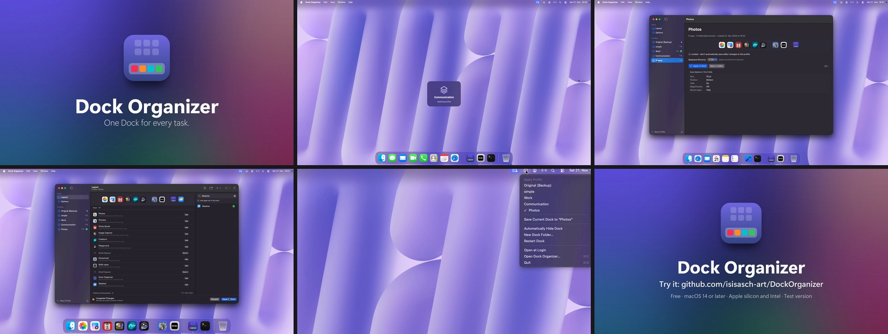

# Making of: ein Werbevideo für Dock Organizer

[English](../DOCK_ORGANIZER_VIDEO.md)

Ein 39 Sekunden langes Video für [Dock Organizer](https://github.com/isisasch-art/DockOrganizer), eine kostenlose
macOS-App, die das Dock als Profile speichert und per Tastenkürzel zwischen ihnen wechselt. Claude Code hat es in
einer Sitzung gemacht: die Musik mit Stable Audio 3 in NVAI-open, die Titeltafeln mit einem kleinen Skript, die
Bildschirmaufnahmen automatisch auf einem Mac mini, den Schnitt im Studio von NVAI-open. Den letzten Feinschnitt gab
es von Hand im Studio. Alles lief lokal, die Musik auf einer RTX 5060 Ti, die Aufnahmen auf einem Mac mini M1. Das
Video auf YouTube: [youtube.com/watch?v=zeig-Rml4gA](https://www.youtube.com/watch?v=zeig-Rml4gA).

## Zuerst Englisch

Die App war nur deutsch, deshalb kam zuerst die Übersetzung: alle 179 Texte der Oberfläche, die App folgt der
Systemsprache. Nebenbei sind die bekannten Einschränkungen aus ihrer README behoben. Beides ging als
[Pull Request](https://github.com/isisasch-art/DockOrganizer/pull/4) an den Autor, und der Mac mini lief für die
Aufnahmen auf Englisch.

## Musik

Stable Audio 3 Medium, ein Satz, am Ende das Tempo:

> Upbeat 8-bit chiptune arcade music with a catchy square-wave lead melody, fast pulse-wave arpeggios, a bouncy
> triangle-wave bassline and punchy noise-channel drums with snappy snares, playful, energetic retro video game style.
> BPM: 124.

Zuerst entstand ein Elektro-Take, gewählt wurde nach Gehör der 8-Bit-Take. Claude hört nicht, also hat es den Take
vermessen: 123,8 BPM, ein Takt dauert 1,94 s, der Bass setzt bei 6,3 s ein. Geschnitten ist in ganzen Takten: ein Takt
je Zwischentafel und je Tastenkürzel, drei Takte für jede längere Szene.

## Titeltafeln

Ein kurzes Python-Skript zeichnet die sechs Tafeln in 1920 × 1080: Farbverlauf mit weichen Lichtern, das App-Symbol
und weiße Schrift. Das Symbol kam aus dem eigenen Symbol-Skript der App, auf dem Mac gerendert. Im Studio zoomt jede
Tafel langsam um 4,5 % heran (zwei Skalier-Keyframes).

## Bildschirmaufnahmen auf dem Mac mini

Jede Szene ist ein kurzes Shell-Skript, so lässt sich ein Take genau wiederholen.

- **Die Bühne:** drei Demo-Profile (Work, Communication, Photos) mit den Kürzeln ⌃⌥1, ⌃⌥3 und ⌃⌥4, ein ruhiger
  Hintergrund, keine Symbole auf dem Schreibtisch. Profile, Dock, Hintergrund und Sprache wurden vorher gesichert und
  danach zurückgestellt.
- **Klicks und Tasten:** Ein kleines Swift-Kommandozeilenprogramm schickt Maus- und Tastaturereignisse (CGEvent) und
  findet Knöpfe über die Bedienungshilfen. `screencapture -v` nimmt den Bildschirm auf.
- **Fallen:** Sondertasten müssen als echte Tastenereignisse gedrückt und losgelassen werden; eine hängende
  Control-Taste machte aus Klicks Rechtsklicks. SwiftUI ignoriert künstliches Ziehen und Ablegen, deshalb fügt das
  Video Apps mit dem „+“-Knopf hinzu. macOS nimmt mit wechselnder Bildrate auf und hört etwa zwei Sekunden zu früh auf;
  jeder Clip wurde vor dem Schnitt auf feste 60 Bilder/s umgerechnet.

## Ein Fehler kam ans Licht

Im ersten Take der Tastenkürzel kam das Profil Photos nicht im Dock an. Claude hat nachgemessen: Bei Wechseln im
Abstand von 4 s stimmten nach 2 s nur 5 von 9. Die Ursache: Das Dock schreibt beim Beenden seinen alten Stand zurück.
Die Korrektur schreibt das Profil noch einmal, sobald das alte Dock beendet ist (9 von 9 richtig), und ging als
[Issue](https://github.com/isisasch-art/DockOrganizer/issues/3) und
[Pull Request](https://github.com/isisasch-art/DockOrganizer/pull/5) an den Autor. Die Tastenkürzel-Szene wurde mit
7 s Abstand zwischen den Wechseln neu aufgenommen.

## Der Schnitt im Studio

Claude hat den Schnitt mit den REST-Befehlen des Studios gebaut: Tafeln und Aufnahmen auf V1, die Musik auf A1. In
der Menüleisten-Szene zoomt das Bild um die rechte obere Ecke auf 170 % (`anchor` und vier Skalier-Keyframes), eine
halbe Sekunde Überblendung führt in die Schlusstafel. Die erste Fassung kam zu langsam in Gang; die zweite gab jedem
Tastenkürzel nur einen Takt (41,6 s). Den letzten Feinschnitt am Intro gab es von Hand im Studio: 39 s, exportiert als
youtube-1080p mit 60 Bildern/s und −14 LUFS.

## Was bleibt

- **Vor der Aufnahme übersetzen.** Erst die englische Fassung macht ein englisches Video möglich, und sie hilft jedem
  Nutzer.
- **Jede Szene als Skript.** Ein Take lässt sich in einer Minute wiederholen, auch nach einer Fehlerkorrektur.
- **Zuerst feste Bildrate.** Bildschirmaufnahmen vor dem Schnitt umrechnen.
- **Tempo messen und in ganzen Takten schneiden.** Claude hört nicht, aber es kann zählen.
- **Den Mac vor der Bühne sichern** und danach zurückstellen.

Die Aufnahmeskripte entstanden nur für dieses Video und gehören nicht zu NVAI-open.
