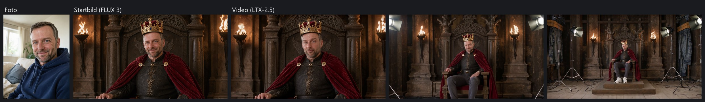
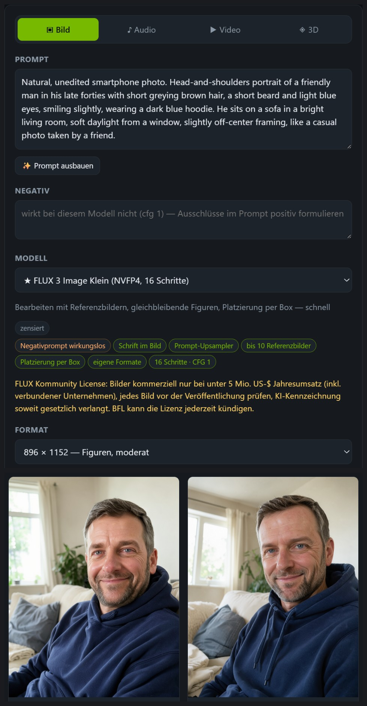
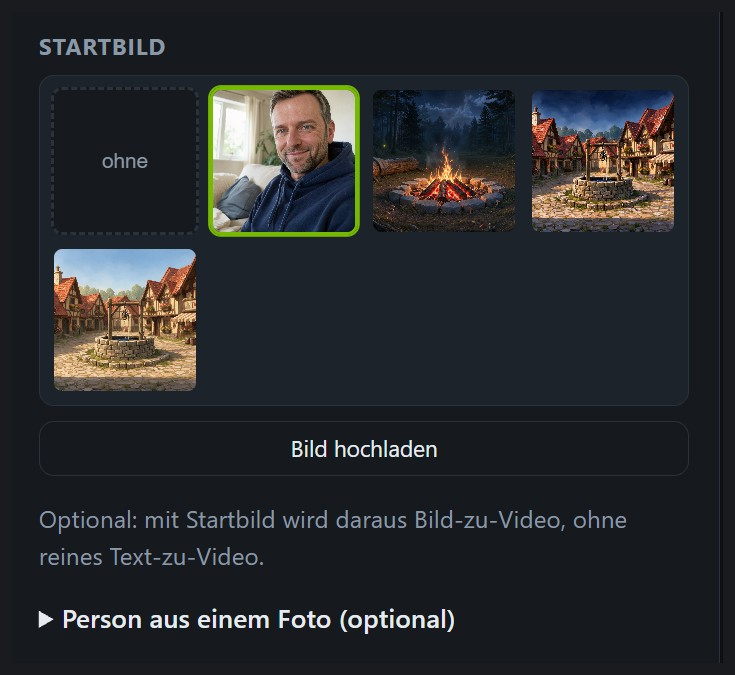
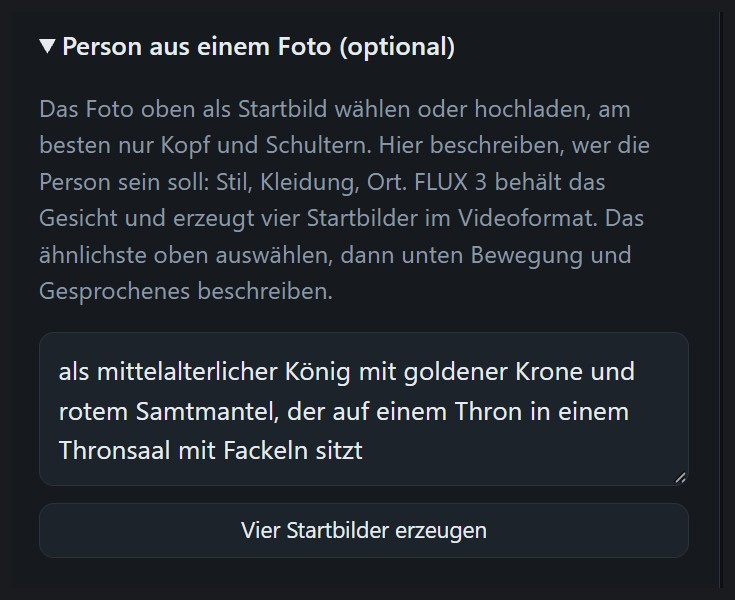
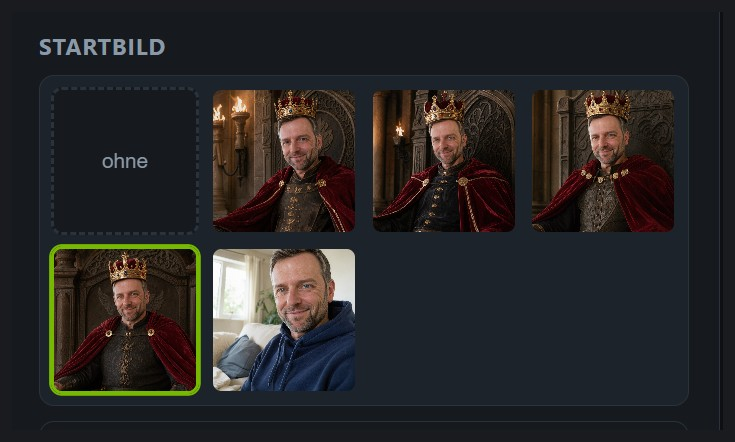
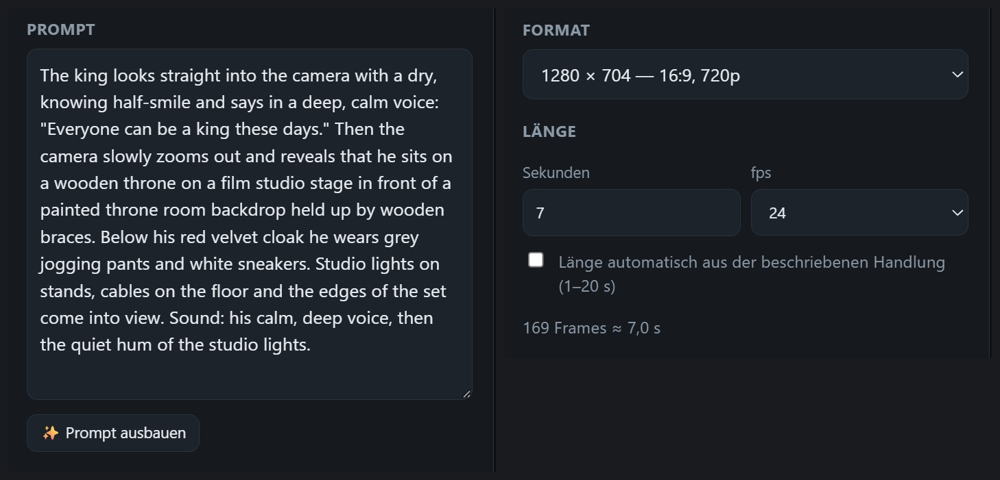

# Vom Foto zum Video

*English: [../PHOTO_TO_VIDEO.md](../PHOTO_TO_VIDEO.md)*

Ein Foto einer Person, eine Rolle in ein paar Worten, und NVAI-open versetzt die Person in diese Rolle
und macht ein Video, in dem sie sich bewegt und spricht. Im Beispiel wird aus einem Alltagsporträt ein
König, der sagt: „Everyone can be a king these days.“ Dann zoomt die Kamera heraus ins Filmstudio: Der
Thronsaal ist eine gemalte Kulisse, und unter dem Samtmantel trägt er Jogginghose und Turnschuhe.

Das Video als GIF, ohne Ton. <a href="../videos/photo-video-king.mp4">MP4 mit Ton</a> (3 MB).

Auch das Foto im Beispiel ist mit NVAI-open erzeugt: Diesen Mann gibt es nicht. Nur Fotos von
Menschen verwenden, die damit einverstanden sind.

## Was du brauchst

| | |
|---|---|
| FLUX 3 Image Klein | macht aus dem Foto die Startbilder; 20,2 GB Download (NVFP4 für RTX 50, INT8 mit 17,8 GB für RTX 20/30/40) |
| LTX-2.5 | macht aus dem Startbild ein Video mit Ton; 37,5 GB Download |
| Zeit | gemessen auf einer RTX 5060 Ti mit 16 GB: vier Startbilder in 96 s, das 7-Sekunden-Video in 144 s |

Beide stehen unter „Modelle“. Ihre Repos auf Hugging Face sind gesperrt: Dort erst die Lizenz
akzeptieren und den Token in NVAI-open hinterlegen.

Die ganze Kette hat fünf Schritte: Das Porträt entsteht unter „Generieren → Bild“, alles Weitere
unter „Generieren → Video“.

## Schritt 1: das Porträt erzeugen (Generieren → Bild)

Unter „Generieren“ auf „Bild“ gehen, FLUX 3 Image Klein und das Format 896 × 1152 wählen und ein
Alltagsfoto beschreiben. Der Prompt aus dem Beispiel:

> Natural, unedited smartphone photo. Head-and-shoulders portrait of a friendly man in his late
> forties with short greying brown hair, a short beard and light blue eyes, smiling slightly, wearing
> a dark blue hoodie. He sits on a sofa in a bright living room, soft daylight from a window, slightly
> off-center framing, like a casual photo taken by a friend.

Mit „Anzahl“ 2 unter „Feineinstellung“ gibt es zwei Porträts zur Auswahl; im Beispiel geht es mit dem
rechten weiter. Mit einem echten Foto diesen Schritt überspringen und das Foto in Schritt 2 hochladen.

## Schritt 2: das Porträt als Startbild wählen (Generieren → Video)

Auf „Video“ wechseln und das Porträt in der Liste „Startbild“ anklicken oder das Foto dort mit „Bild
hochladen“ hochladen. Am besten eignet sich ein Bild, das nur Kopf und Schultern zeigt, denn FLUX 3
übernimmt daraus das Gesicht.

## Schritt 3: die Rolle beschreiben

Unter den Startbildern „Person aus einem Foto“ aufklappen und beschreiben, wer die Person sein soll:
Kleidung, Ort, Stil, auf Deutsch oder Englisch. Dann auf „Vier Startbilder erzeugen“ klicken.

Kleidung und Umgebung ausdrücklich nennen. Was offen bleibt, erfindet FLUX 3.

## Schritt 4: das ähnlichste Startbild wählen

Nach gut anderthalb Minuten stehen vier Startbilder im Videoformat vorn in der Liste, das erste ist
ausgewählt. Das anklicken, das der Person am meisten ähnelt, und dabei in voller Auflösung ansehen:
FLUX 3 macht Gesichter gern etwas schmaler und jünger.

## Schritt 5: beschreiben, was passiert

Im Prompt in einem Absatz beschreiben, was sich bewegt, was die Kamera macht, den gesprochenen Satz in
Anführungszeichen mit der Stimme und die Geräusche. Die Länge einstellen (hier 7 s) und auf
„Generieren“ klicken. LTX-2.5 macht daraus das Video mit Sprache und Ton.

## Tipps aus unseren Tests

- **Die Person der Kamera zugewandt lassen.** Dreht sie sich weg, zeichnet LTX-2.5 das Gesicht danach
  neu, und es ähnelt dem Foto weniger.
- **Genau sagen, was die Kamera macht.** „The camera holds a steady medium shot“ hält die Einstellung;
  aus „pulls back a little“ wurde im Test eine Totale. Für eine Enthüllung wie oben „zooms out and
  reveals …“ schreiben.
- **Stimme und Lautstärke beschreiben**, etwa „says in a deep, calm voice“. Leise beschriebene
  Geräusche kommen sehr leise heraus.
- **Die Stimme ist erzeugt.** Es ist nie die echte Stimme der Person.
- **Lizenzen:** Bilder von FLUX 3 dürfen kommerziell nur unter 5 Mio. US-$ Jahresumsatz genutzt werden,
  und jedes Bild muss vor der Veröffentlichung geprüft werden (FLUX Kommunity License). LTX-2.5 ist
  unter 10 Mio. US-$ Umsatz kostenlos (LTX-2 Community License).

## Per MCP (Claude Code)

Dasselbe in zwei Aufrufen: `generate_image` mit `flux3-klein-nvfp4`, dem Foto in
`reference_asset_ids`, `batch_size=4`, dem Videoformat (`width=1280, height=704`) und dem Prompt
„Cinematic film still. The person from the first image, with exactly the same face, eyes, nose, mouth
and hair color: <Rolle>. Medium shot from the waist up, the face clearly visible.“ Danach
`generate_video` mit dem gewählten Bild als `image_asset_id`. Mehr in
[CLAUDE_CODE.md](../CLAUDE_CODE.md#person-from-a-photo-since-058).
