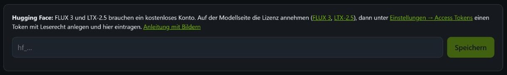
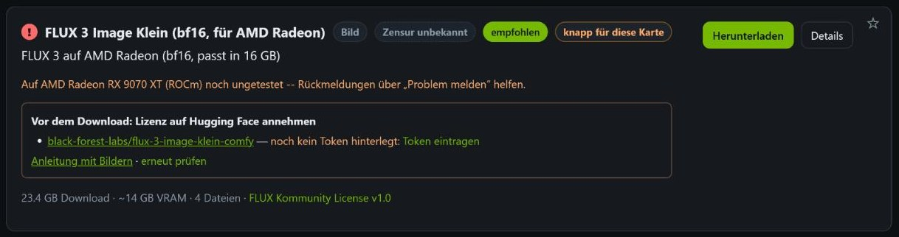

# Hugging Face: Konto, Lizenz, Token

*English: [../HUGGINGFACE.md](../HUGGINGFACE.md)*

Die meisten Modelle lädt NVAI-open ohne Konto. Zwei sind auf Hugging Face **gesperrt** (gated): Ihre
Dateien gibt es erst, wenn man mit seinem Konto die Lizenz angenommen hat. Bevor NVAI-open sie laden kann,
sind einmalig drei Dinge nötig (rund fünf Minuten):

1. ein kostenloses Hugging-Face-Konto,
2. die Lizenz auf der Seite jedes Modells annehmen,
3. einen Token mit Leserecht anlegen und in NVAI-open eintragen.

Der Zugriff gilt sofort nach der Zustimmung: Alle Repositorys unten geben automatisch frei, niemand prüft
die Anfrage von Hand.

| Repository auf Hugging Face | Nötig für |
|---|---|
| [black-forest-labs/flux-3-image-klein-comfy](https://huggingface.co/black-forest-labs/flux-3-image-klein-comfy) | FLUX 3 Image Klein, jede Fassung (NVFP4, INT8, bf16 für AMD Radeon, Base) |
| [Lightricks/LTX-2.5](https://huggingface.co/Lightricks/LTX-2.5) | LTX-2.5, Video mit Ton (NVFP4, INT8) |
| [Lightricks/LTX-2.5-22b-IC-LoRA-Pixel-Spatial-Upscaler](https://huggingface.co/Lightricks/LTX-2.5-22b-IC-LoRA-Pixel-Spatial-Upscaler) | optional: „Höchste Qualität (DFR)“ bei LTX-2.5 |
| [Lightricks/LTX-2.5-22b-LoRA-Cinemagraph](https://huggingface.co/Lightricks/LTX-2.5-22b-LoRA-Cinemagraph) | optionale LoRA: Cinemagraph (stehendes Bild, einzelne Teile bewegen sich) |
| [Lightricks/LTX-2.5-22b-LoRA-Slow-Motion-Control](https://huggingface.co/Lightricks/LTX-2.5-22b-LoRA-Slow-Motion-Control) | optionale LoRA: Zeitlupe |

Nötig sind nur die Repositorys der Modelle, die man laden will.

## 1. Konto anlegen

Auf [huggingface.co/join](https://huggingface.co/join) registrieren. Das Konto ist kostenlos; Hugging Face
schickt einen Link, mit dem man die E-Mail-Adresse bestätigt.

## 2. Lizenz annehmen

Die Modellseite aus der Tabelle angemeldet öffnen. Solange die Lizenz nicht angenommen ist, steht über der
Modellbeschreibung dieser Kasten:

*Das Beispiel ist FLUX.1 Kontext dev, ein Modell, das NVAI-open nicht nutzt: Auf der Seite von FLUX 3 sieht
der Kasten genauso aus. Auf den Seiten von Lightricks (LTX-2.5) heißt der Knopf „Agree and Access“.*

Die Lizenz lesen (Link im Kasten), dann auf den Knopf klicken. Damit stimmt man zu:

- Hugging Face gibt Benutzernamen und die Haupt-E-Mail-Adresse an die Autoren des Modells weiter.
- **FLUX 3** (FLUX Kommunity License): Bilder kommerziell nur unter 5 Mio. US-$ Jahresumsatz; vor der
  Veröffentlichung jedes Bild von Hand prüfen (oder einen Inhaltsfilter einsetzen).
- **LTX-2.5** (LTX-2 Community License): kostenlos unter 10 Mio. US-$ Jahresumsatz. Mit „Agree and Access“
  willigt man außerdem ein, Angebote und Neuigkeiten von Lightricks zu bekommen; abbestellen geht jederzeit.

Danach zeigt die Seite, dass man Zugriff hat:

Das für jedes nötige Repository wiederholen (für LTX-2.5 mindestens `Lightricks/LTX-2.5`).

## 3. Token anlegen

Mit einem Token lädt NVAI-open im Namen des eigenen Kontos. Dazu
[Settings → Access Tokens → Create new token](https://huggingface.co/settings/tokens/new?tokenType=read)
öffnen. Hugging Face fragt dabei unter Umständen erst noch einmal nach dem Passwort:

Dann:

1. Token type: **Read**.
2. Token name: beliebig, zum Beispiel `NVAI-open`.
3. Auf **Create token** klicken und den Token kopieren. Er beginnt mit `hf_` und wird nur dieses eine Mal
   angezeigt.

Ein „Fine-grained“-Token geht auch, wenn „Read access to contents of all public gated repos you can
access“ angehakt ist. Mehr zu Tokens: [User access tokens](https://huggingface.co/docs/hub/security-tokens)
in der Hugging-Face-Dokumentation.

Den Token wie ein Passwort behandeln: nicht weitergeben, nicht auf Bildschirmfotos zeigen.

## 4. Token in NVAI-open eintragen

In NVAI-open unter **Modelle** steht der Kasten „Hugging Face“ über der Modellliste. Token einfügen und
auf **Speichern** klicken:

NVAI-open prüft den Token bei Hugging Face und speichert ihn wie `hf auth login` (im Benutzerordner unter
`.cache\huggingface\token`). Danach zeigt der Kasten nur noch „Hugging Face: angemeldet als …“ mit einem
Link zum Abmelden; den Token selbst zeigt NVAI-open nie wieder an.

## 5. Prüfen und laden

Jedes Modell aus einem gesperrten Repository zeigt unter **Modelle** bis zum Download einen Kasten auf
seiner Karte. Er sagt je Repository, ob der Token schon Zugriff hat:

| Im Kasten steht | Was tun |
|---|---|
| noch kein Token hinterlegt | „Token eintragen“ springt zum Feld für den Token (Schritt 4) |
| noch nicht angenommen | den Link zum Repository öffnen und die Lizenz annehmen (Schritt 2), dann „erneut prüfen“ |
| Zugriff vorhanden | auf **Herunterladen** klicken |
| Stand unbekannt | keine Verbindung zu Hugging Face; später noch einmal versuchen |

## Wenn der Download trotzdem scheitert

- **„Kein Zugriff auf … Das Repo ist gesperrt“**: Die Lizenz ist noch nicht angenommen, oder mit einem
  anderen Konto als dem des Tokens. Welches Konto der Token hat, steht unter „Hugging Face: angemeldet als
  …“. Mit diesem Konto die Lizenz annehmen, dann erneut laden.
- **„Hugging Face lehnt den Token ab“** beim Speichern: Der Token ist unvollständig kopiert, gelöscht oder
  hat kein Leserecht. Einen neuen anlegen (Schritt 3).
- Doch nicht mehr gewollt: „abmelden“ im Kasten „Hugging Face“ entfernt den Token von diesem Rechner. Den
  Token selbst löscht man auf Hugging Face unter
  [Settings → Access Tokens](https://huggingface.co/settings/tokens).
