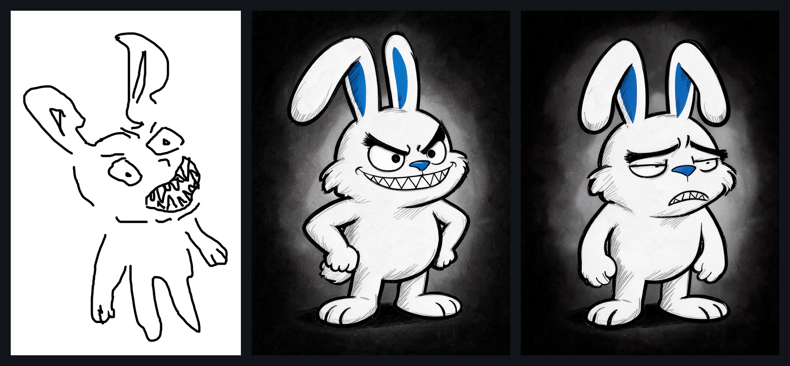
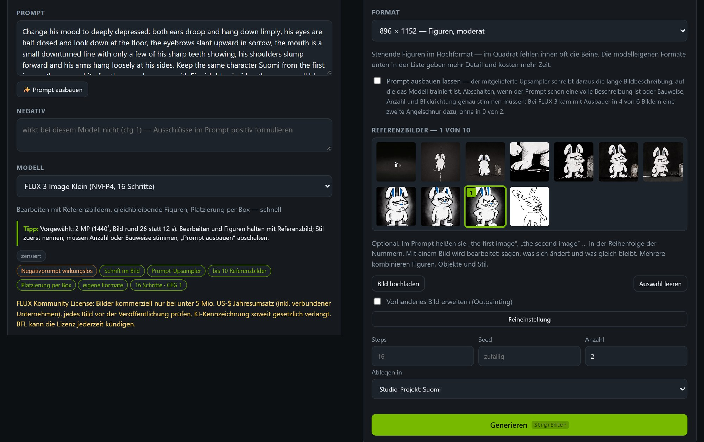
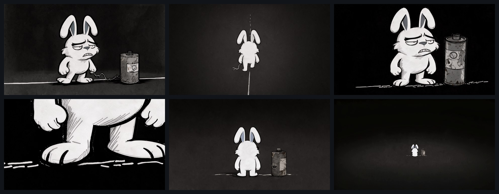
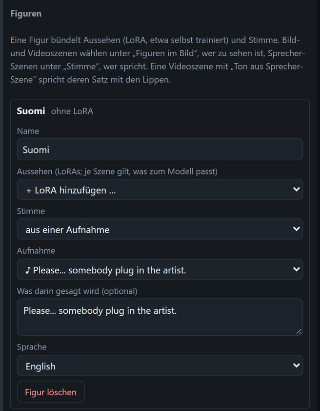
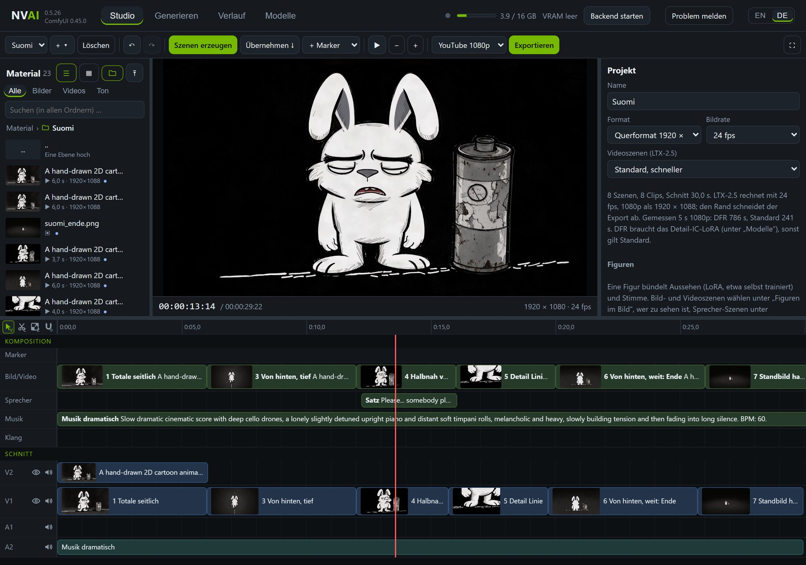
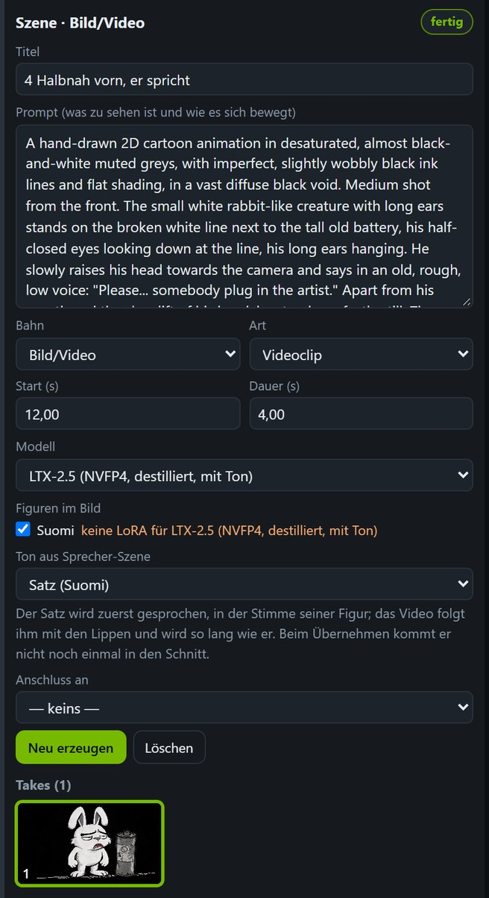
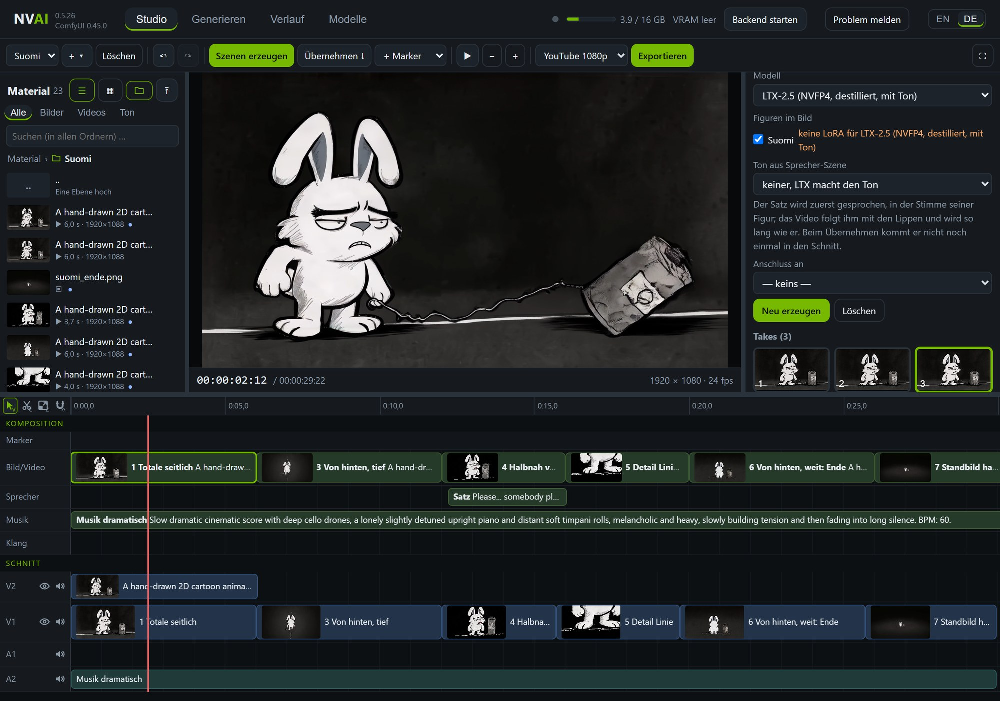

# Kurzfilm: von der Handskizze zum fertigen Film

[English](../SHORT_FILM.md)

Ein Kurzfilm von 30 Sekunden mit einer gezeichneten Figur, an einem Abend mit NVAI-open entstanden. Ein müder weißer
Hase namens Suomi zieht eine alte Batterie an einem ausgefransten Kabel hinter sich her. Die Linie, auf der er geht,
zerfällt. Er hebt den Kopf, sagt „Please... somebody plug in the artist.“, setzt sich, und die Batterie erlischt.

  

Der fertige Film auf YouTube

Idee, Handskizze und jede Entscheidung kamen von einem Menschen: welche Figur, welche Stimme, welche Musik, welcher
Take. Claude Code schrieb die Prompts und bediente NVAI-open über MCP. Jedes Bild, jeder Satz, die Musik und jeder Clip
entstanden lokal auf einer Grafikkarte (RTX 5060 Ti 16 GB), in rund 50 Minuten Rechenzeit.

Diese Seite geht die Schritte in der Reihenfolge durch, in der sie passiert sind, mit den verwendeten Prompts und
dem Ort, an dem jeder Schritt in der App steht.

| Schritt | Modell | Rechenzeit |
|---|---|---|
| Figur aus der Skizze, zwei Runden, 12 Bilder | FLUX 3 Image Klein | 3 min |
| Die müde Stimmung als Bearbeitung, 2 Bilder | FLUX 3 Image Klein | 47 s |
| Startbilder, je Einstellung 2, 1920 × 1088 | FLUX 3 Image Klein | 74–80 s je Einstellung |
| Der gesprochene Satz, 3 Versuche | Qwen3-TTS 1.7B | 45 s beim ersten (Laden), danach je 7 s |
| Musik, 60 s, 2 Versuche | Stable Audio 3 Medium | je 8–11 s |
| Fünf Videoszenen, Standardqualität | LTX-2.5 | 22 min (Szene mit 4 s: 3 min, mit 6 s: 5 min) |
| Einstellung 1 noch zweimal | LTX-2.5 | 10 min |
| Export, 30 s in YouTube 1080p | NVENC | 24 s |

## 1. Von der Skizze zur Figur

Am Anfang standen eine schnelle Skizze (links) und der Wunsch: so schlicht wie die Skizze, aber klar und
ausdrucksstark, auf diffusem schwarzem Grund.

- **Runde 1, mit der Skizze als Referenzbild:** FLUX 3 zeichnete die Skizze fast Strich für Strich nach, samt
  wackliger Linien. Ein Referenzbild wird übernommen, nicht neu gedeutet.
- **Runde 2, ohne Bild:** die Figur in Worten beschrieben, der Stil zuerst. Daraus wurde ein sauberer Entwurf (Mitte),
  8 Bilder in 4 Haltungen, 22 s je zwei Bilder:

  > Hand-inked cartoon illustration with confident black brush outlines of varying thickness, flat white fill, a few
  > loose grey hatching strokes for shading and a single accent color: Finnish flag blue. … The character is Suomi, an
  > original mischievous rabbit-like creature with white fur, two long ears with Finnish blue insides, the right ear
  > bent over halfway so that its tip hangs down, heavy angry slanted eyebrows, … a crooked grin full of sharp zigzag
  > shark teeth … He stands full body in a slightly turned three-quarter view, fists on his hips, grinning. Diffuse
  > black background with a faint soft grey glow behind the character; nothing else in the picture.

Gib der Figur ein paar eigene Merkmale (hier die blauen Ohren und die blaue Nase, die Haifischzähne). Sie machen sie in
jeder späteren Einstellung wiedererkennbar, und sie bleibt deine eigene Figur.

## 2. Eine neue Stimmung als Bearbeitung

Für die Batterie-Geschichte musste Suomi müde sein, nicht böse. Ein neuer Prompt hätte einen anderen Hasen gezeichnet.
Eine Bearbeitung des gewählten Entwurfs behält alles, was nicht erwähnt wird:

1. **Generieren → Bild**, Modell **FLUX 3 Image Klein**.
2. Unter **Referenzbilder** den Entwurf anklicken. Er bekommt die Nummer 1 und heißt im Prompt „the first image“.
3. Im Prompt sagen, was sich ändert und was gleich bleibt:

   > Change his mood to deeply depressed: both ears droop and hang down limply, his eyes are half closed and look down
   > at the floor, … his shoulders slump forward and his arms hang loosely at his sides. Keep the same character Suomi
   > from the first image: the same white fur, the same long ears with Finnish blue insides, … the same body
   > proportions, the same hand-inked black brush outlines … Change only his facial expression and posture as
   > described.

4. **Prompt ausbauen lassen** abschalten (der Prompt ist schon vollständig), ein Hochformat wählen, **Anzahl** 2 und
   unter **Ablegen in** das Studio-Projekt. Dann landet alles gleich im Material des Projekts.

Zwei Bilder dauerten 47 s. In beiden ließ FLUX die Ohren aufrecht stehen, statt sie hängen zu lassen: Es hält sich eng
an die Vorlage. Das mit den müden, halb geschlossenen Augen wurde der Suomi für diesen Film (rechts im Streifen oben).

## 3. Storyboard: ein Startbild je Einstellung

Bevor Rechenzeit in Videos ging, bekam jede Einstellung ein Startbild. LTX-2.5 beginnt den Clip damit, so sieht die
Figur in jeder Einstellung gleich aus. Geplant waren sechs Einstellungen in Grau auf Schwarz und ein langes, stilles
Ende:

| Einstellung | Bildausschnitt | Was passiert |
|---|---|---|
| 1 | Totale | Suomi auf einer dünnen weißen Linie macht einen schweren Schritt und zieht die Batterie hinterher; ihre Anzeige steht fast auf leer |
| 2 | Nah auf die Batterie | später gestrichen: Der Film wurde zu lang |
| 3 | Von hinten, tief | er geht weg; vor ihm zerfällt die Linie in Striche |
| 4 | Halbnah von vorn | er hebt den Kopf und sagt den Satz |
| 5 | Detail am Boden | die Striche unter seinen Füßen verlöschen |
| 6 | Von hinten, sehr weit | er setzt sich, die Anzeige erlischt, die Kamera fährt zurück |
| 7 | Standbild | das letzte Bild von Einstellung 6, in Stille gehalten |

Jedes Startbild ist wieder eine Bearbeitung mit FLUX 3: der müde Suomi (oder die passende Ansicht von ihm, siehe
unten) als Referenzbild, 1920 × 1088 (die Videogröße), zwei Bilder je Einstellung, 74–80 s. Die Prompts folgen einem
Muster. Zuerst der Stil, dazu ein Satz gegen den typischen KI-Look, dann die Figur aus der Referenz, dann die
Einstellung:

> Hand-drawn 2D cartoon frame with imperfect, slightly wobbly black ink lines and a few loose grey hatching strokes,
> flat and simple. The whole picture is desaturated, almost black and white in muted greys … No glossy highlights,
> no glow effects, no lens flare, no blur, no extra details. The character is Suomi from the first image: … Wide shot
> from the side: … an old, worn-out cylindrical battery as tall as his chest, dented, with rust spots and a peeling
> paper label without any text, a small round charge gauge on its side, old-fashioned like from the 1950s … Diffuse
> black background, empty darkness all around.

Was unterwegs auffiel:

- **Ansichten von hinten:** Mit der Vorderansicht als einziger Referenz stand Suomi auch in den Einstellungen von
  hinten der Kamera zugewandt. Deshalb zeichnete FLUX ein Figurenblatt mit Vorder-, Seiten- und Rückansicht, und jede
  Ansicht wurde ausgeschnitten zur Referenz ihrer Einstellungen. Das erste Blatt zeigte einen kleinen Schwanz, der
  nicht gewollt war; das zweite entstand mit „He has no tail at all, in none of the views.“, und die Prompts von hinten
  enden mit „He has no tail.“
- **Seitenansichten und Profil** sahen bei dieser Figur fremd aus. Einstellung 1 blieb deshalb frontal: Statt quer
  durchs Bild zu laufen, macht er einen schweren Schritt und zieht die Batterie hinterher.
- **Das Detail der Füße** (Einstellung 5) ist ein vergrößerter Ausschnitt aus dem Startbild von Einstellung 4, von
  FLUX mit klaren Linien in voller Auflösung neu gezeichnet.
- **Auf Einzelheiten achten:** Ein Bild zeigte zwei Linien wie eine Straße, in einem stand die Anzeige der Batterie
  fast auf voll. Die wurden gelöscht und das nächstbeste genommen.

## 4. Stimme und Musik

**Die Stimme.** Unter **Generieren → Sprache** mit Qwen3-TTS den Satz schreiben und die Stimme beschreiben:

> An old man with a rough, gravelly, deep voice, speaking slowly, quietly and wearily with a lowered, resigned tone.

Dieselbe Beschreibung klingt mit jedem Seed etwas anders. Also drei Versuche (je 7 s, sobald das Modell geladen ist),
anhören, den besten behalten. Die gewählte Aufnahme wird Suomis Stimme:

1. Aus dem Material auf eine Szene in der Bahn **Sprecher** ziehen. Sie wird zum Take dieser Szene.
2. Im Studio ins Leere klicken. Unter **Figuren** auf **+ Figur**, **Stimme: aus einer Aufnahme** wählen, die Aufnahme
   auswählen und wortgenau eintragen, was darin gesagt wird.
3. In der Sprecher-Szene Suomi als Sprecher wählen. Neue Sätze für ihn kommen dann in derselben Stimme.

Suomi hat hier keine LoRA, weil die Startbilder sein Aussehen tragen. Eine Figur kann ihr Aussehen auch als LoRA
mitbringen, etwa eine selbst trainierte ([Figuren](STUDIO.md#figuren)).

**Die Musik.** Stable Audio 3 Medium, ein Satz mit Gattung, Instrumenten, Stimmung und Tempo, 60 s, zwei Versuche mit
je 8–11 s:

> Slow dramatic cinematic score with deep cello drones, a lonely slightly detuned upright piano and distant soft
> timpani rolls, melancholic and heavy, slowly building tension and then fading into long silence. BPM: 60.

Im Studio ist die Musik eine Szene in der Bahn **Musik** über den ganzen Film. Eine Datei aus dem Material, auf eine
Szene gezogen, wird deren Take.

## 5. Die Szenen im Studio

- **Projekt:** 1920 × 1080 bei 24 fps. Videoszenen auf **Standard, schneller**: Der flache Zeichenstil war schon in
  Standardqualität scharf, und DFR dauert rund dreimal so lang.
- **Eine Videoszene je Einstellung** mit LTX-2.5 und einem Absatz Prompt: Stil, Bildausschnitt, die Handlung mit
  Verben, was still bleibt, die Kamera, der Ton. Unter **Figuren im Bild** ist Suomi angehakt; der orange Hinweis sagt
  nur, dass er für dieses Modell keine LoRA hat.
- **Das Startbild:** Claude setzte es je Szene über MCP (`studio_command`, `scene.update` mit
  `params.image_asset_id`). In den Eigenschaften gibt es dafür noch kein Feld. Ohne Claude: den Clip unter
  **Generieren → Video** mit LTX-2.5 und dem **Startbild** machen, im Projekt ablegen und auf die Szene ziehen.
- **Der gesprochene Satz:** eine Szene in der Bahn **Sprecher** mit dem Satz und Suomi als Sprecher, unter
  Einstellung 4. In Einstellung 4 zeigt **Ton aus Sprecher-Szene** auf sie. Das Video folgt dem Satz mit den Lippen und
  wird so lang wie er:

- **Das Ende:** das letzte Bild von Einstellung 6 als Standbild-Szene, 4,25 s in Stille gehalten. Das stille Ende
  gehörte von Anfang an zur Idee.

## 6. Erzeugen, prüfen, Takes wählen

**Szenen erzeugen** machte die fünf Videos in 22 Minuten. Danach wurde jeder Clip Bild für Bild geprüft, bevor etwas in
den Schnitt kam:

- **Einstellung 1** entstand noch zweimal. Im ersten Take verschmierte sein Gesicht bei der Drehung für zwei Bilder,
  und die Batterie kippte um. Im zweiten sprang die Batterie auf seine andere Seite, und am Ende drehte er sich ins
  Profil. Die dritte, ruhige Fassung (er steht still, atmet, die Nadel zittert) war sauber.
- Am Ende blieb der erste Take trotzdem der Favorit. Er liegt auf V2 über dem ruhigen Take auf V1. Jeder Take bleibt in
  der Szene, ein Klick wechselt zwischen ihnen.

## 7. Übernehmen und exportieren

**Übernehmen** legt die gewählten Takes in den Schnitt. Der Satz kommt nicht noch einmal hinein, denn er klingt schon
in Einstellung 4. Die Musik wurde auf das letzte Bild gekürzt. Der Export mit **YouTube 1080p** dauerte für die 30
Sekunden 24 s, auf −14 LUFS ausgesteuert.

## Tipps

- **Eine neue Figur in Worten beschreiben.** Ein Referenzbild wird übernommen; es ist für Bearbeitungen da.
- **Stimmungen und Haltungen als Bearbeitung** des gewählten Entwurfs: sagen, was sich ändert und was gleich bleibt.
- **Erst Startbilder, dann Video.** Zwei Startbilder dauern rund 75 s, ein 6-Sekunden-Clip rund 5 Minuten.
- **Die Einstellungen um die guten Seiten der Figur planen.** Hier: von vorn und von hinten, kein Profil, und „He has
  no tail.“ bei Ansichten von hinten.
- **Clips Bild für Bild prüfen und die Takes behalten.** Fehler dauern oft nur zwei Bilder.
- **Stimme und Musik selbst anhören.** Ein KI-Agent kann sie messen, aber nicht hören.

Wie das Studio im Einzelnen funktioniert: [STUDIO.md](STUDIO.md). Wie Claude das Erklärvideo des Studios gebaut hat:
[MAKING_OF.md](MAKING_OF.md).
