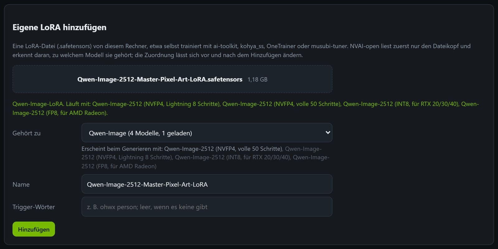
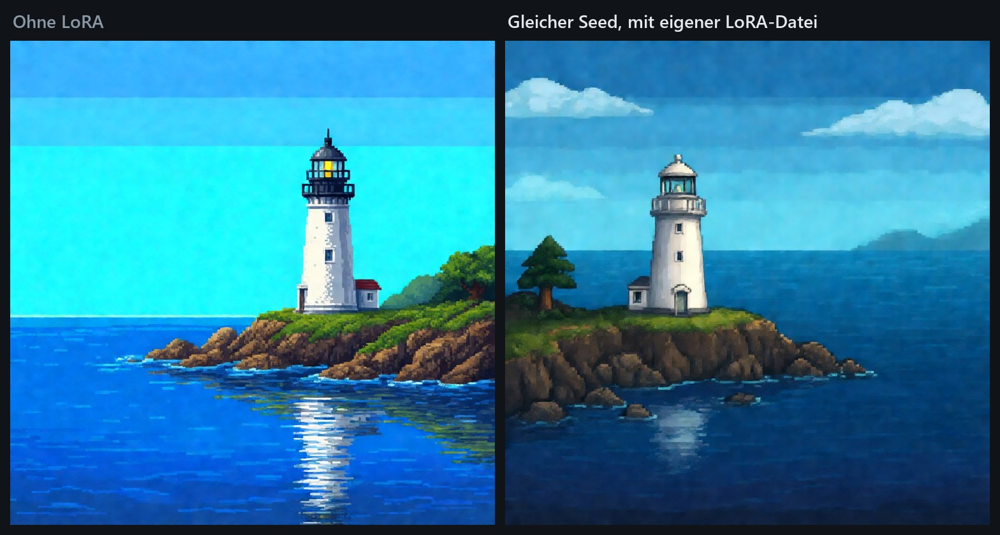
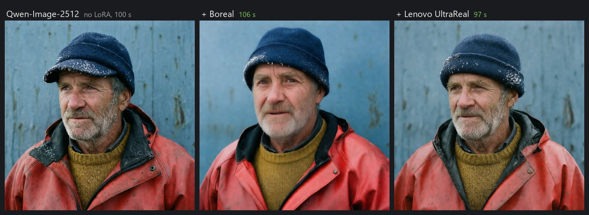
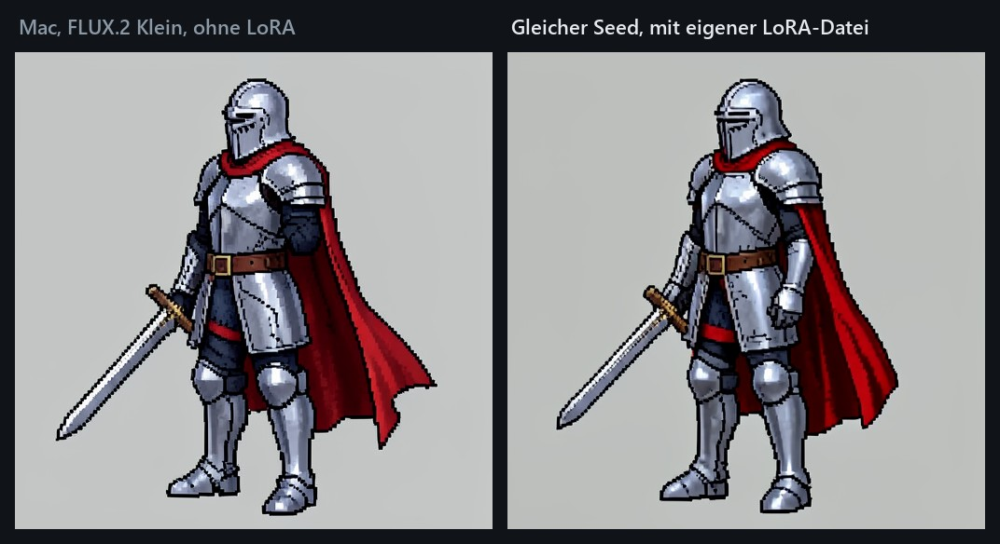

# LoRAs

[English](../LORAS.md)

Eine LoRA ist ein kleiner Zusatz (meist 50 MB bis 1 GB) zu einem großen Modell. Sie bringt ihm eine Sache bei, die es
allein nicht so gut kann: einen Stil wie Pixel-Art oder einen Film-Look, mehr Realismus, eine Kamerafahrt oder eine
bestimmte Person oder Figur. Das Modell selbst bleibt unverändert, die LoRA wird nur beim Generieren dazugeschaltet.

Jede LoRA ist für eine Modellfamilie trainiert, und eine für eine andere Familie wirkt meist gar nicht. NVAI-open liest
deshalb den Kopf jeder LoRA-Datei und bietet sie nur bei den Modellen an, zu denen sie passt.

## Welche Modelle LoRAs nehmen

| Familie | Modelle | Gut zu wissen |
|---|---|---|
| Qwen-Image | Qwen-Image-2512 in jeder Fassung (NVFP4, INT8, FP8, Lightning) | Realismus-, Stil- und Tempo-LoRAs getestet, siehe unten |
| Z-Image | Z-Image, Z-Image INT8 | |
| SDXL | SDXL Base, Juggernaut XL, Pony V6 XL, Illustrious XL, NoobAI-XL | die größte Auswahl; eine LoRA wirkt am besten auf dem Checkpoint, für den sie gemacht ist |
| FLUX.1 / Chroma | FLUX.1 schnell, Chroma1-HD | |
| LTX-2 / 2.3 | LTX-2.5, LTX-2.3 | die meisten LTX-LoRAs sind für LTX-2.3 gemacht und laufen auch mit LTX-2.5 |
| LTX-Video 0.9 | LTX-Video 2B | |
| Wan | Wan 2.1 T2V 1.3B, Wan 2.2 TI2V 5B, Wan 2.2 I2V A14B, Wan 2.1 I2V 14B | jede Größe nimmt nur ihre eigenen LoRAs; für A14B kommen sie meist als Paar (High- und Low-Noise) |
| MiniMax H3 | MiniMax H3, MiniMax H3 Referenz | nur die eigenen Turbo-LoRAs, schon vorgewählt |

Keine LoRAs: FLUX 3 Klein, Krea 2 (bis auf die Stil-LoRA von ostris für Stilvorlagen unter „Modelle“ → „Zusätze
laden“), MOSS-Image, Qwen-Image 2.1 und die übrigen hier nicht genannten Bildmodelle. Auf dem Mac nimmt nur FLUX.2
Klein 4B LoRAs, siehe [Auf dem Mac](#auf-dem-mac).

## Woher LoRAs kommen

- **Empfohlene LoRAs:** Unter LTX-2.5 lädt „Empfohlene LoRAs“ getestete Stile und schaltet sie ein.
- **Suche:** „Modelle“ → „Modelle und LoRAs suchen“ findet LoRAs auf Hugging Face und Civitai. Vor dem Download liest
  NVAI-open den Dateikopf und sagt, zu welchen Modellen die LoRA passt. Civitai verlangt für die meisten Downloads einen
  eigenen API-Schlüssel (civitai.com → Settings → API Keys).
- **Eigene Datei:** eine LoRA, die du selbst trainiert (ai-toolkit, kohya_ss, OneTrainer, musubi-tuner …) oder
  anderswo gefunden hast.

## Eigene LoRA-Datei hinzufügen



1. „Modelle“ → „LoRA-Datei hinzufügen“. Auf der Seite „Generieren“ macht „+ Eigene LoRA-Datei hinzufügen“ in der
   LoRA-Liste unter dem Modell dasselbe, und die neue LoRA ist gleich angehakt.
2. Eine `.safetensors`-Datei hineinziehen oder auswählen. NVAI-open liest nur den Dateikopf, ein paar Kilobyte, und
   zeigt, für welche Familie die LoRA trainiert ist und bei welchen Modellen sie erscheinen wird. Trigger-Wörter, die
   in der Datei stehen, werden eingetragen.
3. Unter „Gehört zu“ die Familie bestätigen oder ändern, dazu Name und Trigger-Wörter. Bei Wan 2.2 A14B auch den
   Experten wählen: beide, nur High-Noise oder nur Low-Noise.
4. „Hinzufügen“ kopiert die Datei in den Modellordner (`loras/`), mit Fortschritt und Abbrechen.

Was NVAI-open prüft:

- **Nur `.safetensors`:** andere Formate (`.pt`, `.ckpt`, `.bin`) können beim Laden Code ausführen.
- **Vollständige Dateien:** Eine abgeschnittene oder beschädigte Datei wird abgelehnt; ihre Größe muss genau zum Kopf
  passen.
- **Keine Kopien:** Dieselbe Datei ein zweites Mal ändert nur ihre Angaben.
- **Ein Modell dazu:** Eine LoRA für eine Familie, die keines deiner Modelle nimmt, wird abgelehnt, weil sie nirgends
  erschiene (etwa FLUX.2 Klein unter Windows).
- **Alle üblichen Formate:** Dateien aus kohya, Diffusers, ComfyUI und PEFT werden erkannt.

**Später ändern:** „Zuordnung“ an der LoRA unter „Modelle“ ändert Familie, Name, Trigger-Wörter und Experten. Das geht
bei jeder LoRA, die du selbst oder über die Suche hinzugefügt hast; die LoRAs, die der Katalog mitbringt, bleiben, wie
sie sind. Löschen entfernt bei einer selbst hinzugefügten LoRA die Datei und den Eintrag.

## LoRAs verwenden

Auf der Seite „Generieren“ steht jede passende LoRA unter dem gewählten Modell:

- **Anhaken** und die Stärke wählen, meist 0,6 bis 1,0.
- **Die Trigger-Wörter in den Prompt**, das macht „+ Trigger“. Ohne sie ließ eine Pixel-Art-LoRA für Qwen-Image-2512
  das Bild fast unverändert; mit „Pixel Art.“ im Prompt kam saubere Pixel-Art.
- **Mehrere zugleich** gehen, jede etwas schwächer: Boreal und Lenovo UltraReal je 0,6.
- **Tempo-LoRAs** brauchen eigene Einstellungen: `steps=4, cfg=1` für Wuli Turbo und für Wan2.2-Lightning.
- Eine LoRA kostet kaum Zeit: 94 bis 106 statt 100 Sekunden mit Qwen-Image-2512.



## Getestete LoRAs

Gemessen auf einer RTX 5060 Ti mit 16 GB:

| LoRA | Modell | Einstellung | Ergebnis |
|---|---|---|---|
| Boreal (Civitai) | Qwen-Image-2512 | 0,9 | wirkt am ehesten wie ein echtes Foto |
| Lenovo UltraReal (Apache-2.0) | Qwen-Image-2512 | 0,9; mit Boreal je 0,6 | natürlicher, am nächsten am Prompt |
| Real Life, flymy realism | Qwen-Image-2512 | | ersetzten den verlangten Hintergrund |
| Skin Fix | Qwen-Image-2512 | | zeichnet weich |
| Qwen-Image-2512 Master Pixel Art | Qwen-Image-2512 | 1,0, „Pixel Art.“ im Prompt | saubere Pixel-Art statt Farbbändern |
| Wuli Turbo | Qwen-Image-2512 | `steps=4, cfg=1` | 18 statt 100 s, fast gleiche Qualität |
| Wan2.2-Lightning I2V (High und Low) | Wan 2.2 I2V A14B | `steps=4, cfg=1` | 90 statt 585 s bei 640 × 640; 5 s in 1280 × 560 in 6,5 statt 55 min, in Zeitlupe (die auch ohne blieb) |
| Cinemagraph | LTX-2.5 | nur mit „Schleife“ | 6 % des Bildes bewegten sich, das Gesicht stand still |
| Slow Motion | LTX-2.5 | | echte Zeitlupe: Gischt fiel über 5 s statt 1,5 s |
| Fantasy Anime, Fantasy Painterly | LTX-2.5 | | ändern den Look deutlich |
| Paper Cut-Out | LTX-2.5 | 1,5 | erst mit 1,5 sichtbar |
| Claymation, Transition | LTX-2.5 | | wirken kaum |



## Figuren im Studio

Im Studio bündelt eine Figur eine oder mehrere LoRAs mit einer Stimme. Jede Szene nimmt die LoRAs, die zu ihrem Modell
passen; eine Figur kann also eine für Standbilder (Qwen-Image) und eine für Clips (LTX-2) haben, und ihre
Trigger-Wörter kommen von selbst vorn in den Prompt. In einem Clip, der einen vorgegebenen Satz spricht, war Fantasy
Anime mit 0,8 nicht zu sehen. So richtest du sie ein: [STUDIO.md](STUDIO.md#figuren).

## Auf dem Mac

NVAI-open für Mac lädt LoRAs nur in FLUX.2 Klein 4B. Der Katalog bringt einige mit (Pixel-Art, Sprite-Sheet, Anime …),
und seit Mac 0.5.5 gehen eigene Dateien wie unter Windows. LoRAs für FLUX.2 Klein 9B und Dateien im kohya-Format lehnt
die Prüfung mit einem Hinweis ab, weil die Mac-Fassung sie nicht anwenden kann. Eine LoRA einschalten lädt das Modell
einmal neu: Auf einem Mac mini M1 brauchte das erste Bild in 512² 50 Sekunden, das nächste mit derselben LoRA 37.



## Lizenzen

Jede LoRA hat ihre eigene Lizenz, sie steht unter „Modelle“ dabei und gilt zusätzlich zur Lizenz des Modells. „not
stated“ heißt: Du kannst nicht davon ausgehen, dass du damit Erzeugtes verkaufen darfst. Bei selbst hinzugefügten
Dateien kennt NVAI-open die Lizenz nicht und zeigt „eigene Datei“.

## Für Claude Code und andere Programme

Per MCP listet `list_models(kind="lora")` die LoRAs mit Familie und Trigger-Wörtern, und `lora_bases` eines Modells
sagt, welche Familien es nimmt. Generiert wird mit `loras=[{"model_id": "…", "strength": 0.8}]` und den Trigger-Wörtern
im Prompt. `add_lora(path)` fügt eine Datei von diesem Rechner hinzu, `update_lora` ändert ihre Zuordnung.

Per REST:

```
# nur den Kopf lesen (Körper: die ersten 8 Byte und der Kopf): Familie, passende Modelle, Trigger-Wörter
POST /api/loras/inspect?file_name=meine-lora.safetensors

# Datei hinzufügen: die Datei ist der Körper, die Angaben stehen in der Adresse (family leer = wie erkannt)
curl -X POST "http://127.0.0.1:8100/api/loras/upload?file_name=meine-lora.safetensors&trigger=ohwx%20person" \
  -H "Content-Type: application/octet-stream" --data-binary @meine-lora.safetensors

# Zuordnung ändern (die id kommt beim Hinzufügen zurück)
curl -X PUT http://127.0.0.1:8100/api/loras/lora-upload-meine-lora -H "Content-Type: application/json" \
  -d '{"family": "qwenimage", "trigger": "ohwx person"}'
```

`DELETE /api/models/{id}` entfernt eine selbst hinzugefügte LoRA samt Datei.
