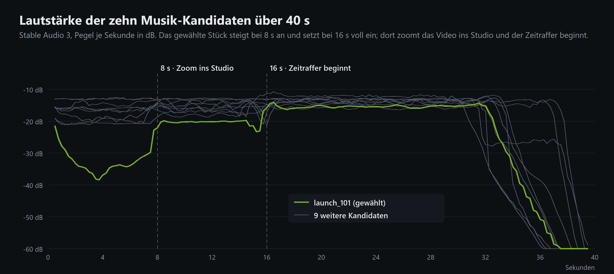
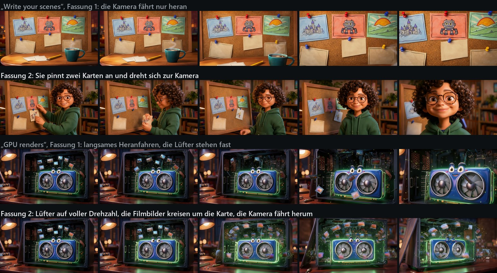
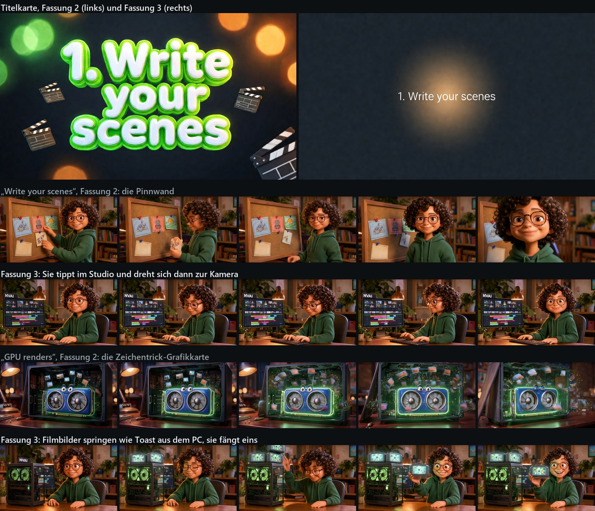

# Making of: das Studio-Video, gebaut von Claude über MCP

[English](../MAKING_OF.md)

Das einminütige Video, das das Studio vorstellt, ist fast vollständig mit NVAI-open selbst entstanden. Eine
Anfrage in Claude Code; Claude hat die Startbilder gemacht, die Szenen im Studio angelegt, Clips, Titelkarten
und Musik von der GPU rechnen lassen, den Schnitt übernommen und ein 30-Sekunden-Tutorial exportiert. Um dieses
Tutorial herum hat Claude dann das Video für Reddit geschnitten: die Konsole, ein Zoom ins Studio, das
Generieren im Zeitraffer und am Ende das fertige Tutorial.

Diese Seite geht den ganzen Ablauf Schritt für Schritt durch, mit den Prompts, den Zeiten und dem, was unterwegs
geprüft wurde. Die Abschnitte 1 bis 7 beschreiben die erste Fassung; die Abschnitte 8 und 9 zeigen, was dem ersten
Zuschauer auffiel und wie zwei weitere Fassungen das behoben haben. Alles lief lokal auf einer **RTX 5060 Ti 16 GB**.

| Schritt | Werkzeug | Zeit auf der GPU |
|---|---|---|
| Fünf Startbilder (FLUX 3) | `generate_image` | rund 10 min |
| Neun Studio-Szenen: zwei Einstellungen mit Sprache (DFR), drei bebildernde, drei Titelkarten, Musik | `studio_command`, `studio_generate` | 74 min |
| Übernehmen und Export des 30-Sekunden-Tutorials | `studio_command`, `studio_export` | 30 s |
| Zehn Musik-Kandidaten fürs Reddit-Video (Stable Audio 3) | `generate_audio` | rund 1,5 min |
| Fassung 2: drei Einstellungen neu, Übernehmen und Export (Abschnitt 8) | `studio_command`, `studio_generate`, `studio_export` | 33 min |
| Fassung 3: zwei neue Startbilder, das ganze Projekt neu (Abschnitt 9) | `generate_image`, `studio_*` | 105 min |

## 1. Die Anfrage

Die Anfrage war kurz: ein Tutorial-Video, gemacht mit NVAI, zum Posten auf Reddit, auf Englisch, über das
Studio selbst, im Stil eines animierten Erklärvideos (3D-Cartoon-Moderatorin, Titelkarten, schnelle Schnitte).
Im Video erscheint sie als Prompt, der in Claude Code getippt wird:

Die Konsole im Video ist gezeichnet, nicht abgefilmt: Ein kleines Programm zeichnet das Claude-Code-Fenster
Bild für Bild und tippt den Prompt. Die Zeilen darunter sind die MCP-Aufrufe, die für dieses Video wirklich
gemacht wurden, mit ihren echten Ergebnissen (Anzahl der Bilder, Sekunden, Projekt-ID).

## 2. Startbilder mit FLUX 3

LTX-2.5 erfindet in jeder Text-zu-Video-Szene ein neues Gesicht. Eine Moderatorin, die zweimal vorkommt,
braucht deshalb Startbilder, und die Szenen bekommen sie als erstes Bild.

- **Die Moderatorin:** `flux3-klein-nvfp4`, 1920 × 1088 (die Videogröße), `batch_size=4`, 178 s. Stil zuerst:
  „3D animated film still in the style of a modern Pixar movie, soft warm cinematic lighting, rich colors. A
  friendly young woman presenter with short curly dark brown hair, big expressive brown eyes, light freckles
  and round tortoiseshell glasses, wearing a plain dark green hoodie without any print, sits at a wooden desk
  in a cozy home studio … Behind her on the left a computer monitor shows a video editing timeline … and the
  bold white word "NVAI" at the top of the screen.“ Alle vier waren brauchbar; gewählt wurde in voller
  Auflösung das mit dem klarsten Gesicht und ruhigen Händen.
- **Dieselbe Person noch einmal, näher:** das gewählte Bild als `reference_asset_ids`, „The woman from the first
  image, with exactly the same face, glasses, curly hair and dark green hoodie, in the same cozy home studio.
  Medium close-up from the chest up …“, 4 Bilder in 204 s. Alle 4 behielten Gesicht, Brille, Haar, Kleidung und
  Raum.
- **Drei bebildernde Einstellungen** im selben Stil, je 2 Bilder in rund 80 s: eine Pinnwand mit
  Storyboard-Karten, eine freundliche Grafikkarte in einem offenen PC-Gehäuse, ein Schnittplatz mit Filmklappe.

## 3. Die Szenen im Studio

Claude hat das Projekt mit `studio_create("NVAI Studio Tutorial")` angelegt und dann je Einstellung ein
`scene.add` geschickt. Das Studio zeigte jede Szene, sobald sie angelegt war.

| Zeit | Szene | Art | Modell | Qualität |
|---|---|---|---|---|
| 0–6 s | Hi there | Video mit Sprache, Startbild: Moderatorin | LTX-2.5 | DFR |
| 6–8 s | Step 1 | Titelkarte | Qwen-Image-2512 | 50 Schritte |
| 8–12 s | Write your scenes | Video, Startbild: Pinnwand | LTX-2.5 | Standard |
| 12–14 s | Step 2 | Titelkarte | Qwen-Image-2512 | 50 Schritte |
| 14–18 s | GPU renders | Video, Startbild: Grafikkarte | LTX-2.5 | Standard |
| 18–20 s | Step 3 | Titelkarte | Qwen-Image-2512 | 50 Schritte |
| 20–24 s | Cut & export | Video, Startbild: Schnittplatz | LTX-2.5 | Standard |
| 24–30 s | Agents via MCP | Video mit Sprache, Startbild: Nahaufnahme | LTX-2.5 | DFR |
| 0–30 s | Music | Bahn Musik | Stable Audio 3 | |

Ein Marker `transition` bei 24 s legt eine halbe Sekunde Überblendung in die letzte Einstellung.

**Die Prompts, gekürzt:**

- *Sprache, erste Einstellung:* „She looks into the camera, lifts one hand in a small friendly wave and says in
  a warm, cheerful, clear female voice: "Hi! Want a whole video, made right on your own PC?" Then she smiles
  and nods once. Static camera, a locked-off shot; the framing stays exactly as in the first frame. Quiet room
  tone …“ (Fassung 1 endete mit „Let me show you how.“; siehe Abschnitt 8.)
- *Sprache, letzte Einstellung:* „… says … "And the best part? Every AI agent can now drive this through MCP."
  Then she smiles and nods once.“ Der Produktname wird nicht gesprochen (wie ein Modell eine Abkürzung ausspricht,
  ist Glückssache); er steht auf dem Monitor hinter ihr und auf der Abschlusskarte.
- *Titelkarten:* „A bright 3D cartoon title card in the style of an animated movie, centered composition. Big
  glossy rounded 3D letters in white with a lime green outline read "1. Write your scenes" … nothing else
  written anywhere.“ Größe 1664 × 928, Qwens eigenes 16:9.
- *Musik:* „Playful warm orchestral pop underscore for an animated short with pizzicato strings, glockenspiel,
  light marimba, soft brushed drums and a bouncy upright bass, cheerful and curious like a cartoon tutorial.
  BPM: 112.“

## 4. Generieren

`studio_generate(wait=False)`, dann alle paar Sekunden `studio_get`. Die Warteschlange rechnet erst den Ton,
dann die Titelkarten, dann die Videos:

| Szene | Zeit |
|---|---|
| Musik, 30 s | 12,5 s |
| Titelkarten | je 188–201 s |
| Bebildernde Einstellungen, 4 s Standard | je 239–257 s |
| Einstellungen mit Sprache, 6 s DFR | 1519 s und 1599 s (Fassung 2 der ersten: 1248 s) |

Zusammen 74 Minuten auf der GPU; den Großteil machen die beiden DFR-Einstellungen aus. Allein ihr erster
DFR-Schritt dauerte 6½ Minuten, solange LTX-2.5 mit dem Detail-IC-LoRA in die 16-GB-Karte geladen wurde.

## 5. Takes prüfen

Vor dem Übernehmen hat Claude von jedem Video-Take drei Bilder in voller Auflösung angesehen (Anfang, Mitte,
Ende) und den Ton geprüft. Hören kann Claude einen Take nicht; bei den beiden Einstellungen mit Sprache hat es
deshalb gemessen, wann das Band von 300 bis 3400 Hz über das Grundrauschen steigt: in der ersten Einstellung
vier Satzteile mit Pausen, passend zu Kommas und Fragezeichen des Satzes; in der letzten endet der Satz nach
4 s, danach ein leises Lachen. Den Wortlaut selbst müssen Menschen anhören.

Die Befunde: Die Moderatorin bleibt in beiden Einstellungen dieselbe Person, das „NVAI“ auf dem Monitor bleibt
lesbar. Die Storyboard-Karten flogen nicht wie verlangt an die Pinnwand; stattdessen fuhr die Kamera heran, was
für „Write your scenes“ trotzdem passt. Bei der Grafikkarte bleibt in den letzten Momenten ein dunkles Filmbild an
einem Lüfter hängen. Claude hielt nichts davon für einen zweiten Take wert; der erste Zuschauer sah das anders
(Abschnitt 8). Das Bild oben zeigt schon die Takes von Fassung 2.

## 6. Übernehmen, Musikpegel, Export

`edit.conform` hat die neun Takes auf die Spuren gelegt (eine Überblendung bei 24 s). `clip.update` hat die Musik
auf A2 um 9 dB abgesenkt, damit die Sprache vorn bleibt, und `studio_export(preset="youtube-1080p")` hat das
Tutorial aus den verlustfreien Kopien gerechnet: 30 s in 1920 × 1080, in 24 s mit NVENC, −14,7 LUFS, True Peak
−2,3 dBTP.

## 7. Das Video drumherum

**Das Studio aufnehmen.** Ein unsichtbarer Chrome (headless, eigenes Profil) zeigte das Studio in
1920 × 1080 mit Skalierung 2, jedes Bild ist also ein 4K-Bild, und die Zooms bleiben scharf. Ein Skript hat
über das Chrome DevTools Protocol Bildschirmfotos gemacht, rund sechs je Sekunde beim Anlegen der Szenen und
eins alle 3 s beim Generieren, dabei dieselben MCP-Aufrufe wie oben geschickt und notiert, wann es welchen
gemacht hat. Der Schnitt folgt diesen Zeitstempeln. Aufgenommen wurde auf einem eigenen NVAI-open-Server mit
leerem Datenordner, deshalb zeigt die Materialliste nur, was für dieses Video entstand.

**Der Schnitt.** Ein kleines Programm legt Konsole und Studio als Fenster auf eine dunkle Bühne und fährt mit
einer Kamera darüber: In der Konsole taucht sie in die MCP-Aufrufe ein, blendet ins Studio über, das auf die
erste Szene gezoomt ist, und fährt zurück. Das Anlegen der Szenen läuft 1,3-mal schneller als in echt, die 74
Minuten Generieren 445-mal schneller mit der echten GPU-Uhr in der Ecke, dann Übernehmen und Export, ein Zoom in
den Studio-Monitor, in dem das Tutorial anläuft, und das Tutorial im Vollbild mit Untertiteln. Die Untertitel
sitzen nach der gemessenen Sprache, nicht geschätzt.

**Die Musik.** Stable Audio 3 hat zehn Kandidaten zu 40 s gemacht (fünf Stilrichtungen, je zwei Seeds). Hören
kann Claude auch die nicht, sie wurden also gemessen: Taktstärke, Tempo, Höhen, Lautheit und ihr Verlauf über die
Zeit. Die meisten laufen vom Anfang bis zum Ende auf demselben Pegel. Eins, `launch_101` („Upbeat modern
electronic pop instrumental … BPM: 120.“), hat ein leises Intro, steigt bei genau 8,0 s an und setzt bei genau
16,0 s voll ein; darauf wurde das Video geschnitten: Bei 8 s taucht die Kamera ins Studio ein, bei 16 s beginnt
der Zeitraffer. Die Abschlusskarte nimmt seine letzten vollen Takte und seinen eigenen Ausklang.

**Der Ton.** Musik, Tastenklicks und ein leises Rauschen beim Zoom wurden mit dem Ton des Tutorials gemischt, auf
−14 LUFS gebracht und wie ein Studio-Export bei −2,5 dBFS begrenzt (AAC schwingt bei dichtem Ton bis 2 dB über).
Das leise Intro der Musik wurde um 6 dB angehoben, damit die ersten Sekunden nicht leer klingen. Ergebnis:
−14,8 LUFS, Spitze −2,0 dBFS; Intro −21 LUFS, Studio-Teil −15,5, Tutorial −14,0, Abschlusskarte −14,8.

## 8. Fassung 2: was dem ersten Zuschauer auffiel

Dem ersten, der das Video gesehen hat, sind drei Dinge aufgefallen; alle drei sind mit denselben Werkzeugen
behoben:

- **Das letzte Wort brach ab.** „Let me show you h…“: Die 15 Wörter füllten die 6-s-Einstellung bis zum letzten
  Bild. Der neue Satz hat 11 Wörter, „Hi! Want a whole video, made right on your own PC?“, danach „Then she
  smiles and nods once.“ Im Band von 300 bis 3400 Hz gemessen läuft die Sprache jetzt in drei Teilen (0,6–1,1 s,
  1,7–3,1 s, 3,4–5,7 s) und endet 0,3 s vor dem Schnitt; die Einstellung endet mit ihrem Lächeln. LTX-2.5 sprach
  hier 2,2 Wörter je Sekunde und im Schlusssatz 3,3, also rund zwei Wörter je Sekunde einplanen. 1248 s mit DFR.
- **Zwei Einstellungen zeigten zu wenig.** Bei „Write your scenes“ fuhr die Kamera nur an die Pinnwand heran, bei
  „GPU renders“ drehten sich die Lüfter kaum. Die neuen Prompts beschreiben eine Folge von Handlungen: Sie drückt
  die Raketenkarte an, nimmt eine zweite Karte vom Tisch, pinnt sie daneben und dreht sich mit stolzem Lächeln
  zur Kamera; die Lüfter der Karte drehen mit Bewegungsunschärfe hoch, sie blinzelt zweimal, und die Filmbilder
  über ihr fliegen wie ein Karussell um sie herum, während die Kamera um die Karte fährt. Der erste Versuch für
  die Grafikkarte verlangte „a burst of glowing film frames … like confetti“ und bekam einen Schwarm glasiger
  grüner Splitter, der ab der zweiten Sekunde das ganze Bild zudeckte; eine ruhigere Beschreibung und ein neuer
  Seed haben es behoben. 205 s und 246 s je Versuch.
- **Der Zoom in den Monitor war nicht sauber.** Fassung 1 zoomte in die kleine Wiedergabe im Browser und blendete
  ins Video über. Jetzt sitzt das erste Bild des Tutorials scharf im Studio-Monitor, die Kamera fährt gleichmäßig
  hinein (der Maßstab wächst exponentiell, der Monitor wandert auf gerader Bahn in die Mitte), und das Tutorial
  läuft erst an, wenn der Monitor das Bild füllt.

`scene.update` mit neuem Prompt und Seed, `studio_generate(scene_ids=[…])` für die drei Szenen, und `edit.conform`
hat die neuen Takes in den Schnitt getauscht, ohne ihn anzufassen; die alten Takes bleiben in der Liste jeder
Szene. Der Export dauerte 22 s mit NVENC (−14 LUFS, Spitze −2,5 dBFS). Das neue Reddit-Video ist 65,6 s lang,
−14,7 LUFS, Spitze −2,0 dBFS.

## 9. Fassung 3: kürzere Gesten, schlichtere Tafeln, neue Einstellungen

Derselbe Zuschauer hat Fassung 2 angesehen und vier weitere Dinge gefunden. Der ganze Lauf wurde auf einem frischen
Testserver neu gebaut und aufgenommen, damit Materialliste und Zeitraffer nur das Neue zeigen:

- **Die Hand wackelte viel zu lange.** In Fassung 2 winkte sie rund vier Sekunden, während sie sprach. „Raises one hand
  for a single quick wave and lowers it back onto the desk right away“ gab immer noch 2,5 s Winken, die ersten 1,4 s
  davon stumm. Der Take im Video winkt gar nicht: „her hands stay resting on the desk, and right away she says …“. Sie
  spricht ab 0,6 s und ist bei 4,5 s fertig.
- **Ein Aussetzer nach einer Sekunde.** Im Bild gab es keinen Sprung (Bild für Bild gemessen). Es war der Ton: Nach
  „Hi!“ machte LTX-2.5 0,6 s Pause, darunter nur die leise Musik. „Hi there, want a whole video made right on your own
  PC?“ mit Komma pausiert 0,3 s. Außerdem läuft die Musik des Reddit-Videos jetzt bis 0,9 s ins Tutorial aus statt bis
  0,2 s, damit die halbe Sekunde vor dem ersten Wort nicht fast still ist (leisester Moment −32 statt −40 dBFS).
- **Die Schrifttafeln waren zu präsent.** Aus großen glänzenden 3D-Buchstaben mit lindgrünem Rand wurde kleine weiße
  Schrift auf dunklem Grund mit einem weichen warmen Licht, 1,5 statt 2 Sekunden: „A minimal, calm title card … one
  line of small clean white sans-serif text reads "1. Write your scenes" …“. Qwen-Image-2512, drei von drei
  buchstabengenau.
- **Notizen- und GPU-Einstellung sollten ganz anders werden.** Jetzt tippt sie an der Tastatur vor dem Studio und
  dreht sich dann zur Kamera, und aus einem PC mit Glasseite springen oben leuchtende Filmbilder heraus wie Toast aus
  dem Toaster; sie fängt eins und hält es hoch. Beide Startbilder kamen von FLUX 3 mit der Moderatorin als Referenzbild
  (206 s und 164 s für je vier), die Clips laufen 4,5 s (113 Bilder, Standard).

Fassung 3 brauchte samt zweitem Intro-Take 99 Minuten auf der GPU: die DFR-Einstellungen mit Sprache je 17–19 Minuten,
die erste 42 Minuten, weil LTX-2.5 mit dem Detail-IC-LoRA direkt nach den Tafeln geladen wurde; die 4,5-s-Einstellungen
3,5–4,4 Minuten, die Tafeln 2,6–2,8 Minuten, die Musik 14 s. Das Reddit-Video: 65,6 s, −14,9 LUFS, Spitze −2,1 dBFS.

## 10. Was hängen bleibt

- **Startbilder zuerst**, wenn eine Person mehrmals vorkommt; weitere Einstellungen derselben Person mit
  `reference_asset_ids`.
- **Kurze gesprochene Sätze.** Rund zwei Wörter je Sekunde: 15 Wörter liefen über das Ende einer 6-s-Einstellung
  hinaus und brachen mitten im Wort ab, 11 endeten 0,3 s vor dem Schnitt. Der Person nach dem Satz etwas zu tun
  geben. Produktnamen nicht sprechen lassen.
- **Gesten aus Einstellungen mit Sprache weglassen.** LTX-2.5 dehnt sie: selbst „a single quick wave“ dauerte
  2,5 s. Kommas statt Ausrufezeichen halten einen Satz im Fluss (0,3 statt 0,6 s Pause).
- **Titelkarten im Hintergrund halten.** Kleine Schrift auf ruhigem Grund, 1,5 s, reicht zwischen den Einstellungen.
- **In jeder Einstellung muss etwas passieren.** Eine Folge von Handlungen beschreiben; ein Heranfahren allein
  wirkt, als passiere nichts. Schwärme vermeiden („a burst of … like confetti“): LTX-2.5 machte daraus Rauschen
  über dem ganzen Bild.
- **DFR nur, wo man es sieht:** Gesicht und Sprache. Es ist drei- bis sechsmal langsamer.
- **Titelkarten als Bildszenen mit Qwen-Image**, der Text in Anführungszeichen: drei von drei buchstabengenau.
- **Lange Läufe mit `studio_generate(wait=False)`** und `studio_get`; `wait=True` wartet höchstens eine Stunde.
- **Jeden Take prüfen**, in voller Auflösung, bevor übernommen wird, und die Sprache von einem Menschen anhören
  lassen.
- **Musik nach ihrem Aufbau wählen** und darauf schneiden.

Dasselbe kurz für andere KI-Agenten: [CLAUDE_CODE.md, Rezept](../CLAUDE_CODE.md#recipe-an-explainer-video-with-a-presenter)
(englisch). Wie das Studio funktioniert: [STUDIO.md](STUDIO.md).

Die Skripte für Aufnahme und Schnitt sind für dieses eine Video entstanden und kein Teil von NVAI-open. Zwei
kleine Dinge sind daraus für die nächste Fassung hervorgegangen: Ein Projekt, das ein Agent über MCP anlegt,
öffnet sich jetzt von selbst im Studio, wenn gerade keins offen ist, und ein über MCP gestarteter Export zeigt
seinen Fortschritt in der Werkzeugleiste.
