# Bildmodelle in NVAI-open: Qwen-Image-2512, FLUX 3 Image Klein, Krea 2 und MOSS-Image

*English: [../MODELS.md](../MODELS.md)*

Referenz für Projekte, die Bilder über NVAI-open erzeugen lassen. Sie gilt für Claude Code
mit dem MCP-Server `nvai` ebenso wie für eigene Programme über die REST-API. Beschrieben sind
die vier Bildmodelle, die NVAI-open bevorzugt: was sie können, wie man sie anspricht, wie lange
sie brauchen und wo sie scheitern. Alle vier nebeneinander, mit gleichen Prompts und Seeds (englisch):
[../MODEL_COMPARISON.md](../MODEL_COMPARISON.md).

Stand: 18. Oktober 2026 (Krea 2: 24. Oktober, MOSS-Image: 25. Oktober). Gemessen auf einer RTX 5060 Ti mit 16 GB (ComfyUI 0.41.3, PyTorch 2.11
cu130). Alle Zeiten und Befunde sind dort gemessen. Was vom Hersteller stammt, ist als
Herstellerangabe gekennzeichnet.

---

## 1. Auf einen Blick

| | **Qwen-Image-2512** | **FLUX 3 Image Klein** | **Krea 2 Turbo** | **MOSS-Image** |
|---|---|---|---|---|
| Modell-ID | `qwen-image-2512-nvfp4` | `flux3-klein-nvfp4` | `krea2-turbo-nvfp4` | `moss-image-sft-int8` |
| Hersteller | Alibaba (Qwen) | Black Forest Labs, Oktober 2026 | Krea.ai, Juni 2026 | OpenMOSS, Oktober 2026 |
| Größe | 20 Mrd. Parameter, NVFP4 | 5,6 Mrd. Parameter, NVFP4 | 12 Mrd. Parameter, NVFP4 | 5 Mrd. Parameter, INT8 |
| Text-Encoder | Qwen2.5-VL-7B | Qwen3-VL-4B, dazu ein Prompt-Upsampler (Qwen3.5-9B) | Qwen3-VL-4B (dieselbe Datei wie bei FLUX 3) | Qwen3.5-9B (W4A8), baut knappe Prompts selbst aus |
| Schritte / CFG | 50 / 4,0 | 16 / 1 (destilliert) | 8 / 1 (destilliert) | 50 / 3 |
| Negativprompt | wirkt; leer = Standard aus Qwens Modellkarte | wirkt **nicht** | wirkt **nicht** | wirkt; leer = Empfehlung aus ComfyUIs Vorlage |
| Referenzbilder | — | bis 10 | — | — |
| Platzierung per Box | — | ja | — | per JSON-Layout („summary“, „items“; Herstellerangabe) |
| Schrift im Bild | buchstabengenau | im Test 3 von 3 fehlerfrei | im Test buchstabengenau | in allen Tests buchstabengenau |
| Zeit für ein Bild 1024² | ~100 s | ~30 s bei neuem Prompt, 13–16 s bei bekanntem | ~20 s | ~51 s (25 Schritte ~28 s), Ausbau beim ersten Mal ~11 s dazu |
| Lizenz | **Apache-2.0** | **FLUX Kommunity License** — Umsatzgrenze, Prüfpflicht | **Krea 2 Community License** — unter 1 Mio. US-$ Umsatz, Prüfpflicht | **Apache-2.0** |
| Stärke | Endassets, konstruktive Details, Schrift | Bearbeiten, gleichbleibende Figuren, Layout, Tempo | fotografischer Look, natürliche Hände und Gesichter, Tempo | Schrift und Layout, Plakate und Grafiken, frei verkaufbar |

## 2. Welches Modell wofür

| Aufgabe | Modell |
|---|---|
| Endasset ohne Vorlage: Objekt, Figur, Icon, Szene | **Qwen** |
| Schrift, Beschriftung, Schilder | **Qwen** oder **MOSS-Image** (rund halb so lang, beide Apache-2.0) |
| Plakat, Grafik, Layout mit viel Text | **MOSS-Image** (~51 s): das fertige Bild beschreiben, Schrift in Anführungszeichen mit Ort und Schriftart |
| Konstruktion muss stimmen (Befestigungen, Scharniere, Griffe) | **Qwen** |
| Fotografisches Bild mit wenig KI-Look, natürliche Hände und Gesichter | **Krea 2** (~20 s), Bildausschnitt nennen; Lizenz nur unter 1 Mio. US-$ Umsatz |
| Vorhandenes Bild gezielt ändern: Teil ersetzen, Farbe, Material | **FLUX 3** mit dem Bild als Referenz |
| Dieselbe Figur oder dasselbe Objekt in mehreren Bildern | **FLUX 3** mit Referenzbild |
| Motive aus mehreren Bildern kombinieren | **FLUX 3** mit mehreren Referenzen |
| Mehrere Objekte an festen Plätzen | **FLUX 3** mit Bounding-Boxen |
| Schnelle Entwürfe | FLUX 3 (13–16 s), Krea 2 (~20 s) oder Qwen Lightning (`qwen-image-2512-lightning`, ~17 s) |
| Historisch exakte Fahrzeuge (Panzer IV, Sd.Kfz. 251 …) | **keines** — siehe Abschnitt 9 |
| Nur ein paar Worte Prompt, Modell ohne eigenen Upsampler | erst **✨ Prompt ausbauen** (`expand_prompt`), siehe Abschnitt 5 |
| Altes Foto restaurieren oder einfärben | Reiter **Restaurieren** (`restore_image`): FLUX 3 entfernt Schäden und färbt ein, SeedVR2 schärft, siehe „Neu in 0.5.11“ |
| Qwen-Image 2.1 ausprobieren (`qwen-image-2.1-int8`) | **nur nicht kommerziell** (Qwen Research License); Bearbeiten wirkte im Test überzeichnet |

Ohne Angabe von `model_id` nimmt NVAI-open das aktive Bildmodell.

### Getestet, nicht aufgenommen (Oktober 2026)

- **Kandinsky 6** (Kandinsky Lab, MIT; Bild und Ton in einem Durchgang, 5 s in 864 × 480, Full HD nur mit einem
  zusätzlichen Super-Resolution-Modell): Pro destilliert traf die Erwartungen, brauchte auf einer 16-GB-Karte
  aber 928–966 s je 5-s-Clip (LTX-2.5 mit demselben Startbild: 114 s in 1280 × 704), Lite zerfiel, und die
  Super-Resolution hätte für 5 s rund 1,5 h gebraucht. Die Tonteile sind nicht kommerziell nutzbar, der
  Video-VAE (Tencent) gilt nicht in der EU. Einzelheiten:
  [CLAUDE_CODE.md](../CLAUDE_CODE.md#kandinsky-6-tested-27-october-2026-not-built-in) (englisch)
- **IC-LoRAs Restore und Ingredients für LTX-2.5** (Lightricks): Restore holte ein verändertes Gesicht nicht
  zurück und brachte neue Artefakte; Ingredients (ein Referenzblatt statt eines Startbilds) hielt eine echte
  Person in keinem Test erkennbar. Für eine erkennbare Person trägt das Startbild das Gesicht, gehalten mit einem
  Endbild oder der „Schleife“ ([FOTO_ZU_VIDEO.md](FOTO_ZU_VIDEO.md#tipps-aus-unseren-tests)).

### Neu in 0.5.13

**Studio:** ein Schnittplatz über den ganzen Bildschirm für ganze Videos. Szenen mit Prompt auf Bahnen für Bild,
Sprecher, Musik und Klang, Marker, die sagen, was wohin kommt (ein Anschluss-Marker lässt einen Clip mit dem letzten
Bild des vorigen beginnen), ein Schnitt mit echten Schnitten und Überblendungen und ein Export mit dem Encoder der
Grafikkarte auf −14 LUFS. Claude Code steuert es mit sechs `studio_*`-Werkzeugen. Schritt für Schritt:
[STUDIO.md](STUDIO.md).

**Verlustfreie Kopie jedes KI-Videos:** Neben dem MP4 schreibt jedes Videomodell die Bilder zusätzlich verlustfrei
(FFV1 in MKV, Ton als Float-PCM). Das Studio exportiert daraus und nimmt Anschluss-Startbilder daraus. Gemessen mit
LTX-2.5 in 1080p: rund 32 MB je Sekunde (das MP4 2 MB); ein YouTube-Export aus dem MP4 kam gegen das Original auf
37,7 dB PSNR, aus der Kopie auf 42,3 dB bei gleicher Bitrate. „Verlustfreie Kopie für den Schnitt“ unter
„Generieren → Video“ schaltet sie ab.

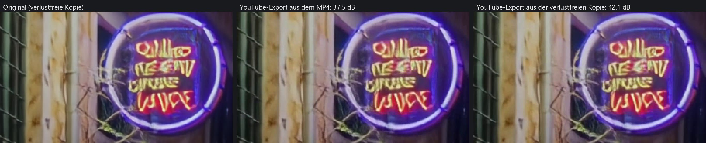

**YouTube 1080p mit 24 Mbit/s** statt 12: 42,8 statt 42,3 dB; 40 Mbit/s brachten 43,0 dB, und die Farbe in 4:2:0
kommt selbst ohne Kompression nicht über 43,9 dB. Neue Exportformate: ein verlustfreier Master (MKV, FFV1) und
ProRes 4444 (MOV); beide spielt kein Browser, deshalb bekommen sie eine H.264-Vorschau.

**ACE-Step entfernt:** Seine Musik war in der Praxis durchweg schlecht. Musik kommt jetzt von Stable Audio 3 Medium
(instrumental, bis 5 Minuten); singen kann vorerst kein Modell.

### Neu in NVAI-open für Mac 0.4.8

**Z-Image Turbo** (Tongyi-MAI, Apache-2.0) ist das dritte Bildmodell der Mac-Fassung neben FLUX.2 Klein und Core ML:
fotografische Bilder und Schrift, Text zu Bild, 8 Schritte, kein Negativprompt. Der Download umfasst 6,2 GB: die
4-Bit-Fassung von mflux-community und 0,28 GB Schichten in bf16. mflux rechnet auch Ein- und Ausgabeschicht,
Zeit- und Text-Einbettung und die Modulation auf 4 Bit herunter; auf dem Mac gab das orangestichige, verwaschene
Bilder mit einem 16-Pixel-Raster. NVAI-open holt genau diese Schichten in bf16 aus mlx-community/Z-Image-Turbo-bf16
(byteweise, ohne das 12,3-GB-Repo). Mit gleichem Seed kam die Kiste danach als verwittertes Holz mit Seilgriff und
buchstabengenauer Schrift; bei 1 MP liefen die Seile durch Bohrungen.

| Gemessen auf einem Mac mini M1, 8 GB | |
|---|---|
| 512 × 512 | 101 s, Spitze 4,6 GB |
| 832 × 1216 (1 MP) | 399 s (acht Schritte zu je rund 48 s, Dekodieren 10 s), Spitze 5,4 GB |
| Größtes Bild | 1 MP bei 8 GB (der Decoder rechnet in überlappenden Kacheln, ohne sichtbare Nähte), sonst 1536² |

**Video mit LTX-Video 2B** (Lightricks, 0.9.8 distilled): Text oder Startbild zu Video in acht Schritten, 24 Bilder je
Sekunde, ohne Ton, als Aufgabe „Video“ neben „Bild erzeugen“. NVAI-open rechnet es mit einem eigenen MLX-Port, der
gegen die Referenz geprüft ist. Der Download umfasst 9,0 GB (Transformer, Decoder und Encoder aus Lightricks' Datei,
der T5-XXL-Text-Encoder in 4 Bit); auf der Platte sind es 8,1 GB, weil der Encoder einmal in eine kleinere Form
umgewandelt wird. Lizenz: LTX-Video Open Weights License, kostenlos unter 10 Mio. US-$ Jahresumsatz; weitergegebene
Videos als KI-erzeugt kennzeichnen.

| Gemessen auf einem Mac mini M1, 8 GB | |
|---|---|
| 512 × 320, 2 s (49 Bilder) | 40 s, Spitze 5,4 GB |
| 768 × 512, 4 s (97 Bilder) | 174 s, Spitze 6,2 GB |
| 768 × 512, 2 s (49 Bilder) mit Startbild | 91 bis 97 s (davon 1 bis 2 s fürs Bild), Spitze 6,0 GB |

Bild und Bewegung passen zusammen (eine Fackel mit Funken und Kamerafahrt, eine Kiste im Regen); Schrift im Bild
gelingt nicht.

**Startbild:** Das gewählte Bild wird zum ersten Bild des Videos. Es wird mittig auf das Videoformat zugeschnitten,
ein Bild im Hochformat stellt das Format auf Hochformat um. Im Prompt das Bild kurz beschreiben, dann Bewegung und
Kamera. Gemessen an einer Welle an Felsen und einem gemalten Lagerfeuer: Das erste Bild trifft die Vorlage (PSNR 26,4
bis 26,8 dB), und die Bewegung setzt ohne Sprung daran an. Lightricks zeichnet das Startbild
zusätzlich weich und komprimiert es wie ein Videobild (H.264, CRF 29). Auf dem Mac ließ dieselbe Kompression (HEIC mit
gleicher Abweichung) die Bewegung im Zweierschritt stocken wie ein Video mit 12 Bildern je Sekunde. NVAI-open schneidet
deshalb nur zu und skaliert; das leichte Rauschen, das Lightricks in jedem Schritt aufs Startbild gibt, bleibt (bei der
Welle 12 % mehr Bewegung, genauso gleichmäßig). LTX-Video vor 0.4.8 geladen? „Startbild nachrüsten“ unter „Modelle“
holt nur den Encoder (1,4 GB). Endbild, Schleife, Ton und LoRAs bleiben LTX-2.5 in der Windows-Fassung vorbehalten.

**Weitere Modelle suchen:** Die Suche unter „Modelle“ hat jetzt „Bilder“ und „Videos“. Bei Bildern findet sie die
Core-ML-Pipelines, die NVAI-open laden kann (Stable Diffusion 1.5, 2 und XL), auch wenn sie nicht unter den 50
meistgeladenen Treffern eines Suchworts sind: „realistic“ fand vorher keine, jetzt 11. MLX-Bildmodelle erscheinen mit
Hinweis: FLUX.2 Klein und Z-Image Turbo laufen als Katalogmodelle, andere Fassungen und Familien lädt sie nicht. Bei
Videos zeigt sie Text- und Bild-zu-Video-Modelle mit denselben Hinweisen: LTX-Video 2B läuft (Katalog), LTX-2.3 und
2.5 brauchen ab 32 GB Arbeitsspeicher, Wan und die übrigen sind noch nicht eingebaut. LoRAs blendet sie aus; der Mac
lädt sie aus der Suche nicht.

Die Fußzeile zeigt jetzt die Version (NVAI-open 0.4.8).


### Neu in NVAI-open für Mac 0.4.7

NVAI-open für Mac restauriert jetzt wie die Windows-Fassung und kann dazu LoRAs und Klänge, alles nativ auf Apple
Silicon (MLX). Gemessen auf einem Mac mini M1 mit 8 GB:

| Was | Wie | Gemessen (M1, 8 GB) |
|---|---|---|
| Schonend restaurieren | behält das Foto in voller Auflösung und ersetzt nur die Schäden, dieselben Regeln wie unter Windows | bei gleicher Größe gleich wie der Windows-Code; 1,1 s für 1216 × 1600 |
| Automatisch | Qwen3.5 4B (Apache-2.0, 3 GB) sieht das Foto an und entscheidet mit einer gemessenen Schwelle, ob die Schäden über das ganze Bild gehen: dann gründlich, sonst schonend | bei 20 von 21 Testfotos wie erwartet, rund 20 s |
| Schärfen und vergrößern | SeedVR2 3B (ByteDance, Apache-2.0, 4,7 GB) in Kacheln von 384 px mit überblendeten Nähten und Farbangleich je Kachel | 1024 × 738 → 2× in 9 min, 1600 × 1216 → 2× in 28 min |
| LoRAs | fünf LoRAs unter Apache-2.0 für FLUX.2 Klein: Pixel-Art, Sprite-Sheet, Hintergrund entfernen, Anime, gleichbleibend bearbeiten | erstes Bild nach einem Wechsel rund 10 s länger |
| Musik und Klänge | Stable Audio 3 Medium (8 Bit, 3,8 GB; Stability AI Community License), bis 60 s auf 8 GB | 30 s Klang in 13 s, 60 s in 23 s |

Grenzen: FLUX.2 Klein 4B entfernt weniger Schäden als FLUX 3 unter Windows (bei einem stark gealterten Testfoto
blieben eine Knicklinie und eine abgerissene Ecke). SeedVR2 3B glättet Gesichter etwas stärker als 7B unter Windows,
lässt sie aber natürlich; Real-ESRGAN war schneller, machte alte Fotos aber wachsartig und flog raus. Auf 8 GB laden die
Modelle nacheinander.

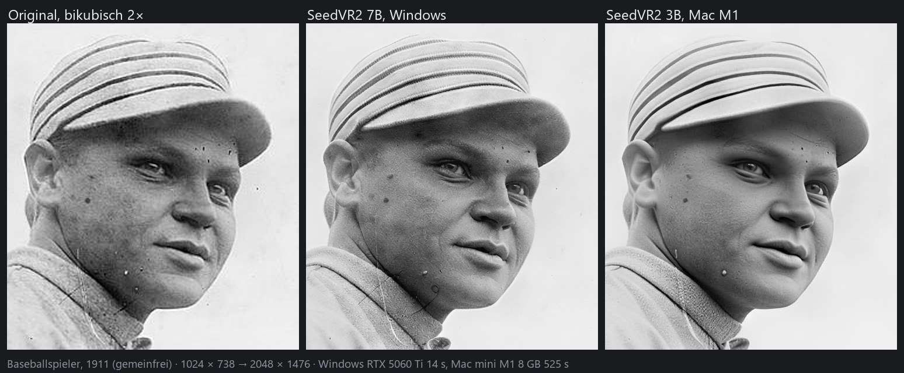

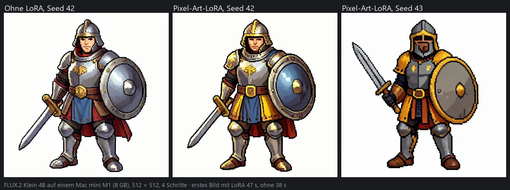

### Neu in 0.5.11

**MOSS-Image** (`moss-image-sft-int8`, OpenMOSS) ist das vierte empfohlene Bildmodell: Schrift und Layout im Bild unter Apache-2.0, also ohne Umsatzgrenze und Prüfpflicht verkaufbar. Knappe Prompts baut es mit seinem eigenen Text-Encoder (Qwen3.5-9B) zur vollen Beschreibung aus, die danach unter `caption` steht (`upsample_prompt=False` schaltet das ab); ein JSON mit „summary“ und „items“ legt laut OpenMOSS das Layout fest. Vorgabe ist die Einstellung von OpenMOSS mit 50 Schritten und cfg 3. Gemessen mit gleichen Prompts und Seeds: 51 s je Bild mit 1 MP, beim ersten Mal rund 11 s für den Ausbau dazu; mit den 25 Schritten aus ComfyUIs Vorlage 28 s. Die Schrift kam in allen Bildern buchstabengenau, der Soldat stand mit beiden Stiefeln im Bild, der Fischer behielt den Kopf im Bild. Die Seilgriffe der Kiste liefen mit 50 Schritten in drei von drei Bildern durch Bohrungen, mit 25 Schritten in zwei von drei. Nur Text zu Bild (keine Referenzbilder, keine Maske), auf dem Mac nicht verfügbar.

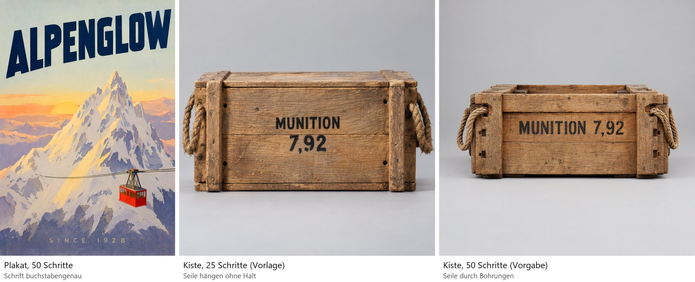

**Alte Fotos restaurieren und einfärben** (`POST /api/image/restore`, MCP `restore_image`, Reiter „Restaurieren“, PhotoCraft-Add-on 0.4.6). Drei Schritte, jeder abwählbar:

| Schritt | Was passiert | Gemessen (RTX 5060 Ti) |
|---|---|---|
| Schäden entfernen | FLUX 3 entfernt Kratzer, Staub, Risse, Flecken und Emulsionsschäden; das Ergebnis wird am Foto ausgerichtet. **Automatisch** (Vorgabe) lässt den Upsampler von FLUX 3 das Foto vorher ansehen und fragt, ob es Wasserflecken oder Rissnetze zeigt: ja → Gründlich, nein → Schonend (bei 20 von 21 Testfotos wie erwartet, rund 2,5 s). **Gründlich** nimmt das ganze Bild von FLUX: Craquelé, feine Kratzer, Wasserflecken und Ausbleichen verschwinden, Gesichter können je Variante leicht abweichen. **Schonend** setzt nur die erkannten Schäden ins Foto und behält Schärfe, Feinzeichnung und Gesichter in voller Auflösung (ein Porträt von 1911 behielt sein Gesicht, obwohl FLUX es in einer von zwei Varianten verändert hatte). Gewählt wird nach der Art des Schadens: flächige Alterung (Wasserflecken, Craquelé, Korn, Ausbleichen) → Gründlich; einzelne Schäden auf einem sonst guten Foto (Staub, Kratzer, Risse, Lichteinfall) → Schonend, das bei echten Glasplatten und einem Foto von 1945 mit Lichteinfall die Schärfe hielt, wo Gründlich weicher wurde. Ähnlichkeit zur unbeschädigten Vorlage an Testfotos (Helligkeit, Viertelgröße, 1 = gleich): stark beschädigt unbearbeitet 0,601, schonend 0,648, gründlich 0,689; leicht beschädigt 0,921, 0,932 und 0,911, dort lag schonend am nächsten, gründlich zeichnete Gesichter in einem Gruppenfoto anders | 2 Varianten: 70 s bei einem Foto bis 1 MP, 150 s bei 2 MP Arbeitsgröße; ein 3,5-MP-Foto mit Einfärben 4,6 min |
| Einfärben | FLUX 3 färbt ein, übernommen wird nur die Farbe; Helligkeit, Detail und Gesichter bleiben die des Fotos. FLUX allein lag in der Helligkeit 5,4 L daneben, die Übertragung rund 1 | rund 40 s je Variante |
| Farbhinweise | Bekannte Farben unter „Hinweise“ („her dress is red with white dots …“) | Farbabweichung ΔE 17,5 → 10,4 (−40 %) bei einem Foto mit bekannten Farben |
| Schärfen | SeedVR2 7B (ByteDance, Apache-2.0, neue Modellart „Hochskalieren“) schärft, nimmt grobes Korn heraus (feines Rauschen in ruhigen Flächen blieb im Test) und vergrößert bis 4× (höchstens 16 MP) | 1024 → 2048 in 6 s, 1200 × 864 → 3840 × 2770 in 18,5 s |

Die Arbeitsgröße fürs Schäden-Entfernen ist 2 MP (höchstens die Fotogröße): Bei 1 MP bekam ein Soldat in einem Gruppenfoto ein anderes Gesicht. Grenzen: Kleine Zeichen, die FLUX weglässt (ein Bindestrich in einer Beschriftung), verschwinden in beiden Arten, Schrift also prüfen; Filmkorn bleibt bei gründlich zum Teil; an gleich hellen Kanten kann Farbe überlaufen; SeedVR2 erfindet bei starker Vergrößerung Feindetail. Was FLUX 3 berechnet, fällt unter die FLUX Kommunity License.

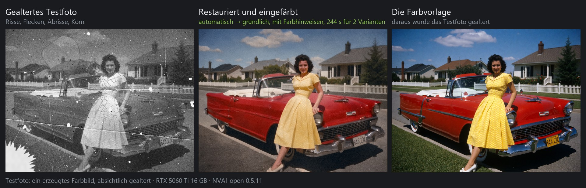

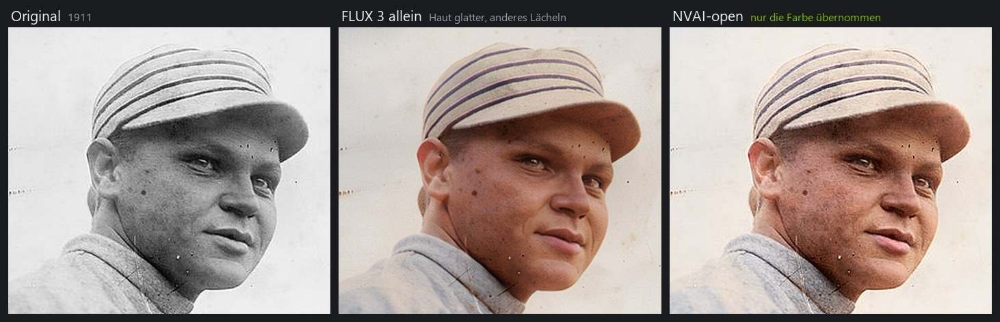

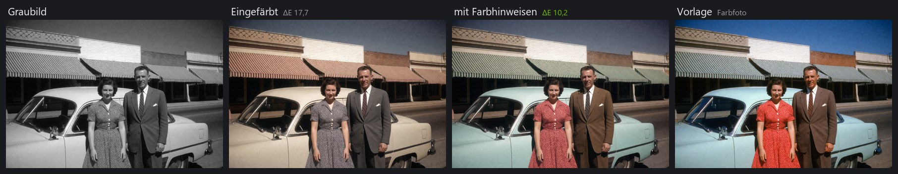

### Neu in 0.5.10

| Was | Gemessen |
|---|---|
| Krea 2 mit Stilvorlage | Mit der Stil-LoRA von ostris (0,46 GB, Krea-2-Lizenz) nimmt Krea 2 ein oder zwei Bilder als Stilvorlage: Malweise, Farben und Licht kommen aus dem Bild, der Inhalt aus dem Prompt. Ein Leuchtturm mit einer Aquarell- bzw. Holzschnitt-Vorlage kam deutlich in deren Stil, in 41–48 statt 24 s. Mit beiden Vorlagen 71 s, dabei setzte sich die erste fast ganz durch. Siehe Abschnitt 6 |
| Vorderseite aus dem Bild (3D) | „Vorderseite aus dem Bild übernehmen“ legt das freigestellte Quellbild auf die Flächen des Meshes, die zur Kamera zeigen, damit Schrift und Aufkleber lesbar bleiben. TripoSG baut gemalte Buchstaben nur als schwaches, verzerrtes Relief; mit der Projektion war „HAFEN“ auf einem Wegweiser lesbar. Die Projektion selbst dauert unter einer Sekunde (das ganze Mesh 66 s). Die Richtung ergibt sich aus der Silhouette (vorn +Z, Deckung 0,93 gegen 0,68 für hinten). Lose Reste der Freistellung wie Bodenflecken fallen vorher weg; passt keine Richtung klar, gilt +Z, die Ansicht, aus der TripoSG das Bild baut. Der Rest eines TripoSG-Meshes bekommt Farben aus dem Bild, ein TRELLIS.2-Mesh behält dort seine eigene Textur (noch nicht getestet, TRELLIS.2 ist hier nicht installiert). `project_front` in `image_to_3d` und `text_to_3d` |
| Video verlängern | LTX-2.5 setzt ein vorhandenes Video fort: Sein letzter Frame wird Startbild, Format und Bildrate kommen vom Video, das neue Stück wird samt Ton angehängt. 5 s + 4 s bei 1920 × 1088 ergaben ein Video von 9,0 s (217 Frames) in 255 s, ohne sichtbare Naht. `extend_asset_id` in `generate_video` |
| „lädt nach“ statt „zu groß“ | Modelle, die größer als der Grafikspeicher sind, laufen trotzdem: ComfyUI lädt bei jedem Schritt Teile aus dem Arbeitsspeicher nach. An einem normalen Anschluss kostete das wenig (Krea 2 INT8 ohne FP4: 13,0 s mit 8 GB, 12,2 s mit 16 GB), deshalb markiert die Modellliste sie nicht mehr rot als „zu groß für diese Karte“ |
| „Zusätze laden“ | Optionale Dateien eines installierten Modells (Kreas Stil-LoRA, das Detail-LoRA von LTX-2.5 für DFR …) haben unter „Modelle“ einen eigenen Knopf; vorher musste man das Modell erneut laden |

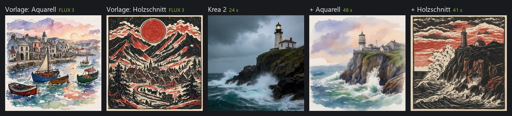

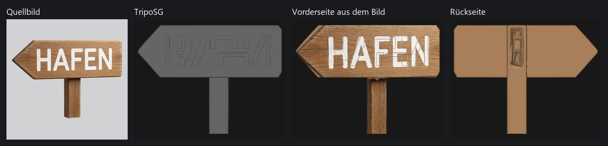

**Welches Format für welche Karte.** NVFP4 rechnet nur auf RTX 50 in Hardware, RTX 20/30/40 rechnen
INT8. In 0.5.9 war Krea 2 NVFP4 auf einer RTX 4060 mit 8 GB schneller als INT8, weil nur die
NVFP4-Fassung in 8 GB passt. Diese Karte hängt aber am Riser (PCIe 3.0 x4, 3,9 GB/s). Um zu sehen, ob das
auch an einem normalen Anschluss gilt, lief die RTX 5060 Ti (PCIe 4.0 x8, 15,8 GB/s) ohne ihre
FP4-Einheiten, ComfyUI nahm also denselben Weg wie auf einer RTX 40, einmal mit ihren 16 GB und einmal
mit 8 GB (den Rest hielt ComfyUI per `--reserve-vram` zurück). Die absoluten Zeiten sind die der 5060 Ti,
es zählt der Vergleich. Erstes Bild mit Laden / nächstes Bild, 1024 × 1024:

| Karte | Krea 2 NVFP4 | Krea 2 INT8 | Qwen-Image-2512 NVFP4 | Qwen-Image-2512 INT8 |
|---|---|---|---|---|
| ohne FP4, 16 GB, PCIe 4.0 x8 | 29,8 / 25,0 s | 17,5 / 12,2 s | 226,9 / 214,0 s | 127,2 / 118,6 s |
| ohne FP4, 8 GB, PCIe 4.0 x8 | 28,5 / 25,1 s | 17,1 / 13,0 s | 237,9 s | 158,9 s |
| RTX 4060, 8 GB, PCIe 3.0 x4 (Riser) | 46 s | 193 / 82 s | 1095 s | 653 s |

INT8 war auch dort schneller, wo es nicht in den Grafikspeicher passte (Krea 2 INT8 hat 13,5 GB). Nur am
langsamen Riser lag NVFP4 vorn, und nur dort, wo es passte und INT8 nicht. NVAI-open empfiehlt deshalb auf
RTX 20/30/40 INT8 und NVFP4 nur an einem Anschluss bis 4 GB/s, wenn nur die NVFP4-Fassung passt
(`recommended` und `gpu_note` in `list_models`; mit mehreren Karten zeigt „Modelle → Grafikkarten“ den
Anschluss jeder Karte).

### Neu in 0.5.9

Videoqualität, gemessen auf einer RTX 5060 Ti mit LTX-2.5 (1920 × 1088, wo nicht anders angegeben):

| Was | Gemessen |
|---|---|
| Höchste Qualität (DFR) | Vorgabe, sobald das Detail-LoRA von Lightricks installiert ist (Lizenz auf Hugging Face akzeptieren). ComfyUIs Vorlage setzt das Startbild auf ein Viertel verkleinert ein, bei 1080p wurde dadurch das ganze Video weich; NVAI-open nimmt jetzt das Vollbild. Gleicher Seed: Gesicht und Stoffe bleiben über die ganze Länge scharf (Kantenschärfe des Gesichts nach 2 s: 625 statt 211), dafür rund dreimal so lang (5 s: 786 statt 241 s). Nicht mit Endbild oder Schleife |
| Cinemagraph-LoRA | Wirkt nur zusammen mit „Schleife“, die die Oberfläche jetzt mit einschaltet. König vor flackernden Fackeln, 4 s bei 1280 × 704: mit Schleife bewegten sich 6 % des Bildes, das Gesicht stand still; Schleife ohne LoRA 28 %; ohne Schleife 82–84 % (auch mit Stärke 1,2), weil die Kamera heranfuhr |
| Zeitlupen-LoRA | Getestet mit Lightricks' Einstellungen (Welle an Felsen, 1920 × 1088, 5 s, Zeitlupe 0,2): Die Gischt sank über die ganzen 5 s statt in rund 1,5 s in Echtzeit, die Tropfen blieben scharf. Ohne LoRA stand die Gischt als milchiger Schleier fast still. Mit 1280 × 704 und 0,25 war die Wirkung schwächer |
| 48 fps | DFR mit `temporal_upscale` hält die Schärfe von 24 fps (gerade und ungerade Frames gleich), 294 statt 118 s für 4 s bei 1280 × 704 |
| 1080p zuerst | Die Formatliste beginnt mit 1920 × 1088 und sagt dazu, dass es rund 2,7-mal so lange dauert (5 s in 251 s statt 93 s bei 1280 × 704) |
| Höhere Bitrate | MP4s werden mit CRF 12 statt ComfyUIs 18 gespeichert: bei gleichem Seed 16,0 statt 7,3 Mbit/s, 10 statt 4,5 MB für 5 s. Feine Details ändern sich kaum, das Weiche kommt vom Modell. `crf` je Auftrag |
| Gesicht nach dem Herauszoomen | Ein Endbild von FLUX 3 (mit denselben Referenzen) hält das Gesicht. Ohne war das Gesicht des Königs im letzten Frame (rund 80 px breit) weich und verzerrt, mit Endbild trifft der letzte Frame das Endbild. 7 s dauerten 648 statt 509 s |
| Weiteres Endbild | Auf „wider shot“ hielt FLUX 3 den Ausschnitt. Outpainting des Endbilds (`outpaint=[320, 184, 320, 184]`, 1920 × 1088 → 2560 × 1456) ergibt einen Zoom: Die Person endet bei 75 % der Größe |

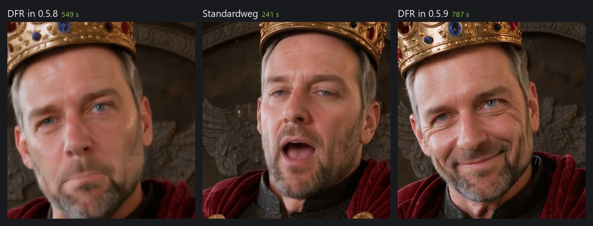

Prompt-Fallen aus einer Szene mit sprechender Person und Menge: „shouts“ ergibt Grimassen („says
firmly in a rough, deep voice“ ist ruhiger). Eine Geste, die „aus dem Bild steigen darf“, lässt die
Kamera ihr folgen. „The camera holds a medium close-up“ wurde zum Heranfahren bis in die extreme
Nahaufnahme; „Static camera, a locked-off medium shot; the framing stays exactly as in the first
frame.“ hielt den Ausschnitt. „Proud, calm expression“ wurde zum Grinsen, „stern, determined
expression and does not smile“ nicht. Dünne Gegenstände wie Gewehre und Fahnenstangen, die im
Startbild Personen kreuzen, verschmelzen im Video. Im Startbild auseinanderhalten und nicht alle
zugleich bewegen.

**Krea 2 Turbo** (`krea2-turbo-nvfp4`) ist das dritte empfohlene Bildmodell: am fotografischsten der drei, rund 20 s je Bild, Lizenz nur unter 1 Mio. US-$ Umsatz. Vergleich und Prompt-Tipps in Abschnitt 6.

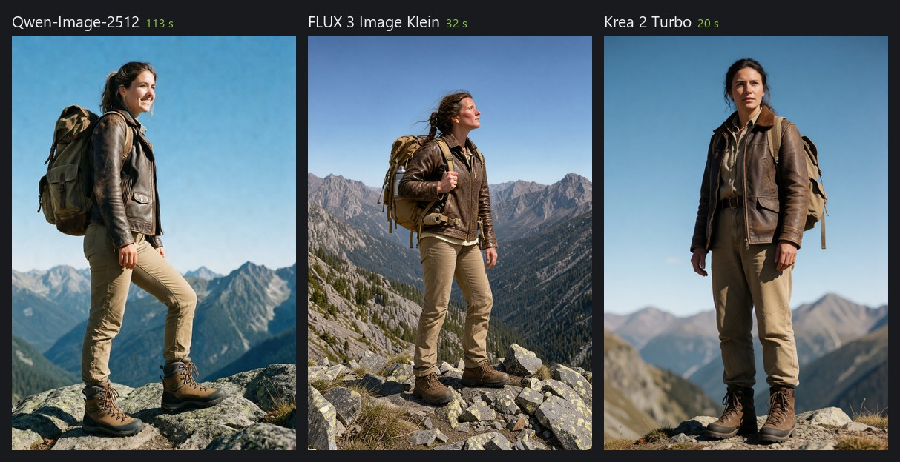

Qwen-Image-2512 gibt es jetzt auch in INT8 für RTX 20/30/40 (`qwen-image-2512-int8`, siehe Abschnitt
4): auf einer RTX 4060 mit 8 GB 653 statt 1095 s mit NVFP4. Krea 2 war auf derselben Karte mit NVFP4
schneller (46 statt 82 s): Nur die NVFP4-Fassung passt in ihre 8 GB, und die Karte hängt an einem
langsamen Riser-Anschluss. An einem normalen Anschluss ist INT8 schneller (siehe Neu in 0.5.10). Im Verlauf zeigt ein Klick auf den Prompt ihn vollständig.

### Neu in 0.5.8

LTX-2.5 (`ltx25-distilled-nvfp4`) ist jetzt das empfohlene Videomodell, mit allen seinen Wegen.
Gemessen auf einer RTX 5060 Ti bei 24 fps mit Ton; der Grafikspeicher ist dabei fast voll, ComfyUI
lagert aus.

| Weg | Parameter | Gemessen |
|---|---|---|
| Text zu Video | — | 5 s bei 1280 × 704 in 93 s (erster Lauf mit Laden 122 s); 1920 × 1088 in 251 s |
| Startbild | `image_asset_id` | 5 s bei 1280 × 704 in 109 s |
| Start- und Endbild | `end_image_asset_id` | 5 s in 154 s; erster und letzter Frame treffen die beiden Bilder |
| Schleife | `loop=True` | 4 s in 125 s; erster und letzter Frame weichen im Mittel um 3,6/255 ab (ohne Schleife 12–44). Nur mit ruhiger Kamera: Mit Kamerafahrt zerfielen die letzten Frames |
| Länge automatisch | `auto_duration=True` | eine Tür, die langsam aufgeht: 3 s, in 72 s |
| Ton vorgeben | `audio_asset_id` | 20 s Blasmusik → 19,7 s Video bei 1024 × 576 in 302 s, der Ton unverändert |
| Mehrere Einstellungen | `expand_prompt(target="video_multishot")` | 8 s in 170 s: zwei Einstellungen mit sauberem Schnitt, in beiden derselbe Leuchtturmwärter |
| DFR, Zeitlupe | `quality="dfr"`, `motion_speed` | noch nicht getestet: Sie brauchen LoRAs von Lightricks, deren Lizenz auf Hugging Face akzeptiert werden muss |

Geräusche so laut beschreiben, wie sie sein sollen: Sprache und Schmiede kamen mit −14 bis −18 LUFS,
ein Lagerfeuer, das „crackles softly“, und ein stiller Dorfplatz mit −41 bis −52 LUFS, mit oder ohne
Schleife. Der erzeugte Ton läuft jetzt durch denselben Limiter wie alle Audioausgaben, bei Video mit
−2,5 dBFS, weil AAC bei dichtem Ton bis 1,9 dB überschwingt; vorher erreichte er bis +1,7 dBTP. Neu im
Video-Reiter: „Person aus einem Foto“ lässt FLUX 3 das Gesicht aus einem Foto übernehmen und vier
Startbilder in einer beschriebenen Rolle erzeugen (95–98 s bei 1280 × 704), die LTX-2.5 dann belebt;
Schritt für Schritt in [FOTO_ZU_VIDEO.md](FOTO_ZU_VIDEO.md). Empfohlene LoRAs für LTX-2.5 und wie sie abschnitten:
[INSTALL.md](INSTALL.md#loras-hugging-face-und-civitai).

### Neu in 0.5.7

| Modell | Wofür | Gemessen (RTX 5060 Ti) | Lizenz |
|---|---|---|---|
| Stable Audio 3 Medium (`stable-audio-3-medium`) | instrumentale Musik, kein Gesang (Chor nur wortlos); in NVAI-open bis 5 Minuten | 60 s in 9–12 s (bis 9,7 GB Grafikspeicher), 300 s in 64 s (16-GB-Karte fast voll) | Stability AI Community (unter 1 Mio. US-$ Umsatz) |

Den Prompt für Stable Audio 3 als einen Satz schreiben: Gattung mit Hauptinstrumenten, Schichten
und Schlagwerk, die Stimmung, dann „BPM: 100.“. NVAI-open hängt „Length: N seconds“ passend zur Dauer
an. „✨ Prompt ausbauen“ schreibt diese Form (`target="music_sa3"`).

ACE-Step 1.5 Turbo läuft jetzt wie ComfyUIs Vorlage (8 Schritte, CFG 1, shift 3). Vorher nahm NVAI-open
12 Schritte und CFG 2 ohne shift, das klang hart und gepresst. Die Lizenz ist MIT (im Katalog stand
Apache-2.0).

Jede Audioausgabe läuft jetzt vor dem Speichern durch NVAI-opens eigenen Limiter (Grenze −1 dBFS, 5 ms
Vorlauf, 80 ms Rücklauf); ACE-Step wird vorher um 3 dB abgesenkt. Seine rohe Ausgabe hat Spitzen bis
+5,7 dBFS, und der MP3-Encoder schnitt alles über 0 dB hart ab. Gemessen mit gleichem Seed, True Peak
der MP3: Industrial +2,3 → 0,0 dBTP, Blaskapelle +2,0 → +0,2 dBTP (nur mit den 3 dB: +1,3 und +0,9).
Was über −1 dB bleibt, ist MP3-Überschwingen.

### Neu in 0.5.3

| Modell | Wofür | Gemessen (RTX 5060 Ti) | Lizenz |
|---|---|---|---|
| LTX-2.3 (`ltx23-nvfp4`) | Video mit Ton; Basis der meisten Community-LoRAs für LTX | 4 s in 1280 × 704 in 101 s, Bild zu Video 448 × 832 in 65 s | LTX-2 Community (unter 10 Mio. US-$ Umsatz) |
| Mochi 1 preview (`mochi-1-preview-fp8`) | Text zu Video mit flüssiger Bewegung | 49 Frames in 848 × 480 in 351 s | Apache-2.0 |
| Kandinsky 5.0 Video Lite, destilliert (`kandinsky5-lite-t2v-distilled`) | kleines MIT-Videomodell, 5 s | 768 × 512 in rund 300 s | MIT, VAE unter Tencent-Lizenz |
| Kandinsky 5.0 Video Lite T2V / I2V | dasselbe mit 50 Schritten; I2V nur im Querformat 768 × 512 | rund 26–27 Minuten | MIT, VAE unter Tencent-Lizenz |

LoRAs (ebenfalls neu in 0.5.3) laufen mit SDXL, SD 1.5, Qwen-Image, Z-Image, FLUX.1/Chroma, Wan und
LTX-2/2.3, siehe [INSTALL.md](INSTALL.md#loras-hugging-face-und-civitai). Gemessen: Eine Pixel-Art-LoRA
an Qwen-Image-2512 änderte bei gleichem Seed deutlich den Stil (168 statt 102 s); ein Orbit-LoRA-Paar
an Wan 2.2 I2V A14B machte aus einer leichten Drehung eine ganze Kamerafahrt um die Figur.

### Neu in 0.5.2

| Modell | Wofür | Gemessen (RTX 5060 Ti) | Lizenz |
|---|---|---|---|
| Boogu-Image 0.1 Turbo (`boogu-image-turbo-nvfp4`) | schnelle Entwürfe, 4 Schritte | 832 × 1216 in ~10 s | Apache-2.0 |
| Boogu-Image 0.1 Base (`boogu-image-nvfp4`) | volle Qualität, Negativprompt wirkt | 832 × 1216 in ~66 s | Apache-2.0 |
| Boogu-Image 0.1 Edit (`boogu-image-edit-nvfp4`) | Bild nach Anweisung ändern; im Test änderte sich nur der Hut | ~147 s | Apache-2.0 |
| HiDream-O1-Image Dev (`hidream-o1-dev-fp8`) | große Bilder, auf ~4 MP trainiert | 1728 × 2304 in ~41 s | MIT |
| HiDream-O1-Image (`hidream-o1-fp8`) | dasselbe mit 40 Schritten und Negativprompt | ~142 s | MIT |
| LTX-2.5 (`ltx25-distilled-nvfp4`) | Video mit Ton, aus Text oder Startbild | 4 s in 1280 × 704 in ~72 s | LTX-2 Community (unter 10 Mio. US-$ Umsatz) |

### Zensiert oder unzensiert

Jedes Bild- und Videomodell in der Liste trägt ein Abzeichen: *unzensiert*, *teilweise
zensiert*, *zensiert* oder *Zensur unbekannt*. Der Tooltip nennt Beleg und Quelle (Modellkarte,
technischer Bericht). NVAI-open selbst filtert nichts. Dieselbe Angabe steht in `GET /api/models`
(`content`, `content_note`, `content_source`).

| Abzeichen | Modelle (Stand Oktober 2026) |
|---|---|
| unzensiert | Chroma1-HD, Pony Diffusion V6 XL, NoobAI-XL, Illustrious XL |
| teilweise zensiert | SDXL, Z-Image, Wan 2.1 / 2.2 |
| zensiert | Qwen-Image-2512, FLUX 3 Image Klein, Krea 2, FLUX.1 schnell |
| Zensur unbekannt | Juggernaut XL, Qwen-Image 2.1, LongCat-Image, LTX-Video |

In 0.5.2 aus dem Katalog genommen (installierte Dateien bleiben): SD 3.5 Medium/Large,
FLUX.1 dev, Chroma v37 (stattdessen Chroma1-HD), HunyuanVideo 1.5 (Lizenz schließt die EU aus;
stattdessen Wan 2.2).

## 3. Zugriff aus einem anderen Projekt

### Voraussetzung

Der NVAI-open-Server muss laufen. Er lauscht auf `http://127.0.0.1:8100`. Beim Windows-Setup
startet ihn der Startmenü-Eintrag **NVAI-open**, im Quelltext-Stand:

```powershell
scripts\start.ps1     # meldet sich, falls er schon läuft
```

Das GPU-Backend (ComfyUI) startet beim ersten Job selbst. Das kostet einmalig rund 30 s und
ist kein Fehler. `health` zeigt, ob alles läuft und welches Modell aktiv ist.

### Per MCP (Claude Code)

Den MCP-Server `nvai` einmal **auf Benutzerebene** registrieren. Dann steht er in jedem
Claude-Code-Projekt bereit, ohne weitere Einrichtung:

```
claude mcp add --scope user nvai -- "<Installationsordner>\server\.venv\Scripts\python.exe" -m nvai.mcp_server
```

Beim Windows-Setup zusätzlich den Datenordner mitgeben (`-e "NVAI_DATA_DIR=<Datenordner>"`),
siehe [CLAUDE_CODE.md](../CLAUDE_CODE.md) (englisch).

Die wichtigsten Werkzeuge:

| Werkzeug | Zweck |
|---|---|
| `health` | immer zuerst: Backend, aktive Modelle, Warteschlange |
| `list_models(kind="image", detailed=True)` | Modelle mit `features` (Abschnitt 8), Pro und Contra, Lizenz |
| `generate_image(...)` | erzeugt Bilder und blockiert bis fertig. Gibt `files`, `asset_ids`, `seed` zurück, bei FLUX 3 auch `caption` |
| `list_assets(kind="image")` | letzte Bilder mit Asset-ID und Pfad |
| `copy_asset(asset_id, ziel)` | Bild in das eigene Projekt kopieren |

Nach einem Update von NVAI-open sieht eine laufende Sitzung die neuen Werkzeugbeschreibungen erst
nach `/mcp` und Neuverbinden.

### Per REST

| Methode und Pfad | Zweck |
|---|---|
| `GET /api/health` | Status |
| `GET /api/version` | Programm-, ComfyUI- und Vertragsversion (`api`), unterstützte Erweiterungen (`features`: `mask`, `references`, `upsampler` …). Vor der ersten Nutzung prüfen |
| `GET /api/models?kind=image` | Modelle mit `features`, dazu `recommended` und `gpu_note` für die erkannte Karte |
| `GET /api/models/search?q=…` | weitere Modelle auf Hugging Face (Repos mit Checkpoint-Dateien) |
| `GET /api/models/inspect?repo=…&file=…` | prüft eine Datei vor dem Laden: Architektur aus dem safetensors-Kopf, Größe. Laden lassen sich SDXL- und SD-1.5-Checkpoints |
| `POST /api/generate/image` | Job anlegen (JSON, Felder wie in Abschnitt 7). Antwort: Job mit `id` |
| `GET /api/jobs/{id}` | `status` (`queued`, `running`, `done`, `error`), `progress` 0–1, `stage` |
| `GET /api/jobs/{id}/assets` | erzeugte Bilder: `id`, `filename`, `url`, `meta` (Seed, Einstellungen, bei FLUX 3 `caption`) |
| `POST /api/upload` | eigenes Bild hochladen (multipart, Feld `file`). Die Antwort-`id` taugt als Referenzbild |
| `GET /files/{filename}` | Bilddatei |

Die Dateien liegen direkt unter `<Datenordner>\assets\<filename>`: im Quelltext-Stand unter
`data\assets`, beim Setup mit dem voreingestellten Datenordner unter
`%LOCALAPPDATA%\NV-AI\assets`.

Von einem anderen Gerät aus (Server mit `scripts\start.ps1 -Lan` gestartet) gibt es diesen
Ordner nicht. Bilder dann über `GET /files/{filename}` laden. Jede Anfrage braucht den Header
`X-NVAI-Token`, auch die nach `/files`; ohne gültigen Token antwortet der Server mit 401.
`/api/version` geht ohne Token und zeigt unter `authorized`, ob der mitgeschickte gilt. Die
REST-API ist in `server/openapi.json` festgehalten (Vertragsversion `api`).

```python
import json, time, urllib.request

API = "http://127.0.0.1:8100"

def call(method, path, body=None):
    req = urllib.request.Request(API + path, method=method,
                                 data=json.dumps(body).encode() if body is not None else None,
                                 headers={"Content-Type": "application/json"})
    with urllib.request.urlopen(req, timeout=60) as r:
        return json.loads(r.read())

job = call("POST", "/api/generate/image", {
    "model_id": "qwen-image-2512-nvfp4",
    "prompt": "Studio product photograph of a weathered wooden ammunition crate. ...",
    "width": 1024, "height": 1024, "seed": 42,
})
while (j := call("GET", f"/api/jobs/{job['id']}"))["status"] not in ("done", "error"):
    time.sleep(2)
for asset in call("GET", f"/api/jobs/{job['id']}/assets"):
    print(asset["id"], r"<Datenordner>\assets" + "\\" + asset["filename"])
```

Der Server arbeitet GPU-Jobs nacheinander ab. Steht ein Job auf `queued`, rechnet gerade ein
anderer.

## 4. Qwen-Image-2512 (`qwen-image-2512-nvfp4`)

### Eckdaten

- 20 Mrd. Parameter (MMDiT). In bf16 wären das 41 GB. Die hier genutzte NVFP4-Quantisierung
  (`Hippotes/Qwen-Image-2512-quants`, Fassung v2) wiegt 14,9 GB, und RTX-50-Karten rechnen
  dieses Format in Hardware.
- Text-Encoder Qwen2.5-VL-7B (fp8, 9,4 GB), VAE von Qwen. Download insgesamt 24,5 GB.
- 50 Schritte, CFG 4,0, Sampler `euler`, Scheduler `simple`, Shift 3,1. Die Werte stammen aus
  ComfyUIs Vorlage und Qwens Modellkarte.
- Lizenz Apache-2.0: kommerziell ohne Einschränkung.

### Was es kann

- **Schrift im Bild buchstabengenau.** Kistenaufschrift und Schilder kommen so, wie sie im
  Prompt in Anführungszeichen stehen.
- **Konstruktion.** Im Test liefen die Seilgriffe einer Munitionskiste durch Bohrungen und
  unter die Leisten. Die destillierte Lightning-Fassung legte sie beim selben Seed ohne Halt
  aufs Holz.
- **Lange Prompts.** Der Encoder ist ein Sprachmodell, es gibt keine 77-Token-Grenze wie bei
  CLIP.
- **Negativprompt wirkt** (CFG 4). Bleibt er leer, setzt NVAI-open den aus Qwens Modellkarte ein:
  `低分辨率，低画质，肢体畸形，手指畸形，画面过饱和，蜡像感，人脸无细节，过度光滑，画面具有AI感。构图混乱。文字模糊，扭曲。`
  Er steht für niedrige Auflösung, deformierte Glieder und Finger, Übersättigung, Wachsoptik,
  KI-Look, wirre Komposition und verzerrte Schrift.
- **Bild als Ausgangspunkt** (`image_asset_id` + `denoise`): Ein fast richtiges Bild wird
  nachgebessert statt neu gewürfelt.
- **Inpainting** (`image_asset_id` + `mask_asset_id` + `denoise=1.0`): Nur der weiße Bereich
  der Maske wird neu gerechnet, schwarz bleibt, Graustufen gehen weich über. Gemessen: Die
  Aufschrift „MUNITION 7,92" einer Kiste wurde in der Maske zu „FLAK 88" in derselben
  Schablonenschrift. Außerhalb der Maske wich das Bild im Mittel um 0,6 von 255 ab, also nur um
  das Rauschen des VAE-Durchlaufs. Mit 28 Schritten dauerte das 82 s einschließlich Kaltstart.
  Seit 0.5.6 füllt auch **FLUX 3** (`features.mask` = `"reference"`): NVAI-open schneidet den Bereich
  mit 35 % Umgebung aus, färbt ihn grau, lässt FLUX 3 nach dem Prompt malen, misst den Versatz und
  setzt nur den Bereich zurück, außerhalb pixelgleich. Gemessen an einem Fischmarkt: Kisten entfernt
  mit durchlaufendem Pflaster, Möwe aufs Wasser gesetzt, je rund 60–70 s. Etwas Vorhandenes
  umschreiben (Schrift auf einem Schild) geht besser als Bearbeitung mit Referenzbild: grau gefüllt
  malte FLUX ein neues, frontales Schild, als Bearbeitung behielt es Lage und Neigung.
  Für neue Objekte das volle Modell nehmen. Lightning setzt laut Test meist nur die Umgebung
  fort, was zum Wegretuschieren genügt.
- **Outpainting** (seit 0.5.4, `image_asset_id` + `outpaint=[links, oben, rechts, unten]` in Pixeln):
  Das Bild wird über den Rand hinaus erweitert, das Format ist Bild plus Rand. **FLUX 3 nehmen:** Es
  bekommt das Bild mit grauem Rand als Referenz und führt die Szene weiter, danach legt NVAI-open das
  Original zurück. FLUX 3 gibt das Bild nie genau an derselben Stelle wieder (je Achse Faktor 0,97–1,055 und bis 43 px
  Versatz, bei Rand auf allen Seiten zoomte es 25–42 % hinein). Deshalb erweitert NVAI-open Achse für Achse,
  misst nach jedem Durchgang den Versatz, rückt das Ergebnis zurück und setzt erst dann das Original
  ein. Gemessen an einer rundum erweiterten Löwenszene: zwei Varianten in 147 s, Nähte in voller
  Auflösung sauber. Qwen-Image-2512 erweitert per Maske, malte den Rand im
  Test aber als eigene Szene mit harter Kante (auch mit 128/256 px Übergang und 50 Schritten).
- **Zweiter Durchgang** (`hires=True`) für Hände, Gesichter und feine Technik.

### Formate

Die allgemeinen Formate um 1 Megapixel funktionieren. Qwen ist aber auf rund 1,76 MP
trainiert, und seine **nativen Formate** bringen sichtbar mehr Detail:

| Nativ | Seitenverhältnis | Wofür |
|---|---|---|
| 1328 × 1328 | 1:1 | Objekte, Icons |
| 1056 × 1584 | 2:3 | stehende Figuren |
| 1584 × 1056 | 3:2 | Fahrzeuge, Szenen |
| 1104 × 1472 / 1472 × 1104 | 3:4 / 4:3 | |
| 928 × 1664 / 1664 × 928 | 9:16 / 16:9 | Panorama |

Gemessen bei 1328² gegenüber 1024²: feinere Seildrehung und Holzmaserung, dafür die doppelte
Zeit.

### Laufzeiten (gemessen)

| Lauf | Zeit |
|---|---|
| 1024², 50 Schritte | ~100 s (1,84 s pro Schritt) |
| 1328² nativ, 50 Schritte | ~200 s (3,79 s pro Schritt) |
| Lightning, 1024², 8 Schritte | ~17 s, vier Bilder ~40 s (gemessen unter ComfyUI 0.30) |
| erster Job nach dem Start | zusätzlich 15–30 s Laden |

### Prompt schreiben

Ganze englische Sätze. Zuerst Medium und Stil, dann das Motiv mit Material, Farbe, Zustand
und Konstruktion, dann Licht und Hintergrund. Schrift wörtlich in Anführungszeichen.

```
Studio product photograph of a weathered wooden ammunition crate. Black stenciled letters on
the front read "MUNITION 7,92". Rope handles pass through drilled holes in the side boards.
Plain light grey background, soft even light.
```

- **Konstruktion ausdrücklich nennen.** Was nicht dasteht, wird erfunden.
- **Keine Gewichtungsklammern** wie `(full body:1.2)`. Das ist CLIP-Syntax und hier wirkungslos.
- **Herkunft von Personen benennen**, als Region plus Gesichtsmerkmale: *Central European
  soldiers with pale northern European features*.
- **Genau eine Ansicht** nennen („strict side view"), nicht zwei.

### Bekannte Grenzen

- Historische Fahrzeuge erfindet es: Aus „Kübelwagen" wurde im Test ein Willys Jeep.
- Mit Lightning (8 Schritte) gehen konstruktive Details verloren. Lightning eignet sich nur
  für Entwürfe.
- Encoder und Modell passen nicht gleichzeitig in 16 GB. Jeder neue Prompt lädt nach, das
  steckt in den gemessenen Zeiten schon drin.

### INT8-Fassung für RTX 20/30/40 (`qwen-image-2512-int8`)

Nur RTX-50-Karten rechnen NVFP4 in Hardware; eine RTX 4060 brauchte damit 1095 s pro Bild. Für ältere
Karten gibt es eine INT8-Fassung, quantisiert mit Comfy-Orgs eigenem Werkzeug comfy-quants (int8
tensorwise mit ConvRot, dieselbe Schichtauswahl wie die offiziellen Exporte). Sie lädt im normalen
ComfyUI ohne Zusatz-Node und rechnet auf jeder NVIDIA-Karte ab der RTX-20-Reihe in Hardware. Es ist ein
Community-Upload (LAXMAYDAY, eine bytegleiche Kopie bei wazimondo), 20,6 GB; Text-Encoder und VAE
teilt sie mit den NVFP4-Fassungen.

Gemessen auf einer RTX 5060 Ti (16 GB), 1024 × 1024, 50 Schritte: 119 s pro Bild, mit Laden 132 s
(NVFP4: 101 bzw. 108 s). Die Testkiste kam so gut wie mit NVFP4: Schrift buchstabengenau, Seilgriffe
durch Bohrungen. Mit 16 GB und weniger lädt ComfyUI Teile des Modells aus dem Arbeitsspeicher nach.
Auf einer RTX 4060 mit 8 GB (am Riser, PCIe 3.0 x4): 653 s samt Laden, die NVFP4-Fassung 1095 s;
keine der beiden passt in 8 GB, INT8 rechnet aber in Hardware. Schrift und Seilgriffe auch dort sauber.

## 5. FLUX 3 Image Klein (`flux3-klein-nvfp4`)

### Eckdaten

- Black Forest Labs, veröffentlicht am 15. Oktober 2026. 5,6 Mrd. Parameter im Bildmodell,
  offizielle NVFP4-Fassung von BFL (5,3 GB).
- Text-Encoder Qwen3-VL-4B (int8, 4,9 GB), Prompt-Upsampler Qwen3.5-9B (int8, 9,8 GB), VAE von
  FLUX.2. Download insgesamt 20,2 GB.
- Destilliert: 16 Schritte ohne Guidance (CFG 1). Laut BFL ist es dasselbe Modell, das hinter
  ihrer API läuft.
- Das Repo auf Hugging Face ist gated. Einmal die Lizenz akzeptieren, dann in der Weboberfläche
  unter **Modelle** einen Hugging-Face-Token eintragen oder im Quelltext-Stand
  `server\.venv\Scripts\hf.exe auth login` ausführen.

### Der Prompt-Upsampler

FLUX 3 ist auf lange Bildbeschreibungen trainiert, die sein eigener Upsampler schreibt. BFL
rät, das Modell nie ohne ihn zu benutzen. In NVAI-open läuft er deshalb automatisch vor jedem Bild:

1. Aus der Anfrage schreibt der Upsampler eine Beschreibung von 100 bis 350 Wörtern. Bei Formaten,
   die nicht quadratisch sind, erfährt er das Seitenverhältnis und komponiert dafür.
2. Das Bild entsteht aus dieser Beschreibung.
3. Die Beschreibung landet im Ergebnis unter **`caption`**, bei MCP direkt im Rückgabewert und
   bei REST in `meta.caption` des Assets.

Er dekodiert deterministisch: Derselbe Prompt ergibt immer dieselbe Beschreibung. NVAI-open
speichert sie zwischen, deshalb kostet ein neuer Seed mit demselben Prompt nur die Bildzeit.
Der Zwischenspeicher lebt im Serverprozess und ist nach einem Neustart leer.

`upsample_prompt=False` schaltet den Upsampler ab. Das lohnt nur, wenn der Prompt selbst schon
eine volle Beschreibung in diesem Stil ist. Ohne Upsampler wurde die Testkiste schlichter und
kleiner.

**Was das für den Prompt heißt:** Kurz und vollständig reicht. Der Upsampler füllt aber jede
Lücke selbst. Im Test hängte er Soldaten einen Mantel wie einen Umhang über den Rücken, gab ihnen
Schnürschuhe statt Marschstiefeln und ließ Seilgriffe lose über die Front einer Kiste hängen.
Alles, was stimmen muss, gehört deshalb in den Prompt, und der **Stil** gehört an den Anfang.
Ohne Stilangabe plant der Upsampler ein Foto.

Stimmt am Bild etwas nicht, zuerst `caption` lesen. Stand der Fehler schon dort, den Prompt
ergänzen, statt neu zu würfeln.

### Prompt ausbauen: der Upsampler für jedes Modell

Derselbe Upsampler arbeitet auch für die anderen Bildmodelle. In der Weboberfläche und im
PhotoCraft-Add-on schreibt der Knopf **✨ Prompt ausbauen** die volle Beschreibung ins
Prompt-Feld; man liest sie, streicht, was nicht stimmt, und generiert mit einem beliebigen Modell.
Per MCP heißt das `expand_prompt(prompt, width, height)`, per REST `POST /api/prompt/expand`.
Ein FLUX-3-Modell muss dafür geladen sein. Gemessen: 13–16 s, direkt nach dem Start rund 36 s.

NVAI-open für Mac (seit 0.4) und das PhotoCraft-Add-on auf dem Mac haben denselben Knopf und dieselbe
REST-Route. Dort schreibt der Text-Encoder Qwen3-4B von FLUX.2 Klein die Beschreibung, mit den
Anweisungen von Black Forest Labs für Text-zu-Bild-Prompts; kein zusätzlicher Download. Gemessen
auf einem Mac mini M1 mit 8 GB: 22–25 s, beim ersten Mal nach dem App-Start 35 s.

Mit nur „a medieval blacksmith“ malte Qwen-Image-2512 ein Kriegerporträt in Lederrüstung, mit dem
ausgebauten Text eine arbeitende Schmiede mit Esse, Amboss, Zange und Funken. Der Upsampler füllt
aber jede Lücke: Er setzte dem Schmied auch einen Eisenhelm auf. Den Text also erst lesen.

Seit 0.5.3 sitzt der Knopf auch in den Reitern **Video**, **Audio** und **3D** (Windows). Derselbe
Upsampler folgt dann NVAI-opens eigenen Anweisungen (`target` in der API): Bei Video ergänzt er
Bewegung, eine Kamerafahrt, Ort und Licht, bei LTX-2.5 auch das Hörbare, mit Startbild nur die
Bewegung. Für Stable Audio schreibt er Klang-Tags (Quelle, Material, Raum, Mikrofon), für Stable Audio 3
einen Satz mit Gattung, Instrumenten, Stimmung und BPM. Im 3D-Reiter erzeugt „Objekt aus Text“ zuerst mit dem
aktiven Bildmodell ein Quellbild: ein geschlossenes Objekt ohne Boden und Schatten. Gemessen auf
der RTX 5060 Ti: 3–12 s je Prompt. Das Modell ist auf Bildbeschreibungen trainiert; Klang-Tags
beginnen manchmal trotzdem mit einem ganzen Satz.

### Referenzbilder

`reference_asset_ids` nimmt bis zu zehn Asset-IDs: erzeugte Bilder oder eigene Uploads
(`POST /api/upload`). Im Prompt heißen sie in dieser Reihenfolge „the first image", „the second
image" usw.

**Bearbeiten** (ein Referenzbild): Der Prompt sagt, was sich ändert und was gleich bleibt.

```
generate_image(
  prompt="Replace the rope handles with forged iron handles bolted to the side boards; "
         "keep everything else unchanged.",
  model_id="flux3-klein-nvfp4",
  reference_asset_ids=["ast_b2e2b512098a"],
)
```

Im Test blieb die Vorlage bis auf die Griffe gleich: Bretter, Schablonenschrift und Leisten
waren unverändert, die neuen Griffe sind mit Platten verschraubt. Allerdings setzte das Modell
drei Griffe statt zwei, einen davon auf die Frontleiste.

**Kombinieren und Konsistenz** (mehrere Referenzen):

```
prompt="Put the soldier from the first image into the trench from the second image, "
       "same uniform and helmet, seen from the side."
```

Bekommt FLUX 3 nur ein `image_asset_id` und keine `reference_asset_ids`, wird das Bild zur
ersten Referenz; `denoise` gilt dann nicht.
Die Ausgabegröße bestimmen `width` und `height`, nicht die Referenz. Referenzen fließen mit rund
1 MP ein.

Laut BFL verankern Referenzen den Inhalt, legen aber die Form nicht fest. Eine Blaupause als
Referenz macht aus einem erfundenen Fahrzeug also kein maßstabsgetreues.

### Platzierung per Bounding-Box

Am Prompt-Ende eine JSON-Liste anhängen. Jede Box ist `[oben, links, unten, rechts]` auf einem
Raster von 0 bis 1000, mit dem Ursprung oben links:

```
Studio product photograph of three separate weathered wooden ammunition crates standing side
by side on a plain light grey background, soft even light.
[{"id": "crate_1", "bbox": [430, 30, 820, 320], "desc": "a small crate with a hinged lid"},
 {"id": "crate_2", "bbox": [250, 350, 820, 650], "desc": "a tall crate with rope handles"},
 {"id": "crate_3", "bbox": [560, 680, 820, 970], "desc": "a flat, wide crate"}]
```

Im Test standen alle drei Kisten genau an ihren Boxen. Damit lassen sich Anzahl und Anordnung
festlegen, was Diffusionsmodelle über den Text allein nicht zuverlässig schaffen.

- **Die ids nicht im Text als `<crate_1>` zitieren.** Das tut der Upsampler, die Boxen bleiben
  dabei fest. Zitiert der Text alle ids, gilt er als fertige Beschreibung und geht ohne
  Upsampler ans Modell. So macht es BFLs Referenzcode.
- Die Boxen lenken Lage und Größe, sind aber keine harte Maske. Ein Element kann über seine Box
  hinausragen, sehr kleine Elemente können fehlen.

### Formate

Seiten müssen Vielfache von 16 sein. Die allgemeinen 1-MP-Formate passen. Laut BFL rechnet
das Modell nativ bis 4K, die NVAI-open-API erlaubt bis 2048 × 2048. Gemessen hat 1440² mehr Detail
gebracht, zum Beispiel ein Seil, das durch eine Öse mit Metallring läuft, bei 26 statt 13 s.
Einen zweiten Durchgang (`hires`) gibt es bei FLUX 3 nicht. Wer mehr Detail will, wählt direkt
ein größeres Format.

### Laufzeiten (gemessen)

| Lauf | Zeit |
|---|---|
| neuer Prompt, 1024² | ~30 s (Upsampler 8–15 s, Bild ~12 s) |
| derselbe Prompt, neuer Seed | 13–16 s |
| vier Bilder in einem Lauf | ~37 s |
| 1440 × 1440 | ~26 s |
| Bearbeiten mit einem Referenzbild | ~45 s |
| Box-Layout (Upsampler im Layout-Modus) | ~36 s |

FLUX 3 und Qwen liefen im Test abwechselnd ohne Speicherfehler. ComfyUI belegte dabei bis
15,5 GB, weil es Modelle im Speicher hält, solange Platz ist.

### Befunde aus dem Test (11 Fälle, Bilder in voller Auflösung geprüft)

| Geprüft | Ergebnis |
|---|---|
| Schrift „MUNITION 7,92" | 3 von 3 fehlerfrei (BFL selbst warnt, Schrift könne ungenau sein) |
| Soldaten, Hochformat | 5 von 5 vollständig mit Füßen, Helmform passend. Erfunden wurden ein Mantel als Umhang und Schnürschuhe |
| Seilgriffe | 3 von 3 ohne sinnvolle Schlaufe, nur einmal (1440²) durch eine Öse |
| Bearbeiten | Vorlage bis auf die Griffe unverändert |
| Boxen | 3 von 3 Kisten am vorgegebenen Platz |
| Szene „Kübelwagen" | Ölgemälde, deutsche Helme passend. Statt des Kübelwagens kam ein kleiner Pritschenwagen |
| ohne Stilangabe | fotorealistisch |

### Base-Fassung (`flux3-klein-base-nvfp4`)

Diese Fassung ist undestilliert: 50 Schritte, CFG 3,5, und der Negativprompt wirkt. BFL bietet
sie vor allem für Feintuning und LoRA-Training an. Gemessen braucht sie 53 s pro Bild. Im Test
brachte sie keinen sichtbaren Gewinn gegenüber der destillierten Fassung.

### INT8-Fassung für RTX 20/30/40 (`flux3-klein-int8`)

NVFP4 rechnet nur auf RTX 50 in Hardware. Ältere Karten laden es zwar, entpacken es aber
Schicht für Schicht und sind deutlich langsamer. Für sie gibt es BFLs offizielle INT8-Fassung
(`flux3-image-klein-int8-convrot`, 5,8 GB). INT8 rechnet ab RTX 20 auf jeder NVIDIA-Karte in
Hardware. Wie in BFLs eigener INT8-Vorlage gehört der kleinere Upsampler dazu (w4a8, 6,7 statt
9,8 GB). Laut BFL läuft das auf 8-GB-Karten wie der RTX 3070, auf einer RTX 4070 in unter 9 s
pro Bild (16 Schritte, 1 MP). Von uns noch nicht gemessen. Prompts, Referenzbilder, Boxen und
Upsampler funktionieren wie bei NVFP4.

NVAI-open erkennt die Karte (`compute_cap` per nvidia-smi) und markiert in `list_models` passende
Modelle mit `recommended`: auf RTX 50 Qwen, FLUX 3 und LTX-2.5 in NVFP4, auf älteren Karten
Qwen-Image-2512, FLUX 3, Z-Image und LTX-2.5 in INT8. Ein Format, das auf der erkannten Karte nicht in Hardware rechnet, bekommt
einen Hinweis in `gpu_note`.

### Lizenz: FLUX Kommunity License v1.0

Das ist kein Rechtsrat; maßgeblich ist der Volltext im Repo (`LICENSE.md`).

- Kommerzielle Nutzung der Bilder ist nur für „Qualifying Users" erlaubt: Jahresumsatz zusammen
  mit verbundenen Unternehmen unter 5 Mio. US-$ (Abschnitte 1.e und 2.a).
- Bedingungen (Abschnitt 2.e): entweder einen Inhaltsfilter einsetzen **oder** jedes Bild vor der
  Veröffentlichung auf rechtswidrige und rechteverletzende Inhalte prüfen. Dazu eine
  KI-Kennzeichnung, soweit ein Gesetz sie verlangt.
- BFL kann die Lizenz jederzeit per Mitteilung kündigen (8.b).
- Bilder dürfen kein anderes Bildmodell trainieren (4.b).
- Keine EU-Sperre.
- Text-Encoder und Upsampler stehen unter Apache-2.0.

Bei jedem FLUX-3-Bild, das in ein verkauftes Produkt geht, auf diese Lizenz hinweisen. Ohne diese
Bedingungen: Qwen.

## 6. Krea 2 Turbo (`krea2-turbo-nvfp4`)

### Eckdaten

- Von Krea.ai, Juni 2026: ein Diffusion-Transformer mit 12 Mrd. Parametern, offen veröffentlicht als
  Raw (zum Feintunen) und Turbo (destilliert). NVAI-open nimmt Turbo mit den Werten aus ComfyUIs
  Vorlage `image_krea2_turbo_t2i.json`: 8 Schritte, CFG 1, Sampler `euler`, Scheduler `simple`.
- Text-Encoder Qwen3-VL-4B, bytegleich mit der Datei von FLUX 3; der VAE ist der von Qwen-Image,
  ebenfalls bytegleich (SHA-256 verglichen). Ist eines der beiden Modelle installiert, kommen nur noch
  die 7,7 GB von Krea selbst dazu, sonst 12,8 GB (dazu 0,46 GB für die optionale Stil-LoRA). Die Dateien stammen aus Comfy-Org/Krea-2, das anders
  als Kreas eigene Repos nicht gated ist.
- Ausgaben von 1 bis 2 MP (Herstellerangabe). Der Negativprompt wirkt nicht (CFG 1).
- Keine Maske, kein zweiter Durchgang (`hires`). Seit 0.5.10 ein oder zwei Bilder als Stilvorlage
  (optionale Stil-LoRA, siehe unten); zum Bearbeiten bleibt FLUX 3.
- Lizenz: Krea 2 Community License, siehe unten.

### Im Vergleich mit Qwen und FLUX 3 (gemessen)

Gleicher Prompt und Seed, RTX 5060 Ti, Bilder in voller Auflösung geprüft:

| Motiv | Qwen-Image-2512 | FLUX 3 | Krea 2 Turbo |
|---|---|---|---|
| Alter Fischer flickt ein Netz, 1024² (erstes Bild, mit Laden) | 160 s | 36 s | 41 s |
| Munitionskiste mit Aufschrift, 1024² | 109 s | 31 s | 21 s |
| Entdeckerin als ganze Figur, 832 × 1216 | 113 s | 32 s | 20 s |

- **Am fotografischsten der drei.** Hände und Gesichter wirkten natürlich; Haut, Wolle und Leder
  haben Struktur statt KI-Glätte.
- **Schrift:** „MUNITION 7,92“ kam buchstabengenau, die Seilgriffe laufen durch Bohrungen. Die Kiste
  kam ohne Deckel, den der Prompt nicht nannte: Was da sein muss, ausdrücklich nennen.
- **Ganze Figur:** Die stehende Entdeckerin hat beide Stiefel im Bild.
- **Bildausschnitt nennen.** Der Fischer-Prompt betont die wettergegerbten Hände, und Krea schnitt
  den Kopf in drei von drei Bildern oben ab (zwei Seeds, auch bei 1408 × 1408). Mit dem Satz „Medium
  shot from the waist up, his whole head and face inside the frame with free space above his head.“
  war der Kopf in zwei von zwei Bildern drin. Ohne diesen Satz hatte FLUX 3 hier den besten Bildaufbau.

### Laufzeiten (gemessen)

| Lauf | Zeit |
|---|---|
| 1024², 8 Schritte | 20–21 s |
| 1408 × 1408 (2 MP) | 37 s |
| erstes Bild nach FLUX 3 (Laden) | 41 s |

### Prompt schreiben

Wie bei Qwen: ganze englische Sätze, erst Stil und Medium, dann das Motiv mit Material, Farbe und
Konstruktion, dann Licht und Hintergrund; Schrift wörtlich in Anführungszeichen. Den Bildausschnitt
nennen („medium shot from the waist up“, „full body, both boots inside the frame“). Krea 2 ist auf
ausführliche Beschreibungen trainiert; ein paar Worte vorher mit **✨ Prompt ausbauen** ausbauen
(Kreas eigene Vorlage macht das ebenso).

### Stilvorlage (seit 0.5.10)

Mit der Stil-LoRA von ostris (`ostris/krea2_turbo_style_reference`, 0,46 GB, Krea 2 Community License,
nicht gated) nimmt Krea 2 ein oder zwei Bilder als Stilvorlage. Malweise, Farben und Licht kommen aus dem
Bild, der Inhalt aus dem Prompt. Die LoRA ist optional: Ein neuer Download von Krea 2 bringt sie mit, bei
einem installierten Krea 2 holt sie „Zusätze laden“ unter „Modelle“. Bis dahin ist
`features.references` 0 und `features.missing.style_reference` nennt die Hugging-Face-Seite. Die Bilder
gehen wie bei FLUX 3 in `reference_asset_ids`; die Weboberfläche beschriftet sie als Stilvorlagen.

Gemessen bei 1024², Prompt „A lighthouse on a rocky cliff above a stormy sea, waves crashing against the
rocks below.“, Vorlagen von FLUX 3 (Bild in Abschnitt 2):

| Lauf | Zeit | Ergebnis |
|---|---|---|
| ohne Vorlage | 24 s | fotografisch, dunkle Sturmwolken |
| Aquarell-Vorlage | 48 s | Aquarell; der Sturmhimmel übernahm das pastellige Abendlicht der Vorlage |
| Holzschnitt-Vorlage | 41 s | Holzschnitt in Schwarz, Rot und Creme wie die Vorlage |
| beide Vorlagen | 71 s | fast ganz die erste Vorlage |

Im Prompt nur den Inhalt beschreiben. Licht und Farben kommen aus der Vorlage, auch wo der Prompt etwas
anderes sagt (aus dem Sturm wurde Pastell); mit zwei Vorlagen setzt sich die erste durch, eine reicht
also. Krea übernimmt den Stil der Vorlage, nicht ihren Inhalt: Zum Ändern eines Bildes bleibt FLUX 3.

Der Graph folgt ComfyUIs Vorlage `image_krea2_turbo_int8_image_style_reference.json`: die LoRA mit
Stärke 1,0, `ModelSamplingFlux` (1,15 / 0,5), die Bilder über `TextEncodeQwenImageEditPlus` (der
Qwen3-VL-Encoder hat den Bildteil) und `FluxKontextMultiReferenceLatentMethod`, 8 Schritte, CFG 1.

### Lizenz: Krea 2 Community License

- Kommerziell nur unter 1 Mio. US-$ Jahresumsatz, verbundene Unternehmen eingeschlossen.
- Vorgeschrieben ist ein Inhaltsfilter oder die Prüfung jedes Bildes von Hand.
- KI-Kennzeichnung, soweit gesetzlich verlangt.
- Krea kann die Lizenz mit 30 Tagen Frist kündigen.
- Ohne diese Bedingungen: Qwen-Image-2512 (Apache-2.0).

### INT8-Fassung für RTX 20/30/40 (`krea2-turbo-int8`)

Comfy-Orgs INT8-Fassung (ConvRot), rechnet auf jeder NVIDIA-Karte ab der RTX-20-Serie in Hardware.
Die Modelldatei hat 13,5 GB (18,6 GB mit Text-Encoder und VAE); auf Karten mit weniger Speicher lädt
ComfyUI Teile aus dem Arbeitsspeicher nach.

Gemessen auf einer RTX 4060 mit 8 GB (am Riser, PCIe 3.0 x4), 1024 × 1024, die Kiste von oben: erstes
Bild 193 s, danach 82 s, Schrift genau wie mit NVFP4. Die NVFP4-Fassung brauchte auf derselben Karte 46 s
samt Laden, obwohl die 4060 FP4 nicht in Hardware rechnet: Mit 7,7 GB passt sie in den Grafikspeicher,
die INT8-Fassung mit 13,5 GB nicht und wird bei jedem Schritt über den langsamen Riser (3,9 GB/s)
nachgeladen. An einem normalen Anschluss ist es umgekehrt: Die RTX 5060 Ti ohne ihre FP4-Einheiten
(PCIe 4.0 x8) brauchte mit INT8 bei 8 GB 13,0 statt 25,1 s und bei 16 GB 12,2 statt 25,0 s. **Auf RTX
20/30/40 die INT8-Fassung nehmen, NVFP4 nur an einem langsamen Anschluss (bis 4 GB/s)**; so empfiehlt
es NVAI-open (Abschnitt 2, Neu in 0.5.10).

## 7. Parameter von `generate_image`

Gilt gleichermaßen für das MCP-Werkzeug und den Body von `POST /api/generate/image`.

| Parameter | Qwen-50 | FLUX 3 | Hinweis |
|---|---|---|---|
| `prompt` | ausführlich, ganze Sätze | kurz und vollständig, Stil zuerst | |
| `negative_prompt` | wirkt; leer = Modellkarten-Standard | wirkungslos | ~10 Begriffe, keine Stil-Verbote |
| `model_id` | `qwen-image-2512-nvfp4` | `flux3-klein-nvfp4` | leer = aktives Modell |
| `width`, `height` | Vielfache von 8, nativ ~1,76 MP | Vielfache von 16, bis 2048 | Format nach Silhouette |
| `steps`, `cfg` | 50 / 4,0 | 16 / 1 | leer lassen = Modellstandard |
| `sampler`, `scheduler` | euler / simple | euler / simple | `karras` und `exponential` meiden |
| `seed` | ✓ | ✓ | |
| `batch_size` | ✓ | ✓ (4 Bilder ~37 s) | ein Modell-Load statt vieler |
| `hires`, `hires_scale`, `hires_denoise` | ✓ | — | |
| `image_asset_id` + `denoise` | Bild nachbessern | wird zur ersten Referenz | |
| `mask_asset_id` | ✓ Inpainting (mit `image_asset_id`, `denoise=1.0`) | ✓ seit 0.5.6 per Referenz: Bereich grau, ausgerichtet eingesetzt | weiß = neu, schwarz = behalten; Maske per `POST /api/upload` |
| `outpaint` | ✓ per Maske, oft harte Kante | ✓ nahtlos, Original pixelgenau | `[links, oben, rechts, unten]`, Format ergibt sich |
| `reference_asset_ids` | — | bis 10 | Fehlermeldung bei anderen Modellen |
| `upsample_prompt` | — | Standard an | |
| `slg`, `controlnet_*` | — | — | nur für SD-3.5-Modelle |

Format nach Silhouette: stehende Figur 832 × 1216 (Qwen nativ 1056 × 1584), Fahrzeug quer
1216 × 832 (1584 × 1056), Objekt und Icon 1024 × 1024 (1328 × 1328).

## 8. Das Feld `features`

`GET /api/models` und `list_models(detailed=True)` liefern je Bildmodell ein Feld `features`.
Andere Programme können ihre Bedienung danach ausrichten, so wie es die NVAI-open-Weboberfläche
tut.

| Schlüssel | Bedeutung | Qwen-50 | FLUX 3 |
|---|---|---|---|
| `steps`, `cfg` | Standardwerte | 50, 4,0 | 16, 1,0 |
| `negative_prompt` | wirkt der Negativprompt? | true | false |
| `default_negative` | greift, wenn keiner angegeben ist | Qwens Standard | leer |
| `upsampler` | Prompt-Upsampler vorhanden | false | true |
| `references` | maximale Zahl an Referenzbildern | 0 | 10 |
| `bbox` | Platzierung per Box | false | true |
| `img2img` | Startbild mit `denoise` | true | false |
| `mask` | Inpainting mit `mask_asset_id` (true = Maske, `"reference"` = über ein grau markiertes Referenzbild) | true | "reference" |
| `outpaint` | Weg beim Erweitern (`"mask"`, `"reference"`, null) | "mask" | "reference" |
| `hires` | zweiter Durchgang sinnvoll | true | false |
| `text_rendering` | Schrift im Bild | true | true |
| `sizes` | zusätzliche empfohlene Formate `{label, w, h}` | 7 native | 4 bis 2048² |
| `prompt_hint` | Kurzanleitung, deutsch | ✓ | ✓ |
| `placeholder` | Beispielprompt | ✓ | ✓ |

## 9. Bekannte Fallen

- **Historische Fahrzeuge:** Kein Modell kennt die Silhouette eines Panzer IV oder Kübelwagens.
  Mehr Seeds ergeben nur andere Fantasiefahrzeuge. Für Treue bräuchte es eine Vorlage plus
  ControlNet, und das ist für keines der beiden Modelle eingebunden.
- **FLUX-3-Upsampler erfindet Lücken:** Was zählt, ausdrücklich in den Prompt schreiben und
  `caption` prüfen.
- **Box-ids im Text zitiert:** Dann läuft kein Upsampler, siehe Abschnitt 5.
- **Negativprompt bei FLUX 3 und Lightning:** wird gar nicht berechnet. Ausschlüsse deshalb
  positiv formulieren, etwa *plain light grey background* statt *no background*.
- **PyTorch cu130 ist Pflicht für NVFP4.** Mit cu128 schaltet ComfyUI seine NVFP4-Kernel ab,
  alles wird drei- bis fünfmal langsamer. `setup_comfyui.ps1` installiert cu130.
- **ComfyUI ab 0.41** für FLUX 3. `install.ps1` pinnt v0.42.1.
- **Ergebnisse in voller Auflösung prüfen:** Verkleinerte Vorschauen verstecken genau die Fehler,
  auf die es ankommt, etwa einen Seilgriff ohne Bohrung.

## 10. Für die Wartung

| Was | Wo |
|---|---|
| Katalogeinträge, `features`, Texte | `server/nvai/catalog.py` |
| ComfyUI-Graphen (`build_qwen_image`, `build_flux3`, `build_krea2`) | `server/nvai/workflows.py` |
| Upsampler, Box-Logik, Zwischenspeicher | `server/nvai/flux3_prompt.py` (nach BFLs Referenzcode, Apache-2.0) |
| Upsampler-Systemprompts von BFL | `server/nvai/flux3_pup_prompts.json` |
| Ablauf (Upsampler, dann Bild; Referenzen bereitstellen) | `server/nvai/jobs.py`, `_txt2img` |
| MCP-Anleitung und Werkzeugtexte | `server/nvai/mcp_server.py` |
| Modelldateien | `external/comfyui/models/{diffusion_models,text_encoders,vae,loras}` (beim Windows-Setup im bei der Installation gewählten Modellordner) |

Die Graphen sind ComfyUIs mitgelieferten Vorlagen nachgebaut: `image_qwen_Image_2512.json`,
`image_flux3_klein_*`, `image_krea2_turbo_t2i.json` und für die Stilvorlage
`image_krea2_turbo_int8_image_style_reference.json`. CLIPLoader-Typen sind `qwen_image`, `flux3`
und `krea2`, das Leerlatent ist `EmptySD3LatentImage`, `EmptyFlux2LatentImage` bzw.
`EmptyLatentImage`, Referenzen laufen über
`ReferenceMultiLatent`, der Upsampler über `TextGenerate`.
