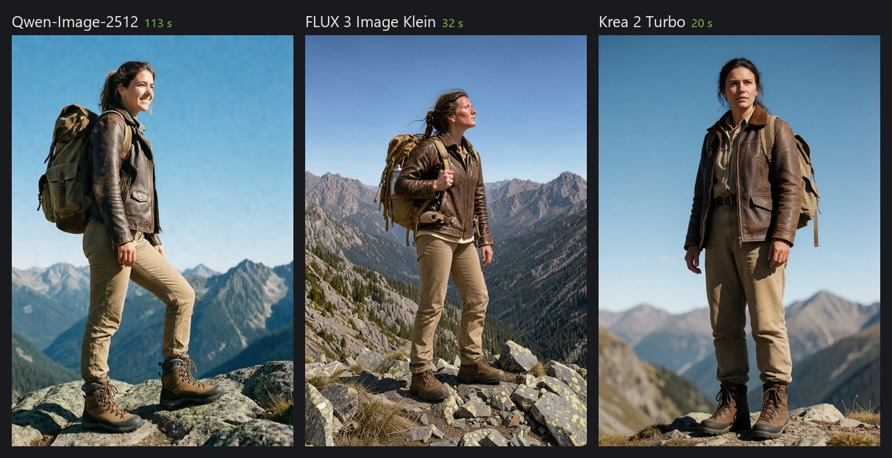
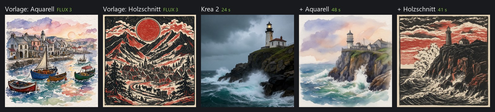
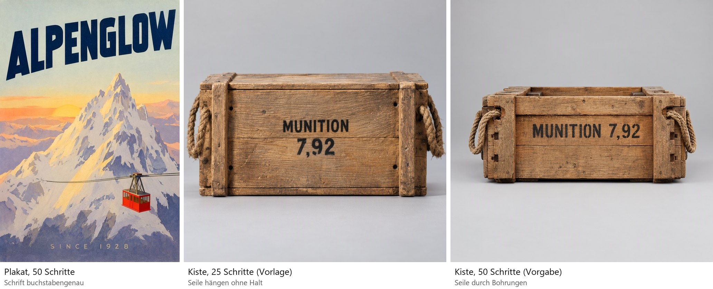
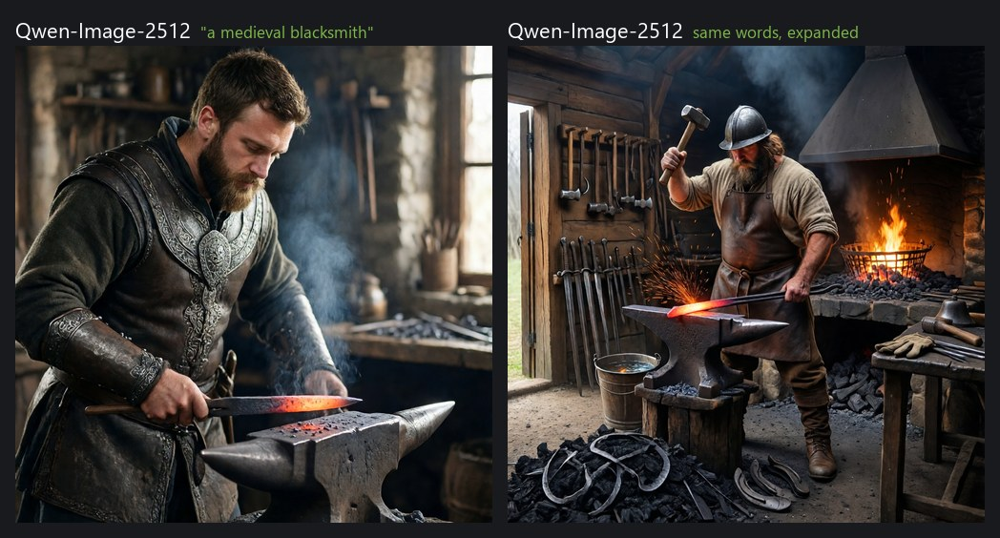
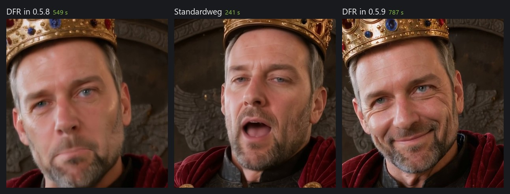
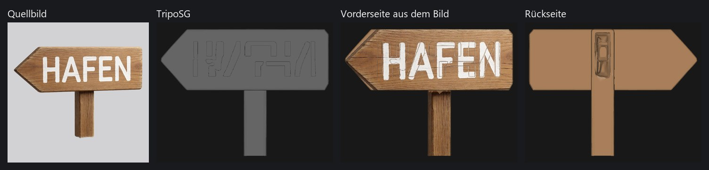
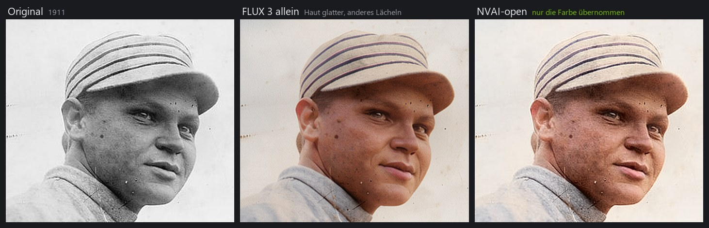
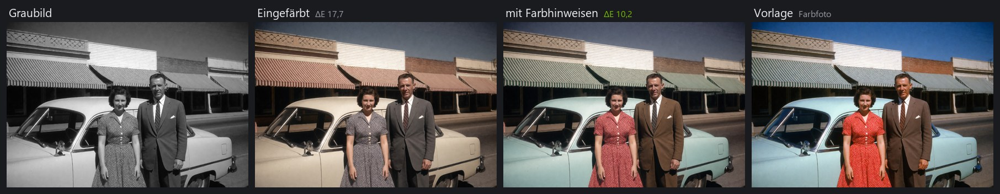
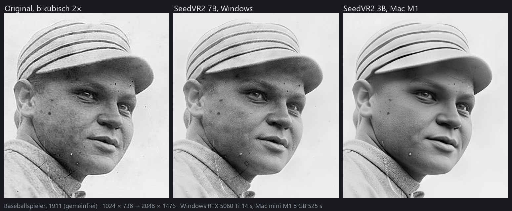

# Die Modelle in NVAI-open

*English: [../MODELS.md](../MODELS.md)*

Was jedes Modell kann, wie man es anspricht, wie lange es braucht und wo es scheitert. Das gilt für die App, für Claude
Code mit dem MCP-Server `nvai` und für eigene Programme über die REST-API. Gemessen ist alles auf einer RTX 5060 Ti mit
16 GB, wenn nichts anderes dasteht; was vom Hersteller stammt, ist so gekennzeichnet. Die vier Bildmodelle
nebeneinander, mit denselben Prompts und Seeds: [MODEL_COMPARISON.md](../MODEL_COMPARISON.md) (englisch).

- [Bilder](#bilder): Qwen-Image-2512, FLUX 3 Image Klein, Krea 2, MOSS-Image
- [Video](#video): LTX-2.5, MiniMax H3, weitere
- [Ton](#ton), [3D](#3d), [Alte Fotos](#alte-fotos)
- [Zensiert oder unzensiert](#zensiert-oder-unzensiert), [Auf dem Mac](#auf-dem-mac), [Für Programme](#für-programme)

## Auf einen Blick

| | **Qwen-Image-2512** | **FLUX 3 Image Klein** | **Krea 2 Turbo** | **MOSS-Image** |
|---|---|---|---|---|
| Modell-ID | `qwen-image-2512-nvfp4` | `flux3-klein-nvfp4` | `krea2-turbo-nvfp4` | `moss-image-sft-int8` |
| Hersteller | Alibaba (Qwen) | Black Forest Labs | Krea.ai | OpenMOSS |
| Schritte / CFG | 50 / 4 | 16 / 1 | 8 / 1 | 50 / 3 |
| Negativprompt | wirkt | wirkungslos | wirkungslos | wirkt |
| Referenzbilder | — | bis zu 10 | 1–2 als Stilvorlage | — |
| Schrift im Bild | buchstabengenau | 3 von 3 fehlerfrei | buchstabengenau | buchstabengenau, am saubersten |
| Zeit je Bild 1024² | ~100 s | ~30 s, 13–16 s bei bekanntem Prompt | ~20 s | ~51 s |
| Lizenz | Apache-2.0 | FLUX Kommunity License: unter 5 Mio. US-$ Umsatz, jedes Bild prüfen | Krea 2 Community License: unter 1 Mio. US-$ Umsatz, jedes Bild prüfen | Apache-2.0 |
| Stark bei | Endassets, Konstruktion, Schrift | Bearbeiten, dieselbe Figur in mehreren Bildern, Layout | Foto-Look, Hände und Gesichter | Plakate, Schilder, Layout |

## Welches Modell wofür

| Aufgabe | Modell |
|---|---|
| Endasset: Objekt, Figur, Icon, Szene | **Qwen-Image-2512** |
| Beschriftung, Schilder, Plakate, Layout mit viel Text | **MOSS-Image** oder Qwen-Image-2512 |
| Konstruktion muss stimmen (Befestigungen, Scharniere, Griffe) | **Qwen-Image-2512** |
| Ein Foto mit wenig KI-Look, natürliche Hände und Gesichter | **Krea 2**, Bildausschnitt nennen |
| Einen Teil eines vorhandenen Bildes ändern, den Rest behalten | **FLUX 3** mit dem Bild als Referenz |
| Dieselbe Figur oder dasselbe Objekt in mehreren Bildern | **FLUX 3** mit Referenzbild |
| Mehrere Objekte an festen Positionen | **FLUX 3** mit Bounding-Boxen |
| Schnelle Entwürfe | FLUX 3 (13–16 s), Krea 2 (~20 s) oder `qwen-image-2512-lightning` (~17 s) |
| Nur ein paar Worte Prompt | erst **✨ Prompt ausbauen**, dann jedes Modell |
| Video mit Ton | **LTX-2.5** |
| Instrumentalmusik / Soundeffekte | **Stable Audio 3** / **Stable Audio Open** |
| Sprecherstimme, Dialogzeilen | **Qwen3-TTS** |
| 3D-Modell aus einem Bild | **TripoSG** (Form) oder **TRELLIS.2** (mit Texturen) |
| Altes Foto restaurieren oder einfärben | Reiter **„Restaurieren“**: FLUX 3 und SeedVR2 |
| Historisch genaue Fahrzeuge (Panzer IV, Kübelwagen …) | **keins**, siehe [Bekannte Fallen](#bekannte-fallen) |

Ohne `model_id` nimmt NVAI-open das aktive Modell der Art. Jedes Modell startet mit seinen gemessenen Bestwerten, und
ein kurzer Tipp unter der Modellwahl sagt, worauf es ankommt.

---

## Bilder

### Qwen-Image-2512 (`qwen-image-2512-nvfp4`)

20 Mrd. Parameter, in NVFP4 14,9 GB (RTX 50 rechnet das Format in Hardware); Text-Encoder Qwen2.5-VL-7B, zusammen
24,5 GB Download. 50 Schritte, CFG 4, Apache-2.0.

- **Buchstabengenaue Schrift**, so wie sie im Prompt in Anführungszeichen steht.
- **Konstruktion:** Die Seilgriffe einer Kiste liefen durch Bohrungen; die destillierte Lightning-Fassung legte sie ohne
  Halt aufs Holz.
- **Der Negativprompt wirkt.** Leer nimmt NVAI-open den aus Qwens Modellkarte (geringe Auflösung, verformte Hände,
  Wachs- oder KI-Look, verzerrte Schrift).
- **Verfeinern statt neu würfeln:** `image_asset_id` mit `denoise` (0,3 behutsam, 0,5 deutlich). `hires=True` rechnet
  einen zweiten Durchgang für Hände, Gesichter und feine Technik.
- **Native Formate geben mehr Detail** (trainiert auf rund 1,76 MP), bei doppelter Zeit:

| Natives Format | Für |
|---|---|
| 1328 × 1328 | Objekte, Icons |
| 1056 × 1584 | stehende Figuren |
| 1584 × 1056 | Fahrzeuge, Szenen |
| 928 × 1664 / 1664 × 928 | Panoramen |

Zeiten: 1024² rund 100 s, 1328² rund 200 s, Lightning (8 Schritte) rund 17 s; der erste Auftrag nach dem Start dauert
15–30 s länger.

Prompt in ganzen englischen Sätzen: erst Medium und Stil, dann das Motiv mit Material, Farbe, Zustand und Konstruktion,
dann Licht und Hintergrund; Schrift wörtlich in Anführungszeichen.

```
Studio product photograph of a weathered wooden ammunition crate. Black stenciled letters on
the front read "MUNITION 7,92". Rope handles pass through drilled holes in the side boards.
Plain light grey background, soft even light.
```

Konstruktion ausschreiben (was nicht dasteht, wird erfunden), genau eine Ansicht nennen, die Herkunft von Personen als
Region plus Merkmale angeben („with pale northern European features“) und Gewichtungsklammern wie `(full body:1.2)`
weglassen: Das ist CLIP-Syntax und wirkt hier nicht.

**INT8 für RTX 20/30/40** (`qwen-image-2512-int8`, 20,6 GB): ab RTX 20 in Hardware gerechnet. Auf der RTX 5060 Ti 119
statt 101 s bei gleicher Qualität; auf einer RTX 4060 mit 8 GB 653 statt 1095 s mit NVFP4.

### FLUX 3 Image Klein (`flux3-klein-nvfp4`)

Black Forest Labs, 5,6 Mrd. Parameter, offizielle NVFP4-Fassung (5,3 GB), Text-Encoder Qwen3-VL-4B und ein
Prompt-Upsampler (Qwen3.5-9B), zusammen 20,2 GB Download. 16 Schritte ohne Guidance. Das Repository ist gesperrt: die
Lizenz auf Hugging Face annehmen und einen Token eintragen ([HUGGINGFACE.md](HUGGINGFACE.md)).

**Der Upsampler.** FLUX 3 ist auf lange Beschreibungen trainiert, die sein eigener Upsampler schreibt, und BFL rät von
der Nutzung ohne ab. Der Upsampler macht deshalb aus deiner Anfrage erst eine Beschreibung mit 100 bis 350 Wörtern,
daraus entsteht das Bild, und die Beschreibung kommt als **`caption`** zurück. Derselbe Prompt gibt immer dieselbe
Beschreibung, ein neuer Seed kostet also nur die Bildzeit. Der Upsampler füllt jede Lücke selbst: Er hängte Soldaten
den Mantel wie ein Cape um und gab ihnen Schnürschuhe. Alles, was stimmen muss, gehört deshalb in den Prompt, der
**Stil zuerst** (ohne plant er ein Foto), und stimmt das Bild nicht, zuerst `caption` lesen statt neu zu würfeln.
`upsample_prompt=False` schaltet ihn ab; das lohnt sich, wenn Bauweise, Anzahl oder Blickrichtung genau stimmen müssen
(er setzte in 4 von 6 Bildern eine zweite Angelschnur dazu, ohne ihn 0 von 2), dann die volle Beschreibung selbst
schreiben.

**Referenzbilder:** `reference_asset_ids` nimmt bis zu zehn Bilder; im Prompt heißen sie „the first image“, „the second
image“ und so weiter. Zum Bearbeiten sagen, was sich ändert und was bleibt:

```
generate_image(
  prompt="Replace the rope handles with forged iron handles bolted to the side boards; "
         "keep everything else unchanged.",
  model_id="flux3-klein-nvfp4",
  reference_asset_ids=["ast_b2e2b512098a"],
)
```

Nur die Griffe änderten sich; Bretter, Schrift und Leisten blieben. Mehrere Referenzen kombinieren Motive („put the
soldier from the first image into the trench from the second image“). Ein einzelnes `image_asset_id` wird zur ersten
Referenz. Referenzen legen den Inhalt fest, nicht die Form: Eine Bauzeichnung macht ein erfundenes Fahrzeug nicht
maßstabsgetreu.

**Platzierung mit Boxen:** eine JSON-Liste anhängen; jede Box ist `[oben, links, unten, rechts]` auf einem Raster von 0
bis 1000.

```
Studio product photograph of three separate weathered wooden ammunition crates standing side
by side on a plain light grey background, soft even light.
[{"id": "crate_1", "bbox": [430, 30, 820, 320], "desc": "a small crate with a hinged lid"},
 {"id": "crate_2", "bbox": [250, 350, 820, 650], "desc": "a tall crate with rope handles"},
 {"id": "crate_3", "bbox": [560, 680, 820, 970], "desc": "a flat, wide crate"}]
```

Alle drei Kisten standen in ihren Boxen. Die ids nicht als `<crate_1>` im Text zitieren: Der Text gilt dann als fertige
Beschreibung und geht am Upsampler vorbei.

**Formate und Zeiten:** Vielfache von 16, bis 2048 × 2048; ein größeres Format gibt mehr Detail (1440² 26 s), einen
zweiten Durchgang gibt es nicht. Neuer Prompt in 1024² rund 30 s, derselbe Prompt mit neuem Seed 13–16 s, vier Bilder
37 s, Bearbeiten mit Referenz rund 45 s.

**INT8 für RTX 20/30/40** (`flux3-klein-int8`, die offizielle Fassung von BFL mit kleinerem Upsampler); laut BFL läuft
sie auf Karten mit 8 GB. Die nicht destillierte **Base**-Fassung (50 Schritte, Negativprompt) brachte keinen sichtbaren
Gewinn.

**Lizenz (FLUX Kommunity License v1.0, keine Rechtsberatung):** Bilder kommerziell nur unter 5 Mio. US-$ Jahresumsatz
samt verbundenen Unternehmen; ein Inhaltsfilter **oder** jedes Bild vor der Veröffentlichung prüfen; KI-Kennzeichnung,
wo das Gesetz sie verlangt; BFL kann die Lizenz per Mitteilung kündigen; die Bilder dürfen kein anderes Bildmodell
trainieren. Keine EU-Sperre. Ohne diese Bedingungen: Qwen-Image-2512.

### Krea 2 Turbo (`krea2-turbo-nvfp4`)

Krea.ai, 12 Mrd. Parameter, 8 Schritte ohne Guidance. Der Text-Encoder ist Byte für Byte der von FLUX 3, der VAE der
von Qwen-Image; ist eines davon installiert, bleiben 7,7 GB zu laden. Die Dateien kommen von Comfy-Org und sind nicht
gesperrt. 1 bis 2 MP; kein Negativprompt, keine Maske, kein zweiter Durchgang.

| Gleicher Prompt und Seed | Qwen-Image-2512 | FLUX 3 | Krea 2 Turbo |
|---|---|---|---|
| Fischer flickt ein Netz, 1024² (mit Laden) | 160 s | 36 s | 41 s |
| Kiste mit Schrift, 1024² | 109 s | 31 s | 21 s |
| Entdeckerin in ganzer Figur, 832 × 1216 | 113 s | 32 s | 20 s |



Das fotografischste der drei: natürliche Hände und Gesichter, Struktur statt glattem KI-Look, Schrift genau. **Den
Bildausschnitt nennen:** Dem Fischer fehlte in 3 von 3 Bildern der Kopf; mit „Medium shot from the waist up, his whole
head and face inside the frame“ war er in 2 von 2 im Bild. Krea 2 ist auf ausführliche Beschreibungen trainiert, ein
paar Worte also erst mit ✨ Prompt ausbauen erweitern. 2 MP (1408²) dauern 37 s.

**Stilvorlage:** Mit der Stil-LoRA von ostris (0,46 GB, unter „Modelle“ → „Zusätze laden“) nimmt Krea 2 ein oder zwei
Bilder in `reference_asset_ids` als Vorlage: Malweise, Farben und Licht kommen aus dem Bild, der Inhalt aus dem Prompt.
Im Prompt nur den Inhalt beschreiben; Licht und Farben kommen aus der Vorlage, auch wo der Prompt anderes sagt, und mit
zwei Vorlagen gewinnt die erste.



| Lauf (1024², ein Leuchtturm im Sturm) | Zeit | Ergebnis |
|---|---|---|
| ohne Vorlage | 24 s | fotografisch, dunkle Sturmwolken |
| Aquarell-Vorlage | 48 s | Aquarell im pastelligen Abendlicht der Vorlage |
| Holzschnitt-Vorlage | 41 s | Holzschnitt in Schwarz, Rot und Creme |

**Lizenz (Krea 2 Community License):** kommerziell nur unter 1 Mio. US-$ Jahresumsatz samt verbundenen Unternehmen; ein
Inhaltsfilter oder jedes Bild von Hand prüfen; KI-Kennzeichnung, wo verlangt; Krea kann mit 30 Tagen Frist kündigen.

**INT8 für RTX 20/30/40** (`krea2-turbo-int8`, 13,5 GB): an einem normalen Anschluss schneller als NVFP4 auf einer
Karte ohne FP4-Einheiten (12–13 statt 25 s).

### MOSS-Image (`moss-image-sft-int8`)

OpenMOSS, 5 Mrd. Parameter in INT8, Apache-2.0: Schrift und Layout ohne Umsatzgrenze. Sein Text-Encoder (Qwen3.5-9B)
baut kurze Prompts selbst zur vollen Beschreibung aus, die als `caption` zurückkommt (`upsample_prompt=False` schaltet
das ab); laut OpenMOSS legt ein JSON mit „summary“ und „items“ das Layout fest. 50 Schritte, cfg 3: 51 s je Bild mit
1 MP, das erste Ausbauen rund 11 s mehr. Die Schrift war in jedem Bild buchstabengenau; die Seilgriffe der Kiste liefen
mit 50 Schritten in 3 von 3 Bildern durch Bohrungen, mit 25 in 2 von 3. Beschreiben, wie das fertige Bild aussieht,
die Schrift in Anführungszeichen mit Ort und Schriftart. Nur Text zu Bild, keine Referenzen oder Maske; eine
vorhandene Figur kam als andere Person heraus.



### Füllen und erweitern

- **Füllen** (`mask_asset_id`, weiß = neu, schwarz = behalten, mit `image_asset_id` und `denoise=1.0`): Qwen-Image-2512
  machte aus „MUNITION 7,92“ auf einer Kiste „FLAK 88“ in derselben Schablonenschrift; außerhalb der Maske blieb das
  Bild, wie es war. FLUX 3 füllt über eine Referenz: NVAI-open graut den Bereich, FLUX malt ihn, und nur der Bereich
  kommt deckungsgleich zurück. Gut zum Entfernen und Hinzufügen (Kisten weg, eine Möwe dazu, 60–70 s). Um Vorhandenes
  umzuschreiben, etwa ein Schild, stattdessen mit Referenz bearbeiten.
- **Erweitern** (`outpaint=[links, oben, rechts, unten]` in Pixeln): FLUX 3 nehmen. Es setzt die Szene auf einem grauen
  Rand fort; weil es das Bild nie genau an derselben Stelle zurückgibt (mit Rand rundum zoomte es um 25–42 %),
  erweitert NVAI-open eine Achse nach der anderen, misst den Versatz, schiebt zurück und setzt das Original pixelgenau
  ein. Qwen-Image-2512 erweitert über eine Maske, malte den Rand aber als eigene Szene mit harter Kante.

### Prompt ausbauen

**✨ Prompt ausbauen** (MCP `expand_prompt`, REST `POST /api/prompt/expand`) schreibt aus ein paar Worten die volle
Beschreibung, mit dem Upsampler von FLUX 3 (13–16 s, FLUX 3 muss geladen sein). Es geht in jedem Reiter: Bilder, Video
(Bewegung, Kamera, Ort, Licht; bei LTX-2.5 auch der Ton; mit Startbild nur die Bewegung), mehrere Einstellungen,
Soundeffekte, Musik für Stable Audio 3 und 3D. Mit „a medieval blacksmith“ malte Qwen-Image-2512 einen Krieger in
Lederrüstung, mit dem ausgebauten Text eine Schmiede mit Amboss, Zange und Funken. Dem Schmied gab es dabei einen Helm:
den Text lesen und streichen, was nicht passt.



### NVFP4 oder INT8

Nur RTX 50 rechnet NVFP4 in Hardware; RTX 20, 30 und 40 rechnen INT8. NVAI-open markiert die passende Fassung als
`recommended` und erklärt andere in `gpu_note`. Ein Modell, das größer ist als der Grafikspeicher, läuft trotzdem, weil
ComfyUI Teile aus dem Arbeitsspeicher nachlädt: an einem normalen Anschluss kostete das wenig (Krea 2 INT8 mit 8 GB
13,0 statt 12,2 s). Nur an einem langsamen Anschluss wie einem Riser (PCIe 3.0 x4) lag NVFP4 vorn, wo nur es in den
Speicher passte.

| Erstes / nächstes Bild, 1024² | Krea 2 NVFP4 | Krea 2 INT8 | Qwen NVFP4 | Qwen INT8 |
|---|---|---|---|---|
| ohne FP4-Einheiten, 16 GB, PCIe 4.0 x8 | 29,8 / 25,0 s | 17,5 / 12,2 s | 226,9 / 214,0 s | 127,2 / 118,6 s |
| RTX 4060, 8 GB, Riser | 46 s | 193 / 82 s | 1095 s | 653 s |

---

## Video

### LTX-2.5

`ltx25-distilled-nvfp4` (RTX 50) bzw. `-int8`: Bild und Ton in einem Durchgang, MP4 mit 24 fps. LTX-2 Community
License, kostenlos unter 10 Mio. US-$ Umsatz; das Repository ist gesperrt. Formate in Vielfachen von 64 (1280 × 704,
1920 × 1088), Längen 8n+1 Bilder (97 = 4 s, 121 = 5 s), bis 20 s. Mit 16 GB einen Clip in 1920 × 832 höchstens 6 s lang
machen; längere Szenen entstehen aus mehreren Clips.

| Weg | Parameter | Gemessen |
|---|---|---|
| Text zu Video | — | 5 s in 1280 × 704 in 93 s; 1920 × 1088 in 251 s |
| Startbild | `image_asset_id` | 5 s in 1280 × 704 in 109 s |
| Start- und Endbild | `end_image_asset_id` | 5 s in 154 s; erstes und letztes Bild treffen die zwei Bilder |
| Schleife | `loop=True` | 4 s in 125 s; nur mit ruhiger Kamera, sonst zerfallen die letzten Bilder |
| Vorgegebener Ton | `audio_asset_id` | 20 s Blasmusik → ein Clip von 19,7 s in 1024 × 576 in 302 s, der Ton unverändert |
| Mehrere Einstellungen | `expand_prompt(target="video_multishot")` | 8 s in 170 s, zwei Einstellungen mit sauberem Schnitt, dieselbe Person |
| Verlängern | `extend_asset_id` | 5 s + 4 s in 1920 × 1088 in 255 s, keine sichtbare Naht |
| Anschluss | `chain_asset_id` | der neue Clip übernimmt die letzte Sekunde des angegebenen und setzt dessen Bewegung fort |
| Länge automatisch | `auto_duration=True` | eine Tür, die langsam aufgeht: 3 s |

- **Höchste Qualität (DFR)** (`quality="dfr"`): Vorgabe, sobald das Detail-LoRA von Lightricks installiert ist.
  Gesichter und Stoffe bleiben über den ganzen Clip scharf (Kantenschärfe nach 2 s 625 statt 211), dafür rund dreimal so
  lang (5 s in 1080p: 786 statt 241 s). Nicht mit Endbild oder Schleife.



- **Endbild und Schleife halten Gesicht und Ausschnitt** (Ähnlichkeit zum Startbild 0,80–1,0 über 5 s statt 0,3–0,4).
  Der Preis: Was in beiden Bildern gleich ist, steht dazwischen still, auch Wasser und Rauch, selbst wenn der Prompt sie
  bewegen will. Für bewegten Hintergrund nur ein Startbild geben.
- **Ton:** so laut beschreiben, wie er sein soll. Sprache und eine Schmiede kamen mit −14 bis −18 LUFS, ein Lagerfeuer,
  das „leise knistert“, mit −41 bis −52. Der Ton jedes Videos läuft durch einen Limiter bei −2,5 dBFS.
- **LoRAs** („Empfohlene LoRAs“ unter dem Videomodell): Cinemagraph nur zusammen mit „Schleife“ (6 % des Bildes
  bewegten sich, das Gesicht stand still); Slow Motion gibt echte Zeitlupe (Gischt fiel über 5 statt 1,5 s);
  `motion_speed` allein tut das nicht. Fantasy Anime und Painterly ändern den Look deutlich, Paper Cut-Out mit Stärke 1,5.
- **48 fps** mit `temporal_upscale`, **Bitrate** CRF 12 (rund 16 Mbit/s bei 1080p; das Weiche kommt aus dem Modell,
  nicht vom Encoder).
- **Person aus einem Foto:** FLUX 3 übernimmt das Gesicht aus einem Foto und macht vier Startbilder in einer Rolle, die
  du beschreibst (95–98 s), und LTX-2.5 erweckt sie zum Leben: [FOTO_ZU_VIDEO.md](FOTO_ZU_VIDEO.md). Die Stimme ist nie die
  echte.

**Prompt schreiben** (nach Lightricks): ein Absatz im Präsens, 4–8 Sätze: Einstellung → Ort und Licht → Handlung mit
Verben → Personen über Merkmale statt Gefühle → Kamera → Ton. Gesprochenes in Anführungszeichen mit der Stimme. Kurz
halten: Mit 8 statt 14 Sätzen bewegte sich die Person 38–49 % weniger. Ruhe positiv sagen („sits perfectly still like a
statue“) und nicht nennen, was nicht passieren soll, auch nicht verneint. Fallen aus den Tests: „shouts“ gibt Grimassen
(„says firmly in a rough, deep voice“ ist ruhiger); „proud, calm expression“ wurde ein Grinsen („stern … does not smile“
nicht); „static camera“ allein fuhr trotzdem heran („Static camera, a locked-off medium shot; the framing stays exactly
as in the first frame.“ hielt); dünne Gegenstände wie Gewehre, die Personen kreuzen, verschmelzen.

### MiniMax H3 (seit 0.5.18)

> **⚠️ Ohne eigene Lizenz von MiniMax in der EU, in Großbritannien, Südkorea und den USA nicht erlaubt.** Die
> MiniMax H3 Community License schließt diese Gebiete aus (Abschnitt I.3 und I.5) und verbietet dort jede Nutzung der
> Gewichte und ihrer Ergebnisse, auch privat (Abschnitt V.4). **Videos und Bilder daraus dürfen nicht veröffentlicht
> werden**, auch keine Standbilder oder Screenshots; deshalb steht hier kein Bild. Lizenzanfrage:
> <https://platform.minimax.io/h3-license>. Die App markiert das Modell und jedes Ergebnis rot („Nicht
> veröffentlichen“), bis unter „Modelle“ der Haken „Ich habe eine Genehmigung erworben“ gesetzt ist. Wer Dritten ein
> Werkzeug zum Erzeugen mit MiniMax anbietet, muss laut Lizenz (Abschnitt V.5) verbotene Inhalte verhindern; NVAI-open
> filtert nichts.

Drei Fassungen, alle mit Bild und Stereoton, 24 fps, 5 bis 15 s, bis 768p: **Startbild** (Text und auf Wunsch ein
Startbild), **Referenz** (bis zu 9 Referenzbilder, im Prompt `<Picture 1>`, `<Picture 2>` …) und **FastH3** (fest 8
Schritte, kaum Zeitlupe), dazu die Turbo-LoRAs von lightx2v.

**Vorgewählt** ist der schnellste gemessene Weg ohne Bildsprung: Turbo-LoRA 8 Schritte v1.1, sol-attn und
INT8-Attention. App, Studio und MCP nehmen ihn, solange ein Auftrag nichts anderes sagt. Auf Karten älter als RTX 30
fällt sol-attn weg, älter als RTX 20 auch die INT8-Attention, auf AMD beides.

Im ersten Test (dieselbe Szene wie mit LTX-2.5, 9,4 s) folgte MiniMax der Beschreibung genauer, und das Gesicht aus den
Referenzbildern blieb über den ganzen Clip gleich. Es neigt zu Zeitlupe: Es bewegt sich etwa halb so stark wie LTX-2.5,
also jede Bewegung mit Tempo beschreiben (das machte die Explosion um 30–55 % heftiger).

| Dieselbe Szene, 9,4 s in 1344 × 576 | Startbild-Fassung | Referenz-Fassung |
|---|---|---|
| 20 Schritte, ohne Beschleuniger | 37,3 min | 37,1 min |
| **Vorgewählt:** Turbo 8 v1.1 + sol-attn + INT8 | **6,9 min** | **6,6 min** |
| Am schnellsten: Turbo 4 + sol-attn | 4,5 min | 4,8 min |
| Wenig Zeitlupe: FastH3 | 7,9 min | – |
| Nicht empfohlen: Veda bei diesem Format | Bildsprung gegen Ende | Bildsprung gegen Ende |

Die Attention bremst, nicht der Speicher: sol-attn und INT8-Attention halbieren jeweils die Zeit. Der Download hat rund
39 GB für die Startbild-Fassung und weitere 19,5 GB für die Referenz-Fassung; beim Rechnen waren 14,9 GB Grafikspeicher
belegt, und der freie Arbeitsspeicher blieb über 31,8 von 64 GB, weniger als 64 GB RAM ist also knapp. In NVAI-open für
Mac gibt es MiniMax nicht.

<details>
<summary>Die ganze Messreihe (23 Läufe)</summary>

<!-- messreihe -->
| Lauf | Fassung | Beschleunigung | Schritte | Rechenzeit | Ton (dBFS RMS) |
|---|---|---|---|---|---|
| Messung 1 | Startbild | ohne LoRA | 20 | 37,3 min | Wind von Anfang an (−14 dBFS), Explosion −4,8 bei 2,5 s, kein eigener Flossenschlag |
| Messung 2 | Referenz | ohne LoRA | 20 | 37,1 min | leiser Anfang (−38), Pfiff, Explosion −5,8, Flossenschlag 6,5 s (−18,8), danach Stille |
| Test 1 | Startbild | Turbo 8 v1.0 (544p, Shift 12/3, res_multistep wie ComfyUI-Vorlage) | 8 | 15,8 min (2,4-mal so schnell) | laut ab Beginn (−6 bis −9), Explosion −5,2, kleine Spitze bei 6,75 s (+4 dB) |
| Test 2 | Referenz | Turbo 8 v1.1 768p (Shift 12/3, euler, „match“) | 8 | 16,8 min (2,2-mal so schnell) | Sampling 15:01 (113 s/Schritt); leiser Anfang (−37), Pfiff und Explosion 1,25–2,5 s (−6,0), Aufprall 3,75 s (−23), Stille ab 5,5 s, Flossenschlag 6,5 s (−20,2), danach Stille |
| Test 3 | Referenz | wie Test 2 + sol-attn (tau 1,3 ab 20 %) | 8 | 8,3 min (4,5-mal so schnell) | Sampling 7:15 (dicht 113, dünn ~34 s/Schritt); Anfang −30, Explosion 1,25–2,5 s (−6,2), Aufprall 3,5 s, Stille ab 5,5 s, Flossenschlag 6,75 s (−19,9) |
| Test 4 | Startbild | Turbo 8 v1.1 768p (Shift 6/3, euler) | 8 | 15,8 min (2,4-mal so schnell) | Sampling 14:25; laut ab Beginn (−7 bis −9), Explosion 2,25–3 s (−7,2), Abklingen bis −40, kleine Spitze 7,0 s (+3,5 dB) |
| Test 5 | Startbild | wie Test 4 + sol-attn | 8 | 8,2 min (4,5-mal so schnell) | Sampling 7:22; laut ab Beginn (−7), Explosion 2,25–2,5 s (−7,7), Flossenschlag-Spitze 6,75–7,0 s (+5 dB) |
| Test 6 | Referenz | Turbo 4 v1.0 768p (Shift 12/3, euler, „match“) | 4 | 8,5 min (4,4-mal so schnell) | Sampling 7:25 (112 s/Schritt); leiser Anfang (−42), Explosion 1,25–2,0 s (−6,7), Stille ab 5 s, Flossenschlag 6,5 s (−21,6), danach Stille |
| Test 7 | Startbild | Turbo 4 v1.2 768p (Shift 6/3, euler) | 4 | 8,7 min (4,3-mal so schnell) | Sampling 6:53 (103 s/Schritt; erster Lauf nach Neustart, Kaltstart im Gesamtwert); laut ab Beginn (−7), Explosion 1,25–2,5 s (−5,6), Flossenschlag-Spitze 6,75 s (+6 dB) |
| Test 8 | Referenz | wie Test 6 + sol-attn | 4 | 4,8 min (7,7-mal so schnell) | Sampling 2:39 (dicht 112, dünn ~16 s/Schritt); leiser Anfang (−40), Explosion 1,25–2,0 s (−6,4), Geräusch 5,75–6,5 s (−29), Flossenschlag 6,75 s (−22,3), danach Stille |
| Test 9 | Startbild | wie Test 7 + sol-attn | 4 | 4,5 min (8,3-mal so schnell) | Sampling 2:29; laut ab Beginn (−8), Explosion ab 1,25 s (−5,3), Spitzen 6,5 und 7,0 s (−27), Geräusch 7,75–8,25 s |
| Test 10 | Referenz | Turbo 8 v1.0 768p (Shift 12/3, euler, „match“) | 8 | 15,7 min (2,4-mal so schnell) | Sampling 14:21 (109 s/Schritt; samt Modellwechsel im Gesamtwert); Anfang −33, Explosion 1,25–2,5 s (−6,0), Stille ab 5 s, Flossenschlag 6,5 s (−20,5), danach Stille |
| Test 11 | Referenz | wie Test 3 + INT8-Attention | 8 | 6,6 min (5,6-mal so schnell) | Sampling 5:38; Anfang −27, Explosion 1,25–2,5 s (−6,4), Aufprall 3,5 s, Stille ab 5,5 s, Flossenschlag 6,75 s (−20,7), danach Stille |
| Test 12 | Referenz | wie Test 2 + INT8-Attention | 8 | 8,3 min (4,5-mal so schnell) | Sampling 7:09 (ohne INT8 15:01); leiser Anfang (−39), Explosion 1,25–2,5 s (−5,8), Aufprall 3,75 s, Stille ab 5,5 s, Flossenschlag 6,5 s (−19,9), danach Stille |
| Test 13 | Referenz | wie Test 3, sol-attn tau 1,5 | 8 | 8,2 min (4,5-mal so schnell) | Sampling 7:08 (tau 1,3: 7:15); Anfang −28, Explosion 1,25–2,5 s (−6,0), Aufprall 3,5 s, Stille ab 5,5 s, Flossenschlag 6,75 s (−19,4), danach Stille |
| Test 14 | Referenz | wie Test 2 + Veda (32 Kacheln) | 8 | 6,7 min (5,5-mal so schnell) | Sampling 5:15 (R2VA-Prädiktor; Kaltstart und Kompilieren im Gesamtwert); Bewegung 1–4 s 2,34 statt 1,78 (Test 2), aber Bildsprung bei 7,75 s (5,1); Ton: Stille (−49), Explosion 1,25–2,0 s (−5,4), Flossenschlag 6,5 s (−19,8), danach Stille |
| Test 15 | Startbild | FastH3 8 Schritte (VSA, Shift 10/3, fest) | 8 | 7,9 min (4,7-mal so schnell) | Sampling 6:50 (Laden des neuen Checkpoints im Gesamtwert); Bewegung 1–4 s 4,21 (andere MiniMax 1,8–2,8, LTX 5,1), Explosion 8,7 bei 2,5 s (LTX 7,5); Ton laut ab Beginn (−6), Explosion 2,25–3,0 s (−3,6), Flossenschlag 7,0 s (+20 dB), danach Stille |
| Test 16 | Startbild | wie Test 4 + Veda (32 Kacheln) | 8 | 6,1 min (6,1-mal so schnell) | Sampling 5:05 (38 s/Schritt, samt einmaligem Kompilieren der Triton-Kernel); laut ab Beginn (−11), Explosion 1,25–2,25 s (−5,7), Flossenschlag-Spitze 6,75 s (+6 dB), danach Stille (−40); Veda: 28 % Polster-Kacheln bei 1344 × 576; Bildsprung bei 7,75 s (13,2) |
| Test 17 | Referenz | wie Test 14 + INT8-Attention | 8 | 6,3 min (5,9-mal so schnell) | Sampling 5:13; in Bewegung und Ton identisch mit Test 14: neben Veda wirkt INT8 nicht |
| Test 18 | Startbild | wie Test 4 + INT8-Attention | 8 | 8,0 min (4,7-mal so schnell) | Sampling 6:46 (ohne INT8 14:25); laut ab Beginn (−8), Explosion 1,25–2,5 s (−6,3), Flossenschlag-Spitze 6,75 s (+5 dB) |
| Test 19 | Startbild | wie Test 9, Prompt mit Tempo (Echtzeit, schnell, energisch) | 4 | 4,6 min (8,1-mal so schnell) | Sampling 2:29; Bewegung 1–4 s 2,48 statt 2,19 (Test 9), Explosion 6,6 statt 4,3 (LTX 5,1/7,5); Ton laut ab Beginn, Explosion 1,25 s (−4,3), Flossenschlag 7,0 s (+11 dB) |
| Test 20 | Startbild | wie Test 16, Prompt mit Tempo | 8 | 6,1 min (6,1-mal so schnell) | Sampling 5:05; Bewegung 1–4 s 2,80 statt 2,75 (Test 16); wieder ein Bildsprung am Ende (9,0 s, 10,1); Ton laut ab Beginn, Explosion 1,25 s (−4,8), Flossenschlag 6,75–7,0 s (+9 dB) |
| Test 21 | Referenz | wie Test 8, Prompt mit Tempo | 4 | 4,8 min (7,7-mal so schnell) | Sampling 2:33; Bewegung 1–4 s 1,78 statt 1,76 (Test 8), Explosion 3,7 statt 2,8; Ton: Anfang lauter (−24 statt −40), Explosion 1,5 s (−6,7), Flossenschlag 6,75 s (−26,6), danach Stille |
| Test 22 | Referenz | wie Test 14, Prompt mit Tempo | 8 | 6,3 min (5,9-mal so schnell) | Sampling 5:14; Bewegung 1–4 s 2,41 (Test 14: 2,34), Bildsprung bei 9,0 s (6,1); Ton: Anfang −34, Explosion 1,25–2,0 s (−5,0), Flossenschlag 6,5 s (−21,5), danach Stille |
| Test 23 | Startbild | wie Test 5 + INT8-Attention (Vorgabe-Kandidat) | 8 | 6,9 min (5,4-mal so schnell) | Sampling 5:21 (Test 5 ohne INT8: 7:22); Bewegung: Explosion 2,25 s (4,43), Flossenschlag 7,0–7,25 s (2,0–2,3); Ton: Explosion ab 1,25 s (−5,6), Flossenschlag 7,0 s (−29,0), danach Stille (−40) |
<!-- /messreihe -->

Andere Hardware (laut Quellen, nicht gemessen): RTX 30/40 rechnen sol-attn und INT8-Attention, RTX 20 nur die
INT8-Attention; laut Veda-Messung läuft H3 auch auf einer RTX 5070 mit 12 GB. Auf AMD ist sol-attn ungeprüft, deshalb
bietet NVAI-open dort keinen der beiden Schalter an.

</details>

### Weitere Videomodelle

| Modell | Wofür | Gemessen | Lizenz |
|---|---|---|---|
| Wan 2.2 TI2V 5B, Wan 2.1 T2V 1.3B | Text zu Video; 832 × 480 ist der günstige Standard, Bewegung ausdrücklich beschreiben | | Apache-2.0 |
| Wan 2.2 I2V A14B | Bild zu Video, zwei Experten | 5 s in 1280 × 560 in 55 min, mit der 4-Schritt-LoRA Lightning in 6,5 min; beides kam in Zeitlupe | Apache-2.0 |
| LTX-2.3 (`ltx23-nvfp4`) | die Basis, für die die meisten Community-LoRAs für LTX gemacht sind | 4 s in 1280 × 704 in 101 s | LTX-2 Community |
| Mochi 1 preview | Text zu Video mit weicher Bewegung | 49 Bilder in 848 × 480 in 351 s | Apache-2.0 |
| Kandinsky 5.0 Video Lite | kleines Videomodell, 5 s | 768 × 512 in rund 300 s (destilliert) | MIT, VAE unter Tencents Lizenz |

Getestet und nicht aufgenommen: **Kandinsky 6** (Pro brauchte 928–966 s je 5-s-Clip gegen 114 s bei LTX-2.5, Lite
zerfiel, Teile davon sind nicht kommerziell oder in der EU nicht lizenziert) und die **IC-LoRAs Restore und Ingredients
für LTX-2.5** (keines hielt eine echte Person erkennbar).

---

## Ton

| Modell | Wofür | Gemessen | Lizenz |
|---|---|---|---|
| Stable Audio Open | Soundeffekte und Atmosphäre bis 47 s | 6 s in rund 12 s | Stability AI Community (unter 1 Mio. US-$ Umsatz) |
| Stable Audio 3 Medium | Instrumentalmusik bis 5 Minuten, kein Gesang | 60 s in 9–12 s, 300 s in 64 s | Stability AI Community (unter 1 Mio. US-$ Umsatz) |

- **Soundeffekte:** den Klang beschreiben, nicht die Szene: „heavy metal sword clash, single impact, bright metallic
  ring, dry studio recording“; kurze Effekte 3–8 s.
- **Musik:** ein Satz mit Gattung und Instrumenten, Schlagwerk und Stimmung, dann „BPM: 100.“; ✨ Prompt ausbauen
  schreibt diese Form. Die Länge hängt NVAI-open selbst an. Ein Modell für Lieder mit Gesang ist nicht dabei.
- Jede Tonausgabe läuft vor dem Speichern durch den Limiter von NVAI-open (−1 dBFS).

---

## Sprache

| Modell | Wofür | Gemessen | Lizenz |
|---|---|---|---|
| Qwen3-TTS 1.7B (`qwen3-tts-1.7b`) | Sprecherstimme und Dialogzeilen in 10 Sprachen, darunter Deutsch und Englisch | 5,8 s Sprache in 2,3 s; eine übernommene Stimme in 2 s | Apache-2.0 |

Die Stimme kommt aus einer Beschreibung oder aus einer Aufnahme:

- **Beschreiben** in einem Satz: Geschlecht, Alter, Tonlage, Tempo und Stimmung, etwa „eine ruhige, tiefe
  Männerstimme, etwa fünfzig, warm und leicht rau“. Dieselbe Beschreibung klingt mit jedem Seed anders: Im Test lag die
  tiefe Männerstimme zwischen 102 und 175 Hz. Ein paar Proben anhören und die beste behalten.
- **Übernehmen** aus einer Aufnahme (Ton, Video oder Upload, die ersten 20 s; drei Sekunden reichen). Mit dem genauen
  Wortlaut der Aufnahme übernimmt das Modell auch die Sprechweise, ohne ihn nur den Stimmklang. Zeilen aus einer
  Vorlage lagen bei einer Ähnlichkeit von 0,99 zu ihr; ein anderer Seed derselben Beschreibung kam auf 0,97–0,98, eine
  junge Frauenstimme auf 0,96. Stimmen nur aus Aufnahmen übernehmen, deren Sprecher zugestimmt haben.
- **Ein Sprecher für viele Zeilen:** die erste Zeile aus einer Beschreibung erzeugen, dann sie als Aufnahme für alle
  weiteren nehmen. Im Studio heißt das „Gleiche Stimme wie“ auf der Sprecher-Bahn.
- Whisper verstand jedes Wort unserer deutschen und englischen Testzeilen (0 Fehler in 166 Wörtern). Satzzeichen setzen
  die Pausen; eine aus einer deutschen Zeile übernommene Stimme spricht auch Englisch. Kein Gesang.
- Der erste Auftrag einer Sitzung braucht 20 bis 65 s länger (Laden), die weiteren nur die Zeit oben. Qwen3-TTS rechnet in einem
  eigenen Prozess mit faster-qwen3-tts (MIT) und braucht rund 5 GB Grafikspeicher.

```bash
curl -X POST http://127.0.0.1:8100/api/generate/speech -H "Content-Type: application/json" -d '{
  "text": "Willkommen in der alten Mühle. Hier wurde früher Korn gemahlen, heute erzählt sie Geschichten.",
  "voice": "eine ruhige, tiefe Männerstimme, etwa fünfzig, warm und leicht rau", "language": "de", "seed": 7}'
# gleiche Stimme für die nächste Zeile: Asset-ID und genauer Text der ersten
curl -X POST http://127.0.0.1:8100/api/generate/speech -H "Content-Type: application/json" -d '{
  "text": "Morgen früh geht es weiter, dann zeige ich euch den Keller.", "voice_asset_id": "<Asset-ID der ersten Zeile>",
  "voice_text": "Willkommen in der alten Mühle. Hier wurde früher Korn gemahlen, heute erzählt sie Geschichten.", "language": "de"}'
```

Aus Claude Code geht dasselbe mit dem MCP-Werkzeug `generate_speech`.

---

## 3D

Zwei Schritte: erst ein Bild des Objekts, dann `image_to_3d` (oder `text_to_3d`, das beides macht). Was im Bild steht,
landet im Mesh: Boden, Tisch und Schlagschatten werden zu Platten, zwei Objekte verschmelzen. Also: ein geschlossenes
Objekt vor schlichtem Hintergrund, ohne Boden und Schatten („plain flat background, no cast shadow, not standing on a
floor or table“).

| Modell | Was | Zeit | Lizenz |
|---|---|---|---|
| TripoSG | nur Geometrie, Teil des Setups | rund 60 s warm, 180 s kalt | MIT |
| TRELLIS.2 4B | Geometrie mit PBR-Texturen (2048²); nur mit einer Installation aus dem Quelltext | rund 75 s warm | MIT |

**Vorderseite aus dem Bild** (`project_front=True`): Schrift übersteht den Weg zum Mesh nicht; das legt das
freigestellte Quellbild auf die Flächen, die zur Kamera zeigen, so wurde „HAFEN“ auf einem Wegweiser lesbar (unter einer
Sekunde zusätzlich zu den 66 s). Beide Modelle liefern Meshes, die nicht sicher wasserdicht sind; vor dem Einsatz im
Spiel ein Retopo machen.



---

## Alte Fotos

Der Reiter **„Restaurieren“** (`POST /api/image/restore`, MCP `restore_image`, auch im PhotoCraft-Add-on), drei
schaltbare Schritte:

| Schritt | Was passiert | Gemessen |
|---|---|---|
| Schäden entfernen | FLUX 3 entfernt Kratzer, Staub, Risse, Flecken und Ausbleichen; das Ergebnis wird deckungsgleich ausgerichtet. **Automatisch** (Vorgabe) fragt den Upsampler von FLUX, ob das Foto Wasserflecken oder Rissnetze zeigt: ja → **Gründlich** (das ganze Bild von FLUX, für flächige Alterung), nein → **Schonend** (nur die Schäden werden ersetzt, Schärfe und Gesichter bleiben in voller Auflösung, für Staub, Kratzer, Risse und Lichteinfall). Bei 20 von 21 Testfotos lag es richtig | 2 Varianten in der Arbeitsgröße 2 MP: 150 s |
| Einfärben | FLUX 3 färbt ein, übernommen wird aber nur die Farbe; Helligkeit, Detail und Gesichter bleiben die des Fotos | rund 40 s je Variante |
| Farbhinweise | bekannte Farben unter „Hinweise“ („her dress is red with white dots“) | Farbfehler −40 % |
| Schärfen | SeedVR2 7B schärft und vergrößert bis 4× (höchstens 16 MP) | 1024 → 2048 in 6 s |

Nach der Art des Schadens wählen, nicht nach der Menge. Gesichter können sich von Variante zu Variante leicht ändern,
also beide in voller Größe vergleichen; kleine Zeichen wie ein Bindestrich können fehlen, also Schrift prüfen; an gleich
hellen Kanten kann Farbe überlaufen. Was FLUX 3 rechnet, fällt unter die FLUX Kommunity License.





---

## Zensiert oder unzensiert

Jedes Bild- und Videomodell in der Liste trägt ein Etikett, mit Beleg und Quelle im Tooltip (auch in `GET /api/models`
als `content`, `content_note`, `content_source`). NVAI-open selbst filtert nichts.

| Etikett | Modelle |
|---|---|
| unzensiert | Chroma1-HD, Pony Diffusion V6 XL, NoobAI-XL, Illustrious XL |
| teilweise zensiert | SDXL, Z-Image, Wan 2.1 / 2.2 |
| zensiert | Qwen-Image-2512, FLUX 3 Image Klein, Krea 2, FLUX.1 schnell |
| Filterung unbekannt | Juggernaut XL, Qwen-Image 2.1, LongCat-Image, LTX-Video |

Aus dem Katalog genommen (installierte Dateien bleiben): SD 3.5, FLUX.1 dev, Chroma v37 und HunyuanVideo 1.5, dessen
Lizenz die EU ausschließt.

---

## Auf dem Mac

NVAI-open für Mac rechnet mit eigenen, nativen Modellen auf Apple Silicon (MLX). Gemessen auf einem Mac mini M1 mit
8 GB:

| Modell | Was | Gemessen |
|---|---|---|
| FLUX.2 Klein 4B | Bilder: generieren, überarbeiten, füllen, erweitern, bis zu 3 Referenzen; LoRAs (Pixel-Art, Sprite-Sheet, Anime …) | 512² in 40,5 s |
| Z-Image Turbo | fotografische Bilder und Schrift, 8 Schritte | 512² in 101 s, 1 MP in 399 s |
| LTX-Video 2B | Video aus Text oder einem Startbild, 24 fps, ohne Ton | 4 s in 768 × 512 in 174 s |
| Stable Audio 3 Medium | Musik und Klänge bis 60 s bei 8 GB | 30 s in 13 s |
| Qwen3-TTS (VoiceDesign 1.7B 4 Bit, Base 0.6B 8 Bit), ab Mac 0.5.3 | Sprecherstimme aus einer Beschreibung oder Aufnahme | 0,9-fache Echtzeit, höchstens 3,9 GB |
| Qwen3.5 4B, SeedVR2 3B | „Automatisch“ beim Restaurieren; Schärfen | Automatisch rund 20 s; 1024 × 738 → 2× in 9 min |

FLUX.2 Klein entfernt bei alten Fotos weniger Schäden als FLUX 3 unter Windows, und SeedVR2 3B glättet Gesichter etwas
mehr als der 7B.



<a name="neu-in-nvai-open-für-mac-050"></a>

### Videomodelle je Arbeitsspeicher

| Arbeitsspeicher | Empfohlen | Ton | Stand |
|---|---|---|---|
| unter 16 GB | LTX-Video 2B | nein | gemessen |
| 16–23 GB | LTX-Video 13B, 4 Bit | nein | Block für Block gegen ComfyUI geprüft, nicht ganz gerechnet |
| 24–31 GB | LTX-Video 13B, 8 Bit | nein | wie oben |
| 32–63 GB | LTX-2.3 distilled, 4 Bit | ja | eingebaut, nicht gerechnet; macOS 26.3 |
| ab 64 GB | LTX-2.5 distilled, 8 Bit | ja | eingebaut, nicht gerechnet; macOS 26.3, gesperrt |

Unter seinem Mindestspeicher lässt sich ein Modell nicht laden. Im Studio rechnen Videoszenen mit dem Modell, das unter
„Generieren → Video“ gewählt ist. Berichte von Macs mit mehr Speicher sind als
[Issue](https://github.com/Mantux775/NVAI-open/issues) willkommen.

---

## Für Programme

Der Server lauscht auf `http://127.0.0.1:8100`; das GPU-Backend startet mit dem ersten Auftrag (einmalig rund 30 s).
Aus Claude Code geht es über den MCP-Server ([CLAUDE_CODE.md](../CLAUDE_CODE.md), englisch). Per REST:

| Methode und Pfad | Zweck |
|---|---|
| `GET /api/health` | Zustand, aktive Modelle, Warteschlange |
| `GET /api/version` | Versionen, Vertrag (`api`) und unterstützte Erweiterungen (`features`) |
| `GET /api/models?kind=image` | Modelle mit `features`, `recommended` und `gpu_note` |
| `POST /api/generate/image` (`/video`, `/audio`, `/speech`) | Auftrag anlegen; die Antwort hat seine `id` |
| `GET /api/jobs/{id}` | `status` (`queued`, `running`, `done`, `error`), `progress` 0–1, `stage` |
| `GET /api/jobs/{id}/assets` | die Ergebnisse mit `id`, `filename`, `url`, `meta` (Seed, Einstellungen, `caption`) |
| `POST /api/upload` | eigenes Bild hochladen (multipart, Feld `file`), etwa als Referenz |
| `GET /files/{filename}` | die Datei |

```python
import json, time, urllib.request

API = "http://127.0.0.1:8100"

def call(method, path, body=None):
    req = urllib.request.Request(API + path, method=method,
                                 data=json.dumps(body).encode() if body is not None else None,
                                 headers={"Content-Type": "application/json"})
    with urllib.request.urlopen(req, timeout=60) as r:
        return json.loads(r.read())

job = call("POST", "/api/generate/image", {
    "model_id": "qwen-image-2512-nvfp4",
    "prompt": "Studio product photograph of a weathered wooden ammunition crate. ...",
    "width": 1024, "height": 1024, "seed": 42,
})
while (j := call("GET", f"/api/jobs/{job['id']}"))["status"] not in ("done", "error"):
    time.sleep(2)
for asset in call("GET", f"/api/jobs/{job['id']}/assets"):
    print(asset["id"], asset["url"])
```

GPU-Aufträge laufen nacheinander; ein Auftrag in `queued` wartet auf den vor ihm. Von einem anderen Gerät (Server mit
`scripts\start.ps1 -Lan` gestartet) braucht jede Anfrage den Header `X-NVAI-Token`. Die API steht in
`server/openapi.json`.

### Parameter von `generate_image`

| Parameter | Qwen-Image-2512 | FLUX 3 | Hinweis |
|---|---|---|---|
| `prompt` | ausführlich, ganze Sätze | kurz und vollständig, Stil zuerst | |
| `negative_prompt` | wirkt; leer = Vorgabe der Modellkarte | wirkungslos | ~10 Begriffe, keine Stilverbote |
| `width`, `height` | Vielfache von 8, nativ ~1,76 MP | Vielfache von 16, bis 2048 | Format nach Silhouette |
| `steps`, `cfg` | 50 / 4 | 16 / 1 | leer = Vorgabe des Modells |
| `seed`, `batch_size` | ✓ | ✓ (4 Bilder ~37 s) | ein Modell-Laden für mehrere Bilder |
| `hires` | ✓ | — | |
| `image_asset_id` + `denoise` | Bild verfeinern | wird zur ersten Referenz | |
| `mask_asset_id` | Füllen mit Maske | Füllen über eine Referenz | weiß = neu, schwarz = behalten |
| `outpaint` | über Maske, oft harte Kante | nahtlos | `[links, oben, rechts, unten]` |
| `reference_asset_ids` | — | bis zu 10 | |
| `upsample_prompt` | — | an als Vorgabe | |

Format nach Silhouette: stehende Figur 832 × 1216, Fahrzeug im Querformat 1216 × 832, Objekt oder Icon 1024 × 1024.

### Das Feld `features`

`GET /api/models` und `list_models(detailed=True)` liefern für jedes Modell `features`, damit ein Programm seine
Bedienelemente anpassen kann wie die Weboberfläche: `steps` und `cfg` (Vorgaben), `negative_prompt` (wirkt er?),
`default_negative`, `upsampler`, `references` (Höchstzahl), `bbox`, `img2img`, `mask` (true oder `"reference"`),
`outpaint` (`"mask"`, `"reference"`), `hires`, `text_rendering`, `sizes` (empfohlene Formate), `recommended` (die
gemessenen Bestwerte), `prompt_hint` und `placeholder`, dazu `missing` für optionale Dateien, die noch fehlen.

---

## Bekannte Fallen

- **Historische Fahrzeuge:** Kein Modell kennt die Silhouette eines Panzer IV oder Kübelwagens; mehr Seeds geben nur
  andere Fantasiefahrzeuge. Treue bräuchte eine Vorlage und ein ControlNet, und keins ist eingebaut.
- **Der Upsampler von FLUX 3 füllt Lücken mit Erfundenem:** was zählt, in den Prompt schreiben und `caption` prüfen.
- **Negativprompt bei FLUX 3, Krea 2 und Lightning:** wirkt nicht. Ausschlüsse positiv formulieren („plain light grey
  background“ statt „no background“).
- **NVFP4 braucht PyTorch mit cu130:** Mit cu128 wird alles drei- bis fünfmal langsamer. Das Setup installiert cu130.
- **Ergebnisse in voller Auflösung prüfen:** Verkleinerte Vorschauen verstecken genau die Fehler, auf die es ankommt,
  etwa einen Seilgriff ohne Loch.

## Für die Wartung

| Was | Wo |
|---|---|
| Katalogeinträge, `features`, Texte | `server/nvai/catalog.py`, englische Texte `catalog_en.py` |
| ComfyUI-Graphen | `server/nvai/workflows.py` (nach ComfyUIs Vorlagen) |
| Upsampler, Box-Logik, Cache | `server/nvai/flux3_prompt.py` (nach BFLs Referenzcode, Apache-2.0) |
| MiniMax H3 | `server/nvai/minimax.py` |
| Ablauf der Aufträge | `server/nvai/jobs.py` |
| MCP-Anleitung und Werkzeugtexte | `server/nvai/mcp_server.py` |
