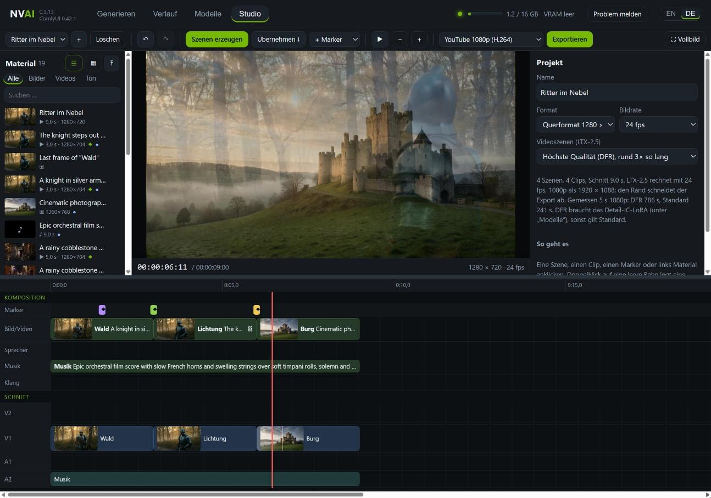
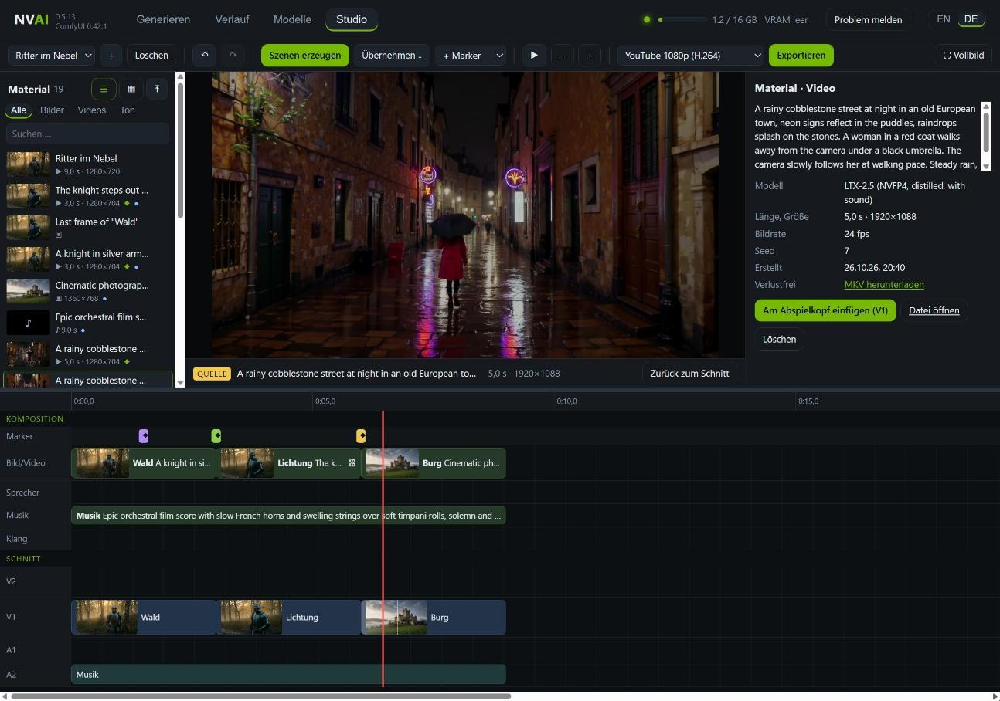

# Studio: ganze Videos aus Szenen

*English: [../STUDIO.md](../STUDIO.md)*

Das Studio ist ein eigener Reiter, der das ganze Fenster einnimmt. Oben komponierst du: Szenen mit
Prompt auf Bahnen für Bild, Sprecher, Musik und Klang, dazu Marker, die sagen, was wohin kommt. Unten
schneidest du die echten Clips: schneiden, trimmen, überblenden, Lautstärke. Ist der Schnitt fertig,
exportiert das Studio mit dem Video-Encoder deiner Grafikkarte. Es ist auf hochwertiges 1080p ausgelegt:
Videoszenen entstehen in höchster Qualität, jedes KI-Video wird zusätzlich verlustfrei aufbewahrt, und
komprimiert wird erst beim Export. Claude Code kann das alles genauso.

## Die zwei Zeitleisten

**Komposition** (oben): Jede Szene ist ein Prompt, ein Modell und eine Länge auf einer von vier Bahnen.

| Bahn | Was sie erzeugt |
|---|---|
| Bild/Video | Videoclips mit Ton (LTX-2.5) oder Standbilder (jedes Bildmodell) |
| Sprecher | Noch nichts: Eine Sprachausgabe hat NVAI-open bisher nicht. Stattdessen eine aufgenommene Tondatei auf die Szene ziehen |
| Musik | Instrumentalmusik bis 5 Minuten (Stable Audio 3 Medium); singen kann noch kein Modell |
| Klang | Geräusche und Atmosphäre (Stable Audio Open) |

**Schnitt** (unten): die Clips, die ins Video kommen, auf den Spuren V2 (über V1), V1, A1 und A2. Jeder
Clip hat einen Anfangs- und einen Endpunkt, eine Lautstärke und auf Wunsch eine Überblendung am Anfang.

**Übernehmen** legt die gewählten Takes der Komposition in den Schnitt. Ein Clip bleibt mit seiner Szene
verbunden: Szene neu erzeugen, übernehmen, und der Clip bekommt das neue Material, dein Schnitt bleibt.

## Schritt für Schritt

1. **Neues Projekt:** oben links **+** neben der Projektauswahl klicken. Projekte heißen „New 1“, „New 2“
   und so weiter und beginnen mit 1920 × 1080 und 24 fps. Name, Format, Bildrate und die Qualität der
   Videoszenen stehen rechts in den Eigenschaften, solange nichts gewählt ist.
2. **Szenen anlegen:** Doppelklick auf eine Bahn, dann in den Eigenschaften den Prompt schreiben. Eine
   Szene verschiebst du durch Ziehen, ihre Länge am rechten Rand. Bei Video legt die Länge die Bildzahl
   fest (LTX-2.5 mit 24 Bildern je Sekunde); ein 1080p-Projekt bekommt 1920 × 1088.
3. **Marker setzen:** Doppelklick auf die Markerzeile, „+ Marker“ oder M für eine Notiz am Abspielkopf.
4. **Szenen erzeugen:** erzeugt alle Szenen ohne Take, mit dem Modell aus den Eigenschaften oder dem
   aktiven. Kurze Aufträge kommen zuerst (Ton, Standbilder), dann die Videos; eine Anschluss-Szene wartet
   auf die Szene davor und folgt von selbst. Fertige Szenen zeigen ihre Takes in den Eigenschaften; ein
   Klick auf einen Take nimmt ihn.
5. **Übernehmen.**
6. **Schneiden:** C schneidet am Abspielkopf, Clips verschiebst du durch Ziehen, an den Rändern trimmst
   du sie, Entf löscht, Umschalt+Entf schließt dabei die Lücke. Überblendung, Lautstärke und Stumm stehen
   in den Eigenschaften.
7. **Exportieren:** Format wählen und „Exportieren“ klicken. Das fertige Video steht auch im Verlauf.

Das Studio speichert jede Änderung sofort. Rückgängig und Wiederholen reichen 100 Schritte zurück; Takes,
die in der Zwischenzeit fertig werden, bleiben. „Löschen“ neben dem Projekt verschiebt es in den
Papierkorb des Studios (`studio\papierkorb` im Datenordner).

## Material

Die Liste links enthält alles aus dem Verlauf, neueste zuerst: kompakt als Liste oder als Kacheln, mit
Filter für Bilder, Videos und Ton und einem Suchfeld. Sie bleibt von selbst aktuell: Fertige Aufträge,
Hochgeladenes und Gelöschtes erscheinen sofort. ◆ zeigt ein Video mit verlustfreier Kopie, ● Material,
das im Schnitt liegt.

**Anklicken** macht den Monitor zum Quellmonitor: Videos und Ton laufen mit eigenen Bedienelementen,
Bilder stehen in voller Größe. Die Eigenschaften zeigen Modell, Länge, Größe, Bildrate, Seed und Datum,
den Download der verlustfreien Kopie, „Am Abspielkopf einfügen“ (V1, Ton auf A2) und „Löschen“. Esc oder
„Zurück zum Schnitt“ zeigt wieder den Schnitt. Auf eine Spur gezogen wird eine Datei zum Clip, auf eine
Szene gezogen zum Take.

**Löschen** fragt im Knopf selbst nach („Löschen?“), ohne Browser-Dialog. Die Datei ist danach weg, samt
verlustfreier Kopie und Vorschau. Was als Clip im Schnitt liegt, lässt sich hier nicht löschen: erst den
Clip löschen. Ein gelöschter Take verschwindet aus seiner Szene.

Verlustfreie Dateien (FFV1 in MKV, ProRes in MOV) und hochgeladene MKV-, MOV- oder AVI-Dateien spielt kein
Browser ab. NVAI-open gibt ihnen eine H.264-Vorschau: Studio-Exporte schreiben sie im selben Durchgang mit,
Hochgeladenes bekommt sie im Hintergrund wenige Sekunden später. Die Vorschau ist nur zum Ansehen; Export
und Download nehmen das Original.

## Marker

| Marker | Was er bewirkt |
|---|---|
| Platzieren | Beim Übernehmen kommt die gewählte Szene an diese Stelle, auf die gewählte Spur (V2 liegt über V1) |
| Übergang | Beim Übernehmen bekommt der Clip, der hier beginnt, eine Überblendung dieser Länge |
| Anschluss | Beim Erzeugen beginnt die Videoszene an dieser Stelle mit dem letzten Bild der Szene davor: ein nahtloser Übergang |
| Ton ab hier | Beim Übernehmen beginnt die gewählte Ton-Szene (Musik, Sprecher, Klang) an dieser Stelle |
| KI-Auftrag | Ein Auftrag für Claude: Es liest ihn per MCP, arbeitet ihn ab und hakt ihn ab |
| Notiz | Nur eine Notiz |

Im Test geht ein Ritter durch einen Nebelwald (3 s). Ein Anschluss-Marker bei 3 s lässt die Szene auf der
Lichtung mit dem letzten Bild der Waldszene beginnen, ein Übergang-Marker bei 6 s blendet in 0,75 s auf die
Burg über. Das exportierte Video, Bild für Bild:

## Qualität: 1080p ohne Verluste unterwegs

- **Höchste Qualität für Videoszenen:** Ist das Detail-IC-LoRA installiert (unter „Modelle“), laufen
  LTX-2.5-Szenen als „Höchste Qualität (DFR)“: Details bleiben über den ganzen Clip, dafür rund dreimal so
  lang (5 s in 1080p: 786 statt 241 s). Die Projekteinstellung „Videoszenen“ stellt auf „Standard,
  schneller“.
- **Verlustfreie Kopie jedes KI-Videos:** Neben dem MP4 speichert NVAI-open jedes erzeugte Video Bild für
  Bild ohne Kompression (FFV1, Ton als Float-PCM). Das Studio schneidet und exportiert daraus, und eine
  Anschluss-Szene nimmt ihr Startbild daraus. Gegen das Original gemessen: Ein YouTube-1080p-Export aus dem
  MP4 kam auf 37,7 dB PSNR, aus der verlustfreien Kopie auf 42,3 dB bei gleicher Dateigröße; ein
  Anschluss-Startbild aus der Kopie ist pixelgenau. Das kostet Platz: rund 32 MB je Sekunde bei 1080p (5 s:
  162 statt 10 MB). Der Schalter „Verlustfreie Kopie für den Schnitt“ unter „Generieren → Video“ schaltet
  sie ab.
- **Kein unnötiges Skalieren:** LTX-2.5 rechnet 1080p als 1920 × 1088; der Export schneidet die 8 Zeilen
  zu viel ab, statt das ganze Bild zu verkleinern. Clips, deren Seitenverhältnis höchstens 5 % vom Projekt
  abweicht, füllen den Rahmen, andere bekommen schwarze Ränder.

## Tastatur

| Taste | |
|---|---|
| Leertaste | Abspielen und anhalten |
| C | Am Abspielkopf schneiden (ist ein Clip gewählt, nur auf seiner Spur) |
| M | Notiz-Marker am Abspielkopf |
| Entf / Umschalt+Entf | Auswahl löschen / Clip löschen und Lücke schließen |
| Strg+Z / Strg+Y | Rückgängig / Wiederholen |
| ← → | Ein Bild; mit Umschalt eine Sekunde |
| Pos1 / Ende | An den Anfang / ans Ende |
| + / −, Strg+Mausrad | Zoomen |
| Esc | Vom Quellmonitor zurück zum Schnitt |

„Vollbild“ oben rechts blendet alles außer dem Studio aus.

## Export

| Format | |
|---|---|
| YouTube 1080p (H.264) | 1920 × 1080, 24 Mbit/s |
| YouTube 4K (H.265) | 3840 × 2160, 40 Mbit/s |
| Hochformat 1080 × 1920 (Shorts) | H.264, 10 Mbit/s |
| AV1 1080p (klein) | 6 Mbit/s |
| Projektformat (H.264) | in der Größe des Projekts |
| Master verlustfrei (MKV, FFV1) | pixelgenau, Ton als Float-PCM; zum Archivieren und Weiterverarbeiten |
| ProRes 4444 (MOV) | für andere Schnittprogramme, Ton 24 Bit |

Das Studio nimmt den Video-Encoder deiner Karte: NVENC bei NVIDIA, AMF bei AMD Radeon, Quick Sync bei Intel,
ohne einen solchen rechnet die CPU. Der Ton aller Clips wird gemischt und auf −14 LUFS gebracht, die
Lautheit, mit der YouTube abspielt, mit einem Limiter gegen Übersteuern. Der Export läuft in einer eigenen
Warteschlange, du kannst also währenddessen weiter erzeugen.

Warum 24 Mbit/s für YouTube 1080p: gegen das verlustfreie Original gemessen kamen 12 Mbit/s auf 42,3 dB,
24 Mbit/s auf 42,8 dB und 40 Mbit/s auf 43,0 dB; die Farbe in 4:2:0, die jeder YouTube-Upload hat, kommt
selbst ohne Kompression nicht über 43,9 dB. Über 24 Mbit/s wächst die Datei, das Bild kaum.

## Mit Claude Code

Der MCP-Server von NVAI-open hat sechs Studio-Werkzeuge: `studio_projects`, `studio_create`, `studio_get`,
`studio_command`, `studio_generate` und `studio_export`. Bitte Claude um eine Geschichte, und es schreibt
die Szenen, erzeugt sie, übernimmt sie, setzt Marker und Schnitte und exportiert; das Studio zeigt jede
Änderung live. Mit einem „KI-Auftrag“-Marker hinterlässt du Claude eine Notiz direkt in der Zeitleiste,
etwa „hier einen Titel einblenden“: Claude findet offene Aufträge mit `studio_get` und hakt sie ab, wenn
sie erledigt sind. Einrichtung und Einzelheiten (englisch):
[CLAUDE_CODE.md](../CLAUDE_CODE.md#studio-whole-videos-from-scenes-since-0513).

## Zeiten

Gemessen auf einer RTX 5060 Ti 16 GB:

| | |
|---|---|
| LTX-2.5-Clip, 5 s in 1920 × 1088, Standard / höchste Qualität (DFR) | 241 s / 786 s |
| Vier Testszenen: zwei Clips à 3 s in 1280 × 704 (der zweite per Anschluss), ein Standbild, 9 s Musik | zusammen 270 s, der Anschluss-Clip 78 s |
| Standbild mit Krea 2 / 20 s Musik mit Stable Audio 3 | 25 s / rund 7 s |
| Verlustfreie Kopie, 5 s in 1080p | in rund 1,6 s geschrieben, 162 MB |
| Export 5 s in 1080p aus der verlustfreien Kopie: YouTube (NVENC) / Master / ProRes 4444 | 4 s / 4,4 s / 11,9 s |
| Lautheit des Exports | −14,0 LUFS, True Peak −2,5 dBTP |

Ein langes Video nur aus erzeugten Clips dauert: 10 Minuten sind 120 Clips à 5 s, in 1080p rund 8 Stunden
mit dem Standardweg und rund einen Tag mit DFR. Standbilder mit Musik und Sprecher sind viel günstiger.

## Was noch fehlt

- Sprecherstimme (Sprachausgabe). Bis dahin eine aufgenommene Tondatei auf die Sprecher-Szene ziehen.
- Titel, Untertitel, Kamerafahrten auf Standbildern, Wellenformen, Export als PNG-Einzelbilder, WAV oder
  SRT, Austausch mit anderen Schnittprogrammen (OpenTimelineIO).
- Das Studio in NVAI-open für Mac.
