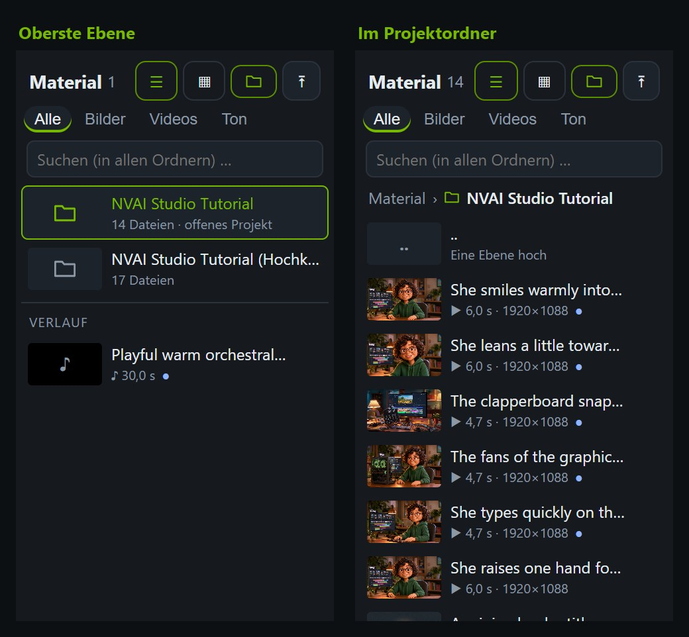
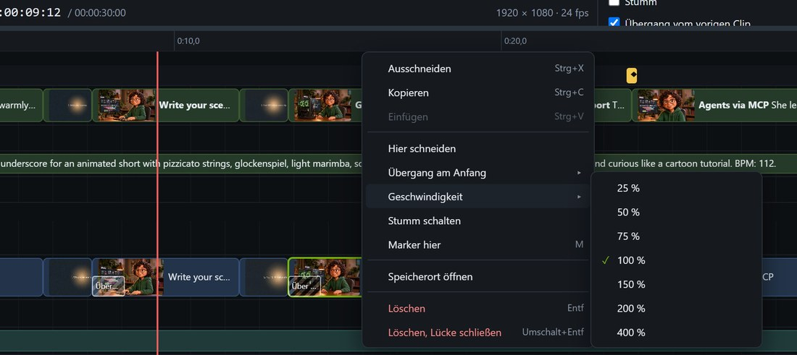
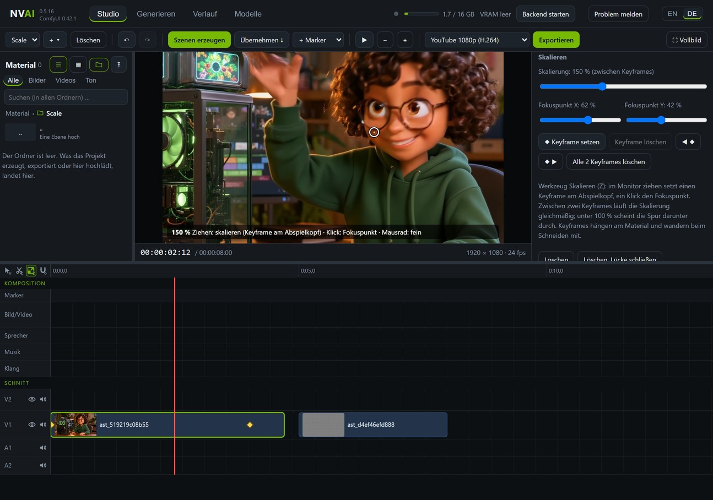
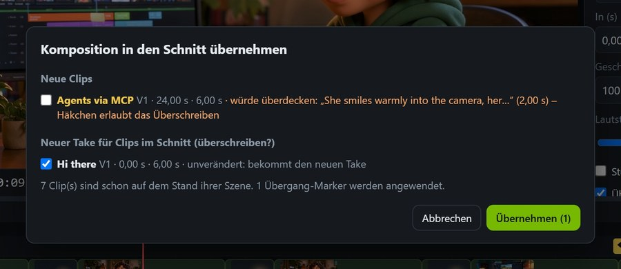

# Studio: ganze Videos aus Szenen

*English: [../STUDIO.md](../STUDIO.md)*

Das Studio ist ein eigener Reiter, der das ganze Fenster einnimmt; es ist der erste Reiter und beim Start offen. Oben komponierst du: Szenen mit
Prompt auf Bahnen für Bild, Sprecher, Musik und Klang, dazu Marker, die sagen, was wohin kommt. Unten
schneidest du die echten Clips: schneiden, trimmen, überblenden, Lautstärke. Ist der Schnitt fertig,
exportiert das Studio mit dem Video-Encoder deiner Grafikkarte. Es ist auf hochwertiges 1080p ausgelegt:
Videoszenen entstehen in höchster Qualität, jedes KI-Video wird zusätzlich verlustfrei aufbewahrt, und
komprimiert wird erst beim Export. Claude Code kann das alles genauso.

## Die zwei Zeitleisten

**Komposition** (oben): Jede Szene ist ein Prompt, ein Modell und eine Länge auf einer von vier Bahnen.

| Bahn | Was sie erzeugt |
|---|---|
| Bild/Video | Videoclips mit Ton (LTX-2.5) oder Standbilder (jedes Bildmodell) |
| Sprecher | Noch nichts: Eine Sprachausgabe hat NVAI-open bisher nicht. Stattdessen eine aufgenommene Tondatei auf die Szene ziehen |
| Musik | Instrumentalmusik bis 5 Minuten (Stable Audio 3 Medium); singen kann noch kein Modell |
| Klang | Geräusche und Atmosphäre (Stable Audio Open) |

**Schnitt** (unten): die Clips, die ins Video kommen, auf den Spuren V1, V2 (über V1) … und A1, A2 …;
weitere Spuren legt ein Rechtsklick auf den Spurnamen an. Jeder Clip hat einen Anfangs- und einen Endpunkt,
eine Geschwindigkeit, eine Lautstärke und auf Wunsch einen Übergang am Anfang.

**Übernehmen** legt die gewählten Takes der Komposition in den Schnitt. Ein Clip bleibt mit seiner Szene
verbunden: Szene neu erzeugen, übernehmen, und der Clip bekommt das neue Material, dein Schnitt bleibt.
Liegt schon etwas im Schnitt, fragt das Studio vorher nach (siehe [Übernehmen ohne Überraschungen](#übernehmen-ohne-überraschungen)).

## Schritt für Schritt

1. **Neues Projekt:** oben links **+** neben der Projektauswahl, dann „Neues Projekt“. Projekte heißen
   „New 1“, „New 2“ und so weiter und beginnen mit 1920 × 1080 und 24 fps. Name, Format, Bildrate und die
   Qualität der Videoszenen stehen rechts in den Eigenschaften: Ein Klick auf die Projektauswahl zeigt sie,
   ebenso ein Klick ins Leere.
2. **Szenen anlegen:** Doppelklick auf eine Bahn, dann in den Eigenschaften den Prompt schreiben. Eine
   Szene verschiebst du durch Ziehen, ihre Länge am rechten Rand. Bei Video legt die Länge die Bildzahl
   fest (LTX-2.5 mit 24 Bildern je Sekunde); ein 1080p-Projekt bekommt 1920 × 1088.
3. **Marker setzen:** Doppelklick auf die Markerzeile, „+ Marker“ oder M für eine Notiz am Abspielkopf.
4. **Szenen erzeugen:** erzeugt alle Szenen ohne Take, mit dem Modell aus den Eigenschaften oder dem
   aktiven. Kurze Aufträge kommen zuerst (Ton, Standbilder), dann die Videos; eine Anschluss-Szene wartet
   auf die Szene davor und folgt von selbst. Fertige Szenen zeigen ihre Takes in den Eigenschaften; ein
   Klick auf einen Take nimmt ihn.
5. **Übernehmen.**
6. **Schneiden:** Mit der Auswahl (V) verschiebst du Clips durch Ziehen und trimmst sie an den Rändern;
   mit dem Schneidewerkzeug (C) teilt ein Klick den Clip, Strg+K schneidet am Abspielkopf. Entf löscht,
   Umschalt+Entf schließt dabei die Lücke. Ein Rechtsklick zeigt überall, was geht; Geschwindigkeit,
   Übergang, Lautstärke und Stumm stehen auch in den Eigenschaften.
7. **Exportieren:** Format wählen und „Exportieren“ klicken. Das fertige Video steht auch im Verlauf.

Das Studio speichert jede Änderung sofort. Rückgängig und Wiederholen reichen 100 Schritte zurück; Takes,
die in der Zwischenzeit fertig werden, bleiben. „Löschen“ neben dem Projekt verschiebt es in den
Papierkorb des Studios (`studio\papierkorb` im Datenordner).

## Material

Die Liste links enthält dein Material, neueste zuerst: kompakt als Liste oder als Kacheln, mit Filter für
Bilder, Videos und Ton und einem Suchfeld. Sie bleibt von selbst aktuell: Fertige Aufträge, Hochgeladenes
und Gelöschtes erscheinen sofort. ◆ zeigt ein Video mit verlustfreier Kopie, ● Material, das im Schnitt
liegt. Geladen werden je 100; „Weitere 100 laden“ am Ende holt die nächsten, und Filter und Suche gehen über
dein ganzes Material, nicht nur über das Geladene. Die Linie rechts neben der Liste macht sie breiter, wenn
du sie ziehst; ein Doppelklick auf die Linie stellt sie zurück.

**Jedes Projekt hat seinen eigenen Ordner** (seit 0.5.15), auf der Platte im Datenordner
unter `assets\Studio\<Projektname>`; benennst du das Projekt um, heißt der Ordner mit. Was das Studio für ein
Projekt erzeugt, landet dort: Takes, Exporte, die letzten Bilder für Anschlüsse und was du hochlädst, während
der Ordner offen ist. Der Verlauf führt, was dort erzeugt oder exportiert wurde, mit dem Namen des Ordners, und
sein Ordnerfilter zeigt alles, nur den allgemeinen Verlauf oder ein Projekt. Bilder, Videos, Ton und restaurierte Fotos, die du im Generator für ein
Projekt machst, kommen ebenfalls gleich in seinen Ordner: unter „Ablegen in“ über dem Generieren-Knopf das Projekt
wählen (Claude: `project_id`). Der Ordner-Knopf neben dem Hochladen-Knopf blendet
die Ordner ein und aus: Auf der obersten Ebene stehen die Projektordner (der des offenen Projekts grün),
darunter der allgemeine Verlauf; „..“ oben in einem Ordner geht eine Ebene hoch, ein Doppelklick öffnet einen
Ordner, und ein Rechtsklick auf einen Ordner bietet „Speicherort öffnen“. Wechselst du das Projekt, öffnet
sich sein Ordner. Ausblenden versteckt nur diese Ordnereinträge: Die Liste bleibt in dem Ordner, den du offen
hast. Die Suche sucht immer in allen Ordnern und zeigt, wo eine Datei liegt.

Beim ersten Start von 0.5.15 wandert das Material bestehender Projekte in deren Ordner: Takes, Clips,
Start- und Endbilder, vorgegebener Ton, Exporte, letzte Bilder und Hochgeladenes, das nur dieses Projekt
nutzt. Was mehrere Projekte nutzen oder ein Auftrag im Verlauf als Vorlage braucht, bleibt, wo es ist.
„Verlauf leeren“ lässt die Projektordner in Ruhe und ebenso alles, was ein Projekt nutzt; einen einzelnen
Eintrag zu löschen löscht seine Dateien auch im Projektordner, außer ein Projekt nutzt sie. Ein gelöschtes
Projekt behält seinen Ordner samt Material; ein leerer verschwindet.

**Anklicken** macht den Monitor zum Quellmonitor: Videos und Ton laufen mit eigenen Bedienelementen,
Bilder stehen in voller Größe. Die Eigenschaften zeigen Modell, Länge, Größe, Bildrate, Seed und Datum,
den Download der verlustfreien Kopie, „Am Abspielkopf einfügen“ (V1, Ton auf A2) und „Löschen“. Esc oder
„Zurück zum Schnitt“ zeigt wieder den Schnitt. Auf eine Spur gezogen wird eine Datei zum Clip, auf eine
Szene gezogen zum Take.

**Löschen** fragt im Knopf selbst nach („Löschen?“), ohne Browser-Dialog. Die Datei ist danach weg, samt
verlustfreier Kopie und Vorschau. Was als Clip im Schnitt liegt, lässt sich hier nicht löschen: erst den
Clip löschen. Ein gelöschter Take verschwindet aus seiner Szene.

Verlustfreie Dateien (FFV1 in MKV, ProRes in MOV) und hochgeladene MKV-, MOV- oder AVI-Dateien spielt kein
Browser ab. NVAI-open gibt ihnen eine H.264-Vorschau: Studio-Exporte schreiben sie im selben Durchgang mit,
Hochgeladenes bekommt sie im Hintergrund wenige Sekunden später. Die Vorschau ist nur zum Ansehen; Export
und Download nehmen das Original.

## Werkzeuge, Rechtsklick und Spuren

Links oben über den Spurnamen stehen drei Werkzeuge, jeweils mit ihrer Taste:

- **Auswahl (V):** Ziehen verschiebt, die Ränder trimmen, ein Rahmen im Leeren wählt mehrere Objekte;
  Umschalt- oder Strg-Klick nimmt einzelne dazu oder heraus. Was gewählt ist, wandert zusammen, Clips auch
  auf eine andere Spur derselben Art.
- **Schneiden (C):** Eine weiße Linie zeigt die Stelle, ein Klick teilt den Clip, mit Umschalt auf allen
  Spuren. Esc oder V führt zurück zur Auswahl.
- **Magnet:** Eingeschaltet docken Clips, Szenen und Marker an Kanten, Markern, dem Abspielkopf und 0 an;
  eine weiße Linie zeigt, wo. Ausgeschaltet dockt an, solange die Umschalttaste ⇧ gedrückt ist. An und aus
  per Klick oder mit S.

Der **Rechtsklick** geht überall:

| Wo | Was |
|---|---|
| Clip | Ausschneiden, Kopieren, Einfügen, Hier schneiden, Übergang am Anfang, Geschwindigkeit, Stumm, Marker hier, Speicherort öffnen, Löschen |
| Übergang | Art, Dauer, Entfernen |
| Freie Stelle im Schnitt | Hier einfügen, Übergang am Schnitt in der Nähe, Marker hier, Spur hinzufügen |
| Spurname (V1, A1 …) | Video- oder Tonspur hinzufügen, ausblenden, stumm schalten, Spur entfernen |
| Szene, freie Bahn | Erzeugen, Ausschneiden, Kopieren, Einfügen, Löschen; neue Szene oder neues Standbild hier |
| Marker, Markerzeile | Erledigt, Art, Ausschneiden, Kopieren, Löschen; Marker hier |
| Material links | Im Monitor zeigen, an eine Spur senden (am Abspielkopf), Speicherort öffnen, Datei öffnen, Löschen |

**Kopieren und Einfügen:** Strg+C merkt die gewählten Clips, Szenen oder Marker, Strg+V legt sie am
Abspielkopf ab, Clips auf dieselben Spuren; danach steht der Abspielkopf an ihrem Ende. Ausschneiden
(Strg+X) lässt eine Lücke. Ein ausgeschnittener Clip bleibt beim Einfügen mit seiner Szene verbunden.

**Spuren:** V1 und A1 bleiben immer. Neue Videospuren kommen oben dazu (V3 über V2), Tonspuren unten.
Das Auge blendet das Bild einer Videospur aus, der Lautsprecher schaltet ihren Ton stumm, bei Videospuren
den Ton ihrer Clips. Beides gilt für die Vorschau und den Export. Eine entfernte Spur nimmt ihre Clips mit;
Rückgängig holt beides zurück.

## Geschwindigkeit und Übergänge

**Geschwindigkeit** in Prozent (10 bis 1000 %) stellst du in den Eigenschaften des Clips oder per
Rechtsklick ein. Wie bei FilmCraft bleiben In und Out Zeiten im Material; der Clip wird kürzer oder länger.
Bilder werden dabei wiederholt oder übersprungen, der Ton behält seine Tonhöhe, in der Vorschau wie im
Export. Stößt ein langsamerer Clip an den nächsten, fragt das Studio nach: bis zum nächsten Clip (der Clip
zeigt dann weniger Material), die späteren Clips der Spur nach hinten schieben oder sie überdecken.
Gemessen: 80 % machen aus einem 6-s-Clip 7,5 s, und der Export zeigt die richtige Stelle im Material
(geprüft 4 und 7 s nach dem Clipanfang).

**Übergänge** gibt es als Überblendung, Abblende über Schwarz, Abblende über Weiß und Wischblende (von
links, mit weicher Kante). Sie werden klassisch gerechnet, ohne KI, und wirken sofort; Vorschau und Export
zeigen dasselbe. Ein Übergang liegt als schraffierter Block am Anfang seines Clips über dem Bild: anklicken
wählt ihn, an der rechten Kante ziehen ändert die Dauer. Anlegen per Rechtsklick auf den Clip („Übergang am
Anfang“) oder auf eine freie Stelle über dem Schnitt („Übergang hier“, auch in der obersten Spur), mit
Strg+D an den gewählten Clips oder am Schnitt beim Abspielkopf, oder mit einem Übergang-Marker. Der vorige
Clip läuft dafür über sein Ende hinaus weiter; reicht sein Material nicht, steht sein letztes Bild. Ohne
vorigen Clip auf derselben Spur blendet der Clip über dem Bild darunter bzw. über Schwarz auf.

## Skalieren und zoomen mit Keyframes (seit 0.5.16)

Jeder Videoclip lässt sich von 10 bis 800 % skalieren. Ein **Fokuspunkt** bleibt dabei an seiner Stelle, so
geht ein Zoom auf das Gesicht oder die Grafikkarte zu statt in die Mitte. Unter 100 % wird der Clip über der
Spur darunter kleiner: Bild im Bild.

Mit dem **Werkzeug Skalieren** (Z) arbeitest du direkt im Monitor: nach oben ziehen vergrößert, nach unten
verkleinert; beim Loslassen entsteht am Abspielkopf ein **Keyframe**. Ein Klick ohne Ziehen setzt den
Fokuspunkt, das Mausrad skaliert fein. Ein Klick mit dem Werkzeug auf einen Clip wählt ihn und setzt den
Abspielkopf dorthin. Zwischen zwei Keyframes ändert sich die Skalierung gleichmäßig, vor dem ersten und nach
dem letzten gilt ihr Wert. Keyframes stehen als Rauten auf dem Clip: Klick springt hin, Doppelklick löscht.
Die Eigenschaften des Clips haben dasselbe unter „Skalieren“: den Wert am Abspielkopf, Fokuspunkt X und Y,
Keyframe setzen und löschen, zum vorigen oder nächsten springen, alle löschen. Ohne Keyframes gilt der Wert
für den ganzen Clip.

Keyframes hängen am Material, wie In und Out: Schneidest du einen Clip, behalten beide Teile den Zoom; bei
anderem Tempo bleibt der Zoom an derselben Stelle im Material. Vorschau und Export rechnen dasselbe. Gemessen
an einem Testmuster: Der Fokuspunkt blieb im Export auf einen halben Pixel genau stehen, und der Abstand
zweier Marken wuchs genau mit der Skalierung (100, 150, 200 %).

## Marker

| Marker | Was er bewirkt |
|---|---|
| Platzieren | Beim Übernehmen kommt die gewählte Szene an diese Stelle, auf die gewählte Spur (V2 liegt über V1) |
| Übergang | Der Videoclip, der hier beginnt, bekommt diesen Übergang (Art und Dauer): sofort, wenn er schon im Schnitt liegt, sonst beim Übernehmen. Wandert der Marker, wandert der Übergang mit |
| Anschluss | Beim Erzeugen beginnt die Videoszene an dieser Stelle mit dem letzten Bild der Szene davor: ein nahtloser Übergang |
| Ton ab hier | Beim Übernehmen beginnt die gewählte Ton-Szene (Musik, Sprecher, Klang) an dieser Stelle |
| KI-Auftrag | Ein Auftrag für Claude: Es liest ihn per MCP, arbeitet ihn ab und hakt ihn ab |
| Notiz | Nur eine Notiz |

Im Test geht ein Ritter durch einen Nebelwald (3 s). Ein Anschluss-Marker bei 3 s lässt die Szene auf der
Lichtung mit dem letzten Bild der Waldszene beginnen, ein Übergang-Marker bei 6 s blendet in 0,75 s auf die
Burg über. Das exportierte Video, Bild für Bild:

## Übernehmen ohne Überraschungen

„Übernehmen“ prüft vorher, was es täte. Ist alles neu und überdeckt nichts, legt es einfach an. Sonst
erscheint eine Liste: **neue Clips**, mit Warnung, wenn einer einen vorhandenen Clip überdecken würde (das
Häkchen erlaubt dann das Überschreiben), und mit Hinweis, wenn der Take schon im Schnitt liegt; dazu **Clips
im Schnitt, deren Szene einen neuen Take hat**. Vorgewählt ist, was nichts verändert, das du selbst
geschnitten hast: Ein Clip, der noch so lang ist wie seine Szene, bekommt den neuen Take; einen gekürzten
oder geteilten tauscht das Studio nur, wenn du ihn ankreuzt, und behält dabei deinen Schnitt.

## Projekte weitergeben

**„+“ → „Projekt exportieren“** packt das Projekt mit allem Material in eine ZIP-Datei: Clips, Takes,
Start- und Endbilder, vorgegebener Ton und die Vorschauen, auf Wunsch auch die verlustfreien Kopien (in
1080p rund 32 MB je Sekunde). Das Menü zeigt die Größe vorher. **„Projekt importieren“** liest ein solches
Paket oder eine Projektdatei (.json) ein, auch auf einem anderen Rechner. Material, das es dort schon gibt,
wird nicht doppelt kopiert; heißt schon ein Projekt so, bekommt das neue eine Nummer. Das importierte
Projekt bekommt seinen eigenen Ordner, sein Material landet dort. Gemessen: das Hochkant-Tutorial mit 17
Dateien ergibt 63 MB, gepackt in 0,5 s, ohne Kompression, weil Videos schon komprimiert sind.

## Qualität: 1080p ohne Verluste unterwegs

- **Höchste Qualität für Videoszenen:** Ist das Detail-IC-LoRA installiert (unter „Modelle“), laufen
  LTX-2.5-Szenen als „Höchste Qualität (DFR)“: Details bleiben über den ganzen Clip, dafür rund dreimal so
  lang (5 s in 1080p: 786 statt 241 s). Die Projekteinstellung „Videoszenen“ stellt auf „Standard,
  schneller“.
- **Verlustfreie Kopie jedes KI-Videos:** Neben dem MP4 speichert NVAI-open jedes erzeugte Video Bild für
  Bild ohne Kompression (FFV1, Ton als Float-PCM). Das Studio schneidet und exportiert daraus, und eine
  Anschluss-Szene nimmt ihr Startbild daraus. Gegen das Original gemessen: Ein YouTube-1080p-Export aus dem
  MP4 kam auf 37,7 dB PSNR, aus der verlustfreien Kopie auf 42,3 dB bei gleicher Dateigröße; ein
  Anschluss-Startbild aus der Kopie ist pixelgenau. Das kostet Platz: rund 32 MB je Sekunde bei 1080p (5 s:
  162 statt 10 MB). Der Schalter „Verlustfreie Kopie für den Schnitt“ unter „Generieren → Video“ schaltet
  sie ab.
- **Kein unnötiges Skalieren:** LTX-2.5 rechnet 1080p als 1920 × 1088; der Export schneidet die 8 Zeilen
  zu viel ab, statt das ganze Bild zu verkleinern. Clips, deren Seitenverhältnis höchstens 5 % vom Projekt
  abweicht, füllen den Rahmen, andere bekommen schwarze Ränder.

## Tastatur

| Taste | |
|---|---|
| Leertaste | Abspielen und anhalten |
| V / C / Z | Werkzeug Auswahl / Schneiden / Skalieren |
| S | Magnet an und aus |
| Umschalt (⇧) beim Ziehen | Andocken, auch ohne Magnet |
| Strg+K | Am Abspielkopf schneiden (sind Clips gewählt, nur auf ihren Spuren) |
| Strg+C / Strg+X / Strg+V | Kopieren / Ausschneiden / am Abspielkopf einfügen |
| Strg+D | Überblendung an die gewählten Clips oder an den Schnitt beim Abspielkopf |
| Strg+A | Alle Clips wählen |
| M | Notiz-Marker am Abspielkopf |
| Entf / Umschalt+Entf | Auswahl löschen / Clips löschen und Lücke schließen |
| Strg+Z / Strg+Y | Rückgängig / Wiederholen |
| ← → | Ein Bild; mit Umschalt eine Sekunde |
| Pos1 / Ende | An den Anfang / ans Ende |
| + / −, Strg+Mausrad | Zoomen |
| Esc | Ziehen abbrechen, zurück zur Auswahl, Auswahl aufheben, vom Quellmonitor zurück zum Schnitt |

„Vollbild“ oben rechts blendet alles außer dem Studio aus.

## Export

| Format | |
|---|---|
| YouTube 1080p (H.264) | 1920 × 1080, 24 Mbit/s |
| YouTube 4K (H.265) | 3840 × 2160, 40 Mbit/s |
| Hochformat 1080 × 1920 (Shorts) | H.264, 10 Mbit/s |
| AV1 1080p (klein) | 6 Mbit/s |
| Projektformat (H.264) | in der Größe des Projekts |
| Master verlustfrei (MKV, FFV1) | pixelgenau, Ton als Float-PCM; zum Archivieren und Weiterverarbeiten |
| ProRes 4444 (MOV) | für andere Schnittprogramme, Ton 24 Bit |

Das Studio nimmt den Video-Encoder deiner Karte: NVENC bei NVIDIA, AMF bei AMD Radeon, Quick Sync bei Intel,
ohne einen solchen rechnet die CPU. Der Ton aller Clips wird gemischt und auf −14 LUFS gebracht, die
Lautheit, mit der YouTube abspielt, mit einem Limiter gegen Übersteuern. Der Export läuft in einer eigenen
Warteschlange, du kannst also währenddessen weiter erzeugen.

Warum 24 Mbit/s für YouTube 1080p: gegen das verlustfreie Original gemessen kamen 12 Mbit/s auf 42,3 dB,
24 Mbit/s auf 42,8 dB und 40 Mbit/s auf 43,0 dB; die Farbe in 4:2:0, die jeder YouTube-Upload hat, kommt
selbst ohne Kompression nicht über 43,9 dB. Über 24 Mbit/s wächst die Datei, das Bild kaum.

## Mit Claude Code

Der MCP-Server von NVAI-open hat sechs Studio-Werkzeuge: `studio_projects`, `studio_create`, `studio_get`,
`studio_command`, `studio_generate` und `studio_export`. Bitte Claude um eine Geschichte, und es schreibt
die Szenen, erzeugt sie, übernimmt sie, setzt Marker und Schnitte und exportiert; das Studio zeigt jede
Änderung live. Mit einem „KI-Auftrag“-Marker hinterlässt du Claude eine Notiz direkt in der Zeitleiste,
etwa „hier einen Titel einblenden“: Claude findet offene Aufträge mit `studio_get` und hakt sie ab, wenn
sie erledigt sind. Einrichtung und Einzelheiten (englisch):
[CLAUDE_CODE.md](../CLAUDE_CODE.md#studio-whole-videos-from-scenes-since-0513).

## Zeiten

Gemessen auf einer RTX 5060 Ti 16 GB:

| | |
|---|---|
| LTX-2.5-Clip, 5 s in 1920 × 1088, Standard / höchste Qualität (DFR) | 241 s / 786 s |
| Vier Testszenen: zwei Clips à 3 s in 1280 × 704 (der zweite per Anschluss), ein Standbild, 9 s Musik | zusammen 270 s, der Anschluss-Clip 78 s |
| Standbild mit Krea 2 / 20 s Musik mit Stable Audio 3 | 25 s / rund 7 s |
| Verlustfreie Kopie, 5 s in 1080p | in rund 1,6 s geschrieben, 162 MB |
| Export 5 s in 1080p aus der verlustfreien Kopie: YouTube (NVENC) / Master / ProRes 4444 | 4 s / 4,4 s / 11,9 s |
| Lautheit des Exports | −14,0 LUFS, True Peak −2,5 dBTP |

Ein langes Video nur aus erzeugten Clips dauert: 10 Minuten sind 120 Clips à 5 s, in 1080p rund 8 Stunden
mit dem Standardweg und rund einen Tag mit DFR. Standbilder mit Musik und Sprecher sind viel günstiger.

## Was noch fehlt

- Sprecherstimme (Sprachausgabe). Bis dahin eine aufgenommene Tondatei auf die Sprecher-Szene ziehen.
- Titel, Untertitel, Schwenks (Bild verschieben; Zoomen gibt es seit 0.5.16), Wellenformen, Export als
  PNG-Einzelbilder, WAV oder SRT, Austausch mit anderen Schnittprogrammen (OpenTimelineIO).
- Das Studio in NVAI-open für Mac.

## Making of

Wie das Video entstand, das das Studio vorstellt, von der Anfrage in Claude Code bis zum Export, mit allen Prompts, Zeiten und Prüfungen: [MAKING_OF.md](MAKING_OF.md).
