# Studio: ganze Videos aus Szenen

*English: [../STUDIO.md](../STUDIO.md)*

Das Studio ist der erste Reiter, wenn NVAI-open startet, und nimmt das ganze Fenster ein. Oben komponierst du: Szenen
mit Prompt auf Bahnen für Bild, Sprecher, Musik und Klang, dazu Marker, die sagen, was wohin kommt. Unten schneidest
du die echten Clips. Ist der Schnitt fertig, exportiert das Studio mit dem Video-Encoder deiner Grafikkarte. Es ist auf
hochwertiges 1080p ausgelegt: Videoszenen entstehen in höchster Qualität, jedes KI-Video wird zusätzlich verlustfrei
aufbewahrt, und komprimiert wird erst beim Export. Claude Code kann das alles genauso, und auch NVAI-open für Mac hat
das Studio ([Auf dem Mac](#auf-dem-mac)).

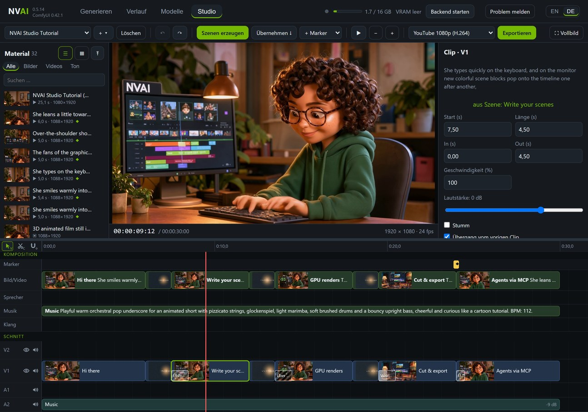

## Die zwei Zeitleisten

**Komposition** (oben): Jede Szene ist ein Prompt, ein Modell und eine Länge auf einer von vier Bahnen.

| Bahn | Was sie erzeugt |
|---|---|
| Bild/Video | Videoclips mit Ton (LTX-2.5) oder Standbilder (jedes Bildmodell) |
| Sprecher | Gesprochene Zeilen mit einer beschriebenen oder übernommenen Stimme (Qwen3-TTS), siehe [Sprecherstimme](#sprecherstimme) |
| Musik | Instrumentalmusik bis 5 Minuten (Stable Audio 3) |
| Klang | Geräusche und Atmosphäre (Stable Audio Open) |

**Schnitt** (unten): die Clips des fertigen Videos auf den Spuren V1, V2 (über V1) … und A1, A2 …. Jeder Clip hat
einen Anfangs- und einen Endpunkt, eine Geschwindigkeit, eine Lautstärke und auf Wunsch einen Übergang am Anfang.

**Übernehmen** legt die gewählten Takes in den Schnitt. Ein Clip bleibt mit seiner Szene verbunden: Szene neu
erzeugen, übernehmen, und der Clip bekommt das neue Material, dein Schnitt bleibt.

## Schritt für Schritt

1. **Neues Projekt:** oben links „+“ neben der Projektauswahl, dann „Neues Projekt“. Es beginnt mit 1920 × 1080 und
   24 fps. Name, Format und die Qualität der Videoszenen stehen rechts in den Eigenschaften; ein Klick ins Leere zeigt
   sie.
2. **Szenen anlegen:** Doppelklick auf eine Bahn und in den Eigenschaften den Prompt schreiben. Eine Szene verschiebst
   du durch Ziehen, ihre Länge am rechten Rand.
3. **Marker setzen:** Doppelklick auf die Markerzeile oder M für eine Notiz am Abspielkopf.
4. **Szenen erzeugen:** erzeugt alle Szenen ohne Take. Ton und Standbilder kommen zuerst, dann die Videos; eine
   Anschluss-Szene wartet auf die Szene davor, eine Sprecher-Szene auf die Stimme, die sie übernimmt. Solange es läuft, zeigt die Leiste neben „Übernehmen“ die Szene, die
   gerade entsteht, mit Prozent und wie viele fertig sind (etwa „Far view 63 % · 2/5“). „✕ Abbrechen“ (zweimal
   klicken) beendet alle laufenden und wartenden Aufträge des Projekts; fertige Takes bleiben.
5. **Übernehmen**, dann **schneiden:** Mit der Auswahl (V) Clips und ihre Ränder ziehen, mit dem Schneidewerkzeug (C)
   per Klick teilen; Strg+K schneidet am Abspielkopf. Ein Rechtsklick zeigt überall, was geht.
6. **Exportieren:** Format wählen und „Exportieren“ klicken. Das Video steht danach auch im Verlauf.

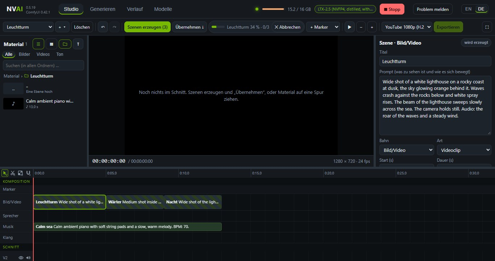

Das Studio speichert jede Änderung sofort, Rückgängig reicht 100 Schritte zurück. „Löschen“ neben dem Projekt
verschiebt es in den Papierkorb des Studios (`studio\papierkorb` im Datenordner).

## Material

Die Liste links zeigt dein Material, neueste zuerst, als Liste oder als Kacheln, mit Filter und einer Suche über alle
Ordner. ◆ zeigt ein Video mit verlustfreier Kopie, ● Material, das im Schnitt liegt. Die Linie neben der Liste macht
sie breiter, wenn du sie ziehst; die Eigenschaften rechts lassen sich genauso ziehen, ein Doppelklick stellt sie
zurück. Der Monitor behält immer mindestens 320 Pixel, so geht das Studio auch auf einem 14-Zoll-Notebook.

**Jedes Projekt hat seinen eigenen Ordner** unter `assets\Studio\<Projektname>` im Datenordner. Takes, Exporte, die
letzten Bilder für Anschlüsse und was du hochlädst, landen dort. Im Reiter „Generieren“ schickt „Ablegen in“ über dem
Generieren-Knopf Bilder, Videos und Ton direkt in den Ordner eines Projekts. Der Ordner-Knopf neben dem
Hochladen-Knopf blendet die Ordner ein; „..“ geht eine Ebene hoch. „Verlauf leeren“ lässt Projektordner in Ruhe, und
ein gelöschtes Projekt behält seinen Ordner.

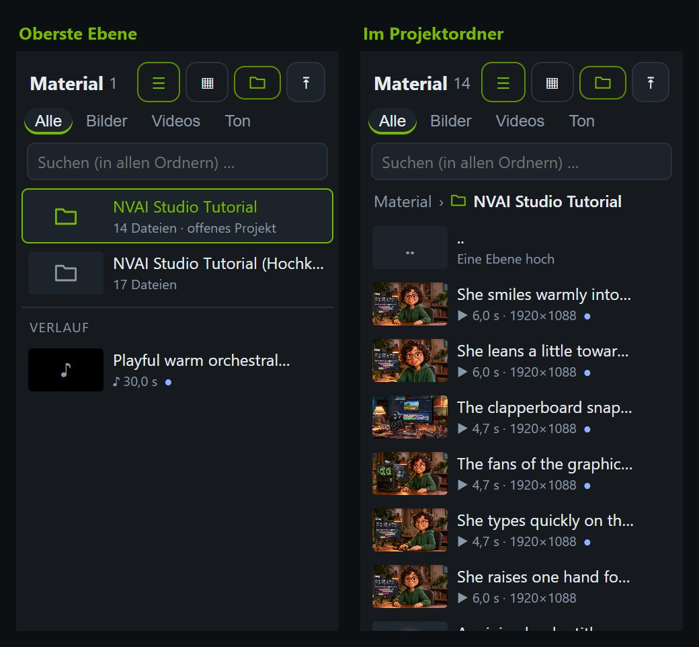

**Anklicken** spielt eine Datei im Monitor ab; Esc führt zurück zum Schnitt. Die Eigenschaften zeigen ihre Angaben,
den Download der verlustfreien Kopie, „Am Abspielkopf einfügen“ und „Löschen“. Auf eine Spur gezogen wird eine Datei
zum Clip, auf eine Szene gezogen zum Take. Was im Schnitt liegt, lässt sich erst nach seinem Clip löschen.

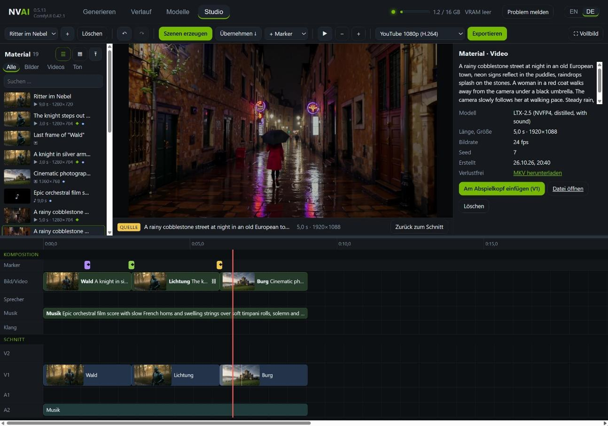

Verlustfreie Dateien und hochgeladene MKV-, MOV- oder AVI-Dateien spielt kein Browser ab, deshalb macht NVAI-open
dafür eine H.264-Vorschau zum Ansehen. Export und Download nehmen das Original.

## Sprecherstimme

Sprecher-Szenen sprechen ihren Text mit Qwen3-TTS (Apache-2.0, 10 Sprachen, darunter Deutsch und Englisch). Den Text
schreibst du in das Feld, in dem andere Szenen ihren Prompt haben; Satzzeichen setzen die Pausen. Unter „Stimme“
wählst du, woher die Stimme kommt:

- **beschreiben:** ein Satz mit Geschlecht, Alter, Tonlage, Tempo und Stimmung, etwa „eine ruhige, tiefe
  Männerstimme, etwa fünfzig, warm und leicht rau“. Jeder Seed klingt etwas anders, deshalb von der ersten Zeile ein
  paar Takes anhören.
- **gleich wie Szene …:** Der gewählte Take einer anderen Sprecher-Szene ist die Vorlage, samt seinem Text. Die Szene
  wartet, bis jene einen Take hat. So bleibt ein Sprecher über viele Zeilen gleich: Im Test lagen die Zeilen bei einer
  Ähnlichkeit von 0,99 zu ihrer Vorlage.
- **aus einer Aufnahme:** eine Ton- oder Videodatei des Projekts; die ersten 20 s zählen, drei Sekunden reichen. Mit
  dem genauen Wortlaut der Aufnahme wird auch die Sprechweise übernommen. Nur Aufnahmen nehmen, deren Sprecher
  zugestimmt haben.

Eine Sprecher-Szene wird so lang wie ihr Take, so schneidet Übernehmen nie das Satzende ab. Übernehmen legt die Zeilen
auf eine eigene Tonspur „Stimme“ (auf dem Mac ab 0.5.4), die es beim ersten Mal anlegt; sie lässt sich wie jede Spur entfernen, das nächste
Übernehmen legt sie wieder an. Der Export bringt die Mischung auf −14 LUFS. Im Test brauchten drei Zeilen samt Laden
des Modells 30 s.

## Figuren

Eine Figur bündelt Aussehen und Stimme, etwa eine Person, die du als LoRA trainiert hast. Ein Klick ins Leere zeigt die
Projekteinstellungen; unter „Figuren“ legt „+ Figur“ eine an:

- **Aussehen:** eine oder mehrere LoRAs (eigene Dateien unter „Modelle“ → „LoRA-Datei hinzufügen“, siehe
  [LORAS.md](LORAS.md)). Jede Szene nimmt die, die zu ihrem Modell passen; eine Figur kann also eine LoRA für
  Standbilder (Qwen-Image) und eine für Clips (LTX-2) haben. Die Trigger-Wörter kommen von selbst vorn in den Prompt.
- **Stimme:** wie bei einer Sprecher-Szene: beschreiben, vom Take einer Sprecher-Szene übernehmen oder aus einer
  Aufnahme. Klingt ein Satz richtig, ihn als Vorlage wählen, dann behalten alle weiteren Sätze diese Stimme.

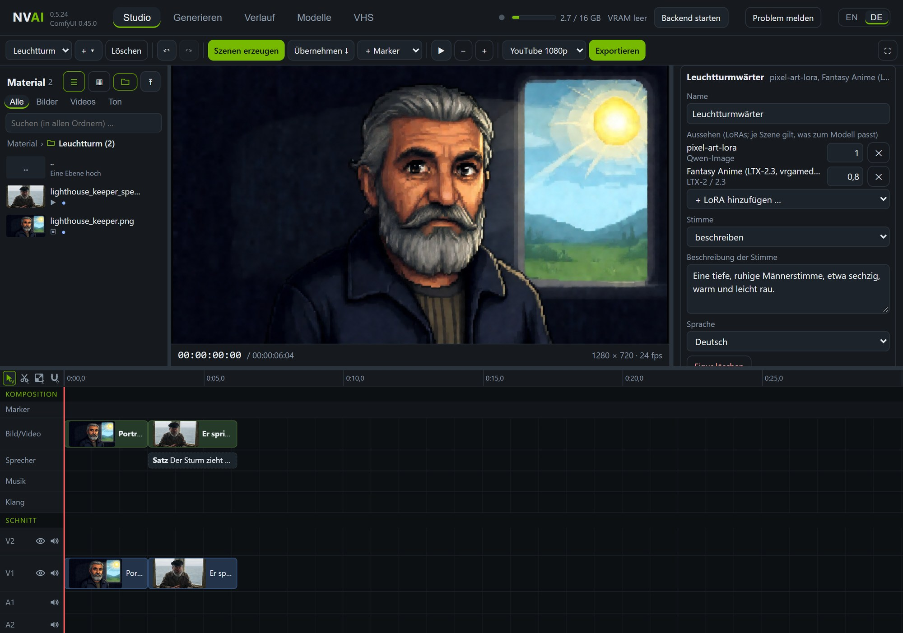

Danach die Figur in den Szenen zuordnen:

- **Bildszenen:** unter „Figuren im Bild“ anhaken. Passt keine ihrer LoRAs zum Modell der Szene, steht das dabei.
- **Sprecher-Szenen:** unter „Stimme“ „einer Figur …“ wählen; der Satz wird mit der Stimme der Figur gesprochen.
- **Videoszenen, die sprechen (LTX-2.5):** „Ton aus Sprecher-Szene“ nimmt deren Satz als Ton des Clips. Der Satz
  entsteht zuerst, das Video folgt ihm mit den Lippen und wird so lang wie er. Übernehmen legt den Satz nicht noch
  einmal auf die Spur „Stimme“.

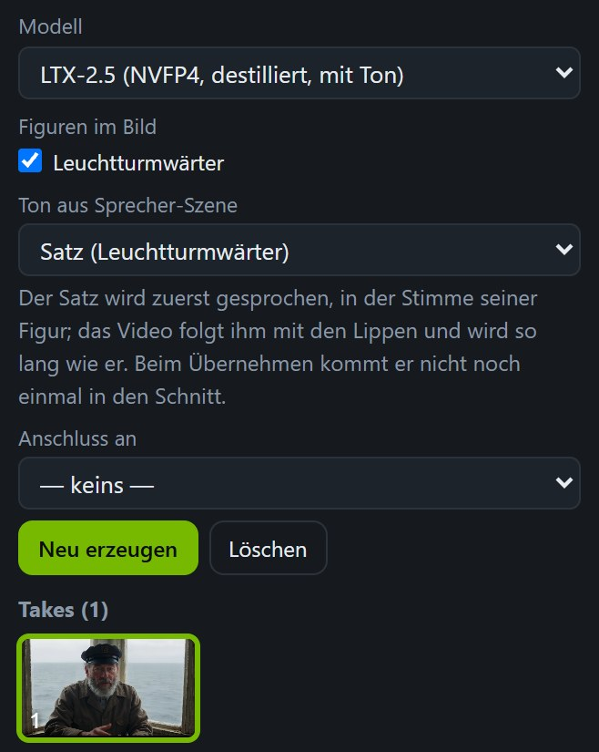

Claude Code macht dasselbe per MCP (`character.add`, `params.characters`, `params.character`, `params.audio_from`).

## Werkzeuge, Rechtsklick und Spuren

- **Auswahl (V):** Ziehen verschiebt und trimmt, ein Rahmen wählt mehrere; Umschalt- oder Strg-Klick nimmt einzelne
  dazu oder heraus.
- **Schneiden (C):** Ein Klick teilt den Clip, mit Umschalt auf allen Spuren.
- **Skalieren (Z):** Zoomen im Monitor, siehe unten.
- **Magnet (S):** Clips, Szenen und Marker docken an Kanten, Markern und dem Abspielkopf an. Ist er aus, dockt an, wer
  die Umschalttaste hält.

Der **Rechtsklick** geht überall: auf Clips (ausschneiden, kopieren, Übergang, Geschwindigkeit, stumm, löschen …),
Übergänge, freie Stellen, Spurnamen (Spur hinzufügen, ausblenden, stumm schalten, entfernen), Szenen, Marker und
Material.

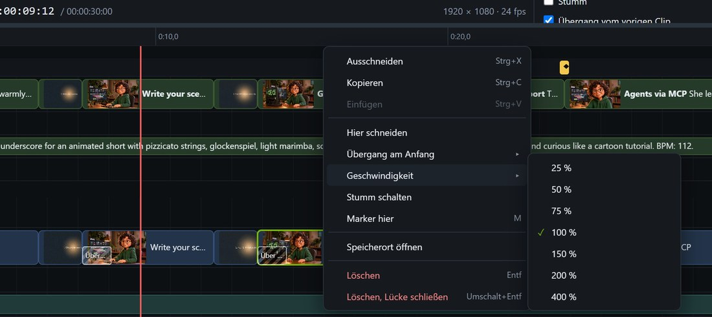

Strg+C und Strg+V kopieren und fügen am Abspielkopf ein. Das Auge blendet eine Videospur aus, der Lautsprecher
schaltet eine Spur stumm; beides gilt für Vorschau und Export.

## Geschwindigkeit und Übergänge

**Geschwindigkeit** geht von 10 bis 1000 % (in den Eigenschaften des Clips oder per Rechtsklick), der Ton behält seine
Tonhöhe. Würde ein langsamerer Clip in den nächsten laufen, fragt das Studio: bis zum nächsten Clip, die späteren
Clips nach hinten schieben oder sie überdecken.

**Übergänge:** Überblendung, Abblende über Schwarz, Abblende über Weiß und Wischblende, klassisch gerechnet ohne KI;
Vorschau und Export sehen gleich aus. Anlegen per Rechtsklick auf den Clip, mit Strg+D oder mit einem
Übergang-Marker, die Länge an der Kante ziehen. Der vorige Clip läuft dafür über sein Ende hinaus weiter; reicht sein
Material nicht, steht sein letztes Bild. Lass jedem Clip deshalb rund eine halbe Sekunde Material über sein Ende.

## Skalieren und zoomen mit Keyframes

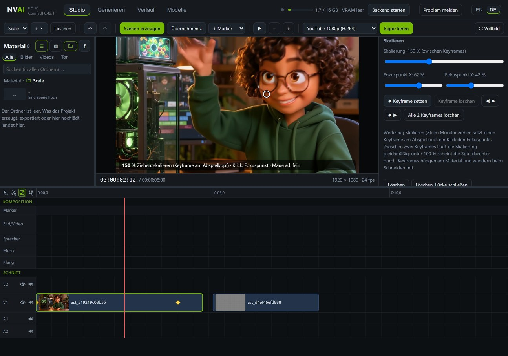

Jeder Videoclip lässt sich um einen **Fokuspunkt** von 10 bis 800 % skalieren, so geht ein Zoom auf das Gesicht zu
statt in die Mitte. Unter 100 % wird der Clip zum Bild im Bild über der Spur darunter.

Mit dem **Werkzeug Skalieren (Z)** im Monitor nach oben oder unten ziehen; beim Loslassen entsteht am Abspielkopf ein
**Keyframe**. Ein Klick setzt den Fokuspunkt, das Mausrad skaliert fein. Zwischen zwei Keyframes ändert sich die
Skalierung gleichmäßig. Keyframes stehen als Rauten auf dem Clip und hängen am Material: Schneidest du den Clip oder
änderst das Tempo, bleibt der Zoom an derselben Stelle.

## Marker

| Marker | Was er bewirkt |
|---|---|
| Platzieren | Beim Übernehmen kommt die gewählte Szene an diese Stelle, auf die gewählte Spur |
| Übergang | Der Clip, der hier beginnt, bekommt diesen Übergang |
| Anschluss | Die Videoszene an dieser Stelle setzt die Szene davor fort (siehe unten) |
| Ton ab hier | Beim Übernehmen beginnt die gewählte Ton-Szene an dieser Stelle |
| KI-Auftrag | Ein Auftrag für Claude: Es liest ihn per MCP, arbeitet ihn ab und hakt ihn ab |
| Notiz | Nur eine Notiz |

**Anschluss:** Mit LTX-2.5 übernimmt die Anschluss-Szene die letzte Sekunde (25 Bilder) der Szene davor und setzt
deren Bewegung fort. Übernehmen blendet über genau diese Bilder, so gehen die zwei Einstellungen ohne Sprung
ineinander über. Mit Endbild, Schleife, vorgegebenem Ton oder einem anderen Modell beginnt sie nur mit dem letzten
Bild. Gemessen an einem Segelboot: Nur mit dem letzten Bild fiel die Bewegung an der Naht auf weniger als die Hälfte,
mit der übernommenen Sekunde lief sie weiter.

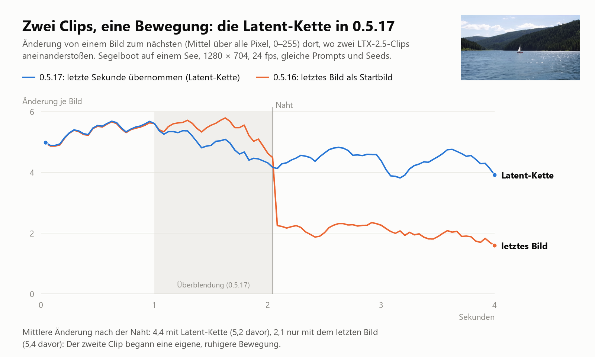

## Übernehmen ohne Überraschungen

Würde Übernehmen etwas überdecken oder ändern, zeigt „Übernehmen“ vorher eine Liste: neue Clips (mit Warnung, wenn
einer einen vorhandenen überdecken würde) und Clips, deren Szene einen neuen Take hat. Vorgewählt ist nur, was deinen
eigenen Schnitt in Ruhe lässt: Ein Clip, der noch so lang ist wie seine Szene, bekommt den neuen Take, ein gekürzter
oder geteilter nur, wenn du ihn ankreuzt.

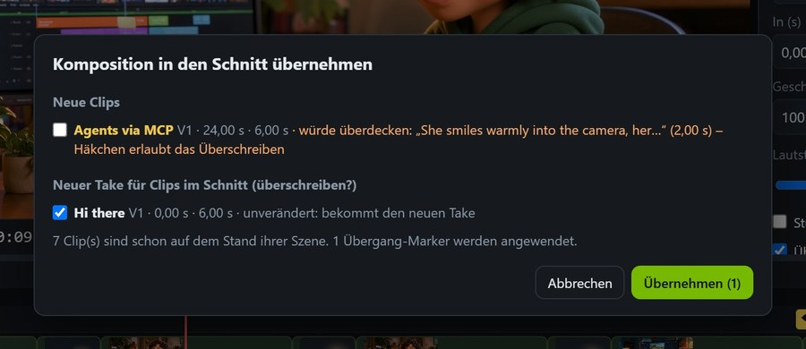

## Projekte weitergeben

„+“ → „Projekt exportieren“ packt das Projekt mit allem Material in eine ZIP-Datei, auf Wunsch mit den verlustfreien
Kopien (in 1080p rund 32 MB je Sekunde). „Projekt importieren“ öffnet so ein Paket oder eine Projektdatei (.json), auch
auf einem anderen Rechner, NVAI-open für Mac eingeschlossen.

## Qualität

- **Höchste Qualität (DFR):** Ist das Detail-IC-LoRA installiert, behalten LTX-2.5-Szenen ihre Details über den ganzen
  Clip, dafür in rund dreifacher Zeit (5 s in 1080p: 786 statt 241 s). Die Projekteinstellung „Videoszenen“ stellt auf
  „Standard, schneller“.
- **Verlustfreie Kopie:** Jedes KI-Video wird zusätzlich ohne Kompression gespeichert, und das Studio schneidet und
  exportiert daraus. Ein YouTube-Export daraus kam auf 42,3 statt 37,7 dB PSNR. Das kostet rund 32 MB je Sekunde bei
  1080p; „Verlustfreie Kopie für den Schnitt“ unter „Generieren → Video“ schaltet sie ab.
- **Kein unnötiges Skalieren:** Clips, deren Seitenverhältnis höchstens 5 % vom Projekt abweicht, füllen den Rahmen
  (LTX-2.5 rechnet 1080p als 1920 × 1088, der Export schneidet die 8 Zeilen zu viel ab), andere bekommen schwarze
  Ränder.

## Tastatur

| Taste | |
|---|---|
| Leertaste | Abspielen und anhalten |
| V / C / Z | Werkzeug Auswahl / Schneiden / Skalieren |
| S | Magnet an und aus |
| Umschalt (⇧) beim Ziehen | Andocken, auch ohne Magnet |
| Strg+K | Am Abspielkopf schneiden (sind Clips gewählt, nur auf ihren Spuren) |
| Strg+C / Strg+X / Strg+V | Kopieren / Ausschneiden / am Abspielkopf einfügen |
| Strg+D | Überblendung an die gewählten Clips oder an den Schnitt beim Abspielkopf |
| Strg+A | Alle Clips wählen |
| M | Notiz-Marker am Abspielkopf |
| Entf / Umschalt+Entf | Auswahl löschen / Clips löschen und Lücke schließen |
| Strg+Z / Strg+Y | Rückgängig / Wiederholen |
| ← → | Ein Bild; mit Umschalt eine Sekunde |
| Pos1 / Ende | An den Anfang / ans Ende |
| + / −, Strg+Mausrad | Zeitleiste zoomen |
| Esc | Ziehen abbrechen, zurück zur Auswahl, Auswahl aufheben, vom Quellmonitor zurück zum Schnitt |

„Vollbild“ oben rechts blendet alles außer dem Studio aus.

## Export

| Format | |
|---|---|
| YouTube 1080p (H.264) | 1920 × 1080, 24 Mbit/s |
| YouTube 4K (H.265) | 3840 × 2160, 40 Mbit/s |
| Hochformat 1080 × 1920 (Shorts) | H.264, 10 Mbit/s |
| AV1 1080p (klein) | 6 Mbit/s |
| Projektformat (H.264) | in der Größe des Projekts |
| Master verlustfrei (MKV, FFV1) | pixelgenau, zum Archivieren und Weiterverarbeiten |
| ProRes 4444 (MOV) | für andere Schnittprogramme |

Der Export nimmt den Video-Encoder deiner Karte (NVENC, AMF oder Quick Sync, sonst Software), mischt den Ton auf
−14 LUFS, die Lautheit, mit der YouTube abspielt, und läuft in einer eigenen Warteschlange, du kannst also weiter
erzeugen. Mehr als 24 Mbit/s bringt bei 1080p kaum etwas: 12, 24 und 40 Mbit/s kamen auf 42,3, 42,8 und 43,0 dB.

## Mit Claude Code

Der MCP-Server hat sechs Studio-Werkzeuge: `studio_projects`, `studio_create`, `studio_get`, `studio_command`,
`studio_generate` und `studio_export`. Bitte Claude um eine Geschichte, und es schreibt die Szenen, erzeugt sie,
übernimmt, schneidet und exportiert, während das Studio jede Änderung live zeigt. Ein „KI-Auftrag“-Marker hinterlässt
Claude eine Notiz direkt in der Zeitleiste. Einzelheiten (englisch):
[CLAUDE_CODE.md](../CLAUDE_CODE.md#studio-whole-videos-from-scenes)

## Zeiten

Gemessen auf einer RTX 5060 Ti 16 GB:

| | |
|---|---|
| LTX-2.5-Clip, 5 s in 1920 × 1088, Standard / höchste Qualität (DFR) | 241 s / 786 s |
| Standbild mit Krea 2 / 20 s Musik mit Stable Audio 3 | 25 s / rund 7 s |
| Export von 5 s in 1080p für YouTube | 4 s |

Zehn Minuten nur aus erzeugten Clips sind 120 Clips à 5 s: in 1080p rund 8 Stunden, mit DFR rund ein Tag. Standbilder
mit Musik und Sprecher sind viel günstiger.

## Auf dem Mac

NVAI-open für Mac hat das Studio ebenfalls, nativ auf Apple Silicon, mit denselben Werkzeugen, Tasten und Menüs, dem
Fortschritt und Abbrechen neben „Übernehmen“ und demselben Projektformat.

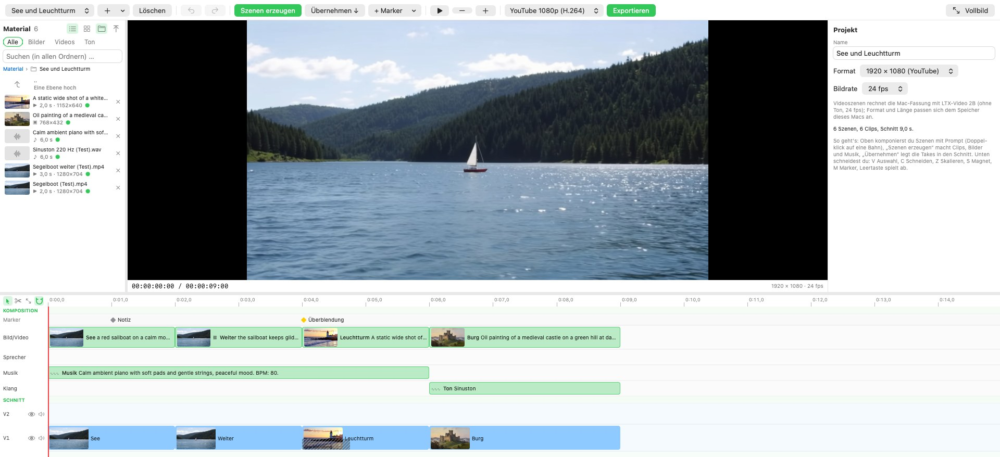

Was der Mac anders macht:

- **Modelle:** Videoszenen rechnet das Videomodell, das unter „Generieren → Video“ gewählt ist. Der Mac empfiehlt eines
  nach Arbeitsspeicher: LTX-Video 2B, ab 16 GB LTX-Video 13B, ab 32 GB LTX-2.3 und ab 64 GB LTX-2.5 mit Ton. Mit 8 GB
  bleibt ein Clip bei höchstens 768 × 512 × 97 Bildern, etwa 4 s in 768 × 512. Standbilder kommen vom aktiven
  Bildmodell, Musik und Klang von Stable Audio 3, Sprecher-Szenen von Qwen3-TTS (ab Mac 0.5.3; VoiceDesign 1.7B in 4 Bit, Base
  0.6B in 8 Bit).
- **Anschluss:** beginnt mit dem letzten Bild; die letzte Sekunde zu übernehmen braucht LTX-2.5 und bleibt Windows
  vorbehalten.
- **Figuren** (seit Mac 0.5.5): wie unter Windows, mit LoRAs für FLUX.2 Klein 4B. „Ton aus Sprecher-Szene“ bleibt im
  Projekt, wirkt aber nicht: Kein Videomodell auf dem Mac nimmt einen vorgegebenen Ton, Übernehmen legt den Satz deshalb
  wie gewohnt auf die Spur „Stimme“.
- **Export** mit dem Encoder des Macs: YouTube 1080p und 4K, Shorts, Projektformat und ProRes 4444. Eine verlustfreie
  Kopie, AV1 und den MKV-Master gibt es nicht.
- **REST:** dieselben `/api/studio/*` wie unter Windows, unter `http://127.0.0.1:8100`.

Gemessen auf einem Mac mini M1 mit 8 GB: Drei Testszenen (ein 2-Sekunden-Video, ein Standbild, 6 s Musik) brauchten
320 s, der Export von 9 Sekunden in 1080p 2 s.

## Was noch fehlt

Titel und Untertitel, Schwenks, Wellenformen, Export als Einzelbilder, WAV oder SRT und der Austausch
mit anderen Schnittprogrammen.

## Making of

Wie das Video des Studios entstand, von der Anfrage in Claude Code bis zum Export: [MAKING_OF.md](MAKING_OF.md).
